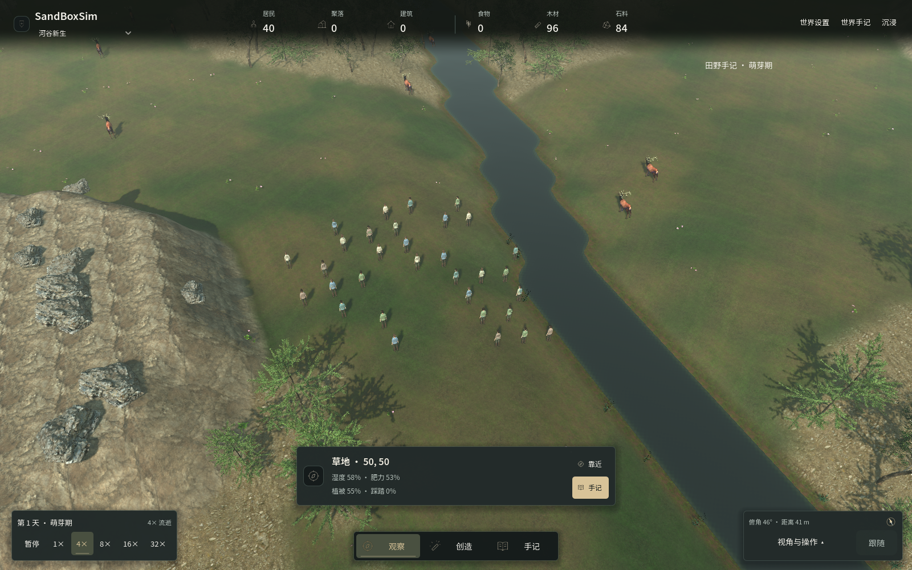

# SandBoxSim

SandBoxSim 是一款 3D 自由沙盒模拟游戏。玩家可以塑造地形、水源和资源，栽植生态群落，观察居民自行采集、耕作、建造、迁移和组成家庭。世界手记、人物档案和地图图层展示这些活动如何影响聚落与土地。游玩由玩家自行探索。



## 开始游玩

Windows 本机已有完整独立包时，双击 [Play-3D.cmd](Play-3D.cmd)。启动器优先使用 `artifacts/game/windows/`，找不到独立包时尝试从源码启动。独立包由 EXE 和同目录的数据文件组成，通过本机导出生成。

从源码启动需要 **PowerShell 7、.NET 8 SDK、Godot 4.7.2 .NET**。在仓库根目录运行：

```powershell
./tools/install-sdk.ps1
./tools/setup-godot.ps1
./tools/godot.ps1 -Mode run
```

安装脚本把开发依赖放在项目 `.tools/` 中。Linux 和 macOS 的引擎路径、已有工具链与独立包更新方法见 [安装与启动](docs/guides/getting-started.md)、[构建与运行](docs/development/build.md) 和 [版本更新](docs/guides/updating.md)。

左键拖动平移，右键拖动旋转与俯仰，滚轮缩放，空格暂停或继续。底部「创造」打开可搜索工具库。「手记」提供现场、详情、历史和曲线。选中居民后点击肖像，可查看面部、双手、全身、实际行为和随身物资。见 [玩家指南](docs/guides/player-guide.md) 与 [观察与界面](docs/guides/gameplay-observation.md)。

## 当前游戏内容

| 系统 | 已实现的体验 |
|---|---|
| 世界与生态 | 改变地貌和资源，栽植花甸、野果、苇泽与腐木，观察天气、火灾、授粉与地力变化。见 [自由探索](docs/guides/exploration.md) 与 [天气与生态](docs/guides/ecology.md) |
| 居民与聚落 | 居民按需求与可达性行动，形成住房、农业、仓储和家庭。作物周期、地力变化、食物腐损、仓储保护及房屋使用状态均可观察。见 [聚落与居民](docs/guides/settlements.md) 与 [农业与食物流动](docs/guides/living-economy.md) |
| 场景与移动 | 林地树丛、贴坡山石、岸边碎砾和连续水陆曲面。人物与鹿狼绕过登记的树干和山石，按地形落脚。居民在采集格内靠近资源，饮水活动产生水面涟漪。见 [地形与场景接触](docs/guides/terrain-and-traces.md) |
| 人物与动物表现 | 来源人体轮廓、贴体衣装与连续肩肘腕形变。成人角色在同速下采用不同步幅与节奏，锤击有外侧蓄力与身前提锤两种路线，交谈有单手强调和双手成组表达。鹿狼使用授权网格与四足贴地。见 [模型系统](docs/development/models.md) |
| 状态观察与保存 | 图层、可搜索居民名录、行动目的地、跟随、世界记录和曲线。保存世界与会话后可继续运行。见 [玩家指南](docs/guides/player-guide.md) 与 [存档与确定性](docs/development/saving.md) |

场景绕行使用普通树干与山石的水平包络。多步跳过或局部找不到干地绕行点时，显示位置会同步到目标，可能出现短跳。详细实现、使用边界及版本记录见 [项目文档](docs/README.md) 和 [更新记录](CHANGELOG.md)。

## 模拟、评测与研究

- **内核与在线控制**支持命令行模拟、固定步进 HTTP、状态观察及语义一致性约束下的配对性能实验。见 [在线控制与效率实验](docs/development/online-efficiency.md)。
- **图形评测**通过公开场景复现模型与界面，输出截图、动作记录、模拟摘要和帧耗时。见 [评测接口](docs/development/benchmark.md) 和 [场景索引](benchmarks/README.md)。
- **代理实验**支持真实源码候选、编译、开发和留出世界对照，以及代理自修改、分叉与撤销方法实验。程序提速、视觉表现和代理改进采用各自的指标。见 [源码研究](docs/development/sandbox-research.md)、[代理改进协议](docs/development/rsi-improver.md) 与 [研究边界](docs/README.md)。

## 开发与维护

```powershell
# 构建内核、控制台与测试
./tools/build.ps1 -Mode build -Configuration Release -Channel sdk -ParallelBuild

# 构建图形客户端的 Debug 程序集
./tools/godot.ps1 -Mode build

# 检查文档链接和路径大小写
./tools/check-docs.ps1
```

| 位置 | 内容 |
|---|---|
| [`src/`](src/README.md) | Core、Console、Godot 与 Tests |
| [`tools/`](tools/README.md) | 安装、构建、验证、评测和素材转换工具 |
| [`config/`](config/README.md) | 模拟默认配置 |
| [`benchmarks/`](benchmarks/README.md) | 公开场景、协议和代理夹具 |
| [`docs/`](docs/README.md) | 玩家指南、开发说明、正式配图和来源资料 |
| [`runs/`](runs/README.md) | 本机存档、运行与实验输出 |

本机工具链、构建输出和临时产物位于 Git 忽略的目录。文件去向与清理规则见 [本地环境与运行目录](docs/development/local-storage.md)。开发流程见 [开发指南](docs/development/developer-guide.md) 与 [贡献指南](CONTRIBUTING.md)，代码授权见 [LICENSE](LICENSE)。
