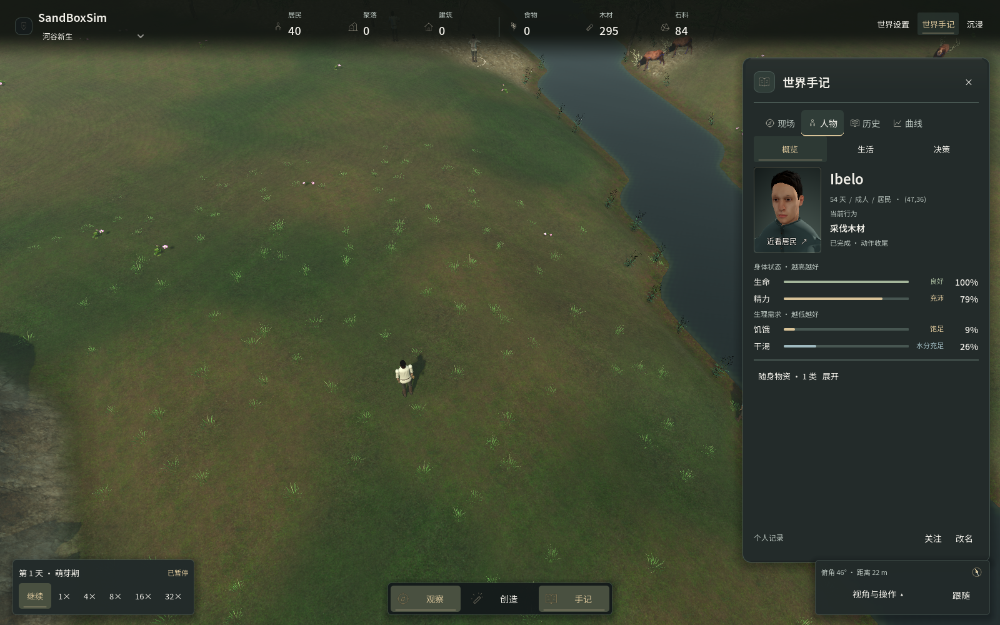

# SandBoxSim

SandBoxSim 是一款以自然生态与居民自主行为为核心的 3D 沙盒模拟游戏。玩家塑造地形、水源和资源，规划土地与聚落；居民依据需求、材料与可达性选择生存、劳动、建造和迁移。人物档案、世界事件与每日曲线帮助观察这些选择的后果。

项目也提供独立的 [在线控制与效率实验接口](docs/development/online-efficiency.md)：HTTP 固定步进、正确性约束下的配对性能比较，以及固定预算/控制代理下的多轮自我改进证据验证。研究模式不改变自由探索玩法。

[真实沙盒源码研究](docs/development/sandbox-research.md) 让代理检查真实工程、提交源码实验，经编译与语义检查后在参考/候选世界中验证；完整过程和失败候选均归档。[冻结研究程序对照](docs/development/sandbox-research-comparison.md) 在相同真实世界中比较父、子与撤销方法组，记录失败和全流程成本。

程序加速与代理改进能力分别评测。[代理改进协议](docs/development/rsi-improver.md) 实际执行代理自修改，并比较父/子产生后代的增益、冻结代理和只撤销自修改方法的对照；多轮程序更快不再直接标记为 RSI。

[重复真实研究对照](docs/development/sandbox-research-series.md) 轮换父/子/撤销组顺序，以完整研究运行作为不确定性单位，并检查每个世界的退步和全部失败成本。



界面以轻量横向顶栏呈现全局资源，人物页分为概览、生活和决策：108×138 的可点击肖像与姓名、身份和真实行为并排，三个页面保留同一身份入口；概览接着按身体状态与生理需求分组显示原始数值、文字状态和可展开物资，关系和历史留在生活页。点击肖像或用 Tab、Enter 打开独立观察窗，不必先滚到下方寻找放大按钮。镜头预设与操作提示从底部“视角与操作”展开，跟随入口常驻；暂停按钮显示“继续”并恢复先前倍率。工具、手记和设置按需展开。查看当前实体详情时收起重复选择卡，历史、曲线和新操作反馈仍保留上下文。选择卡显示当前居民、动物或土地的数据，保存等反馈短暂优先后恢复实时信息。点击顶部“沉浸”或按 F10 可隐藏界面观察世界，F10 / Esc 返回，鼠标视角与空格暂停仍可使用。

人物观察窗以大幅模型、滚动状态正文和固定操作区分层，物资入口始终可见，读数与满宽状态条分行。镜头按观察范围、角度和距离分组，滚轮温和缩放，Shift＋滚轮精调。人物观察窗可直接切换居民，支持面部、双手与全身聚焦，拖动旋转、滚轮缩放及双击复位。头脸使用授权的连续解剖网格、原生皮肤与眼球；眼球有有界的角膜起伏，虹膜与角膜围绕眼心一起转动；细小的下眼睑湿润边缘随眨眼一起运动。观察窗可切换柔光和侧光，保留原来的视角与动作。鹿狼在实际蒙皮上增加有距离预算的护毛，并分别保留眼、鼻镜、蹄部和耳内细节；近景闭眼覆盖沿来源眼表面运动，暂停时保持姿态。来源与运行边界见[模型系统](docs/development/models.md)及[美术资源](docs/development/assets.md)。

场景包含扫描植物与岩石、按尺寸构造的木石建筑、逐株贴地的草花、随踩踏累积的土地痕迹、低矮与较高草丛交错的群落、带拱垂枝条与锯齿复叶的野果灌丛，以及半瓦错缝搭接的瓦屋面。水陆显示跟随实际地类：较宽的连续覆盖场与有界低频变化减弱河岸方格感，同时保留旱地中心脚区、合法通道和水格中心；水面仍从同一地形计算深度，地表植被量影响露土斑块。世界中的居民、动物、地形和生态仍自主演化；观察和界面操作不引入任务流程。

人物观察窗顶部“居民名录”支持姓名、职业与人生阶段搜索，Ctrl / ⌘ F 聚焦，方向键浏览、Enter 确认、Esc 返回；当前与关注身份直接标注，每页最多 64 人且搜索覆盖全部居民。胸肩衣料从授权人体的截面拟合，区分前胸与肩胛轮廓；左右肩袖采用对应的三角面和按边长平滑的权重。伸手时肩点小幅抬升、前移，上臂将抬臂方向与轴向扭转分开处理，接近伸直时采用稳定参考；左右手分别完成交互与收回，工具肘平面连续变化，领口、中线和腰部保持稳定。`--panel=shoulder-motion` 提供同一挥锤动作的正面与侧面近景。鹿蹄增加中央分瓣，狼足沿来源网格细化四趾轮廓与分趾表面，保留原脚底高度，新增独立足部绑定、狼的趾爪与前肢悬趾、鹿的成对副蹄。`--panel=animal-motion` 可对照鹿的四拍行走与狼的对角小跑、足部落地及分段狼尾。

人物领口包边沿实际衣身开口生成，保留前襟缺口与薄折边；人物图册与观察窗重新平衡主光、补光和环境光。观察窗距离滑条与米制读数、滚轮和加减按钮联动；面部、手部和全身分别记住缩放，复位只重置当前范围。可主动开启缓慢环视，拖动、选角度、复位、关闭或失焦时停止，关闭界面动效后停用。

成人模型提供与头脸相配的两种穿衣体型，男性胸廓到髋侧的收束与女性腰胯、臀腿的连续体积分别塑形，短上衣让实际裤装的骨盆轮廓可见；小臂采用连续的肌腹与腕部过渡；女性肩袖、卷袖口、关节与逆绑定一起适配，男性胸廓侧向与女性胸腰／臀腿轮廓分别塑形；衣面附件和近远景同步适配。上衣以缓存截面凸包和松量跨过身体凹处，肩袖中段平顺后保留连接的袖窿与袖口；最终衣片重算法线，腰背在胸廓与骨盆之间连续过渡，腰带、裤腰和工具挂点同步；无工具休息时保留脚踝落点，骨盆与膝部轻微放松。可通过 `--panel=body-motion`、`--panel=body-frames`、`--panel=forearm-frames` 查看同衣色体型与小臂对照；来源、造型参数和限制见[模型说明](docs/development/models.md)。

人物移动采用分段落脚、鞋底滚动与固定肢长解算，骨盆高度与前后脚可达范围连续配合，弯身时求解到局部脚踝落点；空手摆臂协调肩肘与对侧迈腿，前臂将掌心转向身体内侧，手腕保持小幅活动，启停保留过渡速度。`--panel=arm-swing` 可查看正侧面及掌腕近景。步频读取实际渲染位移，启停和转向协调骨盆、胸廓与头部；两种成人外观的摆臂和骨盆幅度保留个体变化。`--panel=locomotion` 可查看同速度、搬运及持锤行走到工作的对照。工具携带采用身体侧下方的手位，短锤与长柄工具分别安排方向；肩肘按实际屈曲平面配合。劳动时髋部与膝部配合工具相位，保持局部脚踝落点和原有腿长。作业动作包含弧形蓄力、挥击与吸收回收；工具目标、头部与躯干保留过渡速度，收纳确认位置、朝向和速度后才接回挂点。实际疲劳、健康状态与有重叠的个体表现系数共同影响节奏；`--panel=work-effort` 可观察男女外观在状态良好与疲劳后的同工具对照。成年裤装采用分别导出的连续骨盆—臀腿衣料表面，通过五骨蒙皮连接实际大腿和膝部动作。成人上身分别贴合含胸廓、腰背与骨盆的授权人体截面，胸廓宽度、髋侧与臀部深度采用不同方向的支撑，女性剪裁调整胸前衣料、腰带高度、骨盆间距及上大腿轮廓，女性上衣低段采用较短剪裁以显露腰胯轮廓，并为自然垂臂留出髋部余量；工具环随腰带适配，腰包保持独立形状。`--panel=body-frames` 提供同衣色的正／侧／背全身对照。头脸独立于身体随机宽度，眉弓、鼻翼、颊部、下颌及颈部采用区域拟合，`--panel=face-frames` 提供正面和三刻面观察。皮肤以实测来源 RGB 参考色统一染色，减少头脸与手部色差；身份错开的眨眼及带停顿的口部、点头与手势表现生活节奏。

## 安装与开始游玩

Windows 本机已有独立导出包时，双击 [Play-3D.cmd](Play-3D.cmd) 即可游玩，不需要开发工具链。启动器优先使用 `artifacts/game/windows/` 中的完整游戏包；发行文件不提交到源码仓库。包的导出和更新见 [构建与运行](docs/development/build.md)，工具链与临时文件的管理见 [本机存储维护](docs/development/local-storage.md)。

源码运行环境为 **PowerShell 7、.NET 8 SDK、Godot 4.7.2 .NET**；中文和符号字体随包提供，无需安装系统字库。从仓库根目录执行：

```powershell
./tools/install-sdk.ps1
./tools/setup-godot.ps1
./tools/godot.ps1 -Mode run
```

工具默认安装在当前项目 `.tools/` 内，SDK、引擎、NuGet 缓存及可选 Blender 均不提交到 Git；不修改系统安装。

Windows 配置完成后可以双击 [Play-3D.cmd](Play-3D.cmd)。Linux/macOS 根据安装脚本输出设置 `GODOT_EXE`，再运行启动脚本。已有环境、工具链路径和常见问题见 [安装与启动](docs/guides/getting-started.md)。

世界没有必须完成的目标，可以自由移动镜头、查看居民或改变土地。**左键拖动平移、右键拖动旋转与俯仰、滚轮缩放**；单击选择或确认落点，观察模式双击靠近；滚轮围绕指针落点缩放，悬停人物和动物显示简短信息。底部“创造”展开左侧可搜索工具库，参数与工具列表集中显示，并保留最近四种工具的快捷入口；没有委托、工程流程、目标或干预额度。完整操作见 [玩家指南](docs/guides/player-guide.md)。

## 当前游戏内容

人物徒手拿取、递交、进食和饮水带有进入、切换与收尾过渡；独立观察窗显示实际握持、当前手持物与暂停状态，并提供跟随居民和查看当前目的地的入口。搬运物在双手就位后显示，进食和饮水时不会将整捆物资带到嘴边。手锤的敲击面和锄头的弧面薄刃使用细化工具网格，详见[模型系统](docs/development/models.md)。

| 内容 | 可以做什么 |
|---|---|
| 自由栽植 | 栽植花甸、野果、苇泽和腐木，组合授粉、涵养、育土与采集，观察受水土与踩踏影响的渐进恢复 |
| 自然与生态 | 改变地形、水土和资源，观察天气、火灾、动物与居民往返逐渐留下的小径和土地压实 |
| 自主居民 | 观察生存、采集、劳动、建造、迁移及家庭与人生记录 |
| 生活经济 | 观察三类作物的周期、耕作消耗与休耕恢复、地面食物腐损及仓储保护，见 [农业与食物流动](docs/guides/living-economy.md) |
| 聚落生活 | 近看真实住户对应的晾晒、长凳和陶器，观察房屋完整度与空置风化；地面物资随库存变化 |
| 荒野探索 | 寻找花甸、苇泽、倒木林隙、泉眼、野果地、古树林、遗迹和矿脉，按自己的喜好命名地点并观察变化 |
| 观察与保存 | 使用图层、人物档案、历史和曲线；保存世界与会话进度，记录实验起点 |

点击人物页肖像后，可在独立观察窗旋转、俯仰、缩放，并切换面部、手部与全身；返回后缩略图恢复面部识别，重新展开保留工作构图和原先焦点。握持、拿取、交谈和搬运跟随居民实际行为，世界角色平滑转向并对脚下坡面作小幅补偿。人物保留连续手部蒙皮与指节，掌背分区显示屈曲折痕、指腹和甲床等表面差异；这些是原网格上的程序材质，不是新人体扫描。模型与配件说明见 [3D 模型系统](docs/development/models.md)。

人物肘部与前臂使用同源解剖网格，腕部以共享椭圆截面平滑连接手掌，鞋楦与鞋带按实际表面对齐。近景上衣保留三种剪裁与原有动作，肩袖采用连续下垂过渡、宽折谷和随蒙皮的细缝线；头脸已更换为 MakeHuman CC0 拓扑与原生 2K 皮肤图集，三套形体配方接入连续眼睑闭合和独立口部动作，儿童另有比例与无胡茬材质。近景采用带真实发根边界过渡的透明发片，远景从同一头颈与眼口减面。鹿、狼已换为 CDmir / TinyWorlds 与 0 A.D. 的授权贴图网格，保留源 UV 与皮毛，采用鹿 18 / 狼 21 关节的运行绑定，四足独立贴合坡面，狼尾采用分段弯曲；保留独立下颌和屏幕 LOD；具体许可随资产提供。建筑同步入口尺度，茅草坡屋面采用带厚度与参差檐口的连续结构。离线重建与当前表现边界见 [模型说明](docs/development/models.md)。

UI 使用炭灰、低饱和青灰绿和暖铜色强调，顶部世界、资源和菜单共用连续背景，底部时间、模式与镜头控制分组，保留更多世界画面。左侧工具库支持 Ctrl / ⌘ K 跨分类搜索、固定分类导航、带用途说明与勾选状态的单列工具及带拖动条的固定参数区，图标底座、标题字重和铜色选中边线统一呈现；Alt＋左键平移，Shift＋滚轮调整常规笔刷半径，切换场景先确认。人物肖像可展开为独立观察窗，左侧旋转、俯仰、缩放和切换面部/手部/全身，右侧同步显示真实行动、身体需求与分组物资，并可直接关注居民或返回地图跟随。手记入口与当前观察模式同步显示状态；近景人物眉毛、头发及动物源耳廓保留实际表面，三种衣装使用收紧胸肩的连续蒙皮，裤腿、靴筒按大腿、小腿与踝部重新收束；皮肤使用原生颜色细节，衣料使用扫描亚麻织纹、法线与粗糙度。建筑、人物与动物共享可复用几何和材质，远景使用 LOD；当前表现与操作说明见 [观察与界面](docs/guides/gameplay-observation.md)。

地形使用连续细分曲面，扫描草叶落叶地面、泥土、林地与岩面按坡度、水分和踩踏混合，颜色与法线同步作稳定旋转，陡坡保留有界岩面起伏；河水按实际河床深度变化。树木在格内错位分布，住房与仓库的石基随坡地贴合。来源、许可及离线素材校验见 [环境素材](docs/development/environment-assets.md)，地表状态与显示规则见 [地形与活动痕迹](docs/guides/terrain-and-traces.md)。当前人物衣身、房屋及地形仍包含程序构造，动物源素材也保留年代与分辨率限制，扫描表面不代表全部模型已经写实。

顶部食物、木材与石料表示已采集储备，包括居民背包、地面物资堆和仓库。地表节点仍需要采集；库存总量也不保证每位居民都能到达物资。

## 实验与 benchmark 接口

可通过独立评测模式运行固定场景，采集墙钟帧耗时与状态摘要，生成无标题的模型图像、视觉问题及答案，并回放人物界面操作。正常游戏仍为自由探索。运行方法、JSON 协议、模型预测格式和研究边界见 [评测接口与实验运行](docs/development/benchmark.md)，公开样例见 [评测场景](benchmarks/README.md)。代理实验提供有界策略选择、实际 Python 候选代码和 HTTP 程序优化三种后端，均保留迁移、失败与控制证据。这些接口用于可复现的开发实验，不代表已经验证 RSI 能力。重复采样与渲染缓存说明见 [性能维护](docs/development/performance.md)。[连续世界实验](docs/development/stateful-rsi.md) 进一步检验库存变化、道路变更、实体世代与旧能力保留，并输出可展开的因果证据报告。[改进器效率研究](docs/development/rsi-efficiency.md) 比较实际时间预算、后代增量收益率与部署成本回收，明确拒绝无法确认的收益。

## 文档入口

- **开始使用**：[安装与启动](docs/guides/getting-started.md)、[玩家指南](docs/guides/player-guide.md)、[故障排查](docs/guides/troubleshooting.md)。
- **理解玩法**：[自由探索](docs/guides/exploration.md)、[世界系统](docs/guides/world-systems.md)、[聚落与居民](docs/guides/settlements.md)、[天气与生态](docs/guides/ecology.md)。
- **继续开发**：[开发指南](docs/development/developer-guide.md)、[项目架构](docs/development/architecture.md)、[扩展指南](docs/development/extending.md)。
- **维护项目**：[目录与文件管理](docs/development/repository-layout.md)、[构建与运行](docs/development/build.md)、[配置](docs/development/configuration.md)、[存档](docs/development/saving.md)。
- **查看更新**：[更新记录](CHANGELOG.md)、[版本更新与兼容](docs/guides/updating.md)。

源码入口见 [src](src/README.md)，工具入口见 [tools](tools/README.md)，公开实验与协议见 [benchmarks](benchmarks/README.md)。所有主题见 [文档导航](docs/README.md)。原始任务书与素材来源保存在 `docs/archive/`。

## 开发入口

```powershell
# 内核、命令行与测试工程
./tools/build.ps1 -Mode build -Configuration Release -Channel sdk -ParallelBuild

# 图形客户端：构建或打开编辑器
./tools/godot.ps1 -Mode build -Configuration Release
./tools/godot.ps1 -Mode editor

# 检查文档文件链接与大小写
./tools/check-docs.ps1
```

`SandBoxSim.sln` 包含 Core、Console 和 Tests；Godot 工程通过 `tools/godot.ps1` 单独构建。测试使用项目自带运行器，入口是 `tools/test.ps1`。逐项操作及验证选择见 [开发指南](docs/development/developer-guide.md)。

## 仓库结构

```text
SandBoxSim/
├─ src/                 Core、Console、Godot 与 Tests 四个工程
├─ config/              默认模拟参数与配置说明
├─ benchmarks/          公开场景、代理夹具、Schema 与 OpenAPI
├─ tools/               安装、构建、运行、测试与文档检查脚本
├─ docs/
│  ├─ guides/           安装、游玩、排错和版本更新
│  ├─ development/      架构、扩展、构建、配置、存档与素材
│  ├─ images/           正式文档配图，保留并提交
│  └─ archive/          原始任务书与素材生成来源
├─ .github/workflows/   核心与图形持续集成
├─ .tools/              本机工具链、依赖、原始素材和下载缓存，忽略提交
├─ artifacts/           本机构建输出，忽略提交
└─ runs/                日志、模拟数据和临时截图，忽略提交
```

游戏资源位于 `src/SandBoxSim.Godot/assets/`：`models/` 保存衍生网格与对应贴图，`materials/scanned/` 保存扫描表面及来源清单，`textures/` 保存仍需保留的材质与地图图集。旧插画、配方目录已移除。开发期间的临时截图放在 `runs/screenshots/`；清理时保留正式文档配图、游戏素材和存档。详细约定见 [文件管理](docs/development/repository-layout.md)。

贡献约定见 [CONTRIBUTING.md](CONTRIBUTING.md)，代码授权见 [LICENSE](LICENSE)。
