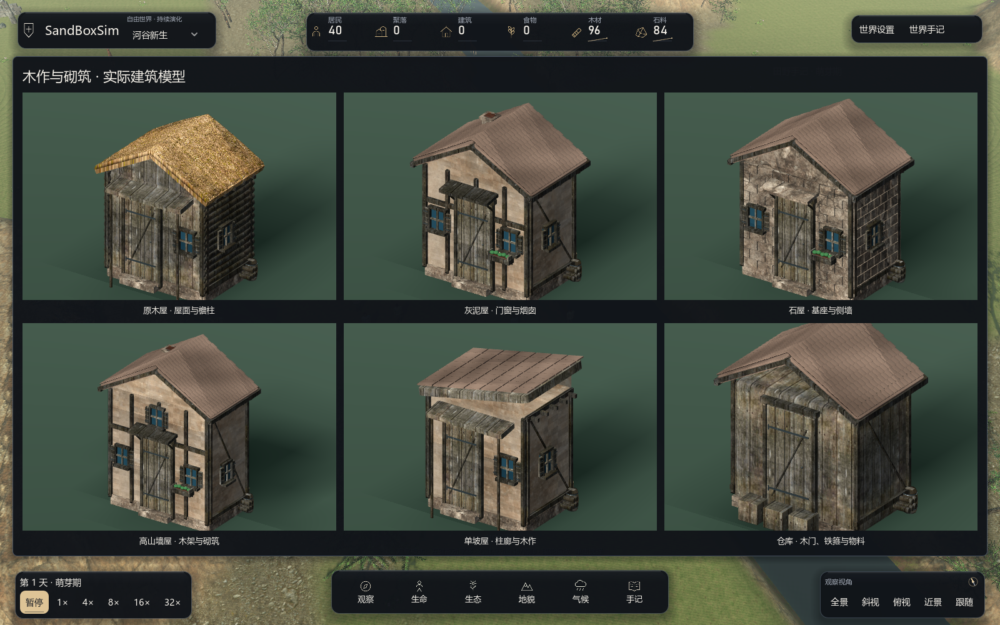
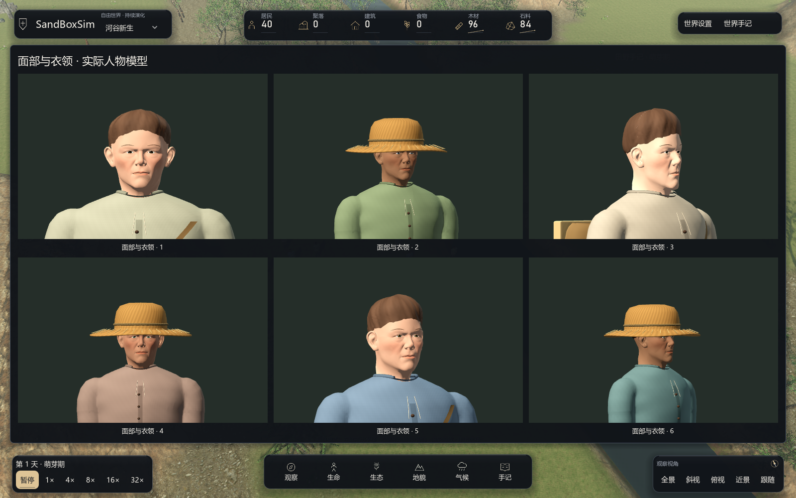
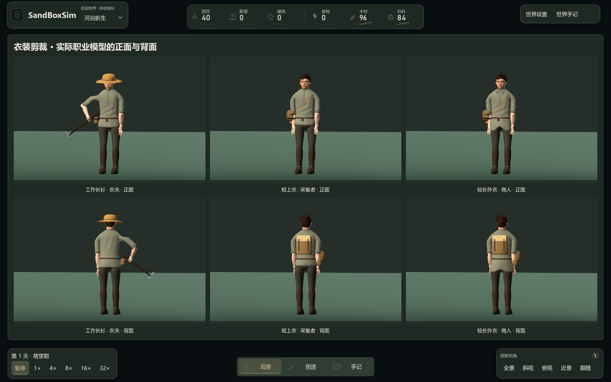
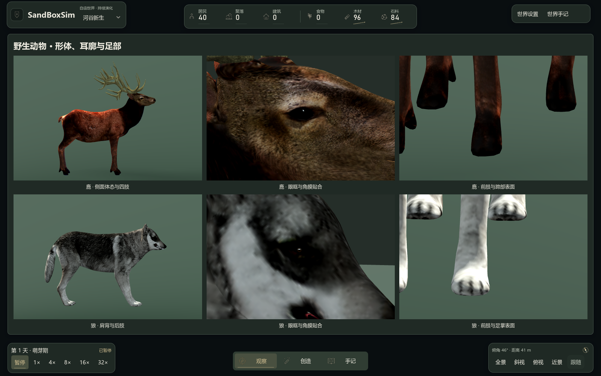
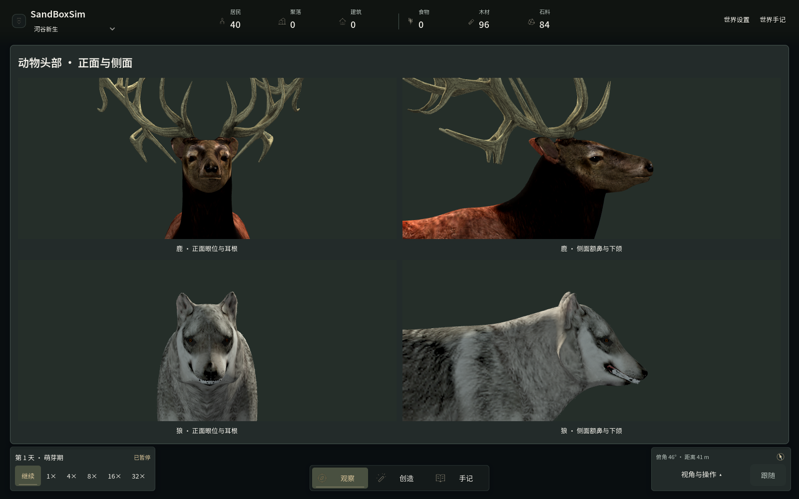
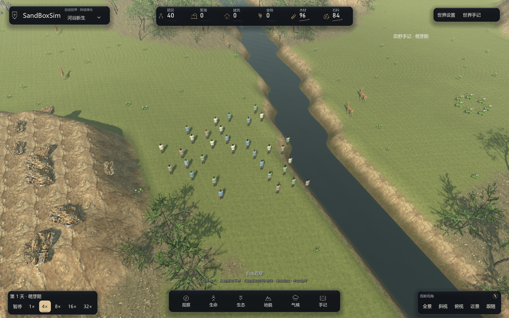
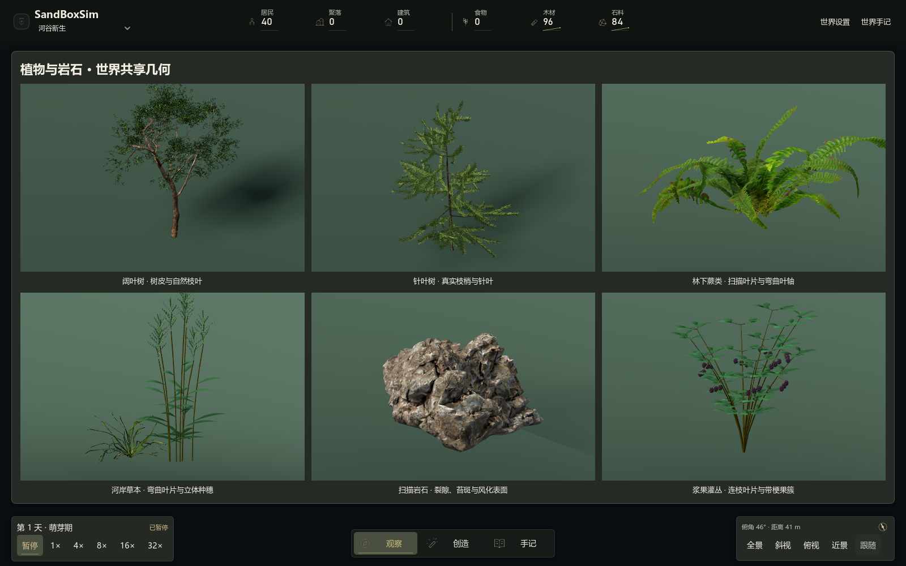
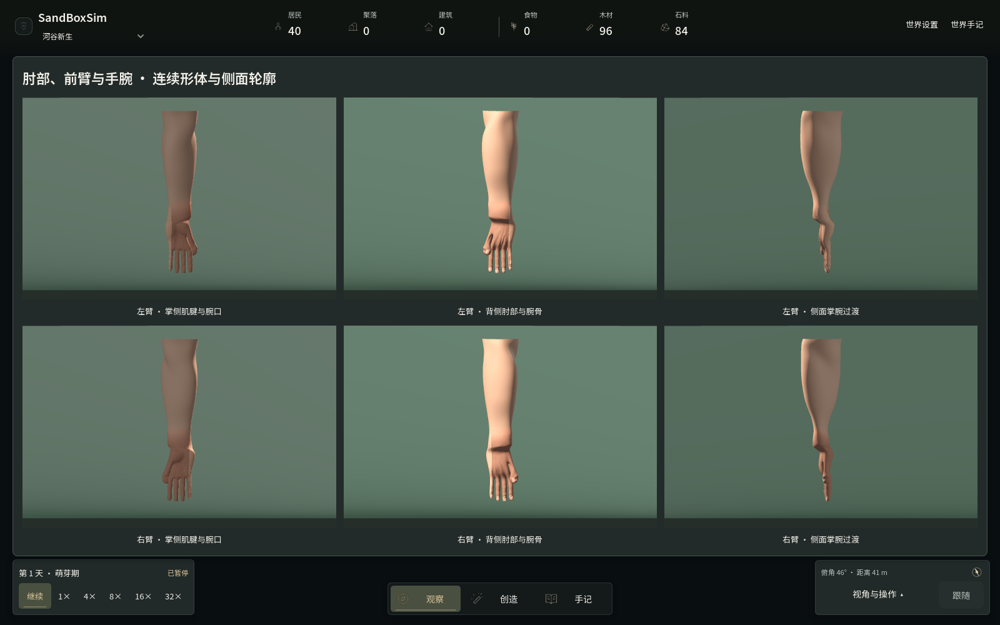

# 3D 模型系统

地图、人物档案和建筑图册使用同一套实际网格。人物头脸使用 MakeHuman CC0 拓扑、原生皮肤／头发图集及运行时变体；植物与普通山石使用 Poly Haven CC0 环境模型与 PBR 贴图；衣身、骨骼关节、房屋及地形由 C# 构造；动物改用 CDmir / TinyWorlds 的 CC0 鹿与 0 A.D. 的 CC BY-SA 3.0 狼，保留来源 UV 与皮毛图；人物解剖手部使用授权离线导出网格。图册展示共用模型，世界存档保存居民、建筑与资源状态。

## 建筑

住房有原木屋、灰泥屋、石屋、高山墙屋和单坡屋五种轮廓。稳定身份决定宽深、楼高和变体；基础房屋宽 3.65–4.13、深 3.05–3.59 个表现单位，采用等比缩放，保留 0.82×1.75 的入口尺度；住房横向尺度与屋顶跨度扩大，灰泥屋、石屋和高山墙屋采用居中入口及左右窗，高山墙/灰泥立面保留竖向木柱与横向木梁；道路决定地图中的朝向。当前门洞、墙高和图册镜头按人物尺度重新调整，模拟建筑占地与通行规则沿用内核单格数据。房屋外壳、生活摆件和坡地地基共用 `BuildingFootprint` 尺寸；表现层检查周围三格建筑，密集区域等比缩小模型，为屋檐与摆件留出空间，拆除邻居后恢复可用尺度。此机制兼容旧存档，但仍不是多格建筑占地或室内空间模拟。

门由独立木板、门框、过梁、铁带和门闩组成；正面及近景侧面窗洞扩大为 0.48×0.60，窗框、格栅、侧板和窗台同步扩大，窗洞深度保持不变；近景侧板补充四层木条和上下铁带，细件并入建筑网格，远景保留原有外轮廓。瓦片坡屋面近景采用 12 行、18 列铺设，减少单块瓦片的厚重感；远景保留较稀铺设。坡屋面有错缝分层瓦片、檐木和山墙边条；近景每块瓦片采用 7×7 曲面采样，远景仍为简化截面；瓦片使用弧面截面，草束屋面带细小起伏与参差边缘。木作、瓦片和砌石具有浅倒角，门板有斜撑、铰链和铆钉；近景补充门框接缝、石质门槛和下缘钉头，全部并入静态网格，单坡屋有坡顶墙面。石屋与基础使用带细倒角的砌石，侧墙有木架；部分住房有烟囱、檐柱、木料与桶箍。近景新增开口木檐槽、铁支架、烟囱砌筑分层和带铰链的展开窗板；这些结构并入静态缓存，远景省略细件。

仓库保留宽门及门前物料；农田采用植株、叶片与通透围栏；矿场具有暗洞口、支架、轨道与矿车。未完工建筑使用基础、立柱、斜撑和材料堆。

近景住房补充两侧窗框、窗台和檐下木作，绕到侧面也能读到结构。石屋采用隔行错缝与边缘半块石，避免整面墙呈现对齐网格；入口雨檐与斜撑随房型变化，近远模型均保留雨檐外轮廓。新增零件仍合并进建筑缓存，远景省略侧窗和檐下细件。

精细窗台采用封闭石质截面，具有向外下降的顶面、前缘倒角和下缘滴水槽；正面与侧面窗口共用同一网格，随整窗尺寸和朝向一起变换。细件进入建筑静态合并，远景使用原有简化窗台。自检验证封闭边、三角面朝向、单位法线与缓存。

近景门板与窗板按各自实际宽、高、厚度生成约 3 毫米的小倒角，避免用单位立方体倒角随长宽比例拉伸。几何按尺寸缓存，并入原有建筑静态网格；远景保留简单板材。封闭边、朝向和法线检查同时覆盖长门板与薄窗板。

五种住房现在采用带门窗开口的薄墙体，窗面和暗色窗洞位于立面以内，细窗棂、外框和百叶位于外侧。石块按开口裁切，原木墙在侧窗处分段，避免外墙盖住内凹玻璃；室内有简单地板。自检以实际合并网格的射线确认五种住房正窗能看到内凹窗面。此结构用于外观，不增加可进入室内的玩法。

瓦屋面使用有内外壁与端面的弧形脊瓦，沿屋脊搭接；近景铺瓦有毫米级高度差。檐下有独立椽尾、穿榫木钉，灰泥屋与高山墙屋保留斜撑和空心陶制烟囱帽。墙体底部的雨溅、潮湿与低矮苔色按合并后的米制高度分布。所有细件仍进入建筑共享静态网格，远景保留稀疏脊瓦，省略榫接与烟囱帽。



近景木门保留带铆钉安装片的空心拉环；灰泥、石作和高山墙住房在山墙增加横梁、中央立柱及成对斜撑，构件按实际跨度连接并合并到静态缓存。远景省略这些细件。

## 人物与动物

### 头脸与肖像

人物已换用 MakeHuman CC0 的男性、中性与女性三套形体配方，保留原生 UV、独立眼球、上下唇与连续头颈。细分后的头颈分别为 31,742、31,676、31,338 三角面；同源远景头脸最多 2,400 三角面。来源与重建入口见 [人物素材](human-assets.md)。

皮肤使用各自 2K 颜色贴图，替换纯色叠加和旧雕刻法线；眼球保留原始 1K 虹膜、瞳孔和透明角膜图。三种近景发型使用带透明发梢的源发片，共 3,678／3,344／5,352 三角面，束发露出额头和双眼。双面发片按实际正反面修正法线，并采用较高粗糙度、较低高光。远景使用简化头皮轮廓。眉毛沿实际脸部采样贴合；不再叠加通用眼皮。

八种稳定身份包含成人与儿童两组比例缓存，儿童面中部缩短、面颊略宽，使用无胡茬皮肤图。源闭眼形变通过第二 UV 驱动原眼睑，网格合并保留并换算位移。每个居民持有独立眨眼和说话材质参数，几何缓存仍可共享；说话固定脸部连接边界和 UV 缝，仅轻微移动唇部内部。眼球始终保持原体积。

近景上眼睑增加按实际眼裂取根的短睫毛，随同一闭合参数运动，不独立悬浮或缩放眼球。皮肤粗糙度分区使用各源头脸记录的鼻部、嘴部坐标，鼻额与唇周具有较低粗糙度；耳部透光在约 7–8.6 厘米的头侧范围内衰减，不把整个脸颊染亮。此处是兼容渲染器中的薄层背光，没有完整皮下散射。皮肤、嘴唇、虹膜和眼白具有不同反光层次；几何、远景切换与暂停规则见[人物素材](human-assets.md)。

头部动作围绕颈部基点补偿位置。人物观察窗使用独立工作室、渐变背景与主补光；面部默认距离 1 米、垂直视场 26°。面部、手部与全身各有独立构图，底部栏不遮住站立时的靴子。鼠标旋转、俯仰、缩放和正面／三刻／背面按钮只改变表现状态。质量元数据使用 `studio=textured-portrait-v5`、`backdrop=natural-radial-v2`，并记录 `lensFov`。



### 衣装与身体比例

亚麻表面的三个投影分别处理朝向符号，正面、背面和肩侧使用对应的纹理方向。法线基在顶点阶段通过逆转置矩阵变换后交给片元阶段，减少非等比缩放和背向表面的细纹反光偏差。衣装源网格、骨骼与扫描贴图保持原有数据。

人物骨盆提高、腿部延长，躯干和胸肩截面收束；头脸、手掌与前臂保持各自解剖尺度。衣身、腰带、挂点共用比例映射，法线按映射导数修正；不会通过拉长手臂满足握持位置。三种上衣剪裁由职业外观选择，儿童使用基础短衣，不改变职业规则。

衣身采用 64×40 连续曲面，肩部与衣袖共顶点蒙皮，沿用三骨肩部与原手臂关节。腰下褶皱改为非均匀分布，腰带压褶和袖窿牵引分别控制；三套服装重新烘焙了下摆起伏、腰上斜向牵引折痕与背部浅褶。停步站姿轻屈肘部并自然弯曲手指，工具和搬运动作继续由原有握持解算接管。衣领、袖口、下摆有内折面，门襟、纽扣、腰扣与斜带沿真实衣面采样；皮具翻盖、边缘与内层保留厚度。背包翻盖和两根扁束带逐点投影到实际包体三角形，层间距离约 0.5–4.5 毫米，带闭合边缘与独立扣框；自检核对真实表面间距，避免按固定 Z 坐标悬挂。

连续蒙皮衣装复制材质时保留颜色、法线／粗糙度采样器，并修正双面法线。自检直接检查最终身体网格上的贴图绑定，避免只检验源材质而漏掉运行时纹理丢失。

三套衣装进一步收窄肩颈过渡和领口厚度，诊断袖根随实际衣面内收；重新烘焙三种蒙皮及哈希清单。亚麻法线强度降低，减少硬塑料般的鼓起。三套衣装收窄了胸腹截面，腰带牵引形成少量宽脊、窄谷的斜向折痕，背部褶皱与袖窿相接；源采样与蒙皮成品同步重建。靴子增加按鞋楦逐点贴合的鞋舌、鞋孔环和侧面缝线，鞋带保留原来的表面投影。皮具使用经过距离过滤的不规则细粒，避免规则棋盘状凹凸。

亚麻衣料使用 Poly Haven `rough_linen` 的颜色、法线和粗糙度图，以约 0.27 米的三向投影贴到身体、袖口和衣领。色泽由居民衣色控制，织纹随 mipmap 缩小；原图为 1024×1026，清单记录真实尺寸，不强制拉成正方形。配色保持灰绿、亚麻灰、灰棕与蓝灰。



### 手臂、工具与动作

前臂、手掌和手指使用授权解剖网格，经共顶点腕部过渡环连成蒙皮。每手 16 骨，左右镜像同时处理顶点、法线、绕序和拇指方向。指甲保留独立材质并共享皮肤权重。远景使用同源 1,400 三角面的手部模型及静态前臂，按左右缓存张手与握柄姿态。

居民闲置、漫游和完成作业后手持职业工具；行走采用单手携带，进入作业时平滑过渡到工作姿态和辅助握持。搬运、交谈、进食和睡眠先让出双手，工具经过伸手、合拢、接管、回位和松开的完整状态转换。收纳处有包围柄轴的双皮环和连接腰带的扁皮带；木柄带渐细端部、细木纹、金属套箍及铆钉。双手目标由两节 IK 求解，支撑手跟随实际握柄，近远景都保留闭合握拳。工具类型由真实动作和职业外观决定，不新增工具库存或任务流程。

握持自检覆盖闲置、行走、作业完成、暂停、货物优先、取回工具及远景闭手；工作测试继续检查手掌位置、指节与柄轴间隙、辅助握持和取放连续性。这些是表现层接触约束，当前没有工具刚体碰撞、可拾取的独立工具物品或工具刃口与每个资源网格的碰撞解算。

交谈、分享、进食和搬运动作读取实际行动状态；短动作可有界补播，新的行进、失败或紧急状态取消补播。观察、肖像、呼吸、注视及姿态不消费模拟随机流、不修改存档。暂停冻结位置与姿态。近景坡面最多补偿 7 厘米，不拉长肢体跨越大台阶。

鞋面、平底鞋底及四组交叉鞋带来自同一鞋楦，保证接触与落地。外观仍由现有步态驱动，不模拟完整肌肉、软组织或足部 IK。

### 动物

世界、人物动物图册和视觉评测共用两种授权动物，不再以不断微调的程序头骨作为正式外观。鹿来自 [CDmir / TinyWorlds 的 Old Deer Male](https://opengameart.org/content/old-deer-male)，CC0；狼来自 [0 A.D. 的狼网格与灰狼皮毛](https://github.com/0ad/0ad/tree/61a3b9507d974084e6badb88a0826bd89a6d5b8b/binaries/data/mods/public/art)，CC BY-SA 3.0。各资源目录保留署名、原始路径、源哈希及修改说明，转换规则见下文。

鹿保留原作的头部、眼睛、耳廓、复杂鹿角、体态与六张 1K 颜色／法线图，共 19,840 三角面；狼保留原作肩背、吻部、耳朵、尾部和原始皮毛图，经两次细分为 16,704 三角面。两种网格共享缓存与屏幕尺寸 LOD，鹿有独立 14 关节骨架，狼保留来源下颌后为 15 关节。毛皮使用来源 UV，不再叠加旧程序毛束和眼面。

四足仍由现有步态和两节关节解算驱动，源骨骼权重映射到运行关节。后腿保留源姿态的飞节弯曲方向；24 米内采样实际坡面，身体最多补偿 10 厘米，源足底目标在局部高度范围内最多调整 18 厘米，并按真实腿长限制可达距离，不拉长肢体跨越台阶。耳朵、尾部、呼吸、鹿进食低头与暂停保持接入。狼的 `Jaw2` 权重保留为独立下颌，静止时收拢，移动时轻微张合；下颌不带动上吻与头颈。

耳内短毛从来源表面选择实际受耳骨驱动的顶点，每耳最多 48 个根部，附着到同一耳骨，18 米外隐藏。毛皮微法线按像素足迹衰减，鹿角独立使用较高粗糙度。鹿眼保留源眼球几何，使用较暗虹膜和横向瞳孔；狼的近景角膜通过源 UV 定位，再以局部表面切线构建约 18×9 毫米的眼裂，边缘与原贴图混合，20 米外隐藏。角膜与原头部的实际装配间距自检限制在约 0.1–1.1 毫米以内，跟随头骨运动。`animal-details` 图册提供独立眼眶近景。

鼻镜与鹿蹄的表面分区在读取来源网格时从绑定姿态生成，保存在顶点颜色通道；鼻部反光较集中，鹿蹄与毛皮保留不同粗糙度。鹿眼的虹膜坐标存入第二 UV，随蒙皮一起移动，避免依赖动画后的空间坐标定位细节。分区和眼部坐标不修改来源 JSON、骨架或存档，自检核对覆盖、范围与有限值。

这些是可再分发的游戏素材及衍生绑定，并非新制作的解剖扫描。原素材年代较早，狼贴图为原始 256×256，近景分辨率有限；当前没有独立足趾关节、密集毛发物理、动物眼睑形变或完整动作捕捉库。细分改善曲面，不会创造源素材中不存在的皮毛细节。





## 植被与地貌

花甸使用约 38 厘米高、花冠约 5.5 厘米宽的通用草花，包含弯曲花茎、三片叶、薄曲面五瓣花冠和独立花心；非开花阶段保留种头。三种配色与两个阶段共享网格和屏幕 LOD。它们属于项目造型，不作为具体植物物种标签。

实际世界中，每株花分别采样脚下地形，跳过建筑、水域、熔岩、道路和火烧占地；花甸按成熟度缩放，分成 24 米空间批次，42 米外裁剪并关闭细花投影。根部随已有土地压实显示刷新调整高度，包围盒保留 4 厘米余量。CPU 保存批次位置供更新和无窗口检查，图形模式额外核对 GPU 实例；不在运行循环中读回实例变换。

芦苇顶端由分枝轴和小穗形成疏松花序，替换原来的实体棒状种穗。每颗野莓使用 18 个相接的小果粒，顶部保留五片萼片和原有果梗；果实几何缓存共享，合并后的灌丛生成屏幕 LOD，42 米外隐藏。果实的封闭边、法线、朝向、尺度与缓存进入几何自检，植物分布和季节结果仍读取原有模拟。

叶片材质使用少量背光透射，木质面仍保持不透光；降低叶片法线强度与岩石高光，避免细碎亮点。草甸配色减少黄白，山坡保留岩层颜色并收束微法线。扫描岩石降低金黄色偏色、法线强度与高光；浆果灌丛增加到九组枝条，每组配成对侧生复叶和相连叶柄。树木、蕨类、草丛及岩石继续使用已有扫描几何，不把材质调整称为重新扫描。裸坡叠加连续层理色差，湿岸混合较暗淤泥色，仍读取实际水土状态。

阔叶树和针叶树使用授权衍生模型，保留自然枝条与树皮、叶片材质。地图中的树干、枝条、冠层和岩石按 24 米网格分区批量绘制；每批保留自己的包围盒，镜头只绘制可见区域，保持原有植被几何和位置。古树林、野果地和遗迹复用同类叶片、石材与木材；岩石采用低频断面轮廓和倾斜层次，从变形后的三角面累积法线并合并环绕接缝，避免仍按球面着色的软团感。表面保留低对比纹理、粗糙度与材质差异。3D 叶片、树皮、人物与扫描表面统一具有实际 mip 链，远景使用过滤后的源表面。



早期地表模型专题见 [历史自然图册](../images/nature-detail.png)。

### 场景接地与采样边界

灌木、蕨类、草丛和芦苇从根部落到地表，按周围高度适度倾斜，根部埋入约 1.2 厘米；树干保持竖直并稍埋根部。扫描灌木不再沿用旧球形灌木的 28 厘米抬升。浆果地使用独立的连枝灌丛，叶柄和浆果梗连接到枝条，不再将果球悬挂在酢浆草上方；遗迹蕨类与倒木草本落在根部，泉水与湿地使用有叶片、种穗的芦苇。普通山石和矿石共用扫描岩石几何，矿石保留独立矿物材质。地表边界显式限制插值格索引，支持边缘以外的坡度探针，避免大地图浮点舍入造成越界。植物和岩石仍使用已有授权扫描资产，本轮没有宣称重新制作全部扫描网格。

## 自然造型与材质层次

当前表现更新覆盖人物、鹿狼、阔叶树和针叶树、灌木、蕨类、草叶、岩石、地表、水面及建筑材料。人物使用授权基础头脸，植物采用专业环境素材，动物使用授权衍生蒙皮，服装、建筑与地形仍包含项目程序网格；本次没有加入完整写实角色动画库。

人物降低肩部鼓起，袖身与前臂改用更收束的轮廓；皮肤、眼球和发丝校准粗糙度及反光，眼白保留暖灰层次。动作与工具仍使用原有骨骼和取用状态，自检检查暂停、握持、腕部与肩部连续性。当前头脸使用上文的三套 MakeHuman 形体，儿童为同源比例变化，不等同于独立儿童雕刻。

鹿狼已切换到上文的授权网格与源 UV 皮毛；旧程序眼部、耳廓、角和短毛束保留为校准实现，不再叠加到正式动物。头颈、耳、尾和四肢由独立骨架活动，身份相位和暂停不消费模拟随机流。

阔叶树、针叶树、蕨类、草丛和灌木使用 Poly Haven CC0 素材的衍生网格，保留 1K 的颜色、法线、粗糙度与透明遮罩。树木按完整叶片单元抽样，木质部分独立简化；蕨类、草叶和灌木保留源素材的轮廓。网格和多材质由世界与图册共用，树木保留导出叶片索引以维护轮廓，其他低矮植物继续使用屏幕 LOD；来源、转换和尺寸见 [环境素材](environment-assets.md)。林下蕨类由真实植被、湿度与火灾状态筛选，稳定位置序列不消耗模拟随机流。

河岸芦苇由七根分节茎、弯曲叶片和立体种穗组成。它只出现在湿度超过 30%、邻接实际水域且未被建筑或烧毁状态占用的适宜土地上；湿度阈值、火灾与占地变化会刷新植被。林下蕨类成簇散布，草叶高度叠加稳定斑块差异。芦苇在 42 米、蕨类在 38 米裁剪，继续按 24 米区域批量绘制；扫描植物使用低频阵风和较轻叶梢摆动。

岩石采用不规则断裂平面的径向交点构造轮廓，法线由实际网格累积。地形保持既有连续地面采样，将规则正弦波纹换成两尺度稳定噪声起伏；水面、道路与压实处减弱起伏，居民和建筑仍从实际地面取高度。地表细砂与木石表面的微法线随屏幕覆盖减弱，避免用大量新增几何表达微小材质变化。水面校准浅岸色、波纹反射与粗糙度。

石砌住房和基础的近景砌块采用浅倒角，远景保留原轮廓；木材、石材、灰泥、瓦片与草束使用统一的低饱和自然色系。世界天气光照、图册中性补光分别维护，图册不使用专用替身模型。

`--panel=ecology-details` 和 [visual-ecology-details.json](../../benchmarks/scenarios/visual-ecology-details.json) 提供树、蕨类、草叶、岩石与灌木的世界共享几何近景。语义裁切标签包含 `tree`、`fern`、`grass`、`rock`、`shrub`；这是对象识别输入，不是游戏任务。植物自检覆盖有限顶点、单位法线、三角面朝向、属性长度、根部范围与缓存预算；完整场景另外核对实际画面和性能。



## 源码入口

| 文件 | 作用 |
|---|---|
| `NatureModels.Buildings.cs` | 建筑轮廓、屋顶与窗结构 |
| `NatureModels.ArchitectureDetail.cs` | 门、屋面搭接、砌石、支架与道具 |
| `NatureModels.Joinery.cs` | 空心弧形脊瓦、檐下榫接、陶制烟囱帽 |
| `NatureModels.Residents.cs`、`NatureModels.Tailoring.cs` | 人物衣装、四肢、手部与配件 |
| `NatureModels.Equipment.cs` | 帽壳、贴合衣装与背包挂点 |
| `NatureModels.HandTools.cs` | 工具模型、腰侧与手掌挂点、库存携带外观 |
| `NatureModels.Forearm.cs` | 同源前臂网格加载、左右镜像、腕口对齐及维护预览 |
| `NatureModels.HandSkin.cs` | 连续掌形、手指与腕部过渡的蒙皮网格和绑定 |
| `ResidentRig.cs`、`ResidentRig.HandPose.cs` | 真实行为呈现、收纳切换、肘腕求解、指节姿态与手部骨骼 |
| `NatureModels.Articulation.cs` | 连续蒙皮衣袖与肩部结构 |
| `NatureModels.GarmentSkin.cs` | 上衣规则采样导出、缝片网格加载、权重与连通性检查、近远景袖子替换 |
| `NatureModels.Thatch.cs` | 连续草束屋面、厚度、不规则檐口与纤维表面 |
| `NatureModels.HumanAsset.cs` | 授权头脸数据读取、哈希、结构变体与头发表面查找 |
| `NatureModels.Face.cs` | 实际眼球、唇部、眼睑、眉毛与虹膜表现 |
| `NatureModels.ResidentLod.cs` | 保留轮廓与肤发色的远景头部网格 |
| `NatureModels.HandlingValidation.cs` | 工具转移连续性、握持、作业、切换、携带与暂停检查 |
| `NatureModels.ClothSurface.cs` | 扫描亚麻织纹、染色与粗糙度 |
| `NatureModels.AuthoredAnimals.cs` | 正式鹿狼资源、来源检查、UV 材质、14/15 关节映射、缓存和接地自检 |
| `NatureModels.Coat.cs` | 旧程序动物的校准毛束、权重插值和几何缓存 |
| `AnimalRig.cs` | 正式与校准动物共用的步态、坡面接地、耳尾及暂停 |
| `NatureModels.Animals.cs`、`NatureModels.AnimalDetail.cs` | 保留的程序动物校准造型与几何检查；不是当前世界外观 |
| `NatureModels.Meadow.cs` | 保留的程序草叶构造器；当前世界使用授权草丛数据 |
| `NatureModels.Botanical.cs` | 程序植物辅助结构、材料与植物几何检查 |
| `NatureModels.ScannedEnvironment.cs` | 专业环境素材读取、哈希、多材质与地面绑定 |
| `WorldView3D.Relief.cs` | 地形的稳定噪声起伏 |
| `WorldView3D.Surface.cs` | 扫描地表混合、坡面投影与读取河床深度的水面 |
| `WorldView3D.Buildings.cs` | 地图建筑增量同步、路向、近远景切换与贴地石基 |
| `ScannedSurfaces.cs` | 扫描纹理共享加载、实际 mip 检查与法线/粗糙度打包缓存 |
| `addons/texture_import_guard/` | 编辑器中的纹理重导入与真实 mip 链核验；普通游玩不加载 |
| `NatureModels.ScannedCraft.cs` | 建筑木材、灰泥和石作扫描表面 |
| `NatureModels.Vegetation.cs` | 树冠、针叶枝层与树干 |
| `NatureModels.Craft.cs` | 平滑截面、倒角石块与连接构件 |
| `NatureModels.Surface.cs` | 木纹、灰泥、石材、屋面和植被的表面处理 |
| `NatureModels.RoofSurface.cs` | 弧面瓦片、草束起伏、边缘与封闭截面 |
| `NatureModels.CharacterSurface.cs` | 耳廓曲面、肤色表面和发丝着色 |
| `NatureModels.Validation.cs` | 曲面朝向、网格完整性、静态合并与关节检查 |

地图中的建筑同时缓存近景与远景网格；远景减少曲面细分和小构件倒角，保留同一屋面排布、轮廓与材质。进入 24 米以内切回近景，离开 32 米以外切回远景，避免在边界反复切换。模型图册始终使用近景几何。

新网格需要采用 Godot 的顺时针正面约定，并保持朝外法线。截面插值保留轮廓；不要仅提高球体细分来替代身体结构。静态部件按材质合并，动物和居民保留活动关节。建筑变体键限制到 140 个稳定组合，图册和地图共用缓存规则。

## 人物前臂与鞋楦

人物肘部和前臂使用同一授权人体导出的连续解剖表面，替换球体肘部加截面管的组合；左右分别镜像；近景与手部共用过渡环，构成单张连通蒙皮，避免两张开放表面在腕口相接。源文件、许可、转换方式和维护预览见 [人物解剖素材](human-assets.md)。前臂顶点通过腕部补偿骨保持在肘坐标系内，手掌与手指保留转动；当前仍以现有肘关节驱动整段前臂，不模拟桡尺骨交叉或皮肤滑动。



鞋楦长度为局部 0.26 米，前掌和鞋腰收窄，鞋面与鞋底仍共用截面。鞋底降低约 19 毫米，使默认直立姿态落在地面；足弓保留抬起。四组交叉鞋带由同一鞋楦函数采样高度并分段弯曲，替换任意高度的直线，避免穿入鞋面或悬浮。自检按实际鞋面三角形核对鞋带间距、鞋面/鞋底贴合和静止落地。行走仍沿用原有关节动作，没有地面足部 IK。

## 动物来源、转换与重建

正式数据位于 `assets/models/animals/cdmir-deer/` 与 `0ad-wolf/`。`tools/export_authored_animals.py` 在项目本地 Blender 中读取源网格、检查固定 SHA-256、转换单位和坐标、细分表面并转移作者权重。鹿细分一次，狼细分两次；保持原始 UV，颜色与法线 PNG 不重绘。PNG 导入开启 mipmap，材质使用各向异性过滤，避免远处皮毛形成高频闪烁。

骨架包含身体、头、尾、四肢上下节、颈和左右耳，鹿共 14 关节，狼另有下颌关节共 15；导出足底位置用于接触解算。反射坐标变换同时处理法线和正面绕序；运行加载器检查衍生 JSON 哈希及对应许可。权重校验允许 GPU 16 位量化误差，不改变归一化要求。

源文件默认位于 `.tools/sources/cdmir-deer/deer1.blend` 和 `.tools/sources/0ad-wolf/wolf.dae`，狼纹理 `wolf-grey.png` 与 DAE 同目录。工具链和下载源均不提交；仓库提交运行数据、PNG、`.import` 和许可。重建示例（替换 Blender 为当前项目内实际路径）：

```powershell
$blender = '.tools/blender-4.5.14/editor/blender-4.5.14-windows-x64/blender.exe'
& $blender --background --factory-startup --disable-autoexec --python tools/export_authored_animals.py -- --species deer --source .tools/sources/cdmir-deer/deer1.blend --output src/SandBoxSim.Godot/assets/models/animals/cdmir-deer
& $blender --background --factory-startup --disable-autoexec --python tools/export_authored_animals.py -- --species wolf --source .tools/sources/0ad-wolf/wolf.dae --output src/SandBoxSim.Godot/assets/models/animals/0ad-wolf
```

重建后检查差异并同步加载器中的成品哈希；不能绕过来源哈希检查接受未知资产。原始下载 URL、版本和许可证位于各目录 `LICENSE.txt`。狼的衍生网格、绑定与源贴图继续按 CC BY-SA 3.0 提供，不更改其他项目代码或无关资源的许可。

`AUTHORED_ANIMALS_PASS` 检查两种正式动物的有限顶点/法线、四权重、关节范围、共享缓存、三角面预算、平地和上下坡接触及暂停。保留的程序动物仍有独立几何校准检查；其毛束、眼睑和趾爪测试通过不表示正式动物具备那些旧细节。近景质量必须查看实际画面，不能从面数或自检推定写实程度。

## 独立预览

当前住房门高为模型局部 1.75 米、门宽 0.82 米，仓库为 1.85/0.95 米；原木屋墙高提高到 2.05 米、仓库到 2.2 米，门框、门板、雨檐与廊柱同步。尺寸还会受建筑根节点缩放影响，模拟占地没有扩大，仍不提供可进入的室内。茅草坡屋面改为连续厚壳与参差檐口，替换瓦片式矩形草束排布；石墙保留扫描细节并降低矿物金色饱和度。

动物预览读取当前授权模型；人物近景使用拟合头部的源发片和原生皮肤图集。来源、预算、转换及当前限制见上文。

先运行 `./tools/godot.ps1 -Mode build -Configuration Debug`，再通过 Godot .NET 可执行文件打开项目：

```powershell
& $env:GODOT_EXE --path src/SandBoxSim.Godot -- --panel=architecture
& $env:GODOT_EXE --path src/SandBoxSim.Godot -- --panel=characters
& $env:GODOT_EXE --path src/SandBoxSim.Godot -- --panel=animal-details
& $env:GODOT_EXE --path src/SandBoxSim.Godot -- --panel=ecology-details
& $env:GODOT_EXE --path src/SandBoxSim.Godot -- --panel=model-details
& $env:GODOT_EXE --path src/SandBoxSim.Godot -- --panel=wardrobe
& $env:GODOT_EXE --path src/SandBoxSim.Godot -- --panel=equipment
& $env:GODOT_EXE --path src/SandBoxSim.Godot -- --panel=actions
& $env:GODOT_EXE --path src/SandBoxSim.Godot -- --panel=motion
& $env:GODOT_EXE --path src/SandBoxSim.Godot -- --panel=grip
& $env:GODOT_EXE --path src/SandBoxSim.Godot -- --panel=hands
& $env:GODOT_EXE --path src/SandBoxSim.Godot -- --panel=forearms
& $env:GODOT_EXE --path src/SandBoxSim.Godot -- --panel=faces
& $env:GODOT_EXE --path src/SandBoxSim.Godot -- --panel=naturemodels
```

`--panel=person-hands` 打开真实人物档案的手部构图。`hands` 提供锤、斧、锄的握持近景；`faces` 同时展示正面与侧转面部。连续预览可使用 `--capture-frames=<绝对目录>`，输出 56 张 PNG，按 8 FPS 采样。录制时给引擎传入 `--max-fps 60 --quit-after 650`，留出启动和七秒录制时间；临时帧放在 `runs/screenshots/`，选定的正式配图放在 `docs/images/`。

这些参数仅打开开发用模型预览，使用固定灯光与同一套实际网格；普通游戏不会显示预览面板。原始素材来源见 [美术资源](assets.md)，界面操作见 [观察与界面](../guides/gameplay-observation.md)。

模型图册也提供无标题的评测裁切图及对象类别标签，入口与使用边界见 [评测接口与实验运行](benchmark.md)。

建筑表现按实体增量同步，共享合并网格并保留各自的位置与朝向；网格构造与缓存维护见 [性能采样与渲染维护](performance.md)。

### 树冠轮廓

树冠使用环境素材的自然枝叶，按完整叶片单元进行稳定抽样，保留叶形和 UV。世界树木按原有稳定序列放置，通过共享多材质网格和空间分块绘制；树木保留叶片索引，草丛等较低植物使用屏幕 LOD；变化属于表现层，不影响树木资源或生态状态。

### 材质与环境光

地表使用有草叶、落叶和细枝的 `leafy_grass` 扫描，按 2 米实际覆盖宽度采样；三角格中的四向旋转同步作用于颜色和法线。岩面与建筑三向投影在各自切线方向还原法线，再合并到实际表面，负向立面也使用对应方向；山坡的岩面起伏由连续高度导数限制到约 8 厘米，并随水域、道路权重缩退。

纹理导入的 `mipmaps/generate=true` 不等于缓存已经包含 mip 链。项目的 `texture_import_guard` 编辑器插件在明确维护命令或独立包导出时启用，统一模型／扫描表面的 mip 配置、重导入并核对实际图像；正常编辑和游玩不执行这项批处理。维护命令为 `./tools/godot.ps1 -Mode test -ReimportTextures`。扫描表面与正式动物加载器也会拒绝缺少实际 mip 链的缓存。

木材包含沿板材方向的细纹、条纹和低频色差；石材与屋面增加倾斜层纹、微小孔隙和局部风化。高频纹理按屏幕导数衰减，减少远景闪烁。木石与屋面继续使用现有图集及程序着色；植物与地面材质混合授权 PBR 贴图，几何来源见 [环境素材](environment-assets.md)。

世界光照在初始化和天气更新中使用一致的中性暖色方向，避免天气刷新重新引入过黄的晴天光。岩石修改只构建一次共享网格，新增草丛复用空间批次；草丛的动态变形和远景范围见 [地形与活动痕迹](../guides/terrain-and-traces.md)。

树木在格内稳定偏移并改变尺度，偏移后重新采样根部地面；符合筛选条件的近景草地每格放置四个错位草丛，建筑占用会刷新植物显示。建筑木墙、灰泥与石作改用扫描表面，建筑屋面和几何由各自模型入口维护。住房、仓库的石基裙边按旋转后的四角贴地，只用于遮住坡地下方空隙；当前房屋仍是小型抽象占地，没有完整室内或真实施工结构。植被分布和坡地基座属于表现层，不改变模拟状态。

## 屏幕尺寸与距离细节

人物和动物的共享合并网格保留完整基础表面，由 Godot 屏幕尺寸 LOD 使用较少的索引绘制远处几何。人物在 18 米外额外使用按顶点保留配色的单材质关节和衣身，进入近景恢复原始表面、肩部蒙皮与手指骨骼。近远切换自检核对单表面合并与原始网格恢复，工具动作的关节层级不变。

世界建筑先使用既有远景模型；进入 24 米范围时，每个表现帧最多生成一个需要的精细网格，离开 32 米后使用远景网格。已生成的精细网格缓存复用，状态和槽位身份变化继续独立检查。该调度减少同时建造的停顿，近景细节可能在随后几个帧补齐。

屏幕 LOD 与缓存用于控制近景素材和程序网格的绘制成本。人物头脸与正式鹿狼采用授权衍生素材，建筑仍为程序化模型，未增加新的家庭扩建模拟。

## 茅草屋面与衣装表面

茅草坡屋面具有约 18–21 厘米的可见厚度，保留参差檐口；屋脊使用封闭的圆弧覆层，与两侧屋面嵌接，近景增加沿弧面贴合的束带。近远网格分别缓存，远景保留屋脊轮廓并省略束带；几何自检覆盖有限顶点、单位法线、缓存和屋脊接缝。参数用于当前小型住房的视觉比例，不是历史建筑施工规范。

采集者、猎人与商人的肩带采用与背包协调的深棕皮革表面，继续使用原有衣身贴合与动作挂点。这里没有替换人物头脸或正式鹿狼资产。

## 住房生活与地面物资

`NatureModels.Crops.cs` 使用内核的稳定作物类型和生长阶段显示三类农作物的十二种形态：谷穗、根茎叶丛和豆荚随周期变化。建筑本体保留田埂与围栏，作物独立共享网格并按距离同步；每帧与住房共用一个附件补建额度。远景减少叶片与截面细分、省略麦芒，保留作物种类与阶段；超过 55 米隐藏。图形自检遍历二十四种近远景组合，检查有限顶点、法线及缓存复用。作物外观不推进农业，实际产量与土壤规则见 [农业与食物流动](../guides/living-economy.md)。

陶器使用闭合径向截面生成外壁、卷边与内壁，口部保持开口；共享 32 边截面网格，检查内外法线和缓存复用。近景木桶使用 40 边鼓腹曲面、十四条木板接缝、环形箍带与盖板；远景使用同位置的简化桶体，保留建筑轮廓。部分灰泥、石砌与高山墙住房增加窗台花箱、托架与小叶簇，细件进入既有静态合并。它们属于程序模型细节，不参与粮食生产或新增容量。

`NatureModels.Living.cs` 生成住房附件与四类物资堆，`WorldView3D.Living.cs` 读取完工状态、住户人数、完整度、天气和实际地面库存。附件继承建筑根节点的缩放、旋转与地形位置；静态生活物件按身份、人数和风化档复用合并网格。晾晒布料使用 8×8 曲面与双面粗糙材质，风摆幅度随 UV 高度增长，上缘保持固定。

完整度大于 75%、大于 35% 和其余范围对应三个表现档。生活附件遵循建筑近远景切换，每帧最多补建一个改变状态的住房附件。物资量小于 8、小于 40 和其余范围对应三个规模档；55 米内显示，每次约 0.3 秒的同步按相机距离排序，最多新建或更换四个物资模型，创建耗时达到 2 ms 后不再开始下一个。单个创建不能被中断，因此这不是严格的 2 ms 上限。网格缓存命中时直接实例化，不重新搭建临时零件；同步列表和存活集合复用。取空与槽位复用独立检查，库存量不因观看而改变。

晾晒架与衣物分别控制可见性，雨雪只收起衣物和夹子，保留架子。无住户且没有风化痕迹的空附件隐藏。自检保存并恢复整个模拟，验证正常住房选择、住户档案链接、天气衣物切换、住房缓存与风化切换、远景隐藏、物资数量档、取空清理、复用位置和观察纯度。实机样例见 [聚落生活](../guides/settlements.md) 和 [正式图片索引](../images/README.md)。

## 展示图与几何契约

[正式图片索引](../images/README.md) 区分当前 UI/地表图与人物动作专题记录。模型图册和肖像读取实际共享网格，专题截图中的旧菜单颜色不作为现行 UI 说明。几何自检验证顶点、法线、UV、关节和预算；美感、人体比例与自然感仍需在真实近景和运动中判断。

## 米制构件与近景细节

近景 `Part` 中的木材、陶瓦材料盒体和石砌盒体使用实际长宽高构造封闭圆角块，不再把统一圆角立方体沿长梁或薄石片拉伸。木作与陶瓦构件倒角上限为 3 毫米，石作上限为 12 毫米，均不超过最薄尺寸的 20%。扫描木石表面的法线基在顶点阶段用模型视图逆转置矩阵变换后传入片元，避免非等比缩放使纹理法线方向偏斜。网格按尺寸和倒角半径缓存，进入原静态合并与建筑近远景调度；远景继续使用简化块体。门窗开口、构件中心和占地保持原尺寸。屋面曲瓦、茅草、圆形构件沿各自构造器生成。

授权鹿狼的触须从源蒙皮中筛选头骨权重大于 0.9999、法线朝外的口鼻顶点，短毛根部距源表面约 0.1 毫米；源法线定义外伸方向，四段渐细管形随头节点运动。鹿每侧三根、狼每侧五根，14 米外隐藏、关闭投影，两种模型分别缓存。检查直接比较最终根部环和源网格，限制间距在 0.35 毫米内，并验证有限单位法线、向外绕序与不超过 400 三角面的细节预算。触须没有独立物理或触觉模拟，狼的原始低分辨率毛皮贴图仍限制极近景质量。

动物非眼表面的第二 UV 保存源米制投影坐标，供鼻镜微纹使用；眼表面保留原来的虹膜坐标。颜色通道分别存鼻镜、鹿蹄和源耳骨权重，耳侧薄层背光不覆盖躯干。原授权纹理、骨架和许可仍随模型保留。

通用草花增加花冠下五枚小萼片、独立细花丝与八面体花药，与茎叶和花瓣合并为共享网格，仍受每个原型 1,400 三角面的预算约束。结构用于改善通用草花近景，不作为精确物种复原。

扫描植物的弯曲变换同步更新法线和切线框架：法线使用弯曲 Jacobian 的逆转置，切线与副切线使用正向变换，同时纳入压实及距离缩退的高度缩放。根部不随风平移；既有扫描网格与纹理无需重新下载。

## 授权动物头部曲面

`NatureModels.AnimalTopology.cs` 在首次读取授权网格时，选择头骨完全控制、曲率较大且长度至少 14 毫米的边。眼部 22 毫米、鼻部 24 毫米范围及骨骼边界不作曲面调整；同一物理边的 UV 接缝副本共享细分选择和投影法线。最多选择 400 组物理边，新顶点采用切平面投影与线性中点的混合，偏移不超过 1.5 毫米或相邻三角形高度的 12%，取较小值。

原顶点保持不动；所有相邻面根据一、二或三条分边补齐三角形，避免细分与未细分区域留下 T 形边。UV、表面分区和四骨权重插值后归一化，原源文件与授权记录保持独立。鹿头部从 6,016 增至 6,816 面，整鹿为 20,640 面；狼从 16,704 增至 17,524 面。共享网格仍生成屏幕 LOD，两个物种均低于原 24,000 面上限。额外检查覆盖位移、接缝一致性和新面的向外绕序，不把细分视为新解剖重建或更高分辨率毛皮贴图。

近景曲瓦在下坡端收圆角，保持原厚度与封闭侧壁，近远瓦片一起检查闭合拓扑。人物唇面增加约 7 微米的过滤细纹法线扰动，保留原唇形、闭合边界与说话形变。

## 源表面护毛与眼周

`NatureModels.AnimalFinish.cs` 从当前授权鹿身体与狼表面的三角形按面积采样，向颈肩和尾部增加采样权重；避开脚部、口鼻和狼眼区域。每束两片渐细弯曲带共六面，鹿 400 束／2,400 面，狼 640 束／3,840 面。根部沿源法线抬高约 0.35 毫米，纹理坐标按重心转移，最多四个骨骼权重归一化后共用原骨架。护毛按物种缓存、18 米内显示并关闭投影，不逐帧重建。源表面、护毛、角膜、耳内短毛与触须合计为鹿 23,616 面、狼 23,180 面，均受整只动物 24,000 面上限检查。

狼毛皮用连续色阶压缩过强的黑白反差，源 UV、毛色分布和鼻镜区域独立保留；眼部增加可见虹膜范围并降低角膜粗糙度，眼周边缘使用相同毛皮色阶；源贴图中绘制的暖色虹膜在局部 UV 范围压暗，避免与独立角膜同时出现两套眼睛图案。鹿身略减饱和，鹿角单独向干燥骨色校准。256 像素狼源贴图仍限制极近景细节，程序护毛不能恢复照片中不存在的信息。来源与衍生许可见[美术资源](assets.md)。

人物下眼睑的湿润细边直接读取每侧 49 个源眼裂采样，沿四段半圆截面形成约 0.18 毫米半径的细带，共 768 面。`NatureModels.LidAnchors.cs` 将眼裂采样挂到源头部的最近三角面，按重心转移实际 `blink` 位移，并按来源族缓存。湿润细边与睫毛共用这一采样；每位居民独立更新材质参数，并跟随头部近远切换；自检比较睁眼、闭眼时与源眼睑的实际距离，限制在 0.5 毫米内。肤色与唇色使用同一 `source_color` 参考，保留原照片贴图，减少原有额外压暗。

水面的细波仅影响片元法线，使用两组不同方向的毫米级振幅与解析梯度，再按像素足迹衰减；它与较长波的网格起伏分开，不修改岸线、碰撞或模拟水量，也没有引入流体求解。

## 角膜、领口与织物

`NatureModels.EyeOptics.cs` 在原始眼球拓扑上形成上限 0.35 毫米的角膜起伏：中央约 5.5 毫米尺度的四次指数剖面，6–8 毫米间平滑回到原表面；后侧不位移。UV、索引与顶点数沿用来源，法线通过位移的逆转置修正，不叠加悬空球体。16 套成年／儿童变体自检检查边界、有限法线和缓存；闭眼仍由原始眼睑承担。它是有界的视觉近似，不是眼球光学或视力模型。

人物眼睛、鹿狼角膜与动物鼻镜分别使用低粗糙度的第二反光层，毛皮仍保留粗糙响应。Godot 4.7.2 的实际着色器变量为 `CLEARCOAT_ROUGHNESS`，以固定版本引擎源码和实际编译结果为准。眼睛仍使用原纹理，没有在贴图上绘制固定高光，也没有完整折射或泪液模拟。

人体头颈保留原始连续形体。衣服前领在源高度 1.215–1.28 米内渐变增加最多 28 毫米的喉部空间，翻折领缘同步前移最多 21 毫米，侧面和后侧不作统一放大；三套衣装从同一模式重新采样、烘焙并更新来源哈希。自检对三套成品领口作三条垂直射线检查，拒绝开口附近的布面或封口横穿喉部；另在高度 1.31 米的中线作水平射线检查，要求前片至少留出 92 毫米前向空间，当前约 98 毫米。原骨架、袖窿连接和服装面数保持不变。

扫描亚麻以固定源纹理在 128×128 采样下约 0.3962 的线性平均亮度作参照，保留照片织纹的相对变化并限制范围，不再沿用偏暗的 0.55 参照。织物法线与少量掠射反光独立处理；原服装剪裁、骨骼和运行面数不变。

---

[文档导航](../README.md) · [项目首页](../../README.md)
