# 3D 模型系统

地图、人物档案和建筑图册使用同一套实际网格。人物头脸使用 MakeHuman CC0 拓扑、原生皮肤／头发图集及运行时变体；植物与普通山石使用 Poly Haven CC0 环境模型与 PBR 贴图；衣身、骨骼关节、房屋及地形由 C# 构造；动物改用 CDmir / TinyWorlds 的 CC0 鹿与 0 A.D. 的 CC BY-SA 3.0 狼，保留来源 UV 与皮毛图；人物解剖手部使用授权离线导出网格。图册展示共用模型，世界存档保存居民、建筑与资源状态。

## 徒手动作与工具

社交手势按错开的节奏抬手、停留和放回，避免双手持续端在胸前。动作过渡先插值手掌位置和朝向，再统一求解肩、肘、腕；进入姿态时从当前肘部平面逐步接入目标肘向。注意方向与世界中的实际目标关联。执行状态但没有有效目标时，不使用缺省坐标驱动身体转向。工具收纳挂点沿当前衣身表面采样，轴心距衣面约 22 毫米，再由闭合皮环和短连接带承托；三种衣装共用同一采样规则。

搬运姿势用 0.4 秒过渡托起与收手，双手就位后才显示物资。进食和饮水优先于搬运外观，避免整捆木材随靠近嘴部的右手移动；递交仍显示实际库存对应的物资。库存清空会立即隐藏物资，随后手臂收回；该机制只影响表现，不延迟库存交易。木材捆保留三根木料，增加两道闭合绑绳、独立木端面及年轮，合并缓存为共享网格。当前仍是双手支撑姿态与挂点表现，不包含任意物体的抓取或物理碰撞求解。

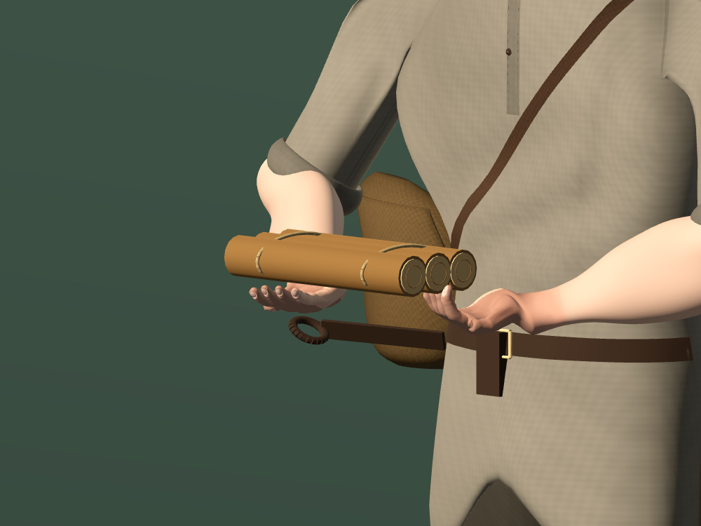

徒手拿取、递交、进食和饮水采用约 0.7 秒的目标姿态进入与退出。目标进度使用五次曲线，在目标曲线端点减速；实际手掌和肘部以上一帧已显示的姿态作参考，不从每帧重建的垂臂姿势重新选择肘向。手掌目标移动速度限制为 1 米/秒，朝向变化限制为 6 弧度/秒，肘部绕肩腕连线的转动限制为 3 弧度/秒。这些是游戏表现参数，不是人体医学标准。

空手到达目标只解算一次肩肘位置，再限制剩余腕部旋转，避免腕部限角反复改变手腕目标、带动肘部重选。淡出结束后仍保留短暂的关节返回过程，直到与普通垂臂姿势衔接；进入下一段工具拿取时记录实际手部起点。工具伸手与取出／放回分别采用约 0.48 秒的目标过渡，触及工具之前连续调整手腕方向。下蹲以 0.24 秒过渡身体高度与膝部，暂停保留当前位置。

进食与饮水采用 2.6 秒循环，包含抬手、嘴前停留、放回和短暂停顿。目标随实际头部及嘴部位置计算，靠近嘴时调整前臂朝向并收拢手指；当前没有独立食物、杯具或唇部接触物理。采集和递交采用 1.8 秒循环，交谈左右手错开半周期。自检逐帧检查进食、饮水、交谈的手腕和肘部位移、60/120 Hz 结果一致性、嘴部接近及返回；原工具握持、腕角、暂停和远景更新频率检查继续执行。

轨迹设计参考 [Flash 与 Hogan 的多关节伸手实验](https://pubmed.ncbi.nlm.nih.gov/4020415/)；肩部协调参考[无约束抬臂实测](https://pmc.ncbi.nlm.nih.gov/articles/PMC2841046/)。五次曲线及本项目的时长用于程序表现，不代表完整人体动力学；现有肩部仍采用有界位移，没有独立肩胛骨旋转、肌肉驱动或动作捕捉。

[日常上肢动作实测](https://pmc.ncbi.nlm.nih.gov/articles/PMC4690598/)与[伸手及手口动作测量](https://pubmed.ncbi.nlm.nih.gov/26539500/)分别记录上臂、肘部、前臂和手腕的运动；本项目据此区分到达目标、肘部连续性和腕部余量约束，没有把实验中的某个峰值当作所有居民的固定姿势。自检在 60 Hz 下将连续抬手的手腕、肘部单帧位移上限分别设为 25、30 毫米，并保留 60/120 Hz 对照、嘴部接近与返回检查。侧面演示用于观察前后深度和肘部弯曲；这些检查不构成人体动作捕捉精度验证。

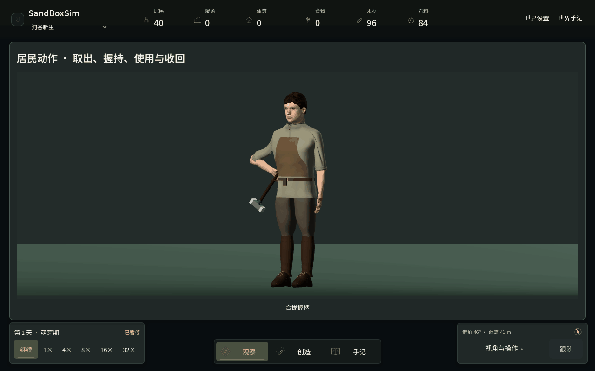

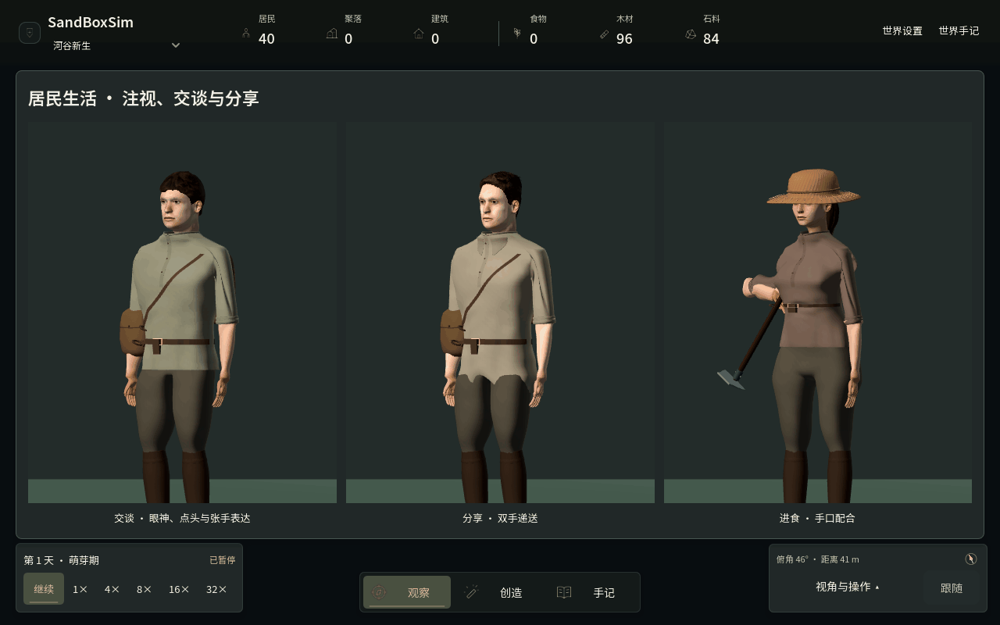

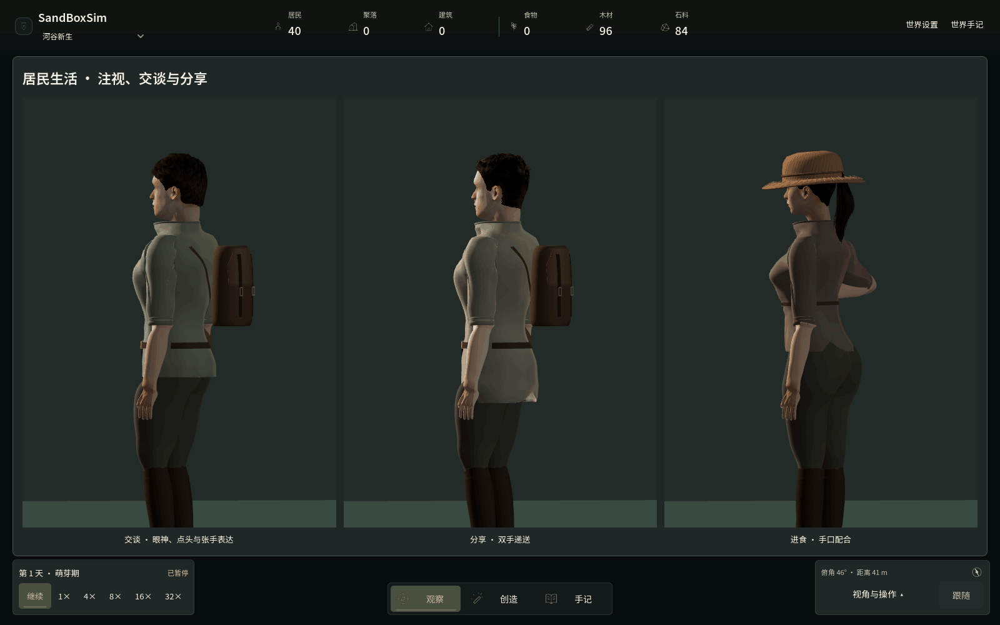

手锤具有中央安装体与两端敲击面，边缘倒角按米制尺寸生成；锄刃有封闭侧壁、弧面及由厚到薄的刃缘，复用工具缓存和原握柄位置。木柄与金属头的材料组织参考 [Royal Museums Greenwich 工具藏品](https://www.rmg.co.uk/collections/objects/rmgc-object-69633)，属于游戏形态设计，没有复制藏品图片或声称复刻该器物。

## 建筑

住房有原木屋、灰泥屋、石屋、高山墙屋和单坡屋五种轮廓。稳定身份决定宽深、楼高和变体；基础房屋宽 3.65–4.13、深 3.05–3.59 个表现单位，采用等比缩放，保留 0.82×1.75 的入口尺度；住房横向尺度与屋顶跨度扩大，灰泥屋、石屋和高山墙屋采用居中入口及左右窗，高山墙/灰泥立面保留竖向木柱与横向木梁；道路决定地图中的朝向。当前门洞、墙高和图册镜头按人物尺度重新调整，模拟建筑占地与通行规则沿用内核单格数据。房屋外壳、生活摆件和坡地地基共用 `BuildingFootprint` 尺寸；表现层检查周围三格建筑，密集区域等比缩小模型，为屋檐与摆件留出空间，拆除邻居后恢复可用尺度。此机制兼容旧存档，但仍不是多格建筑占地或室内空间模拟。

门由独立木板、门框、过梁、铁带和门闩组成；正面及近景侧面窗洞扩大为 0.48×0.60，窗框、格栅、侧板和窗台同步扩大，窗洞深度保持不变；近景侧板补充四层木条和上下铁带，细件并入建筑网格，远景保留原有外轮廓。瓦片坡屋面近景采用 16 行、18 列铺设；交替半瓦边缘形成错缝，相邻排有双搭接。瓦色有六种缓存的细微差异，远景保留较稀铺设。坡屋面有错缝分层瓦片、檐木和山墙边条；近景每块瓦片采用 4×4 曲面采样（96 三角面），在瓦片数量增多的同时降低整片屋面的三角数，远景仍为简化截面；瓦片使用弧面截面，草束屋面带细小起伏与参差边缘。木作、瓦片和砌石具有浅倒角，门板有斜撑、铰链和铆钉；近景补充门框接缝、石质门槛和下缘钉头，全部并入静态网格，单坡屋有坡顶墙面。石屋与基础使用带细倒角的砌石，侧墙有木架；部分住房有烟囱、檐柱、木料与桶箍。近景新增开口木檐槽、铁支架、烟囱砌筑分层和带铰链的展开窗板；这些结构并入静态缓存，远景省略细件。

仓库保留宽门及门前物料；农田采用植株、叶片与通透围栏；矿场具有暗洞口、支架、轨道与矿车。未完工建筑使用基础、立柱、斜撑和材料堆。

近景住房补充两侧窗框、窗台和檐下木作，绕到侧面也能读到结构。石屋采用隔行错缝与边缘半块石，避免整面墙呈现对齐网格；入口雨檐与斜撑随房型变化，近远模型均保留雨檐外轮廓。新增零件仍合并进建筑缓存，远景省略侧窗和檐下细件。

精细窗台采用封闭石质截面，具有向外下降的顶面、前缘倒角和下缘滴水槽；正面与侧面窗口共用同一网格，随整窗尺寸和朝向一起变换。细件进入建筑静态合并，远景使用原有简化窗台。自检验证封闭边、三角面朝向、单位法线与缓存。

近景门板与窗板按各自实际宽、高、厚度生成约 3 毫米的小倒角，避免用单位立方体倒角随长宽比例拉伸。几何按尺寸缓存，并入原有建筑静态网格；远景保留简单板材。封闭边、朝向和法线检查同时覆盖长门板与薄窗板。

五种住房现在采用带门窗开口的薄墙体，窗面和暗色窗洞位于立面以内，细窗棂、外框和百叶位于外侧。石块按开口裁切，原木墙在侧窗处分段，避免外墙盖住内凹玻璃；室内有简单地板。外窗框加深并回嵌墙体，窗棂与玻璃相接，窗台回嵌墙面；高山墙阁楼窗两侧使用短柱和上下承边，中央立柱和腰梁按真实门窗开口裁分。侧墙短角撑避开侧窗；原木屋与单坡屋的廊柱移到角墙前，配套雨檐加宽并保持小于主屋檐，避免柱子挡住正窗。自检以实际合并网格射线覆盖五种住房正窗、阁楼窗及左右侧窗，检查内凹玻璃与窗构件接合。此结构用于外观，不增加可进入室内的玩法。

瓦屋面使用有内外壁与端面的弧形脊瓦，沿屋脊搭接；近景铺瓦有毫米级高度差。檐下有独立椽尾、穿榫木钉，灰泥屋与高山墙屋保留斜撑和空心陶制烟囱帽。墙体底部的雨溅、潮湿与低矮苔色按合并后的米制高度分布。所有细件仍进入建筑共享静态网格，远景保留稀疏脊瓦，省略榫接与烟囱帽。


近景木门保留带铆钉安装片的空心拉环；灰泥、石作和高山墙住房在山墙增加横梁、中央立柱及成对斜撑，构件按实际跨度连接并合并到静态缓存。远景省略这些细件。

## 草甸与水岸

普通世界的草甸使用 24 片狭长、有折面并向外弯曲的叶片，每丛 336 三角面；根部与叶尖有粗细、干湿色差和轻微风动。分布由稳定空间噪声、实际植被量及坡度决定，避开水下和陡坡，替代固定四格一簇的排列。根部采样真实地面，外围根顶点也检查贴地间距；候选掩码变化时刷新自然批次，微小植被变化不重建地形。踩踏字节改变时，只重算受影响地块及邻格的草根；若坡度或外围根接触不再适合则临时隐藏，土壤恢复后可重现。保留 24 米分块、34 米裁剪与压实响应；图册使用同一网格，原扫描草资源仍保留。

水面取地形高度纹理的同一组角点、三角剖分与踩踏修正，深度大于 1 毫米才显示。`WorldView3D.Shoreline.cs` 使用 5×5 邻域、半径 2.1 格的紧支撑 C2 径向权重形成连续水陆过渡，并叠加与种子一致、约 15 米尺度的有限覆盖偏移；归一化权重按细网格相位缓存。干格中心 ±28 厘米脚区、Core 允许的水平／垂直／禁止切角对角通道两侧 ±28 厘米，以及水格中心分别施加干湿约束，避免较宽平滑淹没脚区或填平窄水道。最大 2.4 厘米压实后支撑区仍高于 2 厘米水面。未使用的干格角部允许成为浅水圆角，不承诺每个干格顶点都高于水面。脚部、建筑、绘制和拾取共用实际三角曲面，最终选择的逻辑格仍按原坐标取整。近岸几何波按深度减弱，细波只影响法线；没有新增水量、侵蚀或流体模拟。

地表 tint 使用 RGBA，alpha 携带实际植被量，按 16 档外观变化刷新，存在约 6% 的量化间隔；草地因此可露出低密度土斑，不增加采样器或地表节点。原有两个草丛候选分别采用较宽低矮、较窄高挑的比例，候选数量、单簇面数和距离预算不变。

## 人物与动物

### 头脸与肖像

人物已换用 MakeHuman CC0 的男性、中性与女性三套形体配方，保留原生 UV、独立眼球、上下唇与连续头颈。细分后的头颈分别为 31,742、31,676、31,338 三角面；同源远景头脸最多 2,400 三角面。来源与重建入口见 [人物素材](human-assets.md)。

皮肤使用各自 2K 颜色贴图，替换纯色叠加和旧雕刻法线；眼球保留原始 1K 虹膜、瞳孔和透明角膜图。三种近景发型使用带透明发梢的源发片，共 3,678／3,344／5,352 三角面，束发露出额头和双眼。双面发片按实际正反面修正法线，并采用较高粗糙度、较低高光。远景使用简化头皮轮廓。眉毛沿实际脸部采样贴合；不再叠加通用眼皮。

`NatureModels.Hairline.cs` 从原始发型物理拓扑提取帽体根闭环，排除游离发片和马尾，按来源族缓存到根边的米制距离与沿边弧长。约 1.5 毫米根带形成确定性短发束切边，内部保留源 Alpha；原顶点、UV、发片索引、纹理文件和远景不变。合并网格对头发保留第二 UV 度量，不把它当作眨眼位移缩放。当前 Compatibility 仍使用 Scissor，不能据此宣称完整毛发 Groom 或已启用 Alpha-to-Coverage。

八种稳定身份包含成人与儿童两组比例缓存，儿童面中部缩短、面颊略宽，使用无胡茬皮肤图。源闭眼形变通过第二 UV 驱动原眼睑，网格合并保留并换算位移。每个居民持有独立眨眼和说话材质参数，几何缓存仍可共享；说话固定脸部连接边界和 UV 缝，仅轻微移动唇部内部。眼球始终保持原体积。虹膜、瞳孔与角膜几何围绕来源眼心一起作约 3° 的细微转动，不再只平移纹理；每个居民独立更新，暂停时眼位保持不变。

近景上眼睑增加按实际眼裂取根的短睫毛，随同一闭合参数运动，不独立悬浮或缩放眼球。皮肤粗糙度分区使用各源头脸记录的鼻部、嘴部坐标，鼻额与唇周具有较低粗糙度；耳部透光在约 7–8.6 厘米的头侧范围内衰减，不把整个脸颊染亮。此处是兼容渲染器中的薄层背光，没有完整皮下散射。皮肤、嘴唇、虹膜和眼白具有不同反光层次；几何、远景切换与暂停规则见[人物素材](human-assets.md)。

头部动作围绕颈部基点补偿位置。手记使用 108×138 可点击缩略肖像，与身份和实际行为并排；缩略状态始终使用面部、固定识别角度和距离，观察过双手、全身或背面后也不会变成腹部或后脑。点击或键盘激活后，同一视口移入独立观察窗，恢复保存的工作构图、旋转、俯仰、缩放和灯光，关闭后恢复入口焦点。展开工作室使用渐变背景与主补光，面部默认距离 1 米、垂直视场 26°。质量元数据使用 `studio=continuous-inspector-v9`、`backdrop=natural-radial-v2`，记录实际 `thumbnail`、`thumbnailFraming` 与 `lensFov`。这些操作只改变表现状态。窗口最大 1320×860，侧栏宽 300；状态正文滚动，物资开关、库存摘要和跟随操作固定显示。工作室工具栏按观察范围、观察角度与镜头分组，角度预设有状态反馈，镜头显示目标距离；普通滚轮每步约 10%，Shift 约 3%，距离范围 0.5–4.5 米，全身默认 4.1 米，为脚部和底栏保留余量。三个观察范围分别保存视口内的目标距离，切换时保留当前旋转，重复选择当前范围不复位；双击或复位仅恢复当前范围的默认距离和角度，关闭再展开保留记忆。


观察窗与人物图册采用较低的环境光和更克制的主补光，改善原皮肤高光、眼窝和亚麻细纹的可读性；这只是实际灯光调整，没有替换来源头脸。工作室的距离滑条以对数尺度与滚轮、按钮同步，主动环视仅更新观察角度，关闭、失焦、手动操作或关闭动效后停止，不消耗模拟随机流。操作见[观察与界面](../guides/gameplay-observation.md)。

### 衣装与身体比例

`NatureModels.Tailoring.cs` 的领口包边直接采样 `GarmentPoint(1, angle)`，保留前襟缺口，并在两端封口；六点折边截面沿 96 段开口路径生成，共 1,164 三角形，替换旧的独立椭圆领圈。它随衣身共同作身体比例转换和蒙皮合并，内壁不横跨喉部；复用原亚麻材质、剪裁缓存与远景生成流程，不需要重烘焙未改变的衣身来源网格。

亚麻表面的三个投影分别处理朝向符号，正面、背面和肩侧使用对应的纹理方向。法线基在顶点阶段通过逆转置矩阵变换后交给片元阶段，减少非等比缩放和背向表面的细纹反光偏差。上衣保留原三骨绑定与扫描贴图，袖根和袖身由连续缝片构造。

原始缝片的胸肩基础采样由 MakeHuman CC0 人体支撑截面拟合；运行体型再按下文的完整躯干支撑适配。`torso-cage.json` 保存 65×128 个采样，取自已校验的 HM08 基础体与青年男性宏目标；身体前后表面分别保留胸部与肩胛轮廓，不再仅用同一椭圆收窄到领口。源 A 姿势的手臂在袖窿内侧裁开，各截面的凸包让布料跨过肌肉凹陷，再作有限平滑与 8 毫米基本松量，腹部另作最多 6 毫米的有界松量；商人外衣另加 4 毫米。胸腹拟合区向下延伸以平滑衔接腰部；褶皱集中在腰带和袖窿牵引处，减弱胸前成片的肌肉状沟槽。头部位置上移 18 毫米，源颈部下缘仍嵌入领口，帽子、眼口和颈部旋转基点随头部整体移动。领口喉部空间、下摆和腰带保持各自约束。它是衣料支撑体，不是裸露肌肉网格，也没有为每位居民生成完整生理解剖模型。

形态参考来自[华盛顿大学斜方肌图谱](https://www.rad.washington.edu/muscle-atlas/trapezius)：颈背与锁骨外侧、肩胛之间的连接应区别于上臂三角肌轮廓。[肩胛肱骨节律实测](https://pmc.ncbi.nlm.nih.gov/articles/PMC2841046/)表明抬起、放下手臂的协同关系有所不同；这里采用有界的表现近似，不机械套用固定的 2:1 比例，也不宣称临床或肌肉物理精度。参考图片未复制进游戏素材。

衣身、腰带、挂点共用比例映射和同一表面采样，法线按映射导数修正；不会通过拉长手臂满足握持位置。三种上衣剪裁由职业外观选择，儿童使用基础短衣，不改变职业规则。头脸、手掌与前臂保持各自来源网格。

衣身采用 64×40 连续曲面，肩部与衣袖共顶点蒙皮，沿用三骨肩部与原手臂关节。腰下褶皱改为非均匀分布，腰带压褶和袖窿牵引分别控制；三套服装重新烘焙了下摆起伏、腰上斜向牵引折痕与背部浅褶。停步站姿轻屈肘部并自然弯曲手指，工具和搬运动作继续由原有握持解算接管。衣领、袖口、下摆有内折面，门襟、纽扣、腰扣与斜带沿真实衣面采样；皮具翻盖、边缘与内层保留厚度。背包翻盖和两根扁束带逐点投影到实际包体三角形，层间距离约 0.5–4.5 毫米，带闭合边缘与独立扣框；自检核对真实表面间距，避免按固定 Z 坐标悬挂。

袖窿在肩侧收窄，袖根前两排沿真实衣身切平面延续，再过渡到原袖口；左右四边面使用镜像对应的对角线，避免三角化在一侧肩胛接缝形成额外折角。宽折谷从袖窿延伸，袖口附近保留受约束的压褶。三套实际离线网格为 7,320／7,320／7,200 三角形，保留袖口椭圆、位置及左右骨骼绑定。构造标识为 `relaxed-yoke-v7`，第二 UV 保存袖身缝线坐标，用于随蒙皮运动的细缝线，远景按像素足迹衰减。普通领口等材质不启用该分区；它是衣装造型和表面细化，没有布料物理。

侧胸牵引范围和强度受限；袖身权重在离线构建时按实际网格边长平滑，并限制短边两端的权重差，替代按行号硬编码过渡。胸中线、领口和腰带保持躯干绑定，袖口完全随原肩骨。非衣料配件使用相同的侧胸支持场。动作自检检查三种剪裁的劳动、行走、交谈和进食；独立 Python 检查还覆盖 90° 外展和 75° 前举、开口连接、镜像袖口和接缝折角。运行时复用三骨蒙皮，不增加逐帧网格重建。

伸手解算包含小幅肩带位移：较高目标最多抬肩 20 毫米，前伸最多前移 14 毫米，左右方向对称；衣服骨骼位置与手臂同步。肘部先取向下、略向外的自然方向，再以最小必要调整满足握持手腕角度，而不是直接追随工具轴线。空手动作对肩点位置与关节旋转一同混合，暂停冻结姿态；原手柄接触、指节闭合、工具取放和左右手校验继续执行。当前没有独立肩胛骨网格、肌肉收缩或全身运动捕捉。

连续蒙皮衣装复制材质时保留颜色、法线／粗糙度采样器，并修正双面法线。自检直接检查最终身体网格上的贴图绑定，避免只检验源材质而漏掉运行时纹理丢失。

亚麻使用较低的法线强度；腰带附近保留少量宽脊、窄谷的斜向折痕，胸肩轮廓由上述人体支撑体决定。靴子的鞋舌、鞋孔环和侧面缝线按鞋楦逐点贴合，鞋带使用表面投影。皮具使用经过距离过滤的不规则细粒，避免规则棋盘状凹凸。

亚麻衣料使用 Poly Haven `rough_linen` 的颜色、法线和粗糙度图，以约 0.27 米的三向投影贴到身体、袖口和衣领。色泽由居民衣色控制，织纹随 mipmap 缩小；原图为 1024×1026，清单记录真实尺寸，不强制拉成正方形。配色保持灰绿、亚麻灰、灰棕与蓝灰。


### 手臂、工具与动作

前臂、手掌和手指使用授权解剖网格，经共顶点腕部过渡环连成蒙皮。每手 16 骨，左右镜像同时处理顶点、法线、绕序和拇指方向。指甲保留独立材质并共享皮肤权重。远景使用同源 1,400 三角面的手部模型及静态前臂，按左右缓存张手与握柄姿态。

`NatureModels.HandSurface.cs` 保留原手部拓扑、第一 UV 和骨骼，将未摆姿的绑定坐标写入第二 UV、掌背分区写入顶点色红通道；近景皮肤与甲面仍为两个表面。材质按分区表现掌纹、指节屈曲折痕、指腹、甲床半月、短游离缘与角质边，随蒙皮运动而不滑动。远景跳过细纹计算；这是程序化表面细化，不是新增扫描、指纹识别数据或软组织形变。

`NatureModels.WristContour.cs` 对原来源网格作局部 C2 平滑拟合，将原 54×48 毫米近圆腕环调整为项目选用的 54×37 毫米截面，保留原有不对称细节。近手、独立前臂与远手使用同一映射，法线按含纵向导数的逆转置修正。手指、甲面、掌心握柄区、拓扑、UV 与权重不变，最大源顶点位移约 5.6 毫米。该尺寸是当前模型的美术拟合值，并非人群医学标准；不增加腕部肌腱或桡尺骨物理。

小臂肌腹另使用连续体积拟合：在手部源坐标 Y=75–145 毫米之间逐渐接入，到 255–275 毫米的隐藏肘缘收回。普通成人外观的肌腹横向／前后向最多收束 10%／18%，女性成人外观为 18%／26%；两种形状保留原网格的不对称轮廓，腕环、手掌、手指与埋入袖口的边界固定。近景连接蒙皮、独立前臂和远景代理使用同一映射，缓存包含体型，法线按组合形变的雅可比修正。纹理与骨权重继续来自原授权数据。

研究参考[华盛顿大学肱桡肌图谱](https://www.rad.washington.edu/muscle-atlas/brachioradialis)和[前臂、腕围及长度测量研究](https://pmc.ncbi.nlm.nih.gov/articles/PMC11141550/)。它们用于理解近肘肌腹、远腕过渡及部位之间的比例；上述收束量为项目造型参数，没有从小样本均值推出统一人体尺寸，也没有复制图谱插图。

## 成人体型与男女外观

成人头部横向尺寸独立于身体的随机宽度，避免较窄体型把头脸一并压成长条；身份变化仍保留小幅头宽与头高差异。成年来源形体之上，男性外观保留较宽的下颌、较明显的眉弓、鼻梁与颏部，女性外观保留较轻的眉弓、较饱满的眼下颊部与更垂直的前额。下颌横向局部系数分别为 +8.5%／−6%，颈部局部系数为 +10%／−5.5%；女性下脸段最多上移 4.5 毫米，颈部接缝保持原高度。鼻翼区域分别作最多 +3%／−4.5% 的局部宽度修饰，女性颊侧另有最多 2.2% 的柔和体积变化；眼球不作放大。眉弓、颏部、颊部和额头使用毫米尺度的连续场叠加，区别于整张脸统一放大或收窄。眉毛分别采用较平、较轻弧度的贴面路径。皮肤、眼口、发片和挂点共用 `HumanPoint`，法线使用同一映射的逆转置；自检在八种成人来源表面采样局部雅可比，拒绝翻折及过度拉伸。儿童不套用这些成人局部变化。

脸型设计参考[三维面部区域形态研究](https://pmc.ncbi.nlm.nih.gov/articles/PMC10335371/)、[2022 年成人面部三维研究](https://pubmed.ncbi.nlm.nih.gov/35357226/)和[2026 年成人脸型形态研究](https://pubmed.ncbi.nlm.nih.gov/41827988/)。研究提示应结合多个区域及个体差异理解外观，不能单凭一个部位判定身份；项目中的区域幅度是美术选择。皮肤图集另按同一额部区域的面积加权线性亮度校准来源曝光，头脸和嘴唇的来源曝光及 RGB 参考值由同一额部区域测量，`tools/measure_head_tones.py` 可复算线性 RGB 与亮度。来源参考色用于把平均皮肤颜色映射到居民肤色，保留原图的局部色差；远景头部使用来源的相对色块，不把它当作贴图像素重复加曝光。肤色仍由居民身份控制，校准不抹去来源纹理或更换许可素材。Compatibility 下先将采样与染色转为线性 RGB，完成曝光／染色后再编码；Forward+／Mobile 使用其线性材质输入路径。远景按后端选择正确编码，避免重复伽马转换。依据见[Godot 着色器参考](https://docs.godotengine.org/en/stable/tutorials/shaders/shader_reference/spatial_shader.html)及[4.7 Compatibility 渲染实现](https://github.com/godotengine/godot/blob/4.7-stable/drivers/gles3/shaders/scene.glsl)。`tools/verify_skin_colour.py` 使用实际 GPU 像素和已知颜色验证生产函数；本地已验证 Compatibility，其他后端不能由这一结果推定。

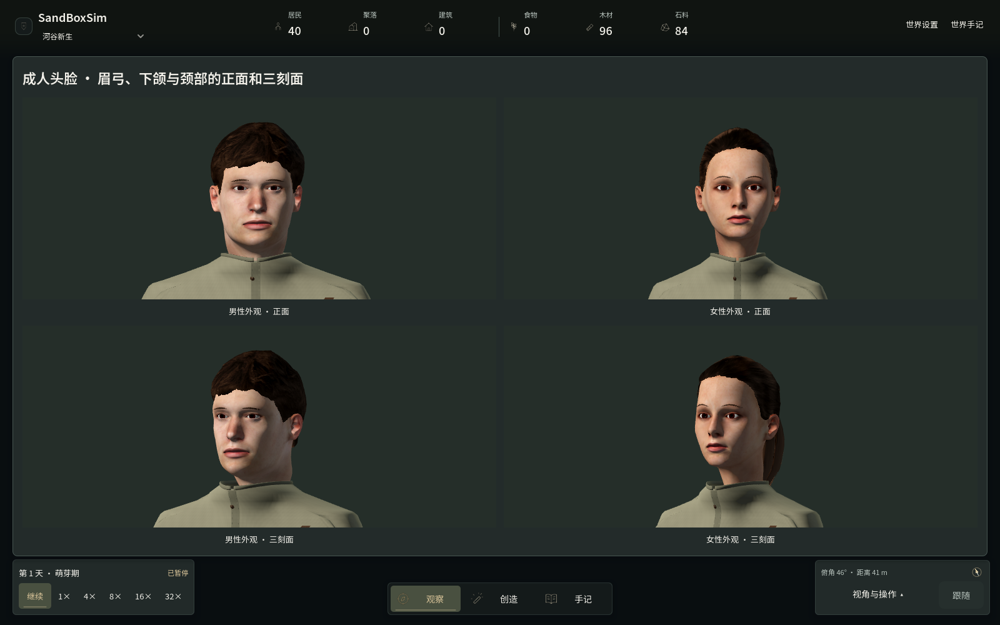

### 行走、启停与转向

`ResidentRig.Locomotion.cs` 使用支撑、蹬离、摆脚和落脚的分段轨迹，替代固定正弦摆腿。世界每帧提供实际渲染位移及剩余转向角，姿态调度消费累计距离与时间得出的平均速度，避免远景只采最后一帧位移；步频按积分后的移动距离推进，启停使用连续速度包络。输入速度在 0–1.7 米／秒的步态表现范围内限幅；单次水平位移达到 1.25 米时按位置重同步处理，不把普通相邻格点插值的较高瞬时速度误当作跳变。预览与人物观察窗没有世界位移时使用独立的标准步速，旋转观察镜头不会被当成角色转身。观察窗的步态因此用于查看动作，不用于测量世界滑步。

支撑段约占周期的 60%，疲劳和双手搬运适度延长支撑；摆动段抬脚、收膝，再向前落脚。脚踝高度参考实际鞋底的 25 个纵向截面，在脚跟／前掌滚动时补偿鞋底接触高度。两节腿部 IK 保留原有大腿、小腿长度，超出可达范围时限制目标，不拉长肢体。近景坡面修正从已有髋关节求解，裤装骨骼在同帧刷新，避免将整条腿从骨盆移开。当前没有跨台阶的路径规划、足底压力或完整物理平衡求解。

男性／女性成人外观分别采用不同幅度的骨盆横向转动、侧倾与基础摆臂，胸廓反向配合，头部在转向时保留较大的朝向偏移。身份带来重叠变化，外观不固定决定移动速度。双手搬运由原有手掌约束接管，骨盆摆动收敛；持锤行走、停止及工作使用同一真实握柄，拾取以 0.48 秒过渡进入重心下降及腿部屈曲。作业力道仍由下节的相对负荷控制。

依据包括 [Bruening 等的全身步态研究](https://pubmed.ncbi.nlm.nih.gov/25548119/)与[控制无量纲速度的研究](https://pmc.ncbi.nlm.nih.gov/articles/PMC7440644/)，它们支持同时考虑骨盆、躯干、摆臂、身体尺寸和速度；[2024 年躯干研究](https://pmc.ncbi.nlm.nih.gov/articles/PMC10828227/)的部分结果不同，因此本项目没有把某个群体均值当作所有人物的规定动作。[转身中的头部控制研究](https://pubmed.ncbi.nlm.nih.gov/16506002/)用于头部与骨盆分段朝向的设计。角度、周期、落脚轨迹均为游戏表现参数，没有导入运动捕捉，也未声称复现论文的个体数据。

`--panel=locomotion` 提供同速度男女外观的启停转身、负重行走及持锤行走—工作六格演示；公开场景为 `visual-locomotion.json`。`LOCOMOTION_PASS` 检查真实关节的启停、不同速度、转向、拾取、固定肢长、实际鞋底截面、步间连续和暂停；`LOCOMOTION_LOAD_PASS` 检查搬运／持锤行走到工作中的掌柄接触、手掌连续、坡面髋部锚点和裤装绑定；`LOCOMOTION_SAMPLING_PASS` 核对逐帧变速输入与间隔八帧消费的相位／速度差，并检查儿童髋部随运动骨盆保持连接。原有远近景节奏、衣装蒙皮和握持检查继续执行。世界根节点仍按模拟格点插值，在高倍速或位置重新同步时不能保证每只脚在世界坐标完全锁定；画廊与截图也不能单独证明动作写实程度。

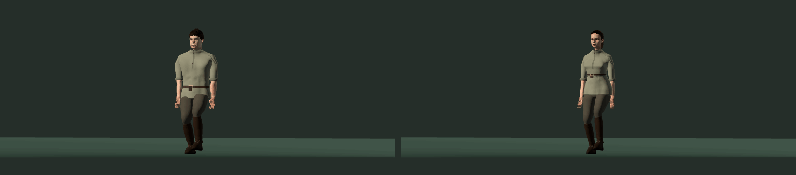

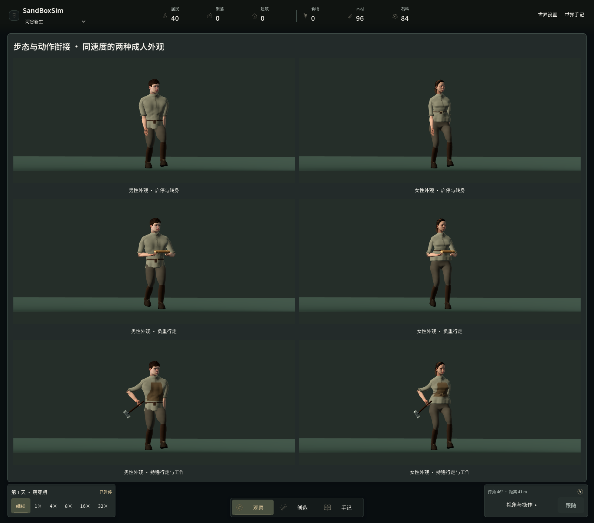

### 发力、疲劳与动作节奏

`ResidentRig.Effort.cs` 以工具类型、个体表现系数、真实疲劳和健康值构成相对作业负荷。男女成人外观的默认系数范围分别为 0.89–1.17、0.80–1.08，范围重叠并由稳定身份选取；这只是程序动画的造型参数，不是实测力量或模拟内核的新技能。相同系数及状态使用同一控制器，不固定规定某种外观必须以某种方式劳动。

蓄力和下挥分别使用端点平滑的五次曲线，末段保留小幅吸收与回收，替代旧循环末尾的停住不动。负荷提高会延长准备与整个周期，疲劳另增加恢复时间；躯干前后配合与小幅转动使用同一作业相位，避免独立正弦摆动与手锤错拍。头部和躯干转动通过保留速度的临界阻尼过渡。状态变化只改变后续相位推进速度，不重置当前挥击。空手到达目标的速度、朝向和肘向随剩余距离减速，已有最高速度、腕角与肩点约束继续生效。

[递增负荷搬举研究](https://pubmed.ncbi.nlm.nih.gov/26851478/)和[上肢搬举研究](https://pubmed.ncbi.nlm.nih.gov/32342895/)用于区分外观、能力与相对负荷；[模拟锤击腕部研究](https://pmc.ncbi.nlm.nih.gov/articles/PMC2901240/)用于理解腕、前臂与上肢协同。搬举不等同于锤击，研究没有直接给出本项目的周期或性别系数。当前仍是受约束的程序动作，没有工具质量、接触冲量、肌肉动力学、完整肩胛骨或动作捕捉；不改变资源产量、伤害和行动时长。

持工具的主手先过滤目标位置与四元数朝向，再执行两节 IK；保留上一时刻的速度，切换目标时不清零。蓄力路径增加小幅外侧／后侧弧线，挥击不原路折返。收纳在位置、完整朝向与剩余速度都接近挂点时才换父节点，工具继续与实际手掌保持刚性接触。工具、躯干和头部的阻尼时间参数分别为 40、60、75 毫秒；参数控制衰减，不表示精确的到位时间。

设计参考[临界阻尼与动画过渡说明](https://www.theorangeduck.com/page/spring-roll-call)和[动画惯性过渡的工程文档](https://dev.epicgames.com/documentation/en-us/unreal-engine/animation-blueprint-blend-nodes-in-unreal-engine)。当前实现是 IK 前的目标跟踪，不是移植 Unreal 节点，也不是完整动画片段惯性融合。自检包含固定目标下的分步一致性、切换目标前的速度保留、两种成人体型的六类动作切换、工具取放时的位置／转角连续性与握持接触。

世界角色与人物观察窗都读取真实疲劳和健康值。`work-effort` 用相同手锤展示两种成人外观的状态对照；自检核对相同系数下的周期一致性、疲劳后的节奏与躯干响应、掌柄接触、状态切换连续性和暂停。该检查保证运行约束，不把通过结果当作动作写实评分。

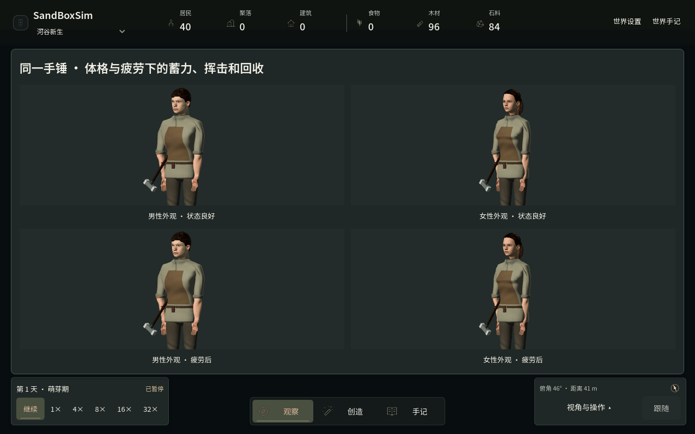

劳动支撑姿态由工具相位和相对负荷驱动，髋部、小幅屈膝与上肢同时配合。计算保持原大腿／小腿长度及脚踝前偏移，反求髋部位置与膝角，使角色局部的两只脚踝落点和鞋底朝向保持稳定；已有世界转向、地面高度与坡面补偿继续生效。这是矢状面支撑姿态，没有全身平衡物理、地面接触力或转身时的世界空间足部锁定。进入和退出保留阻尼速度，暂停冻结。远景仅对便宜的支撑滤波按 60 Hz 分段积分，不重复整套 IK；徒手过渡以最多 1/30 秒子步处理，保留原有 60/120 Hz 和远近景姿态误差检查。

眨眼采用身份错开的确定性时间窗，65 毫秒闭合、155 毫秒睁开，窗口间轻度变化；不消费模拟随机流。交谈的点头、口部和手势共享表达节奏，口部在表达间留出停顿，并平滑收口。进食／饮水仅在手口接近及短暂恢复时保留较小口部动作。目前没有语音、音素口型或独立食物杯具。这些时间是游戏表现参数；设计参考[眨眼与交流研究](https://pmc.ncbi.nlm.nih.gov/articles/PMC6291193/)和[动作捕捉的言语手势整合研究](https://pmc.ncbi.nlm.nih.gov/articles/PMC7280344/)，没有使用论文中的动作数据或宣称人体测量精度。

成人身体使用 `lumbar-drape-v8`。`trunk-masculine-cage.json` 和 `trunk-feminine-cage.json` 分别由同一 MakeHuman CC0 基础体与已校验的青年男女宏目标导出，每套保存 113×128 个 0.74–1.30 米截面采样，覆盖骨盆、腰背和胸廓。导出器将来源皮肤表面与水平面相交，排除 A 姿势的手臂，构造凸包后平滑；下段跨过两条大腿之间的凹隙，表示衣料支撑包络。这里不是新增裸体网格或人体扫描。原 65×128 胸肩支撑体仍用于衣片基础采样及兼容重建。

运行时分别拟合两套完整躯干，不再以腰胯高斯缩放替代来源形状。三种缝片各自预采样参考半径，保留已有褶皱、UV、骨骼与面数；来源截面在上下各 24 毫米内以五点加权平滑，基本松量为 10 毫米，腹部另有最多 4 毫米松量；低段前片另留最多 30 毫米活动余量。女性胸前采用平缓、跨越胸骨的衣料包络，额外前向支撑以左右胸前区域分布，峰值 28 毫米，中线保留约 85% 的平缓衣料桥接；骨盆侧缘和后侧分别采用最多 4／5 毫米的方向性支撑，后腰另留最多 15 毫米衣料桥接以缓和深凹，前侧不作相同膨胀。腰侧另作最多 4 毫米收束。男性上胸侧向增加最多 8 毫米、前胸以最多 18 毫米收平圆鼓，骨盆侧向收束最多 4 毫米；不叠加独立球体。来源的胸背深度差与腰背内收进入正、侧、背轮廓，而不是依赖发型、肤色或统一收窄。外层宽度基准仍为男性 0.98、女性 0.94，加上身份的 ±5% 变化；头部继续抵消该宽度，不改变已采用的脸型。

成年肩关节横向位置分别为男性原基准的 104%、女性的 88%，衣袖网格、静止变换和逆绑定同步；肩侧分别下落 9／14 毫米，以连续的颈肩斜面接入袖片。衣片第二 UV 中的真实袖长坐标区分袖片与相同空间位置的胸腰，袖根前 60 毫米渐变衔接；法线包含该渐变的导数。网格生成检查局部雅可比，拒绝压塌或翻折。领口与肩线上端采用独立平滑过渡，保留原有喉部开口、臂长及握持控制。

骨盆关节半间距分别为 0.100／0.116 米，站姿、行走和劳动姿态都读取同一数值；大腿和小腿长度保持不变。成年裤装改用下述连续来源服装表面，儿童保留原有独立简化裤装。腰带在女性剪裁上提高源坐标 0.17 米，按现有身体比例换算约 14.3 厘米；腰扣、带尾、工具环与其连接带同步移动。腰包和背包保持自身形状，只适配挂点。腰带与工具挂点还随当前低段剪裁一起定位；14.3 厘米描述基础上提量。

`ADULT_CONTOURS_PASS` 对最终近／远衣装的真实三角面作水平截面，排除袖片及不同材质附件，检查外层缩放后的腰／髋、肩／髋差异。`TRUNK_PROFILE_PASS` 在最终布面中线上作三角面射线采样，检查胸前与腰部的前后轮廓差异；另外核对骨盆间距和腰部工具挂点。两类检查约束本项目的穿衣造型，不是围度、裸身解剖测量、性别识别准确率或 RSI 分数。三种衣装继续通过实际动作下的袖口、领口、腰部和暂停检查。

[CT 躯干形态研究](https://pubmed.ncbi.nlm.nih.gov/30259957/)在连接的胸廓和骨盆中观察到性别相关的宽度与曲率关系，并报告了群体差异；本项目据此分别处理胸廓、腰背和骨盆，而不将其缩放为同一形体。上述衣料、胸前包络及裤装幅度是游戏美术参数，不是论文中的测量值。

方向性塑形分别处理骨盆侧缘和臀部后向体积，避免把腹部与臀部一同放大。女性身体的自然垂臂另预留 0.07 弧度的外侧余量，作用于站立和行走的基础姿态，工具／拾取／休息继续由动作解算接管；它用于避免手臂挤入较宽髋部，不代表固定的性别动作习惯。腰／髋与肩／髋检查分别要求两套代表模型至少保留 0.13、0.25 的比例差，近远景都从最终衣装三角面测量；这些边界用于本项目回归，不是人体分类阈值。

[99 人骨盆三维形态研究](https://pubmed.ncbi.nlm.nih.gov/28297185/)区分身高相关的比例变化与非等比的形状变化；[9,209 人躯干形态研究](https://pubmed.ncbi.nlm.nih.gov/35271672/)也说明单组线性尺寸不能描述全部躯干形态。本项目据此采用胸廓、骨盆侧缘、臀部深度与肢体过渡的组合，保留已有身份变化；幅度仍是游戏美术参数，原研究数据没有导入游戏。

女性上衣的低段另作最多 45 毫米上移，在 0.78–1.12 米高度间平滑归零，避免把腰胯曲率压缩成一圈翘边，独立于骨盆、裤装和刚性配件。短上衣减少下摆对上髋的遮挡，仍覆盖裤腰；近远身体缓存均保留剪裁标记。`BODY_CUT_PASS` 检查最终衣装的实际下缘高度，`BODY_CUT_POSE_PASS` 在进食、劳动和拾取过渡中检查衣摆与裤腰覆盖。法线包含剪裁位移导数，原 UV、袖长、领口和面数保留。

[英国 9,617 人三维体型调查](https://pubmed.ncbi.nlm.nih.gov/17284738/)报告胸、腰、髋及年龄相关的体型变化，支持从多个部位的组合观察轮廓。项目据此同时处理穿衣后的胸前分布和腰胯可见性，没有导入其扫描数据，也没有把形体差异当作对所有成年人的统一标准。

### 骨盆与胸廓之间的衣料变形

成人上衣采用四骨绑定：原胸廓、左右肩和新增 `PelvicCloth`。0.86 米以下随骨盆，至 1.12 米平滑转回胸廓；原肩袖权重保持，第四权重槽承接低段。腰带等合并衣面附件使用相同权重，工具、腰包和背包挂点按同一分布移动与旋转，各自保持刚性。裤腰使用同一骨盆变换，胸廓呼吸不再把裤腰整体抬起。近景使用该绑定，远景继续使用简化静态衣料，不包含完整腰背弯曲。

无工具的成人休息站姿在 0.35 秒内进入轻微骨盆侧移与松膝，采用原脚踝落点和原腿长求解双腿，鞋底保持水平；进入和退出时混合腿部姿态，进入阶段允许最多 4 毫米的微小落点变化，稳定放松后以 0.1 毫米容差检查原落点；暂停立即冻结。行走、劳动、拾取和持工具姿态仍由各自控制器驱动，身体特征不等同于统一的力量或动作风格。儿童保留原表现。

`LUMBAR_CLOTH_PASS` 从实际蒙皮三角面检查两种成人外观、三套衣装在拾取、劳动和行走时的裤装覆盖，检查刚性挂点与暂停；`RELAXED_STANCE_PASS` 检查放松站姿的脚踝落点、鞋底方向、腿长和重心变化。Godot 的 16 位蒙皮权重按运行数组解码校验。它们是几何和动作约束，不是人体真实感评分。

设计参考 [Blender Studio 的服装压缩与拉伸形体](https://studio.blender.org/training/realistic-human-research/clothing-shapes/)以及[形体预览与迭代](https://studio.blender.org/training/realistic-human-research/iterating-on-shapes/)。[SMPL 原始项目](https://smpl.is.tue.mpg.de/)区分身份形状、蒙皮及姿态相关形变；本项目仅参考这种区分，没有下载或使用 SMPL 模型、扫描或学习参数。当前实现是有限骨骼混合与解析腿部求解，没有肌肉动力学、布料物理或扫描级姿态校正。

### 连续骨盆与臀腿裤装

成年裤装使用 MakeHuman CC0 HM08 的 `helper-tights` 服装辅助表面，分别应用已校验的青年男女宏目标，替换原来的截面骨盆和两条规则大腿。`trousers-male.mesh.json` 为 2,925 顶点／5,696 三角面，女性文件为 2,731 顶点／5,296 三角面；保留来源的臀腿曲率，一级细分后重新计算法线。它是完整衣料表面，不导入裸露身体或另叠加球形臀部。

`export_resident_trousers.py` 校验原始输入哈希，按来源髋、膝标记去掉 A 姿势腿部外展及前后中心偏移，再映射到现有腿长和关节间距。裁切后只保留最大连通衣片，排除手臂辅助碎片；仅腰口与两个裤脚开放。被上衣遮挡的裤腰收至躯干支撑包络以内，膝部裤脚平滑嵌入现有靴口。输出记录来源文件与躯干支撑的 SHA-256，采用固定 LF；普通构建不需要 Blender 或联网。

裤装使用腰部、左右大腿与左右膝关节五骨连续蒙皮。腰部跟随与上衣低段一致的骨盆表现变换，大腿以其逆变换保持原有独立关节姿态，大腿下段平滑转接膝关节，0.40 米以下裤脚完全跟随膝部／靴口；裤裆以平滑权重过渡；原上衣、手部、靴子、脸部及动作目标保留。裤装按体型共享网格，单材质使用现有扫描织物，近远景保留同一绑定并使用屏幕尺寸 LOD。它没有布料物理或独立肌肉求解。

[MakeHuman 服装建模文档](https://static.makehumancommunity.org/assets/creatingassets/makeclothes/clothes.html)将 tights 辅助几何用于服装拟合；[Blender Studio 服装形体工作流](https://studio.blender.org/training/realistic-human-research/chapter/clothing-shapes-rotation/)强调身体与服装形体的规划。本项目据此采用连续衣料与独立的骨盆／腿部驱动，保持原有 CC0 来源。

`test_resident_trousers.py` 检查输入／成品哈希、单连通表面、三个开放边界、索引、有限数值与归一化五骨权重。客户端 `CONTINUOUS_TROUSERS_PASS` 检查真实关节变换、行走／劳动／拾取过程中的腰部约束、边长拉伸、暂停及距离切换；这些检查不是人体真实感或性别识别准确率的评分。

[NASA 人体整合设计手册](https://www.nasa.gov/wp-content/uploads/2023/03/human-integration-design-handbook-revision-1.pdf)说明了男女尺寸范围与个体差异；[肩胛形态研究](https://pmc.ncbi.nlm.nih.gov/articles/PMC11470781/)也区分了尺寸与形状因素。[FAA 人因设计指南第 14 章](https://rosap.ntl.bts.gov/view/dot/12782/dot_12782_DS1.pdf)区分肩宽、髋宽等尺寸，并要求考虑衣着及多项尺寸的关联；项目用它指导分区与比较方式，没有把某一个样本均值当作所有人的比例。本项目保留身份决定的宽度、身高变化，并通过头脸、躯干及小臂共同表现外观。这里是两种成人表现轮廓，不是模拟内核的性别系统或对角色身份的判断；儿童不应用成人女性躯干映射，目前也没有完整年龄、体脂或肌肉量生成系统。

`--panel=body-motion` 配对展示实际站立、行走和弯身拾取，`--panel=body-frames` 显示无职业装备遮挡、相同衣色与肤色的正面／侧面／背面全身三视图，`--panel=forearm-frames` 显示两种外观的小臂掌侧、背侧和侧面。图册采用实际游戏模型，参数与采样见[配图索引](../images/README.md)。

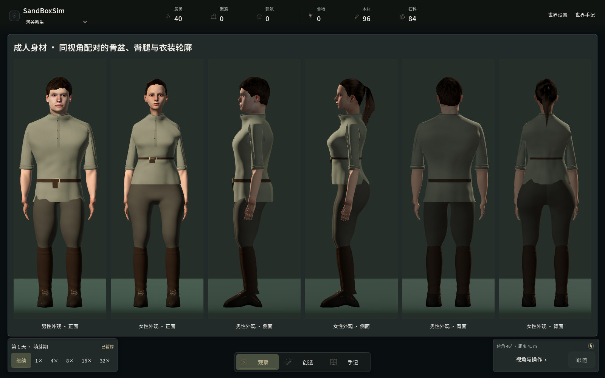

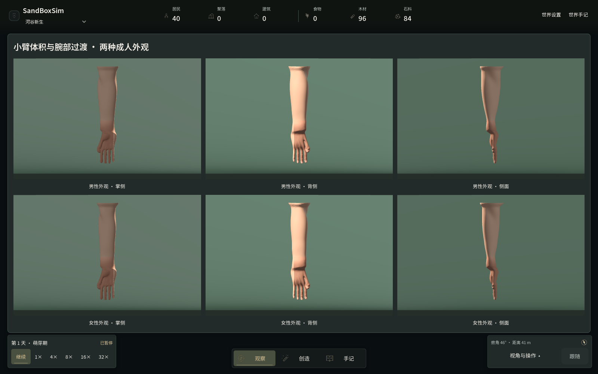

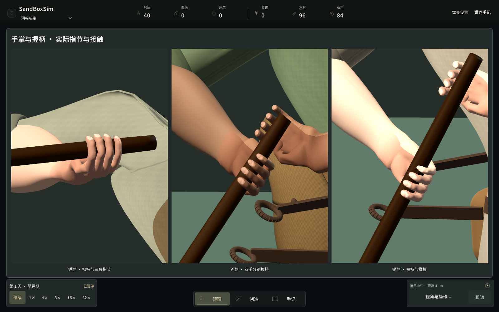

居民闲置、漫游和完成作业后手持职业工具；行走采用单手携带，进入作业时平滑过渡到工作姿态和辅助握持。搬运、交谈、进食和睡眠先让出双手，工具经过伸手、合拢、接管、回位和松开的完整状态转换。收纳处有包围柄轴的双皮环和连接腰带的扁皮带；木柄带渐细端部、细木纹、金属套箍及铆钉。双手目标由两节 IK 求解，支撑手跟随实际握柄，近远景都保留闭合握拳。工具类型由真实动作和职业外观决定，不新增工具库存或任务流程。

握持自检覆盖闲置、行走、作业完成、暂停、货物优先、取回工具及远景闭手；工作测试继续检查手掌位置、指节与柄轴间隙、辅助握持和取放连续性。这些是表现层接触约束，当前没有工具刚体碰撞、可拾取的独立工具物品或工具刃口与每个资源网格的碰撞解算。

交谈、分享、进食和搬运动作读取实际行动状态；短动作可有界补播，新的行进、失败或紧急状态取消补播。观察、肖像、呼吸、注视及姿态不消费模拟随机流、不修改存档。暂停冻结位置与姿态。近景坡面最多补偿 7 厘米，不拉长肢体跨越大台阶。

鞋面、平底鞋底及四组交叉鞋带来自同一鞋楦，保证接触与落地。外观由分段步态和近景腿部 IK 驱动，不模拟完整肌肉或软组织。

### 动物

世界、人物动物图册和视觉评测共用两种授权动物，不再以不断微调的程序头骨作为正式外观。鹿来自 [CDmir / TinyWorlds 的 Old Deer Male](https://opengameart.org/content/old-deer-male)，CC0；狼来自 [0 A.D. 的狼网格与灰狼皮毛](https://github.com/0ad/0ad/tree/61a3b9507d974084e6badb88a0826bd89a6d5b8b/binaries/data/mods/public/art)，CC BY-SA 3.0。各资源目录保留署名、原始路径、源哈希及修改说明，转换规则见下文。

鹿保留原作的头部、眼睛、耳廓、复杂鹿角、体态与六张 1K 颜色／法线图，共 19,840 三角面；狼保留原作肩背、吻部、耳朵、尾部和原始皮毛图，经两次细分为 16,704 三角面。两种网格共享缓存与屏幕尺寸 LOD，鹿源绑定为 14 关节、狼为 15 关节；运行时分别扩展到 18／21 关节，包含四个足部关节与狼尾中、末段。毛皮使用来源 UV，不再叠加旧程序毛束和眼面。

四肢由原有两节肢体与独立足部关节协同解算，来源权重在足区连续转移；鹿采用四拍行走、狼采用对角小跑的表现轨迹。后腿保留源姿态的飞节弯曲方向；24 米内采样实际坡面，身体最多补偿 10 厘米，源足底目标在局部高度范围内最多调整 18 厘米，并按真实腿长限制可达距离，不拉长肢体跨越台阶。耳朵、尾部、呼吸、鹿进食低头与暂停保持接入。狼的 `Jaw2` 权重保留为独立下颌，静止时收拢，移动时轻微张合；下颌不带动上吻与头颈。

耳内短毛从来源表面选择实际受耳骨驱动的顶点，每耳最多 48 个根部，附着到同一耳骨，18 米外隐藏。毛皮微法线按像素足迹衰减，鹿角独立使用较高粗糙度。鹿眼保留源眼球几何，使用较暗虹膜和横向瞳孔；狼的近景角膜通过源 UV 定位，再以局部表面切线构建约 18×9 毫米的眼裂，边缘与原贴图混合，20 米外隐藏。角膜与原头部的实际装配间距自检限制在约 0.1–1.1 毫米以内，跟随头骨运动。`animal-details` 图册提供独立眼眶近景。

正式鹿狼接入来源眼表面上的上下眼睑覆盖，外偏约 0.12 毫米，取相邻皮毛 UV；闭合使用个体的实际眨眼时序，暂停时保持，睁眼时隐藏整个覆盖网格。鹿增加 352、狼增加 560 三角面，包含所有近景细节的总量分别为 23,988 和 23,956，仍受 24,000 面上限约束。它是贴合眼表面的程序遮覆，不是完整重拓扑、具有肌肉和体积形变的动物眼睑系统。

鼻镜与鹿蹄的表面分区在读取来源网格时从绑定姿态生成，保存在顶点颜色通道；鼻部反光较集中，鹿蹄与毛皮保留不同粗糙度。鹿眼的虹膜坐标存入第二 UV，随蒙皮一起移动，避免依赖动画后的空间坐标定位细节。分区和眼部坐标不修改来源 JSON、骨架或存档，自检核对覆盖、范围与有限值。

狼眼周的运行材质在局部源 UV 范围内以原像素密度采样同侧头部的安全皮毛区域，68% 混合减弱过重绘制黑斑，并去除角膜外露出的旧虹膜色素；保留源眉部毛色和暗眼缘，角膜边缘共用同一采样规则，保留较窄杏仁眼裂、窄暗湿边、琥珀虹膜与圆瞳，减少叠加高光；没有修改源贴图文件。自检核对双侧采样仍落在相应头部图集岛内。鹿保留横向瞳孔并提高深棕虹膜的区分，狼闭眼覆盖与周边皮毛采用一致亮度增益。此修复不增加网格、纹理文件、表面或骨骼。

足部使用原下肢蒙皮作有界轮廓细化：狼形成四趾之间的三条凹口，鹿形成双瓣蹄中央凹口。原有顶点的 X／Y 与脚底高度不变，只局部回收足尖 Z 坐标，狼不超过 8 毫米、鹿不超过 12 毫米，法线按形变逆转置修正。鹿两只后蹄在原边插入 11 个采样点、增加 20 个三角形；新增点的 UV 和权重由原边插值。近景完整鹿为 23,988、狼为 23,956 三角形，LOD 共用已调整的顶点缓冲。第二 UV 仅在足区保存绑定坐标，顶点色 Alpha 作为不透明足区掩码，其他区域的眼部坐标和 RGB 分区保留。材质区分趾缝、蹄角质与毛皮；当前没有新增独立足趾骨骼、爪碰撞或蹄瓣张开物理。

四个足部关节分别位于原脚底目标之上，承重期按实际地面高度的局部梯度确定足面方向，摆动期轻微收足；腿部用原段长求解足关节位置。足区在 0.12／0.13–0.24 米高度内连续转接，低段随足部，减少整块足掌跟着下腿翻转的现象。原始 JSON、UV、贴图及脚底高度不变；普通运行不需要 Blender。

狼每足有四枚向前下方弯曲的短爪，前肢另有一枚悬趾，共 18 个贴肤根部；两枚中趾略长，外趾略短。鹿每足后侧有两枚副蹄，共 8 个根部。根部从实际来源三角面采样，随对应足部关节运动，14 米外隐藏。爪蹄采用六边截面和三段弯曲过渡，每个根部 30 面；狼新增 540、鹿新增 240 三角面，分别从护毛分配中减少 54／40 束以维持总预算。狼尾新增中、末段两个关节，按原尾部截面求支点，原尾权重连续分配到三段，保持段长并使用轻微相位延迟；它没有毛发或尾部动力学。

研究参考 [Princeton 犬科形态与四肢图谱](https://assets.press.princeton.edu/chapters/i13221.pdf)对趾行、四个承重趾和前肢悬趾的区分，以及 [明尼苏达大学远端肢体解剖](https://pressbooks.umn.edu/largeanimalanatomy/chapter/distal-limb/)与[密苏里保育部门的鹿足迹说明](https://mdc.mo.gov/discover-nature/field-guide/white-tailed-deer)。[维多利亚博物馆赤鹿资料](https://collections.museumsvictoria.com.au/species/8411)用于核对毛色、臀斑及鹿角等外形参照。这些资料用于结构判断，没有复制其中的照片或图谱。当前尺寸、步态占空比和弯曲幅度是游戏表现参数，不是物种测量数据。

`ARTICULATED_PAWS_PASS` 检查真实蒙皮三角面、爪蹄根部与平地／正反坡面接触，检查步态分段边界连续和暂停；`SEGMENTED_TAIL_PASS` 核对尾段长度、实际骨骼姿态和暂停。原有眼部贴合、来源哈希、LOD、四权重与整只 24,000 面上限继续执行。`--panel=animal-motion` 使用实际世界模型展示行走与足部近景。

这些是可再分发的游戏素材及衍生绑定，并非新制作的解剖扫描。原素材年代较早，狼贴图为原始 256×256，近景分辨率有限；当前没有独立足趾关节、密集毛发物理、动物眼睑形变或完整动作捕捉库。细分改善曲面，不会创造源素材中不存在的皮毛细节。


## 植被与地貌

花甸使用约 38 厘米高、花冠约 5.5 厘米宽的通用草花，包含弯曲花茎、三片叶、薄曲面五瓣花冠和独立花心；非开花阶段保留种头。三种配色与两个阶段共享网格和屏幕 LOD。它们属于项目造型，不作为具体植物物种标签。

实际世界中，每株花分别采样脚下地形，跳过建筑、水域、熔岩、道路和火烧占地；花甸按成熟度缩放，分成 24 米空间批次，42 米外裁剪并关闭细花投影。根部随已有土地压实显示刷新调整高度，包围盒保留 4 厘米余量。CPU 保存批次位置供更新和无窗口检查，图形模式额外核对 GPU 实例；不在运行循环中读回实例变换。

芦苇顶端由实际相连的轻弯穗轴、9 条穗枝和成对小穗组成疏松圆锥花序，修正原分枝起点高于主茎、缺少中央支撑的问题。单丛仍为 7 茎，共 5,068 三角形，沿用原材质、缓存及 LOD；成品网格自检检查轴、分枝和小穗的实际支撑。每颗野莓使用 18 个相接的小果粒，顶部保留五片萼片和原有果梗；果实几何缓存共享，合并后的灌丛生成屏幕 LOD，42 米外隐藏。果实的封闭边、法线、朝向、尺度与缓存进入几何自检，植物分布和季节结果仍读取原有模拟。

叶片材质使用少量背光透射，木质面仍保持不透光；降低叶片法线强度与岩石高光，避免细碎亮点。草甸配色减少黄白，山坡保留岩层颜色并收束微法线。扫描岩石降低金黄色偏色、法线强度与高光；浆果灌丛增加到九组枝条，每组配成对侧生复叶和相连叶柄。树木、蕨类、草丛及岩石继续使用已有扫描几何，不把材质调整称为重新扫描。裸坡叠加连续层理色差，湿岸混合较暗淤泥色，仍读取实际水土状态。

阔叶树和针叶树使用授权衍生模型，保留自然枝条与树皮、叶片材质。地图中的树干、枝条、冠层和岩石按 24 米网格分区批量绘制；每批保留自己的包围盒，镜头只绘制可见区域，保持原有植被几何和位置。古树林、野果地和遗迹复用同类叶片、石材与木材；岩石采用低频断面轮廓和倾斜层次，从变形后的三角面累积法线并合并环绕接缝，避免仍按球面着色的软团感。表面保留低对比纹理、粗糙度与材质差异。3D 叶片、树皮、人物与扫描表面统一具有实际 mip 链，远景使用过滤后的源表面。


早期地表模型专题见 [历史自然图册](../images/nature-detail.png)。

### 场景接地与采样边界

灌木、蕨类、草丛和芦苇从根部落到地表，按周围高度适度倾斜，根部埋入约 1.2 厘米；树干保持竖直并稍埋根部。扫描灌木不再沿用旧球形灌木的 28 厘米抬升。浆果地使用独立的连枝灌丛，叶柄和浆果梗连接到枝条，不再将果球悬挂在酢浆草上方；遗迹蕨类与倒木草本落在根部，泉水与湿地使用有叶片、种穗的芦苇。普通山石和矿石共用扫描岩石几何，矿石保留独立矿物材质。地表边界显式限制插值格索引，支持边缘以外的坡度探针，避免大地图浮点舍入造成越界。植物和岩石仍使用已有授权扫描资产，本轮没有宣称重新制作全部扫描网格。

## 自然造型与材质层次

当前表现更新覆盖人物、鹿狼、阔叶树和针叶树、灌木、蕨类、草叶、岩石、地表、水面及建筑材料。人物使用授权基础头脸，植物采用专业环境素材，动物使用授权衍生蒙皮，服装、建筑与地形仍包含项目程序网格；本次没有加入完整写实角色动画库。

人物降低肩部鼓起，袖身与前臂改用更收束的轮廓；皮肤、眼球和发丝校准粗糙度及反光，眼白保留暖灰层次。动作与工具仍使用原有骨骼和取用状态，自检检查暂停、握持、腕部与肩部连续性。当前头脸使用上文的三套 MakeHuman 形体，儿童为同源比例变化，不等同于独立儿童雕刻。

鹿狼已切换到上文的授权网格与源 UV 皮毛；旧程序眼部、耳廓、角和短毛束保留为校准实现，不再叠加到正式动物。头颈、耳、尾和四肢由独立骨架活动，身份相位和暂停不消费模拟随机流。

阔叶树、针叶树、蕨类、草丛和灌木使用 Poly Haven CC0 素材的衍生网格，保留 1K 的颜色、法线、粗糙度与透明遮罩。树木按完整叶片单元抽样，木质部分独立简化；蕨类、草叶和灌木保留源素材的轮廓。网格和多材质由世界与图册共用，树木保留导出叶片索引以维护轮廓，其他低矮植物继续使用屏幕 LOD；来源、转换和尺寸见 [环境素材](environment-assets.md)。林下蕨类由真实植被、湿度与火灾状态筛选，稳定位置序列不消耗模拟随机流。

河岸芦苇由七根分节茎、弯曲叶片和立体种穗组成。它只出现在湿度超过 30%、邻接实际水域且未被建筑或烧毁状态占用的适宜土地上；湿度阈值、火灾与占地变化会刷新植被。林下蕨类成簇散布，草叶高度叠加稳定斑块差异。芦苇在 42 米、蕨类在 38 米裁剪，继续按 24 米区域批量绘制；扫描植物使用低频阵风和较轻叶梢摆动。

岩石采用不规则断裂平面的径向交点构造轮廓，法线由实际网格累积。地形保持既有连续地面采样，将规则正弦波纹换成两尺度稳定噪声起伏；水面、道路与压实处减弱起伏，居民和建筑仍从实际地面取高度。地表细砂与木石表面的微法线随屏幕覆盖减弱，避免用大量新增几何表达微小材质变化。水面校准浅岸色、波纹反射与粗糙度。

石砌住房和基础的近景砌块采用浅倒角，远景保留原轮廓；木材、石材、灰泥、瓦片与草束使用统一的低饱和自然色系。世界天气光照、图册中性补光分别维护，图册不使用专用替身模型。

`--panel=ecology-details` 和 [visual-ecology-details.json](../../benchmarks/scenarios/visual-ecology-details.json) 提供树、蕨类、草叶、岩石与灌木的世界共享几何近景。语义裁切标签包含 `tree`、`fern`、`grass`、`rock`、`shrub`；这是对象识别输入，不是游戏任务。植物自检覆盖有限顶点、单位法线、三角面朝向、属性长度、根部范围与缓存预算；完整场景另外核对实际画面和性能。


`NatureModels.Bramble.cs` 构造七根拱垂主枝和交错的三／五小叶；每片叶有 20×4 分段，叶面弯曲、叶尖下垂，边缘使用真实锯齿轮廓。复叶的小叶通过短叶柄连到同一节点，主枝补短刺；14 枚果实通过分叉果梗下垂，每枚由 21 个小果粒组成。果实与叶柄在合并后的同一局部坐标中使用共享风动函数，避免枝条摆动时果实停在原处。结果／无果模型共 31,616／16,608 三角形，使用原材质缓存、屏幕 LOD 和 42 米显示距离。结构参考 Kew／RHS 的荆棘类灌木资料，来源与视觉尺度见[环境素材](environment-assets.md)；模拟中的食物、季节和采集规则不变。

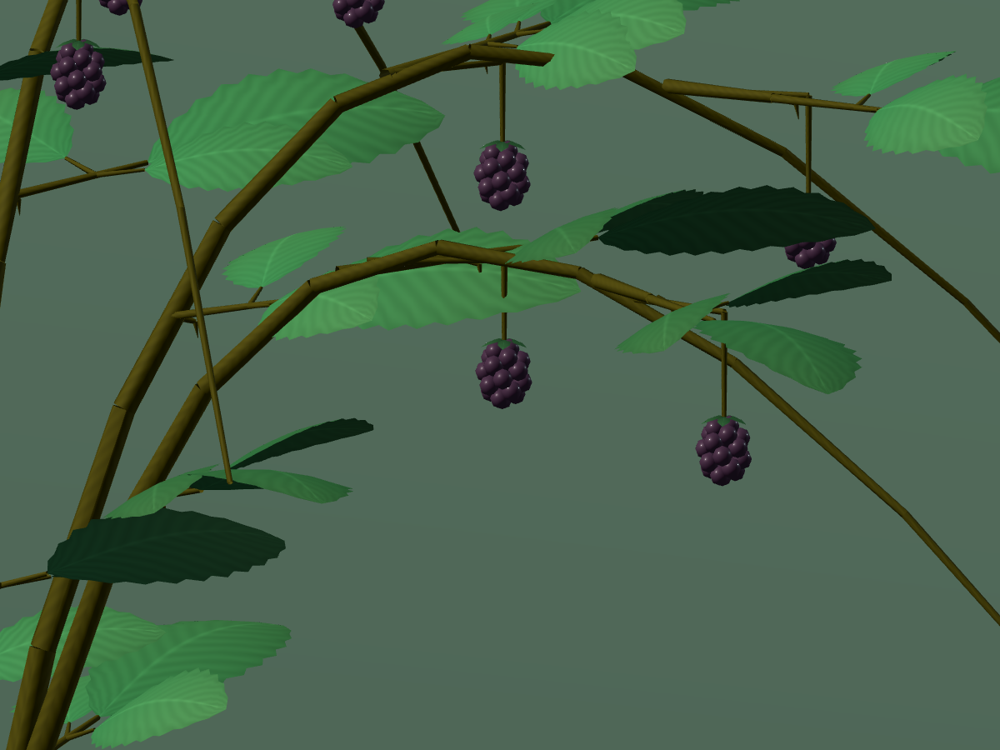

## 源码入口

| 文件 | 作用 |
|---|---|
| `NatureModels.Buildings.cs` | 建筑轮廓、屋顶与窗结构 |
| `NatureModels.ArchitectureDetail.cs` | 门、屋面搭接、砌石、支架与道具 |
| `NatureModels.Joinery.cs` | 空心弧形脊瓦、檐下榫接、陶制烟囱帽 |
| `NatureModels.Residents.cs`、`NatureModels.Tailoring.cs` | 人物衣装、四肢、手部与配件 |
| `NatureModels.Equipment.cs` | 帽壳、贴合衣装与背包挂点 |
| `NatureModels.HandTools.cs` | 工具模型、腰侧与手掌挂点、库存携带外观 |
| `NatureModels.Forearm.cs` | 同源前臂网格加载、左右镜像、腕口对齐及维护预览 |
| `NatureModels.HandSkin.cs` | 连续掌形、手指与腕部过渡的蒙皮网格和绑定 |
| `NatureModels.Hairline.cs` | 来源头皮帽根闭环、毫米度量、非帽体排除和缓存验证 |
| `NatureModels.WristContour.cs` | 手掌、前臂和远手共用的腕部截面与连续法线 |
| `NatureModels.HandSurface.cs` | 绑定坐标、掌背分区、掌纹和甲床表面；近远景细节预算 |
| `ResidentRig.Locomotion.cs` | 距离驱动步态、启停、体型动作轮廓、鞋底滚动与腿部 IK |
| `ResidentRig.cs`、`ResidentRig.HandPose.cs` | 真实行为呈现、收纳切换、肘腕求解、指节姿态与手部骨骼 |
| `NatureModels.Articulation.cs` | 连续蒙皮衣袖与肩部结构 |
| `NatureModels.GarmentSkin.cs` | 上衣规则采样导出、缝片网格加载、权重与连通性检查、近远景袖子替换 |
| `NatureModels.Thatch.cs` | 连续草束屋面、厚度、不规则檐口与纤维表面 |
| `NatureModels.HumanAsset.cs` | 授权头脸数据读取、哈希、结构变体与头发表面查找 |
| `NatureModels.Face.cs` | 实际眼球、唇部、眼睑、眉毛与虹膜表现 |
| `NatureModels.ResidentLod.cs` | 保留轮廓与肤发色的远景头部网格 |
| `NatureModels.HandlingValidation.cs` | 工具转移连续性、握持、作业、切换、携带与暂停检查 |
| `NatureModels.ClothSurface.cs` | 扫描亚麻织纹、染色与粗糙度 |
| `NatureModels.AuthoredEyelids.cs` | 正式鹿狼来源眼表面覆盖、皮毛采样、独立闭合与暂停检查 |
| `NatureModels.MeadowTurf.cs` | 共享的 24 片折面弯叶、风动、压实与距离衰减 |
| `NatureModels.AnimalPaws.cs`、`NatureModels.PawValidation.cs` | 足部权重、贴肤爪蹄几何、地面法线与实际蒙皮接触检查 |
| `NatureModels.AnimalTail.cs` | 狼尾来源截面、连续分段绑定与长度／暂停检查 |
| `NatureModels.AuthoredAnimals.cs` | 正式鹿狼资源、来源检查、UV 材质、原始 14/15 关节来源与运行 18/21 关节映射、缓存和接地自检 |
| `NatureModels.Coat.cs` | 旧程序动物的校准毛束、权重插值和几何缓存 |
| `AnimalRig.cs` | 正式与校准动物共用的步态、坡面接地、耳尾及暂停 |
| `NatureModels.Animals.cs`、`NatureModels.AnimalDetail.cs` | 保留的程序动物校准造型与几何检查；不是当前世界外观 |
| `NatureModels.Meadow.cs` | 保留的程序草叶构造器；当前草甸入口为 `NatureModels.MeadowTurf.cs` |
| `NatureModels.Botanical.cs` | 程序植物辅助结构、材料与植物几何检查 |
| `NatureModels.Bramble.cs` | 拱垂野果灌丛、复叶、短刺、果梗、聚合果与共享风动 |
| `NatureModels.ScannedEnvironment.cs` | 专业环境素材读取、哈希、多材质与地面绑定 |
| `WorldView3D.Relief.cs` | 地形的稳定噪声起伏 |
| `WorldView3D.Surface.cs` | 扫描地表混合、坡面投影与读取河床深度的水面 |
| `WorldView3D.ActorGrounding.cs` | 高倍速未知步及近岸无支撑插值的逻辑中心同步 |
| `WorldView3D.Shoreline.cs` | 水陆分类与显示支撑、旱地脚底／通道及植被覆盖率检查 |
| `WorldView3D.Meadow.cs` | 草丛候选掩码、外围根接地与受踩踏邻域更新 |
| `WorldView3D.Buildings.cs` | 地图建筑增量同步、路向、近远景切换与贴地石基 |
| `ScannedSurfaces.cs` | 扫描纹理共享加载、实际 mip 检查与法线/粗糙度打包缓存 |
| `addons/texture_import_guard/` | 编辑器中的纹理重导入与真实 mip 链核验；普通游玩不加载 |
| `NatureModels.ScannedCraft.cs` | 建筑木材、灰泥和石作扫描表面 |
| `NatureModels.Vegetation.cs` | 树冠、针叶枝层与树干 |
| `NatureModels.Craft.cs` | 平滑截面、倒角石块与连接构件 |
| `NatureModels.Surface.cs` | 木纹、灰泥、石材、屋面和植被的表面处理 |
| `NatureModels.RoofSurface.cs` | 弧面瓦片、草束起伏、边缘与封闭截面 |
| `NatureModels.CharacterSurface.cs` | 耳廓曲面、肤色表面和发丝着色 |
| `NatureModels.Validation.cs` | 曲面朝向、网格完整性、静态合并与关节检查 |

地图中的建筑同时缓存近景与远景网格；远景减少曲面细分和小构件倒角，保留同一屋面排布、轮廓与材质。进入 24 米以内切回近景，离开 32 米以外切回远景，避免在边界反复切换。模型图册始终使用近景几何。

新网格需要采用 Godot 的顺时针正面约定，并保持朝外法线。截面插值保留轮廓；不要仅提高球体细分来替代身体结构。静态部件按材质合并，动物和居民保留活动关节。建筑变体键限制到 140 个稳定组合，图册和地图共用缓存规则。

## 人物前臂与鞋楦

人物肘部和前臂使用同一授权人体导出的连续解剖表面，替换球体肘部加截面管的组合；左右分别镜像；近景与手部共用过渡环，构成单张连通蒙皮，避免两张开放表面在腕口相接。源文件、许可、转换方式和维护预览见 [人物解剖素材](human-assets.md)。前臂顶点通过腕部补偿骨保持在肘坐标系内，手掌与手指保留转动；当前仍以现有肘关节驱动整段前臂，不模拟桡尺骨交叉或皮肤滑动。


鞋楦长度为局部 0.26 米，前掌和鞋腰收窄，鞋面与鞋底仍共用截面。鞋底降低约 19 毫米，使默认直立姿态落在地面；足弓保留抬起。四组交叉鞋带由同一鞋楦函数采样高度并分段弯曲，替换任意高度的直线，避免穿入鞋面或悬浮。自检按实际鞋面三角形核对鞋带间距、鞋面/鞋底贴合和静止落地。行走使用分段足部轨迹及近景地形腿部 IK，鞋底滚动按实际截面补偿接触高度。

## 动物来源、转换与重建

正式数据位于 `assets/models/animals/cdmir-deer/` 与 `0ad-wolf/`。`tools/export_authored_animals.py` 在项目本地 Blender 中读取源网格、检查固定 SHA-256、转换单位和坐标、细分表面并转移作者权重。鹿细分一次，狼细分两次；保持原始 UV，颜色与法线 PNG 不重绘。PNG 导入开启 mipmap，材质使用各向异性过滤，避免远处皮毛形成高频闪烁。

骨架包含身体、头、尾、四肢上下节、颈和左右耳，鹿共 14 关节，狼另有下颌关节共 15；导出足底位置用于接触解算。反射坐标变换同时处理法线和正面绕序；运行加载器检查衍生 JSON 哈希及对应许可。权重校验允许 GPU 16 位量化误差，不改变归一化要求。

源文件默认位于 `.tools/sources/cdmir-deer/deer1.blend` 和 `.tools/sources/0ad-wolf/wolf.dae`，狼纹理 `wolf-grey.png` 与 DAE 同目录。工具链和下载源均不提交；仓库提交运行数据、PNG、`.import` 和许可。重建示例（替换 Blender 为当前项目内实际路径）：

```powershell
$blender = '.tools/blender-4.5.14/editor/blender-4.5.14-windows-x64/blender.exe'
& $blender --background --factory-startup --disable-autoexec --python tools/export_authored_animals.py -- --species deer --source .tools/sources/cdmir-deer/deer1.blend --output src/SandBoxSim.Godot/assets/models/animals/cdmir-deer
& $blender --background --factory-startup --disable-autoexec --python tools/export_authored_animals.py -- --species wolf --source .tools/sources/0ad-wolf/wolf.dae --output src/SandBoxSim.Godot/assets/models/animals/0ad-wolf
```

重建后检查差异并同步加载器中的成品哈希；不能绕过来源哈希检查接受未知资产。原始下载 URL、版本和许可证位于各目录 `LICENSE.txt`。狼的衍生网格、绑定与源贴图继续按 CC BY-SA 3.0 提供，不更改其他项目代码或无关资源的许可。

`AUTHORED_ANIMALS_PASS` 检查两种正式动物的有限顶点/法线、四权重、关节范围、共享缓存、三角面预算、平地和上下坡接触及暂停。保留的程序动物仍有独立几何校准检查；其毛束、眼睑和趾爪测试通过不表示正式动物具备那些旧细节。近景质量必须查看实际画面，不能从面数或自检推定写实程度。

## 独立预览

当前住房门高为模型局部 1.75 米、门宽 0.82 米，仓库为 1.85/0.95 米；原木屋墙高提高到 2.05 米、仓库到 2.2 米，门框、门板、雨檐与廊柱同步。尺寸还会受建筑根节点缩放影响，模拟占地没有扩大，仍不提供可进入的室内。茅草坡屋面改为连续厚壳与参差檐口，替换瓦片式矩形草束排布；石墙保留扫描细节并降低矿物金色饱和度。

动物预览读取当前授权模型；人物近景使用拟合头部的源发片和原生皮肤图集。来源、预算、转换及当前限制见上文。

先运行 `./tools/godot.ps1 -Mode build -Configuration Debug`，再通过 Godot .NET 可执行文件打开项目：

```powershell
& $env:GODOT_EXE --path src/SandBoxSim.Godot -- --panel=architecture
& $env:GODOT_EXE --path src/SandBoxSim.Godot -- --panel=characters
& $env:GODOT_EXE --path src/SandBoxSim.Godot -- --panel=animal-details
& $env:GODOT_EXE --path src/SandBoxSim.Godot -- --panel=ecology-details
& $env:GODOT_EXE --path src/SandBoxSim.Godot -- --panel=model-details
& $env:GODOT_EXE --path src/SandBoxSim.Godot -- --panel=wardrobe
& $env:GODOT_EXE --path src/SandBoxSim.Godot -- --panel=equipment
& $env:GODOT_EXE --path src/SandBoxSim.Godot -- --panel=actions
& $env:GODOT_EXE --path src/SandBoxSim.Godot -- --panel=motion
& $env:GODOT_EXE --path src/SandBoxSim.Godot -- --panel=grip
& $env:GODOT_EXE --path src/SandBoxSim.Godot -- --panel=hands
& $env:GODOT_EXE --path src/SandBoxSim.Godot -- --panel=forearms
& $env:GODOT_EXE --path src/SandBoxSim.Godot -- --panel=faces
& $env:GODOT_EXE --path src/SandBoxSim.Godot -- --panel=naturemodels
```

`--panel=person-hands` 打开真实人物档案的手部构图。`hands` 提供锤、斧、锄的握持近景；`faces` 同时展示正面与侧转面部。连续预览可使用 `--capture-frames=<绝对目录>`，输出 56 张 PNG，按 8 FPS 采样。录制时给引擎传入 `--max-fps 60 --quit-after 650`，留出启动和七秒录制时间；临时帧放在 `runs/screenshots/`，选定的正式配图放在 `docs/images/`。

这些参数仅打开开发用模型预览，使用固定灯光与同一套实际网格；普通游戏不会显示预览面板。原始素材来源见 [美术资源](assets.md)，界面操作见 [观察与界面](../guides/gameplay-observation.md)。

模型图册也提供无标题的评测裁切图及对象类别标签，入口与使用边界见 [评测接口与实验运行](benchmark.md)。

建筑表现按实体增量同步，共享合并网格并保留各自的位置与朝向；网格构造与缓存维护见 [性能采样与渲染维护](performance.md)。

### 树冠轮廓

树冠使用环境素材的自然枝叶，按完整叶片单元进行稳定抽样，保留叶形和 UV。世界树木按原有稳定序列放置，通过共享多材质网格和空间分块绘制；树木保留叶片索引，草丛等较低植物使用屏幕 LOD；变化属于表现层，不影响树木资源或生态状态。

### 材质与环境光

地表使用有草叶、落叶和细枝的 `leafy_grass` 扫描，按 2 米实际覆盖宽度采样；三角格中的四向旋转同步作用于颜色和法线。岩面与建筑三向投影在各自切线方向还原法线，再合并到实际表面，负向立面也使用对应方向；山坡的岩面起伏由连续高度导数限制到约 8 厘米，并随水域、道路权重缩退。

纹理导入的 `mipmaps/generate=true` 不等于缓存已经包含 mip 链。项目的 `texture_import_guard` 编辑器插件在明确维护命令或独立包导出时启用，统一模型／扫描表面的 mip 配置、重导入并核对实际图像；正常编辑和游玩不执行这项批处理。维护命令为 `./tools/godot.ps1 -Mode test -ReimportTextures`。扫描表面与正式动物加载器也会拒绝缺少实际 mip 链的缓存。

木材包含沿板材方向的细纹、条纹和低频色差；石材与屋面增加倾斜层纹、微小孔隙和局部风化。高频纹理按屏幕导数衰减，减少远景闪烁。木石与屋面继续使用现有图集及程序着色；植物与地面材质混合授权 PBR 贴图，几何来源见 [环境素材](environment-assets.md)。

世界光照在初始化和天气更新中使用一致的中性暖色方向，避免天气刷新重新引入过黄的晴天光。岩石修改只构建一次共享网格，新增草丛复用空间批次；草丛的动态变形和远景范围见 [地形与活动痕迹](../guides/terrain-and-traces.md)。

树木在格内稳定偏移并改变尺度，偏移后重新采样根部地面；符合筛选条件的近景草地每格放置四个错位草丛，建筑占用会刷新植物显示。建筑木墙、灰泥与石作改用扫描表面，建筑屋面和几何由各自模型入口维护。住房、仓库的石基裙边按旋转后的四角贴地，只用于遮住坡地下方空隙；当前房屋仍是小型抽象占地，没有完整室内或真实施工结构。植被分布和坡地基座属于表现层，不改变模拟状态。

## 屏幕尺寸与距离细节

人物和动物的共享合并网格保留完整基础表面，由 Godot 屏幕尺寸 LOD 使用较少的索引绘制远处几何。人物在 18 米外额外使用按顶点保留配色的单材质关节和衣身，进入近景恢复原始表面、肩部蒙皮与手指骨骼。近远切换自检核对单表面合并与原始网格恢复，工具动作的关节层级不变。

世界建筑先使用既有远景模型；进入 24 米范围时，每个表现帧最多生成一个需要的精细网格，离开 32 米后使用远景网格。已生成的精细网格缓存复用，状态和槽位身份变化继续独立检查。该调度减少同时建造的停顿，近景细节可能在随后几个帧补齐。

屏幕 LOD 与缓存用于控制近景素材和程序网格的绘制成本。人物头脸与正式鹿狼采用授权衍生素材，建筑仍为程序化模型，未增加新的家庭扩建模拟。

## 茅草屋面与衣装表面

茅草坡屋面具有约 18–21 厘米的可见厚度，保留参差檐口；屋脊使用封闭的圆弧覆层，与两侧屋面嵌接，近景增加沿弧面贴合的束带。近远网格分别缓存，远景保留屋脊轮廓并省略束带；几何自检覆盖有限顶点、单位法线、缓存和屋脊接缝。参数用于当前小型住房的视觉比例，不是历史建筑施工规范。

采集者、猎人与商人的肩带采用与背包协调的深棕皮革表面，继续使用原有衣身贴合与动作挂点。这里没有替换人物头脸或正式鹿狼资产。

## 住房生活与地面物资

`NatureModels.Crops.cs` 使用内核的稳定作物类型和生长阶段显示三类农作物的十二种形态：谷穗、根茎叶丛和豆荚随周期变化。建筑本体保留田埂与围栏，作物独立共享网格并按距离同步；每帧与住房共用一个附件补建额度。远景减少叶片与截面细分、省略麦芒，保留作物种类与阶段；超过 55 米隐藏。图形自检遍历二十四种近远景组合，检查有限顶点、法线及缓存复用。作物外观不推进农业，实际产量与土壤规则见 [农业与食物流动](../guides/living-economy.md)。

陶器使用闭合径向截面生成外壁、卷边与内壁，口部保持开口；共享 32 边截面网格，检查内外法线和缓存复用。近景木桶使用 40 边鼓腹曲面、十四条木板接缝、环形箍带与盖板；远景使用同位置的简化桶体，保留建筑轮廓。部分灰泥、石砌与高山墙住房增加窗台花箱、托架与小叶簇，细件进入既有静态合并。它们属于程序模型细节，不参与粮食生产或新增容量。

`NatureModels.Living.cs` 生成住房附件与四类物资堆，`WorldView3D.Living.cs` 读取完工状态、住户人数、完整度、天气和实际地面库存。附件继承建筑根节点的缩放、旋转与地形位置；静态生活物件按身份、人数和风化档复用合并网格。晾晒布料使用 8×8 曲面与双面粗糙材质，风摆幅度随 UV 高度增长，上缘保持固定。

完整度大于 75%、大于 35% 和其余范围对应三个表现档。生活附件遵循建筑近远景切换，每帧最多补建一个改变状态的住房附件。物资量小于 8、小于 40 和其余范围对应三个规模档；55 米内显示，每次约 0.3 秒的同步按相机距离排序，最多新建或更换四个物资模型，创建耗时达到 2 ms 后不再开始下一个。单个创建不能被中断，因此这不是严格的 2 ms 上限。网格缓存命中时直接实例化，不重新搭建临时零件；同步列表和存活集合复用。取空与槽位复用独立检查，库存量不因观看而改变。

晾晒架与衣物分别控制可见性，雨雪只收起衣物和夹子，保留架子。无住户且没有风化痕迹的空附件隐藏。自检保存并恢复整个模拟，验证正常住房选择、住户档案链接、天气衣物切换、住房缓存与风化切换、远景隐藏、物资数量档、取空清理、复用位置和观察纯度。实机样例见 [聚落生活](../guides/settlements.md) 和 [正式图片索引](../images/README.md)。

## 展示图与几何契约

[正式图片索引](../images/README.md) 区分当前 UI/地表图与人物动作专题记录。模型图册和肖像读取实际共享网格，专题截图中的旧菜单颜色不作为现行 UI 说明。几何自检验证顶点、法线、UV、关节和预算；美感、人体比例与自然感仍需在真实近景和运动中判断。

## 米制构件与近景细节

近景 `Part` 中的木材、陶瓦材料盒体和石砌盒体使用实际长宽高构造封闭圆角块，不再把统一圆角立方体沿长梁或薄石片拉伸。木作与陶瓦构件倒角上限为 3 毫米，石作上限为 12 毫米，均不超过最薄尺寸的 20%。扫描木石表面的法线基在顶点阶段用模型视图逆转置矩阵变换后传入片元，避免非等比缩放使纹理法线方向偏斜。网格按尺寸和倒角半径缓存，进入原静态合并与建筑近远景调度；远景继续使用简化块体。门窗开口、构件中心和占地保持原尺寸。屋面曲瓦、茅草、圆形构件沿各自构造器生成。

授权鹿狼的触须从源蒙皮中筛选头骨权重大于 0.9999、法线朝外的口鼻顶点，短毛根部距源表面约 0.1 毫米；源法线定义外伸方向，四段渐细管形随头节点运动。鹿每侧三根、狼每侧五根，14 米外隐藏、关闭投影，两种模型分别缓存。检查直接比较最终根部环和源网格，限制间距在 0.35 毫米内，并验证有限单位法线、向外绕序与不超过 400 三角面的细节预算。触须没有独立物理或触觉模拟，狼的原始低分辨率毛皮贴图仍限制极近景质量。

动物非眼表面的第二 UV 保存源米制投影坐标，供鼻镜微纹使用；眼表面保留原来的虹膜坐标。颜色通道分别存鼻镜、鹿蹄和源耳骨权重，耳侧薄层背光不覆盖躯干。原授权纹理、骨架和许可仍随模型保留。

通用草花增加花冠下五枚小萼片、独立细花丝与八面体花药，与茎叶和花瓣合并为共享网格，仍受每个原型 1,400 三角面的预算约束。结构用于改善通用草花近景，不作为精确物种复原。

扫描植物的弯曲变换同步更新法线和切线框架：法线使用弯曲 Jacobian 的逆转置，切线与副切线使用正向变换，同时纳入压实及距离缩退的高度缩放。根部不随风平移；既有扫描网格与纹理无需重新下载。

## 授权动物头部曲面

`NatureModels.AnimalTopology.cs` 在首次读取授权网格时，选择头骨完全控制、曲率较大且长度至少 14 毫米的边。眼部 22 毫米、鼻部 24 毫米范围及骨骼边界不作曲面调整；同一物理边的 UV 接缝副本共享细分选择和投影法线。最多选择 400 组物理边，新顶点采用切平面投影与线性中点的混合，偏移不超过 1.5 毫米或相邻三角形高度的 12%，取较小值。

原顶点保持不动；所有相邻面根据一、二或三条分边补齐三角形，避免细分与未细分区域留下 T 形边。UV、表面分区和四骨权重插值后归一化，原源文件与授权记录保持独立。鹿头部从 6,016 增至 6,816 面，整鹿为 20,640 面；狼从 16,704 增至 17,524 面。共享网格仍生成屏幕 LOD，两个物种均低于原 24,000 面上限。额外检查覆盖位移、接缝一致性和新面的向外绕序，不把细分视为新解剖重建或更高分辨率毛皮贴图。

近景曲瓦在下坡端收圆角，保持原厚度与封闭侧壁，近远瓦片一起检查闭合拓扑。人物唇面增加约 7 微米的过滤细纹法线扰动，保留原唇形、闭合边界与说话形变。

## 源表面护毛与眼周

`NatureModels.AnimalFinish.cs` 从当前授权鹿身体与狼表面的三角形按面积采样，向颈肩和尾部增加采样权重；避开脚部、口鼻和狼眼区域。每束两片渐细弯曲带共六面，鹿 360 束／2,160 面，狼 586 束／3,516 面。根部沿源法线抬高约 0.35 毫米，纹理坐标按重心转移，最多四个骨骼权重归一化后共用原骨架。护毛按物种缓存、18 米内显示并关闭投影，不逐帧重建。计入鹿后蹄补点后，源表面、护毛、角膜、耳内短毛、触须、闭眼覆盖及爪蹄附属细节合计为鹿 23,988 面、狼 23,956 面，均受整只动物 24,000 面上限检查。

狼毛皮用连续色阶压缩过强的黑白反差，保留源 UV、毛色分布和独立鼻镜区域；鹿身降低饱和度，鹿角单独向干燥骨色校准。眼部装配与材质处理见上文“动物”。256 像素狼源贴图仍限制极近景细节，程序护毛不能恢复来源中不存在的信息。来源与衍生许可见[美术资源](assets.md)。

人物下眼睑的湿润细边直接读取每侧 49 个源眼裂采样，沿四段半圆截面形成约 0.18 毫米半径的细带，共 768 面。`NatureModels.LidAnchors.cs` 将眼裂采样挂到源头部的最近三角面，按重心转移实际 `blink` 位移，并按来源族缓存。湿润细边与睫毛共用这一采样；每位居民独立更新材质参数，并跟随头部近远切换；自检比较睁眼、闭眼时与源眼睑的实际距离，限制在 0.5 毫米内。肤色与唇色使用同一 `source_color` 参考，保留原照片贴图，减少原有额外压暗。

水面的细波仅影响片元法线，使用两组不同方向的毫米级振幅与解析梯度，再按像素足迹衰减；它与较长波的网格起伏分开，不修改岸线、碰撞或模拟水量，也没有引入流体求解。

## 角膜、领口与织物

`NatureModels.EyeOptics.cs` 在原始眼球拓扑上形成上限 0.35 毫米的角膜起伏：中央约 5.5 毫米尺度的四次指数剖面，6–8 毫米间平滑回到原表面；后侧不位移。UV、索引与顶点数沿用来源，法线通过位移的逆转置修正，不叠加悬空球体。16 套成年／儿童变体自检检查边界、有限法线和缓存；闭眼仍由原始眼睑承担。它是有界的视觉近似，不是眼球光学或视力模型。

人物眼睛、鹿狼角膜与动物鼻镜分别使用低粗糙度的第二反光层，毛皮仍保留粗糙响应。Godot 4.7.2 的实际着色器变量为 `CLEARCOAT_ROUGHNESS`，以固定版本引擎源码和实际编译结果为准。眼睛仍使用原纹理，没有在贴图上绘制固定高光，也没有完整折射或泪液模拟。

人体头颈保留原始连续形体。衣服前领在源高度 1.215–1.28 米内渐变增加最多 28 毫米的喉部空间，翻折领缘同步前移最多 21 毫米，侧面和后侧不作统一放大；三套衣装从同一模式重新采样、烘焙并更新来源哈希。自检对三套成品领口作三条垂直射线检查，拒绝开口附近的布面或封口横穿喉部；另在高度 1.31 米的中线作水平射线检查，要求前片至少留出 92 毫米前向空间，当前约 98 毫米。原骨架、袖窿连接和服装面数保持不变。

扫描亚麻以固定源纹理在 128×128 采样下约 0.3962 的线性平均亮度作参照，保留照片织纹的相对变化并限制范围，不再沿用偏暗的 0.55 参照。织物法线与少量掠射反光独立处理；原服装剪裁、骨骼和运行面数不变。

---


普通世界重建自然物时复用已接受／拒绝的草丛贴地候选，避免为未变化的地块反复检查整圈根部。踩踏字节变化会使邻近地块的支撑缓存失效，重建地形清空缓存；草丛密度、实际根部间距及坡度判定沿用原规则。角色状态和模拟随机流不受此表现缓存影响。

[文档导航](../README.md) · [项目首页](../../README.md)
