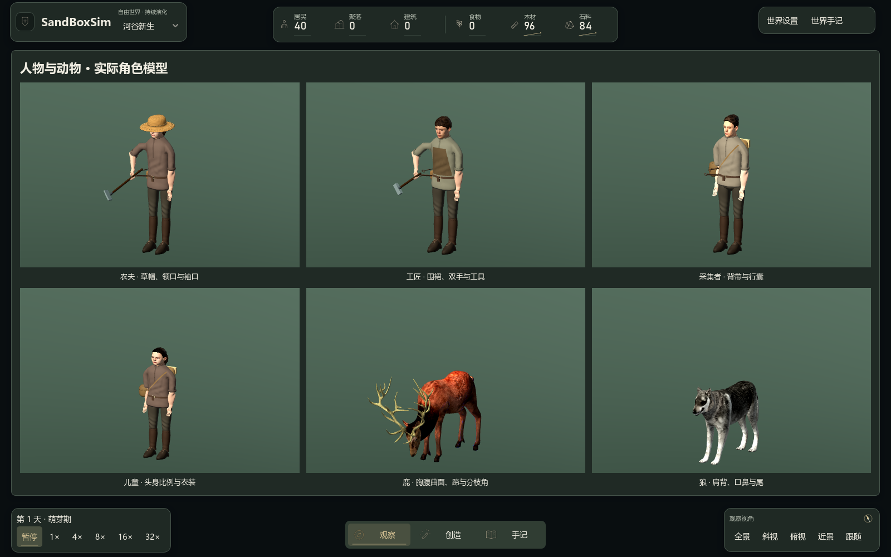

# 3D 模型系统

地图、人物档案和建筑图册使用同一套实际网格。人物头脸使用 MakeHuman CC0 拓扑、原生皮肤／头发图集及运行时变体；植物与普通山石使用 Poly Haven CC0 环境模型与 PBR 贴图；衣身、骨骼关节、房屋及地形由 C# 构造；动物毛皮与人物解剖手部使用离线导出网格，结合材料图集与程序化表面。图册展示共用模型，世界存档保存居民、建筑与资源状态。

## 建筑

住房有原木屋、灰泥屋、石屋、高山墙屋和单坡屋五种轮廓。稳定身份决定宽深、楼高和变体；基础房屋宽 3.65–4.13、深 3.05–3.59 个表现单位，采用等比缩放，保留 0.82×1.75 的入口尺度；住房横向尺度与屋顶跨度扩大，灰泥屋、石屋和高山墙屋采用居中入口及左右窗，高山墙/灰泥立面保留竖向木柱与横向木梁；道路决定地图中的朝向。当前门洞、墙高和图册镜头按人物尺度重新调整，模拟建筑占地与通行规则沿用内核单格数据。房屋外壳、生活摆件和坡地地基共用 `BuildingFootprint` 尺寸；表现层检查周围三格建筑，密集区域等比缩小模型，为屋檐与摆件留出空间，拆除邻居后恢复可用尺度。此机制兼容旧存档，但仍不是多格建筑占地或室内空间模拟。

门由独立木板、门框、过梁、铁带和门闩组成；正面及近景侧面窗洞扩大为 0.48×0.60，窗框、格栅、侧板和窗台同步扩大，窗洞深度保持不变；近景侧板补充四层木条和上下铁带，细件并入建筑网格，远景保留原有外轮廓。瓦片坡屋面近景采用 12 行、18 列铺设，减少单块瓦片的厚重感；远景保留较稀铺设。坡屋面有错缝分层瓦片、檐木和山墙边条；近景每块瓦片采用 5×5 曲面采样，远景仍为简化截面；瓦片使用弧面截面，草束屋面带细小起伏与参差边缘。木作、瓦片和砌石具有浅倒角，门板有斜撑、铰链和铆钉；近景补充门框接缝、石质门槛和下缘钉头，全部并入静态网格，单坡屋有坡顶墙面。石屋与基础使用带细倒角的砌石，侧墙有木架；部分住房有烟囱、檐柱、木料与桶箍。近景新增开口木檐槽、铁支架、烟囱砌筑分层和带铰链的展开窗板；这些结构并入静态缓存，远景省略细件。

仓库保留宽门及门前物料；农田采用植株、叶片与通透围栏；矿场具有暗洞口、支架、轨道与矿车。未完工建筑使用基础、立柱、斜撑和材料堆。

近景住房补充两侧窗框、窗台和檐下木作，绕到侧面也能读到结构。石屋采用隔行错缝与边缘半块石，避免整面墙呈现对齐网格；入口雨檐与斜撑随房型变化，近远模型均保留雨檐外轮廓。新增零件仍合并进建筑缓存，远景省略侧窗和檐下细件。

五种住房现在采用带门窗开口的薄墙体，窗面和暗色窗洞位于立面以内，细窗棂、外框和百叶位于外侧。石块按开口裁切，原木墙在侧窗处分段，避免外墙盖住内凹玻璃；室内有简单地板。自检以实际合并网格的射线确认五种住房正窗能看到内凹窗面。此结构用于外观，不增加可进入室内的玩法。

瓦屋面使用有内外壁与端面的弧形脊瓦，沿屋脊搭接；近景铺瓦有毫米级高度差。檐下有独立椽尾、穿榫木钉，灰泥屋与高山墙屋保留斜撑和空心陶制烟囱帽。墙体底部的雨溅、潮湿与低矮苔色按合并后的米制高度分布。所有细件仍进入建筑共享静态网格，远景保留稀疏脊瓦，省略榫接与烟囱帽。


## 人物与动物

### 头脸与肖像

人物已换用 MakeHuman CC0 的男性、中性与女性三套形体配方，保留原生 UV、独立眼球、上下唇与连续头颈。细分后的头颈分别为 31,742、31,676、31,338 三角面；同源远景头脸最多 2,400 三角面。来源与重建入口见 [人物素材](human-assets.md)。

皮肤使用各自 2K 颜色贴图，替换纯色叠加和旧雕刻法线；眼球保留原始 1K 虹膜、瞳孔和透明角膜图。三种近景发型使用带透明发梢的源发片，共 3,678／3,344／5,352 三角面，束发露出额头和双眼。远景使用简化头皮轮廓。眉毛沿实际脸部采样贴合；不再叠加通用眼皮。

八种稳定身份包含成人与儿童两组比例缓存，儿童面中部缩短、面颊略宽，使用无胡茬皮肤图。源闭眼形变通过第二 UV 驱动原眼睑，网格合并保留并换算位移。每个居民持有独立眨眼和说话材质参数，几何缓存仍可共享；说话固定脸部连接边界和 UV 缝，仅轻微移动唇部内部。眼球始终保持原体积。

头部动作围绕颈部基点补偿位置。人物观察窗使用独立工作室、渐变背景与主补光；面部默认距离 1 米、垂直视场 26°。面部、手部与全身各有独立构图，底部栏不遮住站立时的靴子。鼠标旋转、俯仰、缩放和正面／三刻／背面按钮只改变表现状态。质量元数据使用 `studio=textured-portrait-v5`、`backdrop=radial-unlit-v1`，并记录 `lensFov`。


### 衣装与身体比例

人物骨盆提高、腿部延长，躯干和胸肩截面收束；头脸、手掌与前臂保持各自解剖尺度。衣身、腰带、挂点共用比例映射，法线按映射导数修正；不会通过拉长手臂满足握持位置。三种上衣剪裁由职业外观选择，儿童使用基础短衣，不改变职业规则。

衣身采用 64×40 连续曲面，肩部与衣袖共顶点蒙皮，沿用三骨肩部与原手臂关节。腰下褶皱改为非均匀分布，腰带压褶和袖窿牵引分别控制；三套服装重新烘焙了下摆起伏、腰上斜向牵引折痕与背部浅褶。停步站姿轻屈肘部并自然弯曲手指，工具和搬运动作继续由原有握持解算接管。衣领、袖口、下摆有内折面，门襟、纽扣、腰扣与斜带沿真实衣面采样；皮具翻盖、边缘与内层保留厚度。

连续蒙皮衣装复制材质时保留颜色、法线／粗糙度采样器，并修正双面法线。自检直接检查最终身体网格上的贴图绑定，避免只检验源材质而漏掉运行时纹理丢失。

亚麻衣料使用 Poly Haven `rough_linen` 的颜色、法线和粗糙度图，以约 0.27 米的三向投影贴到身体、袖口和衣领。色泽由居民衣色控制，织纹随 mipmap 缩小；原图为 1024×1026，清单记录真实尺寸，不强制拉成正方形。配色保持灰绿、亚麻灰、灰棕与蓝灰。


### 手臂、工具与动作

前臂、手掌和手指使用授权解剖网格，经共顶点腕部过渡环连成蒙皮。每手 16 骨，左右镜像同时处理顶点、法线、绕序和拇指方向。指甲保留独立材质并共享皮肤权重。远景使用同源 1,400 三角面的手部模型及静态前臂，按左右缓存张手与握柄姿态。

居民闲置、漫游和完成作业后手持职业工具；行走采用单手携带，进入作业时平滑过渡到工作姿态和辅助握持。搬运、交谈、进食和睡眠先让出双手，工具经过伸手、合拢、接管、回位和松开的完整状态转换。收纳处有包围柄轴的双皮环和连接腰带的扁皮带；木柄带渐细端部、细木纹、金属套箍及铆钉。双手目标由两节 IK 求解，支撑手跟随实际握柄，近远景都保留闭合握拳。工具类型由真实动作和职业外观决定，不新增工具库存或任务流程。

握持自检覆盖闲置、行走、作业完成、暂停、货物优先、取回工具及远景闭手；工作测试继续检查手掌位置、指节与柄轴间隙、辅助握持和取放连续性。这些是表现层接触约束，当前没有工具刚体碰撞、可拾取的独立工具物品或工具刃口与每个资源网格的碰撞解算。

交谈、分享、进食和搬运动作读取实际行动状态；短动作可有界补播，新的行进、失败或紧急状态取消补播。观察、肖像、呼吸、注视及姿态不消费模拟随机流、不修改存档。暂停冻结位置与姿态。近景坡面最多补偿 7 厘米，不拉长肢体跨越大台阶。

鞋面、平底鞋底及四组交叉鞋带来自同一鞋楦，保证接触与落地。外观仍由现有步态驱动，不模拟完整肌肉、软组织或足部 IK。

### 动物

鹿和狼的眼部挂点通过实际头骨三角形射线求得，眼睑沿眼眶逐点贴合，避免固定头宽导致远侧眼球悬空。狼耳调整为宽根、渐尖的轮廓；毛皮微法线降低高度，减少大片皱纹状明暗。动物主体以 6 毫米体素重建、八轮平滑，塑形后再次融合并平滑再减面，修正胸腹到骨盆之间过深的背线凹陷；毛束根部保留微小外移，减少与皮肤共面闪烁。

鹿和狼使用离线焊接、平滑和减面的连续毛皮，每种 9,002 顶点、18,000 三角面，绑定共享 12 骨架；颈部、四肢和尾部连接，眼、内耳、鼻、角和分瓣蹄保留各自材质与挂点。真实进食状态驱动鹿低头，暂停冻结动作。四足接触使用双节关节求解，蹄爪和连续毛皮共享同一套关节旋转；24 米内采样实际坡面，平地也有落脚与抬脚周期。身体高度向较低落点作有限补偿，坡面调整限于 10 厘米，不跨越悬崖或拉长肢体。

胸廓、腹部收束、肩胛和后臀轮廓在源截面和 Blender 连续表面中塑形，保持原有三角面预算。鼻梁更窄，眼部改为内凹眼球、连续杏仁状眼睑与泪腺；狼增加贴近口鼻的细触须。底毛减少宽条纹与大斑块，四肢使用更短、更暗的毛色过渡。这些仍是项目生成动物，不是动物扫描或完整肌肉模拟。

近景毛束沿实际皮肤采样并共享骨骼权重，狼 2,200 组、鹿 1,200 组，数量预算保持固定。每组宽度缩小并加入独立色调，底毛也具有更细的方向性起伏和粗糙度变化；18 米外隐藏毛束，余量 3 米。动物仍是项目生成的风格化模型，并非新引入的动物扫描资产。



## 植被与地貌

叶片材质使用少量背光透射，木质面仍保持不透光；降低叶片法线强度与岩石高光，避免细碎亮点。草甸配色减少黄白，山坡保留岩层颜色并收束微法线。此轮修改的是现有扫描网格的材质表现，未替换树木或岩石几何。

阔叶树和针叶树使用授权衍生模型，保留自然枝条与树皮、叶片材质。地图中的树干、枝条、冠层和岩石按 24 米网格分区批量绘制；每批保留自己的包围盒，镜头只绘制可见区域，保持原有植被几何和位置。古树林、野果地和遗迹复用同类叶片、石材与木材；岩石采用低频断面轮廓和倾斜层次，从变形后的三角面累积法线并合并环绕接缝，避免仍按球面着色的软团感。表面保留低对比纹理、粗糙度与材质差异。


早期地表模型专题见 [历史自然图册](../images/nature-detail.png)。

### 场景接地与采样边界

灌木、蕨类、草丛和芦苇从根部落到地表，按周围高度适度倾斜，根部埋入约 1.2 厘米；树干保持竖直并稍埋根部。扫描灌木不再沿用旧球形灌木的 28 厘米抬升。浆果地使用独立的连枝灌丛，叶柄和浆果梗连接到枝条，不再将果球悬挂在酢浆草上方；遗迹蕨类与倒木草本落在根部，泉水与湿地使用有叶片、种穗的芦苇。普通山石和矿石共用扫描岩石几何，矿石保留独立矿物材质。地表边界显式限制插值格索引，支持边缘以外的坡度探针，避免大地图浮点舍入造成越界。植物和岩石仍使用已有授权扫描资产，本轮没有宣称重新制作全部扫描网格。

## 自然造型与材质层次

当前表现更新覆盖人物、鹿狼、阔叶树和针叶树、灌木、蕨类、草叶、岩石、地表、水面及建筑材料。人物使用授权基础头脸，植物采用专业环境素材，动物、服装、建筑与地形仍包含项目程序网格；本次没有加入完整写实角色动画库。

人物降低肩部鼓起，袖身与前臂改用更收束的轮廓；皮肤、眼球和发丝校准粗糙度及反光，眼白保留暖灰层次。动作与工具仍使用原有骨骼和取用状态，自检检查暂停、握持、腕部与肩部连续性。当前头脸使用上文的三套 MakeHuman 形体，儿童为同源比例变化，不等同于独立儿童雕刻。

鹿与狼的头部增加额部到鼻梁的截面，鼻部由连续截面替代椭球，虹膜、瞳孔和微小高光分别构造。耳朵比例缩小并成为独立关节，闲置时小幅转向，暂停后停止；世界中的动物从稳定身份取得不同表现相位。毛皮通过低频色层和屏幕衰减细纹表现，没有加载逐帧毛束或更改动物行为。

阔叶树、针叶树、蕨类、草丛和灌木使用 Poly Haven CC0 素材的衍生网格，保留 1K 的颜色、法线、粗糙度与透明遮罩。树木按完整叶片单元抽样，木质部分独立简化；蕨类、草叶和灌木保留源素材的轮廓。网格和多材质由世界与图册共用，树木保留导出叶片索引以维护轮廓，其他低矮植物继续使用屏幕 LOD；来源、转换和尺寸见 [环境素材](environment-assets.md)。林下蕨类由真实植被、湿度与火灾状态筛选，稳定位置序列不消耗模拟随机流。

河岸芦苇由七根分节茎、弯曲叶片和立体种穗组成。它只出现在湿度超过 30%、邻接实际水域且未被建筑或烧毁状态占用的适宜土地上；湿度阈值、火灾与占地变化会刷新植被。林下蕨类成簇散布，草叶高度叠加稳定斑块差异。芦苇在 42 米、蕨类在 38 米裁剪，继续按 24 米区域批量绘制；扫描植物使用低频阵风和较轻叶梢摆动。

岩石采用不规则断裂平面的径向交点构造轮廓，法线由实际网格累积。地形保持既有连续地面采样，将规则正弦波纹换成两尺度稳定噪声起伏；水面、道路与压实处减弱起伏，居民和建筑仍从实际地面取高度。地表细砂与木石表面的微法线随屏幕覆盖减弱，避免用大量新增几何表达微小材质变化。水面校准浅岸色、波纹反射与粗糙度。

石砌住房和基础的近景砌块采用浅倒角，远景保留原轮廓；木材、石材、灰泥、瓦片与草束使用统一的低饱和自然色系。世界天气光照、图册中性补光分别维护，图册不使用专用替身模型。

`--panel=ecology-details` 和 [visual-ecology-details.json](../../benchmarks/scenarios/visual-ecology-details.json) 提供树、蕨类、草叶、岩石与灌木的世界共享几何近景。语义裁切标签包含 `tree`、`fern`、`grass`、`rock`、`shrub`；这是对象识别输入，不是游戏任务。植物自检覆盖有限顶点、单位法线、三角面朝向、属性长度、根部范围与缓存预算；完整场景另外核对实际画面和性能。


## 源码入口

| 文件 | 作用 |
|---|---|
| `NatureModels.Buildings.cs` | 建筑轮廓、屋顶与窗结构 |
| `NatureModels.ArchitectureDetail.cs` | 门、屋面搭接、砌石、支架与道具 |
| `NatureModels.Joinery.cs` | 空心弧形脊瓦、檐下榫接、陶制烟囱帽 |
| `NatureModels.Residents.cs`、`NatureModels.Tailoring.cs` | 人物衣装、四肢、手部与配件 |
| `NatureModels.Equipment.cs` | 帽壳、贴合衣装与背包挂点 |
| `NatureModels.HandTools.cs` | 工具模型、腰侧与手掌挂点、库存携带外观 |
| `NatureModels.Forearm.cs` | 同源前臂网格加载、左右镜像、腕口对齐及维护预览 |
| `NatureModels.HandSkin.cs` | 连续掌形、手指与腕部过渡的蒙皮网格和绑定 |
| `ResidentRig.cs`、`ResidentRig.HandPose.cs` | 真实行为呈现、收纳切换、肘腕求解、指节姿态与手部骨骼 |
| `NatureModels.Articulation.cs` | 连续蒙皮衣袖与肩部结构 |
| `NatureModels.GarmentSkin.cs` | 上衣规则采样导出、缝片网格加载、权重与连通性检查、近远景袖子替换 |
| `NatureModels.Thatch.cs` | 连续草束屋面、厚度、不规则檐口与纤维表面 |
| `NatureModels.HumanAsset.cs` | 授权头脸数据读取、哈希、结构变体与头发表面查找 |
| `NatureModels.Face.cs` | 实际眼球、唇部、眼睑、眉毛与虹膜表现 |
| `NatureModels.ResidentLod.cs` | 保留轮廓与肤发色的远景头部网格 |
| `NatureModels.HandlingValidation.cs` | 工具转移连续性、握持、作业、切换、携带与暂停检查 |
| `NatureModels.ClothSurface.cs` | 扫描亚麻织纹、染色与粗糙度 |
| `NatureModels.Coat.cs` | 皮肤表面采样、贴伏毛束、权重插值和几何缓存 |
| `NatureModels.Animals.cs`、`AnimalRig.cs` | 动物解剖轮廓、材质与四足步态 |
| `NatureModels.Meadow.cs` | 保留的程序草叶构造器；当前世界使用授权草丛数据 |
| `NatureModels.Botanical.cs` | 程序植物辅助结构、材料与植物几何检查 |
| `NatureModels.ScannedEnvironment.cs` | 专业环境素材读取、哈希、多材质与地面绑定 |
| `WorldView3D.Relief.cs` | 地形的稳定噪声起伏 |
| `WorldView3D.Surface.cs` | 扫描地表混合、坡面投影与读取河床深度的水面 |
| `WorldView3D.Buildings.cs` | 地图建筑增量同步、路向、近远景切换与贴地石基 |
| `ScannedSurfaces.cs` | 扫描纹理共享加载与法线/粗糙度打包缓存 |
| `NatureModels.ScannedCraft.cs` | 建筑木材、灰泥和石作扫描表面 |
| `NatureModels.Vegetation.cs` | 树冠、针叶枝层与树干 |
| `NatureModels.Craft.cs` | 平滑截面、倒角石块与连接构件 |
| `NatureModels.Surface.cs` | 木纹、灰泥、石材、屋面和植被的表面处理 |
| `NatureModels.RoofSurface.cs` | 弧面瓦片、草束起伏、边缘与封闭截面 |
| `NatureModels.CharacterSurface.cs` | 耳廓曲面、肤色表面和发丝着色 |
| `NatureModels.Validation.cs` | 曲面朝向、网格完整性、静态合并与关节检查 |

地图中的建筑同时缓存近景与远景网格；远景减少曲面细分和小构件倒角，保留同一屋面排布、轮廓与材质。进入 24 米以内切回近景，离开 32 米以外切回远景，避免在边界反复切换。模型图册始终使用近景几何。

新网格需要采用 Godot 的顺时针正面约定，并保持朝外法线。截面插值保留轮廓；不要仅提高球体细分来替代身体结构。静态部件按材质合并，动物和居民保留活动关节。建筑变体键限制到 140 个稳定组合，图册和地图共用缓存规则。

## 人物前臂与鞋楦

人物肘部和前臂使用同一授权人体导出的连续解剖表面，替换球体肘部加截面管的组合；左右分别镜像；近景与手部共用过渡环，构成单张连通蒙皮，避免两张开放表面在腕口相接。源文件、许可、转换方式和维护预览见 [人物解剖素材](human-assets.md)。前臂顶点通过腕部补偿骨保持在肘坐标系内，手掌与手指保留转动；当前仍以现有肘关节驱动整段前臂，不模拟桡尺骨交叉或皮肤滑动。


鞋楦长度为局部 0.26 米，前掌和鞋腰收窄，鞋面与鞋底仍共用截面。鞋底降低约 19 毫米，使默认直立姿态落在地面；足弓保留抬起。四组交叉鞋带由同一鞋楦函数采样高度并分段弯曲，替换任意高度的直线，避免穿入鞋面或悬浮。自检按实际鞋面三角形核对鞋带间距、鞋面/鞋底贴合和静止落地。行走仍沿用原有关节动作，没有地面足部 IK。

## 动物毛束与面部细节

狼和鹿在连续皮肤外增加近景短毛束，根部按实际皮肤三角面面积分布，并插值该处法线和骨骼权重。狼有 2,200 组、鹿有 1,200 组，每组两个相交的渐细弧面；近景分别增加 13,200、7,200 三角面与一个绘制表面。毛束朝后、朝下贴伏，狼肩颈较长，鹿保持短被毛；口鼻和蹄足排除在生成区域之外。毛束并非毛发物理或扫描动物资产。

两种毛束网格分别缓存，与皮肤共用现有 12 骨架和姿态更新。距离 18 米隐藏细节层、范围余量 3 米，远景保留原皮肤；这是增加近景质量的开销，不代表帧率改善。自检核对权重、骨骼范围、缓存、固定几何预算、共用骨架和距离条件。

鹿角的三个侧枝从弯曲主枝控制点生长，替换平行且根部不贴合的枝条；两侧保持镜像主结构。鹿瞳孔改为横向，瞳孔表面采用较低粗糙度，鹿和狼鼻头按种类收窄，鼻孔随之移动。它们仍沿用现有动物躯干基础网格与动作。

图册为每张卡片配置与对象尺度匹配的正交阴影，平面地台只接收模型阴影，避免默认大范围阴影在手腕、脸部和地台产生粗糙条带。模型仍正常投射与接收阴影，灯光参数进入评测质量元数据；地图近景也降低阴影范围及法线偏移。当前头脸已替换为 MakeHuman 拓扑与原生图集，见上文。

## 独立预览

当前住房门高为模型局部 1.75 米、门宽 0.82 米，仓库为 1.85/0.95 米；原木屋墙高提高到 2.05 米、仓库到 2.2 米，门框、门板、雨檐与廊柱同步。尺寸还会受建筑根节点缩放影响，模拟占地没有扩大，仍不提供可进入的室内。茅草坡屋面改为连续厚壳与参差檐口，替换瓦片式矩形草束排布；石墙保留扫描细节并降低矿物金色饱和度。

鹿与狼调整了胸腔、腰腹、髋部和上腿体积，腿根向躯干内收并重新焊接烘焙；每种仍为 18,000 三角面。狼的眼部挂点同步贴近收窄的头部，耳廓采用较短的弧形轮廓；毛皮颜色区分背线与腹侧。近景额外使用共用骨架的短毛束，见下文；目前没有完整毛发物理或换毛系统。人物近景使用拟合头部的源发片和皮肤图集，具体转换见上文。

先运行 `./tools/godot.ps1 -Mode build -Configuration Debug`，再通过 Godot .NET 可执行文件打开项目：

```powershell
& $env:GODOT_EXE --path src/SandBoxSim.Godot -- --panel=architecture
& $env:GODOT_EXE --path src/SandBoxSim.Godot -- --panel=characters
& $env:GODOT_EXE --path src/SandBoxSim.Godot -- --panel=ecology-details
& $env:GODOT_EXE --path src/SandBoxSim.Godot -- --panel=model-details
& $env:GODOT_EXE --path src/SandBoxSim.Godot -- --panel=wardrobe
& $env:GODOT_EXE --path src/SandBoxSim.Godot -- --panel=equipment
& $env:GODOT_EXE --path src/SandBoxSim.Godot -- --panel=actions
& $env:GODOT_EXE --path src/SandBoxSim.Godot -- --panel=motion
& $env:GODOT_EXE --path src/SandBoxSim.Godot -- --panel=grip
& $env:GODOT_EXE --path src/SandBoxSim.Godot -- --panel=hands
& $env:GODOT_EXE --path src/SandBoxSim.Godot -- --panel=forearms
& $env:GODOT_EXE --path src/SandBoxSim.Godot -- --panel=faces
& $env:GODOT_EXE --path src/SandBoxSim.Godot -- --panel=naturemodels
```

`--panel=person-hands` 打开真实人物档案的手部构图。`hands` 提供锤、斧、锄的握持近景；`faces` 同时展示正面与侧转面部。连续预览可使用 `--capture-frames=<绝对目录>`，输出 56 张 PNG，按 8 FPS 采样。录制时给引擎传入 `--max-fps 60 --quit-after 650`，留出启动和七秒录制时间；临时帧放在 `runs/screenshots/`，选定的正式配图放在 `docs/images/`。

这些参数仅打开开发用模型预览，使用固定灯光与同一套实际网格；普通游戏不会显示预览面板。原始素材来源见 [美术资源](assets.md)，界面操作见 [观察与界面](../guides/gameplay-observation.md)。

模型图册也提供无标题的评测裁切图及对象类别标签，入口与使用边界见 [评测接口与实验运行](benchmark.md)。

建筑表现按实体增量同步，共享合并网格并保留各自的位置与朝向；网格构造与缓存维护见 [性能采样与渲染维护](performance.md)。

### 树冠轮廓

树冠使用环境素材的自然枝叶，按完整叶片单元进行稳定抽样，保留叶形和 UV。世界树木按原有稳定序列放置，通过共享多材质网格和空间分块绘制；树木保留叶片索引，草丛等较低植物使用屏幕 LOD；变化属于表现层，不影响树木资源或生态状态。

### 材质与环境光

木材包含沿板材方向的细纹、条纹和低频色差；石材与屋面增加倾斜层纹、微小孔隙和局部风化。高频纹理按屏幕导数衰减，减少远景闪烁。木石与屋面继续使用现有图集及程序着色；植物与地面材质混合授权 PBR 贴图，几何来源见 [环境素材](environment-assets.md)。

世界光照在初始化和天气更新中使用一致的中性暖色方向，避免天气刷新重新引入过黄的晴天光。岩石修改只构建一次共享网格，新增草丛复用空间批次；草丛的动态变形和远景范围见 [地形与活动痕迹](../guides/terrain-and-traces.md)。

树木在格内稳定偏移并改变尺度，偏移后重新采样根部地面；符合筛选条件的近景草地每格放置三个错位草丛，建筑占用会刷新植物显示。建筑木墙、灰泥与石作改用扫描表面，建筑屋面和几何由各自模型入口维护。住房、仓库的石基裙边按旋转后的四角贴地，只用于遮住坡地下方空隙；当前房屋仍是小型抽象占地，没有完整室内或真实施工结构。植被分布和坡地基座属于表现层，不改变模拟状态。

## 屏幕尺寸与距离细节

人物和动物的共享合并网格保留完整基础表面，由 Godot 屏幕尺寸 LOD 使用较少的索引绘制远处几何。人物在 18 米外额外使用按顶点保留配色的单材质关节和衣身，进入近景恢复原始表面、肩部蒙皮与手指骨骼。近远切换自检核对单表面合并与原始网格恢复，工具动作的关节层级不变。

世界建筑先使用既有远景模型；进入 24 米范围时，每个表现帧最多生成一个需要的精细网格，离开 32 米后使用远景网格。已生成的精细网格缓存复用，状态和槽位身份变化继续独立检查。该调度减少同时建造的停顿，近景细节可能在随后几个帧补齐。

屏幕 LOD 与缓存用于控制近景素材和程序网格的绘制成本。人物头脸采用授权衍生素材，动物和建筑仍为程序化模型，未增加新的家庭扩建模拟。

## 住房生活与地面物资

`NatureModels.Crops.cs` 使用内核的稳定作物类型和生长阶段显示三类农作物的十二种形态：谷穗、根茎叶丛和豆荚随周期变化。建筑本体保留田埂与围栏，作物独立共享网格并按距离同步；每帧与住房共用一个附件补建额度。远景减少叶片与截面细分、省略麦芒，保留作物种类与阶段；超过 55 米隐藏。图形自检遍历二十四种近远景组合，检查有限顶点、法线及缓存复用。作物外观不推进农业，实际产量与土壤规则见 [农业与食物流动](../guides/living-economy.md)。

陶器使用闭合径向截面生成外壁、卷边与内壁，口部保持开口；共享 32 边截面网格，检查内外法线和缓存复用。近景木桶使用 40 边鼓腹曲面、十四条木板接缝、环形箍带与盖板；远景使用同位置的简化桶体，保留建筑轮廓。部分灰泥、石砌与高山墙住房增加窗台花箱、托架与小叶簇，细件进入既有静态合并。它们属于程序模型细节，不参与粮食生产或新增容量。

`NatureModels.Living.cs` 生成住房附件与四类物资堆，`WorldView3D.Living.cs` 读取完工状态、住户人数、完整度、天气和实际地面库存。附件继承建筑根节点的缩放、旋转与地形位置；静态生活物件按身份、人数和风化档复用合并网格。晾晒布料使用 8×8 曲面与双面粗糙材质，风摆幅度随 UV 高度增长，上缘保持固定。

完整度大于 75%、大于 35% 和其余范围对应三个表现档。生活附件遵循建筑近远景切换，每帧最多补建一个改变状态的住房附件。物资量小于 8、小于 40 和其余范围对应三个规模档；55 米内显示，每次约 0.3 秒的同步按相机距离排序，最多新建或更换四个物资模型，创建耗时达到 2 ms 后不再开始下一个。单个创建不能被中断，因此这不是严格的 2 ms 上限。网格缓存命中时直接实例化，不重新搭建临时零件；同步列表和存活集合复用。取空与槽位复用独立检查，库存量不因观看而改变。

晾晒架与衣物分别控制可见性，雨雪只收起衣物和夹子，保留架子。无住户且没有风化痕迹的空附件隐藏。自检保存并恢复整个模拟，验证正常住房选择、住户档案链接、天气衣物切换、住房缓存与风化切换、远景隐藏、物资数量档、取空清理、复用位置和观察纯度。实机样例见 [聚落生活](../guides/settlements.md) 和 [正式图片索引](../images/README.md)。

## 展示图与几何契约

[正式图片索引](../images/README.md) 区分当前 UI/地表图与人物动作专题记录。模型图册和肖像读取实际共享网格，专题截图中的旧菜单颜色不作为现行 UI 说明。几何自检验证顶点、法线、UV、关节和预算；美感、人体比例与自然感仍需在真实近景和运动中判断。

---

[文档导航](../README.md) · [项目首页](../../README.md)
