# 3D 模型系统

地图、人物档案和建筑图册使用同一套实际网格。人物头脸使用 MakeHuman CC0 拓扑、原生皮肤／头发图集及运行时变体；植物与普通山石使用 Poly Haven CC0 环境模型与 PBR 贴图；衣身、骨骼关节、房屋及地形由 C# 构造；动物改用 CDmir / TinyWorlds 的 CC0 鹿与 0 A.D. 的 CC BY-SA 3.0 狼，保留来源 UV 与皮毛图；人物解剖手部使用授权离线导出网格。图册展示共用模型，世界存档保存居民、建筑与资源状态。

| 查看内容 | 当前实现与入口 |
|---|---|
| 成人体型与成衣 | 来源体型支撑颈肩、胸腰、骨盆和腿部。三种成衣随骨架连续变形。见 [成人体型与男女外观](#成人体型与男女外观) |
| 行走、工具与交谈 | 落脚读取实际位移，成人外观的摆臂、挥击回收和手势各有连续轨迹。图册可对照同速度或同工具。见 [成人动作风格](#成人动作风格) 与 [独立预览](#独立预览) |
| 自然物与动物 | 树石按实测范围布置，显示位置使用地形支撑和局部绕行。动物岸边站位读取自身足部跨度，草叶和水面提供活动反馈。见 [地形与场景接触](../guides/terrain-and-traces.md) |

女性身体按自然匀称、柔和曲线组织肩颈、胸廓和腰腹。颈肩修形覆盖前后肩面的过渡，胸部内收、前向体积与腰腹调整采用五次接续，使区域边界的一阶、二阶导数归零；区域位移上限、胸骨与骨盆固定区、近远景共用表面规则继续生效。它们是角色美术选择，不定义通用的吸引力或性别标准。参考 [Proko 的颈部整体形体](https://www.proko.com/course-lesson/how-to-draw-neck-muscles-form/)、[胸部与胸肌的连接](https://www.proko.com/course-lesson/how-to-draw-breasts-form-and-motion/)和[骨性标志](https://www.proko.com/course-lesson/landmarks-of-the-human-body/)，先处理整体轮廓及连接，再处理局部表面。

颈部姿态检查复用运行时颈根轴心及补偿平移，测试三种俯仰与三种转头组合，结束后完整恢复头部变换。检查覆盖真实头部网格、下颌到前领口的垂直距离，以及颈根皮肤在领口之下的覆盖；它不是全身服装碰撞求解。游戏中的眼口、发型、表情与头部仍使用共同节点和映射。

女性成衣在胸廓、腰腹和臀侧采用周期三次 B 样条取样，替代逐环双线性取样。纵向按 5 毫米支撑行取相邻四行，周向取相邻四列，使用非负权重保持在参与支撑的半径范围内；周向首尾连接，纵向端部夹取。身体接触修正、实际成品近远景一致性、三角形方向及胸腰轮廓约束继续生效。该步骤仅用于成衣构建缓存，动作帧继续复用现有蒙皮和姿态形态。男性与儿童的取样保持原定义。`CLOTH_SAMPLING_PASS` 检查线性纵线保持、曲面范围、周向接缝及逐环切线连续性。

颈部设计检查同时限制头肩间距为 200–215 毫米、下颌到前领口的静止间距为 30–55 毫米，防止颈部再次过度缩短或延长。范围针对当前成年角色的美术设计，不是通用人体比例标准；动态检查继续使用游戏实际颈根旋转轴心。

女性上胸的衣身半径先读取实际胸廓支撑，再通过一次肩颈混合接回衣领和肩袖。前上方的支撑沿胸廓展开，外下侧在接近肋缘时逐渐内收，侧腰保留约 3.5 毫米的连续修正。胸部体积场的局部径向位移上限为 5.5 毫米，并检查左右对称、胸骨固定和局部可逆性。三种剪裁的衣身、门襟、扣子、腰带和挂点共用拟合映射。[人体结构与体块连接](https://www.proko.com/course-lesson/mannequinization-structure-of-the-human-body) · [骨盆表面标志](https://www.proko.com/course-lesson/anatomy-of-the-pelvis)

女性三款上衣的前片由胸廓和各自的腰带位置支撑。纵向布纹沿二次曲线跨过胸廓下缘，接触权重在上下支点渐隐。侧肋最多保留 4.5 毫米的额外衣量，向腰带方向缓慢收回。前片采用较缓的垂线，腰带上方与侧缝的转折随拟合曲面衔接。腰带末端沿成品腰部曲线形成带厚度的皮革叠片，穿回扣旁的小皮环。衣身曲面在缓存构建时生成，参与肩袖蒙皮。[服装松量的三维动作捕捉研究](https://journals.sagepub.com/doi/10.1177/0040517519832842)

三款女性上衣用各自的腰带和局部下摆作为衣片的上下支点，独立分配侧缝、前侧和后侧的布量。短上衣保留较浅的上髋弧线，工作长衫向两侧渐开，旅行外衣在后侧多留一段衣量并保留较长的后摆。下摆用外缘与两道内翻环形成圆顺边缘。缝线读取随网格保存的静止距离，近远景使用同一条缝线；距离拉远时逐渐过滤针脚。`FEMALE_HEM_FINISH_PASS` 检查三款成衣的近远景坐标，腰带和裤装遮盖由原有姿态测试检查。[服装合体的三维体表标记研究](https://proc.3dbody.tech/papers/2018/18222scott.pdf) · [衣料余量分布的截面研究](https://global-sci.com/index.php/JFBI/article/download/12712/25339/26569)

`CHEST_CURVE_PASS` 检查成品网格四条前侧纵线，每隔 5 毫米取样，连续两个深度步长的差值上限为 2 毫米。`FRONT_PANEL_RETURN_PASS` 另测腰带上方五条纵线，限制连续深度变化并检测反向鼓起。抬臂时衣料余量与袖窿、侧缝长度相关，因此同时保留肩袖姿态检查。三视图和抬手预览见[实机图册](../images/README.md)。[抬臂衣量与袖窿研究](https://www.jstage.jst.go.jp/article/fiber/64/9/64_9_236/_article/-char/en)

三款女性上衣的成品前片在 5 毫米的横纵网格上重新取样。拟合同时减小两个方向的深度二阶差，位移受皮肤包络、领缘、袖窿和腰带限制。深度写回网格前检查三角面方向，整理后的前片与各款成衣一起缓存，并作为肩袖姿态修形的输入。腰带上方的窄褶逐渐过渡成较宽的垂坠。`FEMALE_CROSS_DRAPE_PASS` 检查成品前衣片的 891 处横向截线采样。[女性躯干三维形态研究](https://www.sciencedirect.com/science/article/pii/S0003687022002277) · [TailorNet 服装形变研究](https://openaccess.thecvf.com/content_CVPR_2020/html/Patel_TailorNet_Predicting_Clothing_in_3D_as_a_Function_of_Human_CVPR_2020_paper.html)

女性三款上衣从实际缝合的领口沿衣面计算距离。肩带牵引在离缝线 10 至 72 毫米的范围内逐渐接入，过渡跨过肩袖接缝。领口折边、衣身与袖根的姿态修正直接读取成衣的蒙皮权重。`FEMALE_COLLAR_MOTION_PASS` 检查左右臂在三个方向抬起和放下时的成品网格，领口外圈的边长变化受约束。[肩带三维运动研究](https://pmc.ncbi.nlm.nih.gov/articles/PMC2657311/)

女性三款上衣沿实际缝合开口按固定角距取样，圆顺前领斜侧的半径突变。后领沿弧线降低，侧领到肩部的布面沿较宽的范围逐渐落下。前领定型后，再用面积加权的局部二次曲面收顺锁骨下方的窄折，固定领缘和袖口。最终网格用于生成肩袖姿态修形与远景衣面。颈根皮肤增加少量侧面体积和斜向起伏，并沿用来源颈根的衣内覆盖。`COLLAR_CLEARANCE_PASS` 将成品内缘逐点与九种转头及俯仰姿态下的颈部截面比较。后领测量从实际领缘向下取样。[锁骨肌肉附着的三维研究](https://pubmed.ncbi.nlm.nih.gov/36864447/) · [Blender Studio 衣装形体](https://studio.blender.org/training/realistic-human-research/clothing-shapes/)

女性上衣在高举姿态下沿相连的布面邻域收顺袖内侧压褶，并限制肋侧衣片被带向外侧的余量。袖内侧修形以已拟合的上臂为基准，保留袖口，向臂轴方向的附加收缩上限为 2 毫米。修正烘入现有肩袖姿态，正常游玩继续混合这些姿态。抬臂图册直接指定肩肘角度，便于独立观察衣面变形。游戏里则从原始手腕目标随当前肩位重新求解，保持骨段长度和握持目标。`ARM_STUDY_ALIGNMENT_PASS` 检查定姿角度及高举时袖内侧的长翻折边，作业与抓握另外使用实际动作测试。

## 徒手动作与工具

社交手势按错开的节奏抬手、停留和放回，避免双手持续端在胸前。动作过渡先插值手掌位置和朝向，再统一求解肩、肘、腕；进入姿态时从当前肘部平面逐步接入目标肘向。注意方向与世界中的实际目标关联。执行状态但没有有效目标时，不使用缺省坐标驱动身体转向。工具收纳挂点沿当前衣身表面采样，轴心距衣面约 22 毫米，再由闭合皮环和短连接带承托；三种衣装共用同一采样规则。

搬运时，木捆、食物袋、石料袋和铁料袋各使用从成品网格底部取出的两个支撑点。双手就位后才显示物资，其位置和朝向由两只手的实际掌面确定。进食和饮水优先使用空手姿态。木捆的木料、闭合绑绳、端面与年轮合并为共享网格。

居民将双掌托稳的物资送到地面堆或仓库门外的木箱。控制器以物件底部和双掌支撑修正下降；地面堆还会取样当地高程。松手后物件在原地短暂停留，库存由模拟结算。[交互衔接场景](../../benchmarks/scenarios/visual-handling-transitions.json) · [俯身与屈膝取物研究](https://pubmed.ncbi.nlm.nih.gov/21338520/)

徒手拿取、递交、进食和饮水采用约 0.7 秒的目标姿态进入与退出。目标进度使用五次曲线，在目标曲线端点减速；实际手掌和肘部以上一帧已显示的姿态作参考，不从每帧重建的垂臂姿势重新选择肘向。手掌目标移动速度限制为 1 米/秒，朝向变化限制为 6 弧度/秒，肘部绕肩腕连线的转动限制为 3 弧度/秒。这些是游戏表现参数，不是人体医学标准。

空手到达目标只解算一次肩肘位置，再限制剩余腕部旋转，避免腕部限角反复改变手腕目标、带动肘部重选。淡出结束后仍保留短暂的关节返回过程，直到与普通垂臂姿势衔接；进入下一段工具拿取时记录实际手部起点。工具伸手与取出／放回分别采用约 0.48 秒的目标过渡，触及工具之前连续调整手腕方向。下蹲以 0.24 秒过渡身体高度与膝部，暂停保留当前位置。

进食和饮水按伸手、握住、抬起、嘴边停留及放低收手推进。右手上的食物和杯子使用独立的网格，杯口有内壁和杯沿。求解器追踪食物或杯沿到当前嘴部的距离，饮水随举杯逐步抬头和倾杯，进食在接触后收起食物并开始咀嚼。自检检查实际道具的接近、放低和手腕、肘部位移，以及 60/120 Hz 的姿态一致性。采集、递交与交谈各自保留原有动作节奏。[三维饮水动作研究](https://pmc.ncbi.nlm.nih.gov/articles/PMC5933268/) · [抓握开度与运手轨迹实验](https://pubmed.ncbi.nlm.nih.gov/16217646/)

轨迹设计参考 [Flash 与 Hogan 的多关节伸手实验](https://pubmed.ncbi.nlm.nih.gov/4020415/)；肩部协调参考[无约束抬臂实测](https://pmc.ncbi.nlm.nih.gov/articles/PMC2841046/)。五次曲线及本项目的时长用于程序表现，不代表完整人体动力学；肩部使用独立肩带平台和接触约束；空闲伸展另使用下述 CMU 捕捉记录，当前没有肌肉驱动。

[日常上肢动作实测](https://pmc.ncbi.nlm.nih.gov/articles/PMC4690598/)与[伸手及手口动作测量](https://pubmed.ncbi.nlm.nih.gov/26539500/)分别记录上臂、肘部、前臂和手腕的运动；本项目据此区分到达目标、肘部连续性和腕部余量约束，没有把实验中的某个峰值当作所有居民的固定姿势。自检在 60 Hz 下将连续抬手的手腕、肘部单帧位移上限分别设为 25、30 毫米，并保留 60/120 Hz 对照、嘴部接近与返回检查。侧面演示用于观察前后深度和肘部弯曲；这些检查不构成人体动作捕捉精度验证。

[原生作业动作](../images/resident-style-work.webp) · [交谈、递交与进食](../images/resident-style-social.webp) · [生活动作侧面复现](../../benchmarks/scenarios/visual-social-side.json)

手锤具有中央安装体与两端敲击面，边缘倒角按米制尺寸生成；锄刃有封闭侧壁、弧面及由厚到薄的刃缘，复用工具缓存和原握柄位置。木柄与金属头的材料组织参考 [Royal Museums Greenwich 工具藏品](https://www.rmg.co.uk/collections/objects/rmgc-object-69633)，属于游戏形态设计，没有复制藏品图片或声称复刻该器物。

## 建筑

住房有原木屋、灰泥屋、石屋、高山墙屋和单坡屋五种轮廓。稳定身份决定宽深、楼高和变体；基础房屋宽 3.65–4.13、深 3.05–3.59 个表现单位，采用等比缩放，保留 0.82×1.75 的入口尺度；住房横向尺度与屋顶跨度扩大，灰泥屋、石屋和高山墙屋采用居中入口及左右窗，高山墙/灰泥立面保留竖向木柱与横向木梁；道路决定地图中的朝向。当前门洞、墙高和图册镜头按人物尺度重新调整，模拟建筑占地与通行规则沿用内核单格数据。房屋外壳、生活摆件和坡地地基共用 `BuildingFootprint` 尺寸；表现层检查周围三格建筑，密集区域等比缩小模型，为屋檐与摆件留出空间，拆除邻居后恢复可用尺度。此机制兼容旧存档，但仍不是多格建筑占地或室内空间模拟。

门由独立木板、门框、过梁、铁带和门闩组成；正面及近景侧面窗洞扩大为 0.48×0.60，窗框、格栅、侧板和窗台同步扩大，窗洞深度保持不变；近景侧板补充四层木条和上下铁带，细件并入建筑网格，远景保留原有外轮廓。瓦片坡屋面近景采用 16 行、18 列铺设；交替半瓦边缘形成错缝，相邻排有双搭接。瓦色有六种缓存的细微差异，远景保留较稀铺设。坡屋面有错缝分层瓦片、檐木和山墙边条；近景每块瓦片采用 4×4 曲面采样（96 三角面），在瓦片数量增多的同时降低整片屋面的三角数，远景仍为简化截面；瓦片使用弧面截面，草束屋面带细小起伏与参差边缘。木作、瓦片和砌石具有浅倒角，门板有斜撑、铰链和铆钉；近景补充门框接缝、石质门槛和下缘钉头，全部并入静态网格，单坡屋有坡顶墙面。石屋与基础使用带细倒角的砌石，侧墙有木架；部分住房有烟囱、檐柱、木料与桶箍。近景新增开口木檐槽、铁支架、烟囱砌筑分层和带铰链的展开窗板；这些结构并入静态缓存，远景省略细件。

仓库保留宽门及门前物料；农田采用植株、叶片与通透围栏；矿场具有暗洞口、支架、轨道与矿车。未完工建筑使用基础、立柱、斜撑和材料堆。

近景住房补充两侧窗框、窗台和檐下木作，绕到侧面也能读到结构。石屋采用隔行错缝与边缘半块石，避免整面墙呈现对齐网格；入口雨檐与斜撑随房型变化，近远模型均保留雨檐外轮廓。新增零件仍合并进建筑缓存，远景省略侧窗和檐下细件。

精细窗台采用封闭石质截面，具有向外下降的顶面、前缘倒角和下缘滴水槽；正面与侧面窗口共用同一网格，随整窗尺寸和朝向一起变换。细件进入建筑静态合并，远景使用原有简化窗台。自检验证封闭边、三角面朝向、单位法线与缓存。

近景门板与窗板按各自实际宽、高、厚度生成约 3 毫米的小倒角，避免用单位立方体倒角随长宽比例拉伸。几何按尺寸缓存，并入原有建筑静态网格；远景保留简单板材。封闭边、朝向和法线检查同时覆盖长门板与薄窗板。

五种住房现在采用带门窗开口的薄墙体，窗面和暗色窗洞位于立面以内，细窗棂、外框和百叶位于外侧。石块按开口裁切，原木墙在侧窗处分段，避免外墙盖住内凹玻璃；室内有简单地板。外窗框加深并回嵌墙体，窗棂与玻璃相接，窗台回嵌墙面；高山墙阁楼窗两侧使用短柱和上下承边，中央立柱和腰梁按真实门窗开口裁分。侧墙短角撑避开侧窗；原木屋与单坡屋的廊柱移到角墙前，配套雨檐加宽并保持小于主屋檐，避免柱子挡住正窗。自检以实际合并网格射线覆盖五种住房正窗、阁楼窗及左右侧窗，检查内凹玻璃与窗构件接合。此结构用于外观，不增加可进入室内的玩法。

瓦屋面使用有内外壁与端面的弧形脊瓦，沿屋脊搭接；近景铺瓦有毫米级高度差。檐下有独立椽尾、穿榫木钉，灰泥屋与高山墙屋保留斜撑和空心陶制烟囱帽。墙体底部的雨溅、潮湿与低矮苔色按合并后的米制高度分布。所有细件仍进入建筑共享静态网格，远景保留稀疏脊瓦，省略榫接与烟囱帽。

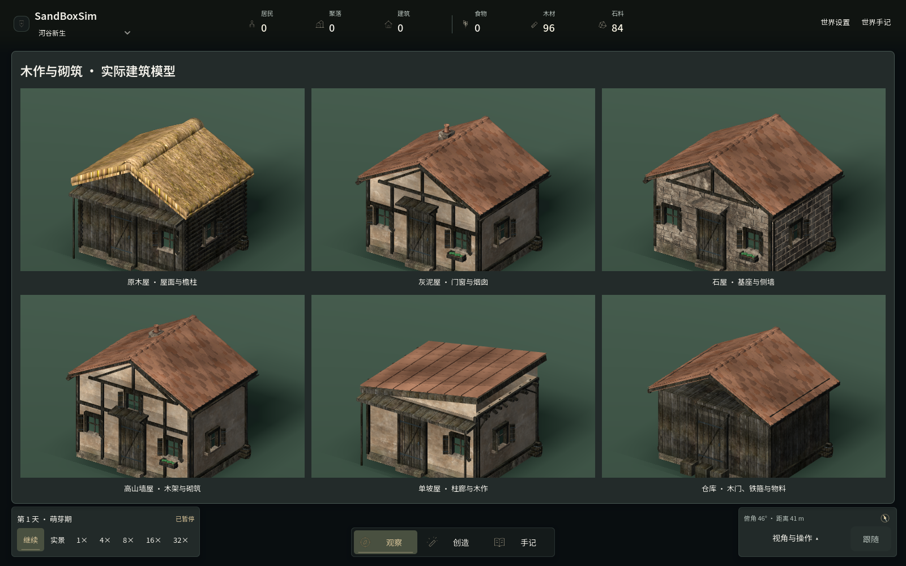

近景木门保留带铆钉安装片的空心拉环；灰泥、石作和高山墙住房在山墙增加横梁、中央立柱及成对斜撑，构件按实际跨度连接并合并到静态缓存。远景省略这些细件。

## 草甸与水岸

普通世界的草甸使用 24 片狭长、有折面并向外弯曲的叶片，每丛 336 三角面；根部与叶尖有粗细、干湿色差和轻微风动。分布由稳定空间噪声、实际植被量及坡度决定，避开水下和陡坡，替代固定四格一簇的排列。根部采样真实地面，外围根顶点也检查贴地间距；候选掩码变化时刷新自然批次，微小植被变化不重建地形。踩踏字节改变时，只重算受影响地块及邻格的草根；若坡度或外围根接触不再适合则临时隐藏，土壤恢复后可重现。保留 24 米分块、34 米裁剪与压实响应；图册使用同一网格，原扫描草资源仍保留。

水面取地形高度纹理的同一组角点、三角剖分与踩踏修正，深度大于 1 毫米才显示。`WorldView3D.Shoreline.cs` 使用 5×5 邻域、半径 2.1 格的紧支撑 C2 径向权重形成连续水陆过渡，并叠加与种子一致、约 15 米尺度的有限覆盖偏移；归一化权重按细网格相位缓存。干格中心 ±28 厘米脚区、Core 允许的水平／垂直／禁止切角对角通道两侧 ±28 厘米，以及水格中心分别施加干湿约束，避免较宽平滑淹没脚区或填平窄水道。最大 2.4 厘米压实后支撑区仍高于 2 厘米水面。未使用的干格角部允许成为浅水圆角，不承诺每个干格顶点都高于水面。脚部、建筑、绘制和拾取共用实际三角曲面，最终选择的逻辑格仍按原坐标取整。近岸几何波按深度减弱，细波只影响法线；没有新增水量、侵蚀或流体模拟。

地表 tint 使用 RGBA，alpha 携带实际植被量，按 16 档外观变化刷新，存在约 6% 的量化间隔；草地因此可露出低密度土斑，不增加采样器或地表节点。原有两个草丛候选分别采用较宽低矮、较窄高挑的比例，候选数量、单簇面数和距离预算不变。

## 人物与动物

### 头脸与肖像

人物已换用 MakeHuman CC0 的男性、中性与女性三套形体配方，保留原生 UV、独立眼球、上下唇与连续头颈。细分后的头颈分别为 31,742、31,676、31,338 三角面；同源远景头脸最多 2,400 三角面。来源与重建入口见 [人物素材](human-assets.md)。

皮肤使用各自的 2K 颜色贴图，眼球保留原始 1K 虹膜、瞳孔和透明角膜图。发片保留源贴图中的发梢透明度与纤维明暗，双面按实际正反面修正法线，并采用较高粗糙度和较低高光。眉毛沿实际脸部采样贴合。

`NatureModels.Hairline.cs` 从原始发型物理拓扑提取帽体根闭环，按来源族缓存到根边的米制距离与沿边弧长。约 1.5 毫米根带形成确定性短发束切边，内部使用源 Alpha。成人女性按连通片分离旧马尾，保留贴合头皮的主体和较短发片。合并网格保留头发的第二 UV 度量。

成年女性三种头部外观分别采用两种长度和走向的编发以及低位盘发。发束的起点从已拟合后头皮的三角面取样，三股发束围绕同一条曲线交叠并向发梢收细。近远景共用头皮和发束曲线，分别采样，避免缩放视角时换成不同的发型。发束随头部骨架运动。`FEMALE_GROOM_PASS` 检查三种外观的网格缓存、拓扑预算和近远景边界。参考 [Blender 的发束聚拢说明](https://docs.blender.org/manual/en/dev/modeling/geometry_nodes/hair/guides/clump_hair_curves.html)和 [Epic 的 MetaHuman 导线与编发工作流](https://dev.epicgames.com/documentation/metahuman/metahuman-groom-workspaces)。

八种稳定身份包含成人与儿童两组比例缓存，儿童面中部缩短、面颊略宽，使用无胡茬皮肤图。源闭眼形变通过第二 UV 驱动原眼睑，网格合并保留并换算位移。每个居民持有独立眨眼和说话材质参数，几何缓存仍可共享；说话固定脸部连接边界和 UV 缝，仅轻微移动唇部内部。眼球始终保持原体积。虹膜、瞳孔与角膜几何围绕来源眼心一起作约 3° 的细微转动，不再只平移纹理；每个居民独立更新，暂停时眼位保持不变。

近景上眼睑增加按实际眼裂取根的短睫毛，随同一闭合参数运动，不独立悬浮或缩放眼球。皮肤粗糙度分区使用各源头脸记录的鼻部、嘴部坐标，鼻额与唇周具有较低粗糙度；耳部透光在约 7–8.6 厘米的头侧范围内衰减，不把整个脸颊染亮。此处是兼容渲染器中的薄层背光，没有完整皮下散射。皮肤、嘴唇、虹膜和眼白具有不同反光层次；几何、远景切换与暂停规则见[人物素材](human-assets.md)。

头部动作围绕颈部基点补偿位置。手记使用 108×138 可点击缩略肖像，与身份和实际行为并排；缩略状态始终使用面部、固定识别角度和距离，观察过双手、全身或背面后也不会变成腹部或后脑。点击或键盘激活后，同一视口移入独立观察窗，恢复保存的工作构图、旋转、俯仰、缩放和灯光，关闭后恢复入口焦点。展开工作室使用渐变背景与主补光，面部默认距离 1 米、垂直视场 26°。质量元数据使用 `studio=continuous-inspector-v9`、`backdrop=natural-radial-v2`，记录实际 `thumbnail`、`thumbnailFraming` 与 `lensFov`。这些操作只改变表现状态。窗口最大 1320×860，侧栏宽 300；状态正文滚动，物资开关、库存摘要和跟随操作固定显示。工作室工具栏按观察范围、观察角度与镜头分组，角度预设有状态反馈，镜头显示目标距离；普通滚轮每步约 10%，Shift 约 3%，距离范围 0.5–4.5 米，全身默认 4.1 米，为脚部和底栏保留余量。三个观察范围分别保存视口内的目标距离，切换时保留当前旋转，重复选择当前范围不复位；双击或复位仅恢复当前范围的默认距离和角度，关闭再展开保留记忆。

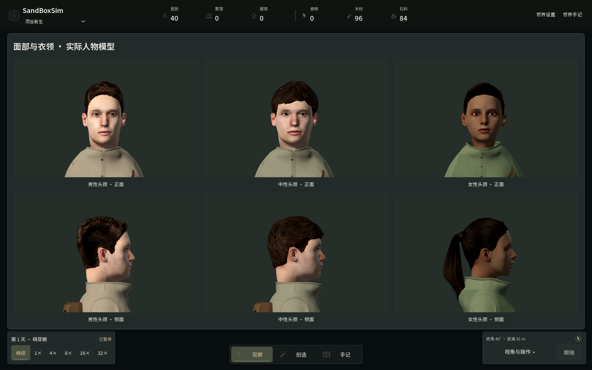

观察窗与人物图册采用较低的环境光和更克制的主补光，改善原皮肤高光、眼窝和亚麻细纹的可读性；这只是实际灯光调整，没有替换来源头脸。工作室的距离滑条以对数尺度与滚轮、按钮同步，主动环视仅更新观察角度，关闭、失焦、手动操作或关闭动效后停止，不消耗模拟随机流。操作见[观察与界面](../guides/gameplay-observation.md)。

### 衣装与身体比例

`NatureModels.Tailoring.cs` 的领口包边直接采样 `GarmentPoint(1, angle)`，保留前襟缺口，并在两端封口；六点折边截面沿 96 段开口路径生成，共 1,164 三角形，替换旧的独立椭圆领圈。它随衣身共同作身体比例转换和蒙皮合并，内壁不横跨喉部；复用原亚麻材质、剪裁缓存与远景生成流程，不需要重烘焙未改变的衣身来源网格。

亚麻表面的三个投影分别处理朝向符号，正面、背面和肩侧使用对应的纹理方向。法线基在顶点阶段通过逆转置矩阵变换后交给片元阶段，减少非等比缩放和背向表面的细纹反光偏差。上衣保留原三骨绑定与扫描贴图，袖根和袖身由连续缝片构造。

原始缝片的胸肩基础采样由 MakeHuman CC0 人体支撑截面拟合；运行体型再按下文的完整躯干支撑适配。`torso-cage.json` 保存 65×128 个采样，取自已校验的 HM08 基础体与青年男性宏目标；身体前后表面分别保留胸部与肩胛轮廓，不再仅用同一椭圆收窄到领口。源 A 姿势的手臂在袖窿内侧裁开，各截面的凸包让布料跨过肌肉凹陷，再作有限平滑与 8 毫米基本松量，腹部另作最多 6 毫米的有界松量；商人外衣另加 4 毫米。胸腹拟合区向下延伸以平滑衔接腰部；褶皱集中在腰带和袖窿牵引处，减弱胸前成片的肌肉状沟槽。头部位置上移 18 毫米，源颈部下缘仍嵌入领口，帽子、眼口和颈部旋转基点随头部整体移动。领口喉部空间、下摆和腰带保持各自约束。它是衣料支撑体，不是裸露肌肉网格，也没有为每位居民生成完整生理解剖模型。

形态参考来自[华盛顿大学斜方肌图谱](https://www.rad.washington.edu/muscle-atlas/trapezius)：颈背与锁骨外侧、肩胛之间的连接应区别于上臂三角肌轮廓。[肩胛肱骨节律实测](https://pmc.ncbi.nlm.nih.gov/articles/PMC2841046/)表明抬起、放下手臂的协同关系有所不同；这里采用有界的表现近似，不机械套用固定的 2:1 比例，也不宣称临床或肌肉物理精度。参考图片未复制进游戏素材。

衣身、腰带、挂点共用比例映射和同一表面采样，法线按映射导数修正；不会通过拉长手臂满足握持位置。三种上衣剪裁由职业外观选择，儿童使用基础短衣，不改变职业规则。头脸、手掌与前臂保持各自来源网格。

衣身采用 64×40 连续曲面，肩部与衣袖共顶点蒙皮，沿用三骨肩部与原手臂关节。腰下褶皱改为非均匀分布，腰带压褶和袖窿牵引分别控制；三套服装重新烘焙了下摆起伏、腰上斜向牵引折痕与背部浅褶。停步站姿轻屈肘部并自然弯曲手指，工具和搬运动作继续由原有握持解算接管。衣领、袖口、下摆有内折面，门襟、纽扣、腰扣与斜带沿真实衣面采样；皮具翻盖、边缘与内层保留厚度。背包翻盖和两根扁束带逐点投影到实际包体三角形，层间距离约 0.5–4.5 毫米，带闭合边缘与独立扣框；自检核对真实表面间距，避免按固定 Z 坐标悬挂。

袖窿在肩侧收窄，袖山用单段 Hermite 曲线从实际衣身切向接到固定袖口，袖根加密采样，避免过早接入直筒而形成硬折；左右四边面使用镜像对应的对角线，避免三角化在一侧肩胛接缝形成额外折角。宽折谷从袖窿延伸，袖口附近保留受约束的压褶。三套实际离线网格为 7,320／7,320／7,200 三角形，保留袖口椭圆、位置及左右骨骼绑定。曲线保持袖窿边界的起始切向与袖口的末端切向，减少袖根之后的隆起长棱。构造标识为 `faired-panel-v8`，第二 UV 保存袖身缝线坐标，用于随蒙皮运动的细缝线，远景按像素足迹衰减。普通领口等材质不启用该分区；它是衣装造型和表面细化，没有布料物理。

侧胸牵引范围和强度受限；袖身权重在离线构建时按实际网格边长平滑，并限制短边两端的权重差，替代按行号硬编码过渡。胸中线、领口和腰带保持躯干绑定，袖口完全随原肩骨。非衣料配件使用相同的侧胸支持场。动作自检检查三种剪裁的劳动、行走、交谈和进食；独立 Python 检查还覆盖 90° 外展和 75° 前举、开口连接、镜像袖口和接缝折角。运行时复用三骨蒙皮，不增加逐帧网格重建。

成人锁骨内端使用转移后体型的来源关节标记，肩点和内端保持同一坐标系；运行标识为 `source-clavicle-v11`。窄肩体型不再绕原来的固定内端旋转。伸手解算包含锁骨弧线和独立肩带平台，上臂方向决定肩点与肩上衣片的响应。肘部先取向下、略向外的方向，再调整以满足握持手腕角度；肱骨参考与实际屈肘平面一致，前臂旋转单独处理。衣料同时使用来源人体的三维肩部表面和姿态修正，原手柄接触、指节闭合、工具取放与左右手校验保留。当前没有独立骨骼解剖网格、肌肉收缩或全身捕捉重定向。

连续蒙皮衣装复制材质时保留颜色、法线／粗糙度采样器，并修正双面法线。自检直接检查最终身体网格上的贴图绑定，避免只检验源材质而漏掉运行时纹理丢失。

卷袖口采用较薄的双折截面，最大外半径 49／47 毫米，领口、门襟和卷边使用略深于衣身的同种亚麻，避免粗厚环形边。亚麻使用较低的法线强度；腰带附近保留少量宽脊、窄谷的斜向折痕，胸肩轮廓由上述人体支撑体决定。靴子的鞋舌、鞋孔环和侧面缝线按鞋楦逐点贴合，鞋带使用表面投影。皮具使用经过距离过滤的不规则细粒，避免规则棋盘状凹凸。

亚麻衣料使用 Poly Haven `rough_linen` 的颜色、法线和粗糙度图，以约 0.27 米的三向投影贴到身体、袖口和衣领。色泽由居民衣色控制，织纹随 mipmap 缩小；原图为 1024×1026，清单记录真实尺寸，不强制拉成正方形。配色保持灰绿、亚麻灰、灰棕与蓝灰。

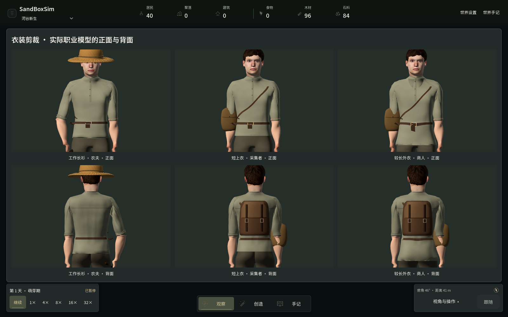

### 手臂、工具与动作

前臂、手掌和手指使用授权解剖网格，经 30 毫米长的切线约束连接连成蒙皮，包含七个 96 列中间环。来源保留 16 骨定义，运行时每手 56 骨：包含三十七个前臂屈肘／扭转站位及四个新增腕部支撑。左右镜像同时处理顶点、法线、绕序和拇指方向；指甲与皮肤共享权重。远景使用同源 1,400 三角面的手部模型及静态前臂，按左右缓存张手与握柄姿态。

`NatureModels.HandSurface.cs` 保留来源掌指拓扑和第一 UV，将未摆姿的绑定坐标写入第二 UV、掌背分区写入顶点色红通道；近景皮肤与甲面仍为两个表面。材质按分区表现掌纹、指节屈曲折痕、指腹、甲床半月、短游离缘与角质边，随蒙皮运动而不滑动。远景跳过细纹计算；这是程序化表面细化，不是新增扫描、指纹识别数据或软组织形变。

`NatureModels.WristContour.cs` 使用当前身体配方的 49 个来源截面，同时拟合腕臂宽深与中心线，法线按完整映射的逆转置修正。取消固定腕环尺寸与共用的前臂最小宽度，让两种体型保留自身的腕臂轮廓。掌根以上逐渐接入，手指、甲面与掌心握柄区保持原位置；体型拟合延续至隐藏肘口，在网格外逐渐退出。实际腕臂六个高度接受截面误差检查，连接带检查连通性、绕序、边长及角向曲率，避免长斜面或密集纵棱。

研究参考[华盛顿大学肱桡肌图谱](https://www.rad.washington.edu/muscle-atlas/brachioradialis)和[前臂、腕围及长度测量研究](https://pmc.ncbi.nlm.nih.gov/articles/PMC11141550/)。它们用于理解近肘肌腹、远腕过渡及部位之间的比例；上述收束量为项目造型参数，没有从小样本均值推出统一人体尺寸，也没有复制图谱插图。

`forearmSkin=continuous-elbow-v9` 分开处理屈肘、前臂旋转与腕部屈伸。前臂屈肘与旋转沿三十六个区间由肘部传到腕部；腕部另用五个区间的四元数支撑把前臂朝向平滑衔接到掌心，避免一次线性旋转混合压扁腕部。每顶点至多四个影响。工具与手掌接触位置、原有指节、左右镜像及材质分区保留；近景更新支撑，远景仍使用缓存代理。

分段设计参考[动态前臂旋转测量](https://pubmed.ncbi.nlm.nih.gov/20696507/)及[实时分段前臂模型研究](https://pmc.ncbi.nlm.nih.gov/articles/PMC8243400/)，区分屈肘、前臂旋转和手腕活动。当前是游戏皮肤的分段近似，没有独立桡尺骨、骨间膜、肌肉收缩或医学有效性；没有把测量论文的骨运动直接当作皮肤位移。`FOREARM_TWIST_PASS` 检查两种成人外观、两侧肢体的肘端／腕端、区间截面、暂停与 LOD；实际工具动作在连续解剖参考框架中检查点误差、混合体积及固定腕部过渡。

`--panel=arm-articulation` 使用游戏共用的抬臂、肘腕求解器和模型，八秒内完成抬臂、屈肘、旋前／旋后与放下。观察入口采用连续五次时间曲线，保留正面、侧面及背面；不推进模拟或增加玩家任务。见 [上肢连动评测场景](../../benchmarks/scenarios/visual-arm-articulation.json)。

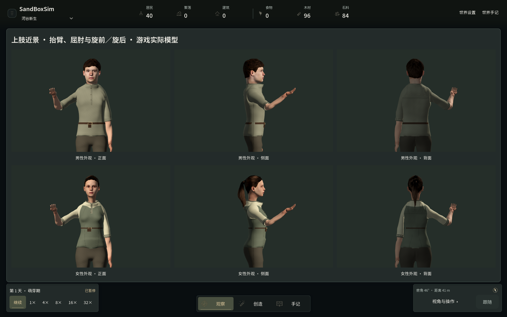

## 成人体型与男女外观

当前成人配方为 `reference-contour-physique-v31`，女性采用 `surfaceStyle=balanced-silhouette-v6`。它协调胸廓、腰侧、后腰、骨盆和上腿的大体块，并以同一配方生成躯干、肩臂、前臂支撑和裤装。上游 CC0 基础身体与头脸／手部来源独立保留；十份衍生支撑已重新导出并更新固定哈希，不能将旧 v27 的输入哈希或旧配图当作当前成品。

女性设计沿用自然匀称、曲线柔和的方向。胸前采用更宽的纵向重分配，来源前向塑形为宽缓的上胸与胸下接续；腰侧适度放松，后腰与后侧骨盆分别建立连续弧线，上腿外侧接入骨盆。关节辅助点固定，统一米制映射的总位移仍限于 18 毫米；来源测试在 1,620 个三维位置检查双侧对称、正向变形及原有 Jacobian 范围，不通过放宽上限获得通过。这里的比例和系数是角色美术选择，不是女性身体或吸引力的统一标准。

`femaleShoulderLine=clavicular-crest-v2` 将女性成衣领口两侧各收低最多 5 毫米。锁骨到袖山的衣片以实际缝制三角面的水平投影为支撑，拟合局部曲面高度，保留领缘与袖口的接合和较宽的肩部曲率。拟合后再生成蒙皮与抬臂修形。`femaleCoatCollar=sewn-facing-v1` 将商人外套的低领翻边织线落在共用的衣面坐标上，随衣身一起变形。`garmentMaterial=quiet-linen-v19` 使用约毫米尺度的纱纹与低对比扫描纹理。[肩部骨性标志](https://anatomy4sculptors.com/blog/shoulder-bony-landmarks/) · [Blender 写实基模与放松绑定姿态](https://studio.blender.org/training/realistic-human-research/use-of-base-meshes/) · [伦敦博物馆的工作罩衫](https://www.londonmuseum.org.uk/collections/v/object-716265/smock/)

`femaleLowerPanel=grain-fitted-waist-v1` 在同一件成衣上拟合下胸廓、侧腰和侧髋。每款首次建模时沿竖向布纹减小局部曲率，靠近腰带和下摆翻边时逐渐收紧位移范围。人体支撑与裤装的实际外包络限制内收。带下布量按各款剪裁从腰部释放，商人外套保留背面两道浅褶。缓存曲面用于成衣和腰带拟合，动作时由现有蒙皮和姿态修形驱动。[Disney 角色衣装的结构与垂坠](https://media.disneyanimation.com/technology/publications/2021/wrapped-clothing-on-disneys-raya-and-the-last-dragon.pdf)

女性工装与短上衣的前后下摆分别以最多 18／12 毫米圆顺，短上衣下摆最低处为 0.842 米；腰带按来源自然腰线拟合，袖口沿用原有挂点。女性裤装采用低饱和灰橄榄色 `#656356`，配合来源骨盆和腿部截面显示体积；男性裤装保持原染色。

### 女性衣装的前片与开合

`femaleFrontCut=supported-closure-v1` 将下胸廓至腰带之间的松量按剪裁分开。工作衫保留较收束的前片与两枚纽扣的窄门襟。采集短衣从胸侧向下斜放布量，与三枚纽扣的短门襟相接。商人外套在下肋分布较宽缓的布量，五枚纽扣沿长门襟落至腰带上方。三款仍按同一居民的形体贴合。近远景共用门襟剪裁，纽扣以最终衣片的三角面定位并继承胸廓与骨盆衣料的权重。[腰部松量分布实验](https://journals.sagepub.com/doi/10.1177/00405175211059211) · [人体与布面间距的三维扫描](https://proc.3dbody.tech/papers/2013/13323_50psikuta.pdf)

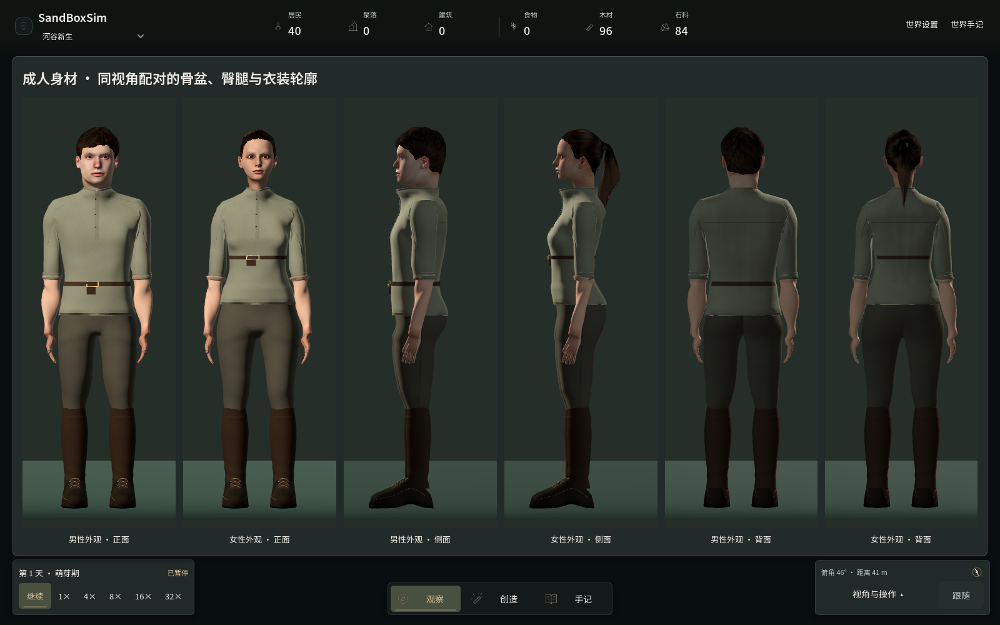

### 女性居民的个人身形

`femaleBodyBuild=regional-builds-v2` 为成年女性居民提供三种穿衣身形。均衡轮廓使用基础版。较直腰线配合较宽、较浅的下胸廓和略收的髋部。圆润髋线增加外髋、后髋和上腿的体积，配合相对收束的腰线和较窄、较深的下胸廓。形体差异从腰部连续过渡，并在肩领下方退出。成品截面分别检查横向宽度和前后深度，腰带、背带与衣面随各身形重新贴合。[女性躯干三维扫描研究](https://pmc.ncbi.nlm.nih.gov/articles/PMC13392141/) · [Cornell 腰髋曲线研究](https://bodyscan.human.cornell.edu/currentPrint.html)

`femaleFlankShape=continuous-flank-v1` 在三种身形共用的底模上重塑侧腰、髋外侧和大腿上段。下腰侧略填平，外髋上缘柔和地接入大腿，前后斜侧的体积同时向侧面收顺。身体截面和裤装使用同一形体场，随后用改好的裤面计算上衣下摆松量及屈髋修形。形体场保留中央腹背、裆线和靴口的支撑。设计参考髂嵴、大转子及髋外侧与大腿连续过渡的形态。[骨盆表面标志](https://anatomy4sculptors.com/blog/butt-bones-and-body-proportions/) · [髋与大腿表面结构研究](https://pubmed.ncbi.nlm.nih.gov/37220258/) · [站坐姿下的裤装与人体扫描研究](https://pmc.ncbi.nlm.nih.gov/articles/PMC8464815/)

世界模型和居民详情使用同一个稳定居民 ID 选择身形，换职业时沿用同一身形并重新贴合对应衣装。区域形变同时应用到上衣、裤装、腰带、工具挂点和各自的姿态修形。背包与腰包按成衣表面定位。袖口、头肩骨架与膝下区域保留原有坐标，空手下垂间隙按实际裤装计算。变形网格按身形与衣装缓存，动作使用原有蒙皮流程。

三维扫描研究分别量化胸腰落差、腰臀落差、腰部深度和后臀深度。本项目据此分别控制横宽与前后深度，用连续的区域曲面连接各截面。三种幅度依据游戏同镜头下的可读性选定。 [女性躯干分区研究](https://www.sciencedirect.com/science/article/pii/S0003687022002277) · [三维躯干形态研究](https://doi.org/10.1371/journal.pone.0265255) · [腰臀宽深分析](https://doi.org/10.1038/s41598-026-37807-1)

可用 [女性身形对照场景](../../benchmarks/scenarios/visual-female-builds.json) 在相同身高、姿态和衣装下观察三种正侧面轮廓。

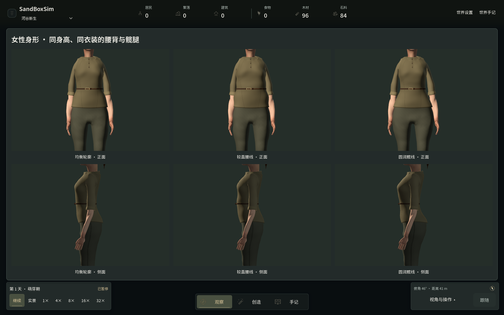

### 女性肩背与袖根

三款女性衣装的后片从肩胛外缘沿袖窿过渡到上臂。拟合时同时比较衣片的朝向、沿袖片的位置及其与身体支撑的距离，让后肩保留应有的活动余量。成品后片、袖根和抬臂形态使用同一个局部圆顺范围，领缘与远端袖口保留原位。近景法线从最终网格计算。

`garmentFit=continuous-drape-v39` 的 `femaleRearShoulder=supported-meridians-v1` 从实际成衣量取 25 条后片剖线，用后领下缘和肩胛附近的切线拟合纵向过渡。向内位移最多 10 毫米，向外最多 3 毫米，修改集中在中央上背，到后领和袖根前逐渐退出。局部回退保持面朝向。成品网格上的后领相对突出量上限为 8 毫米，核对三款衣装和三条中央后片剖线。

后领至肩胛的蒙皮权重按衣片网格的邻接边平滑过渡。短边两端的权重变化受到更强约束，领缘、袖根接缝和腰部保留各自的固定权重。抬臂修形从更新后的成衣网格生成，手臂越过肩高时，后片沿邻接点分散位移。成品修形及其法线在构建网格时缓存。抬臂设计参考实测肩胛上旋和后倾，以及按姿态塑造衣装的方法。 [抬臂时的锁骨和肩胛实测](https://pmc.ncbi.nlm.nih.gov/articles/PMC2657311/) · [Blender Studio 衣装姿态塑形](https://studio.blender.org/training/realistic-human-research/clothing-shapes/)

[肩背图册](../../benchmarks/scenarios/visual-female-shoulders.json) 使用实际居民模型，从背面观察右臂，从后侧观察左臂，分别展示自然垂臂、抬臂 90° 和 135°。衣片设计参考肩缝与袖窿的分区松量实验，以及运动中衣料松量变化的测量。 [缝线三维形态实验](https://doi.org/10.1186/s40691-023-00364-6) · [服装动态松量研究](https://doi.org/10.1177/0040517519832842)

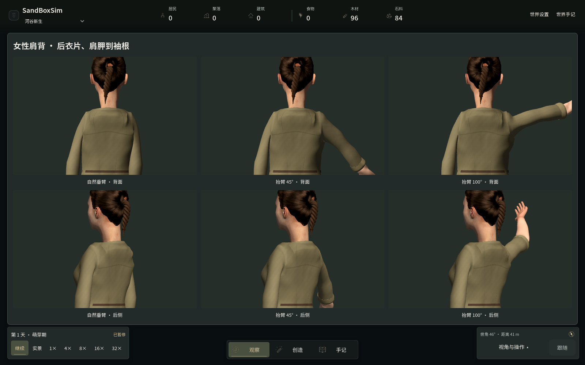

### 来源形体与连续体积

腰侧使用宽缓的纵向过渡；来源臀部后侧转向上腿的弧线连续展开，下腹保留最多 1.5 毫米的前向塑形。运行时以连续的腹部、侧腰和后腰修形场协调最终轮廓：下腹向自然腰线渐变，后腰保留浅而宽的支撑。两种成人的来源关节、共同站姿和整体尺度独立保留。

| 来源场 | 当前控制 |
|---|---|
| 腰侧／骨盆 | 宽缓的 4.5／7 毫米横向控制，连续退出到固定肢体区 |
| 前胸 | 最多 12 毫米向上重分配，纵向覆盖尺度 78 毫米；前向塑形以 1.145 米为中心，胸下平缓返回 |
| 后腰／骨盆后侧 | 1.5／7 毫米前后控制，后侧权重在 8–110 毫米间渐入，避免狭窄位移带放大局部拉伸 |
| 大腿外侧 | 以 0.650 米为中心的 2 毫米宽缓收束，与骨盆连续，来源关节和靴口保留各自约束 |

`balanced-silhouette-v6` 的女性来源场用光滑偶坐标 `sqrt(x*x + 0.012*0.012) - 0.012` 组织左右前胸接续，替代在中线切线不连续的绝对值坐标；来源侧向峰值大致保持原位置。躯干、肩臂、前臂支撑与裤装均从同一 v31 配方重建，仍保留 18 毫米源位移上限、固定关节及原 Jacobian 范围。来源测试另核对中线两侧的切线接续。

### 成衣、肩袖与颈口

女性肩线使用统一的 10 毫米下降量，衣身映射、肩部姿态参考与实际骨架共用该值；男性保留 9 毫米。前胸附加体积改为以 1.145 米为中心的宽缓过渡，上下覆盖尺度分别约 90／60 毫米，前向幅度最多 4.5 毫米；胸骨、外侧根部和高度保持原约束。衣面只保留最多 2 毫米的来源浅起伏，仍跨过更深凹处，减少分离的塑形感。领根浅色区域收为窄面料边，衣身维持较连续的低对比染色。

[腰线拟合](../../src/SandBoxSim.Godot/NatureModels.WaistFit.cs) 在来源支撑的 0.96–1.06 米区域按截面面积寻找腰线，三种剪裁分别逆解衣片高度映射，并按剪裁缓存结果。当前来源腰线约为 1.01 米。腰带、腰扣、带尾、工具挂点和衣料收褶共用该拟合，避免固定上移量压短胸腰之间的视觉距离。`NATURAL_WAIST_BELT_PASS` 通过实际腰带几何的完整比例／衣片映射检查三个剪裁的中心和宽度；接触间距及动作检查独立执行。这里只是角色衣装拟合，没有逐帧重算腰线。

成衣使用 `garmentFit=continuous-drape-v31`：胸下纵向额外跨度由最多 8 毫米增至最多 13 毫米，悬垂包络最多 7 毫米，腰带和领根仍固定。前胸外缘的收束间隙在胸下平滑放至 12 毫米、上部保留 6 毫米，避免表面修形再次将布料吸回皮肤；最低身体净空、三角面方向和近远景一致性检查继续执行。袖子、领根和衣身采用接近的低饱和染色，减弱胸前独立硬壳般的色块；静止颜色坐标与动画蒙皮共用原有流程。

当前 `continuous-drape-v29`／`continuous-drape-v31`／`reference-figure-v25` 将女性上胸与共享袖根视为同一片最终衣面。肩袖几何修复之后，以 45 毫米邻域的面积加权二次曲面整理窄凸条，保留较宽的胸廓曲率；沿颈口、袖口、胸前峰值和腰线退出。共享袖根继续使用同一组顶点，可一起圆顺，不固定在旧凸条位置。局部位移限于 10 毫米乘遮罩；细小三角面触发回退时只缩减相关顶点，保留原有面朝向门槛，并在后续轮次复核邻接边界。静止结果按剪裁与实际输入缓存。候选邻域另外按剪裁和静止／姿态模式缓存，只在规范坐标逐点一致时复用，否则重新生成；索引保持原有升序。姿态半径筛选、面积权重、方程求解与局部回退仍使用当前数据。实际静止输入与第 1、60、120 个姿态的 `BODICE_NEIGHBOR_PASS` 对照完整扫描，核对拟合深度的浮点位模式，避免用改变曲面来缩短构建时间。

同一整理步骤也在肩袖姿态烘焙末端执行：邻域由静止参考筛选，参与权重来自当前侧肩胛／袖管，完成后再计算最终法线与逆蒙皮形态。另一侧、衣领、袖口和腰部保持各自约束，形态数量仍为 120；普通动画帧不执行拟合，也没有新增肌腹鼓包。`BODICE_PATCH_PASS` 检查平面／宽曲率保持、低面积尖点和零面积残片，`BODICE_SURFACE_FLOW`／`BODICE_POSE_FLOW` 记录最终输入的局部修改；现有实际动作、袖根折角、工具接触和暂停检查继续独立执行。这些数据不是吸引力评分。

女性头部挂点下移 26 毫米，颈根抵消旧附加延展，并向上连续回收最多 2 毫米，颈根覆盖保持连续。前领中央修形项上限为 12 毫米，领缘、门襟和衣身共用映射，不增加独立颈柱。`NECK_COVERAGE_PASS` 按实际头部尺度核对覆盖，面部与儿童的原有区域定义独立保留。

女性折领按体型与款式分别缓存。前领开口向颈部收拢，两侧略放宽，后领放低，锁骨到肩头的鞍形过渡同时用于静止支撑面和抬臂修正。衣摆与裤腰之间使用平滑的外层包络，取裤腰顶部附近的有效截面向上渐隐，降低两层支撑交接处的硬折。[Blender Studio 衣装姿态设计](https://studio.blender.org/training/realistic-human-research/clothing-shapes/) · [TailorNet 的形体与服装版型研究](https://openaccess.thecvf.com/content_CVPR_2020/html/Patel_TailorNet_Predicting_Clothing_in_3D_as_a_Function_of_Human_CVPR_2020_paper.html)

女性三款成衣的下摆使用成品外层截面拟合。拟合时剔除内侧翻边三角面，沿最低实测外层截面的切向补足采样边界。翻边的两圈顶点随后从外层下缘和上一排重新定位，分别向内收 2.8 与 3.9 毫米。近景网格重算法线，远景从同一静止衣面生成。裤装与下摆的重叠在拾取、工作和步行姿态下通过蒙皮后的表面检查。

三款女性成衣各自使用下摆高度曲线。工作衫收顺侧边，下缘接近平直。采集短衣在抬高的侧髋留出活动余量，前后保留弧线。商人外套的后片更长，腰带以下的两道褶逐渐分开，在翻边前回收。形体先沿布料纵向跨过短距离的截面起伏，再叠加各剪裁的松量，并依据实际裤装包络限制内收。三款染色分别偏亚麻褐、灰绿和暖赭。 [工作短衣藏品](https://emuseum.colonialwilliamsburg.org/objects/7862/jacket) · [后片褶裥藏品](https://emuseum.colonialwilliamsburg.org/objects/503/jacket) · [服装分区松量研究](https://theses.lib.polyu.edu.hk/handle/200/2765)

下摆的外缘、内折和针脚共用成品网格上的沿面距离。材质从实际缝边定位针脚，近景和远景都使用相同的布面坐标。

采集者与猎人的背包贴合实际后衣片，双肩带沿衣面穿过肩部，并绕回背包的上下挂点。商人的薄皮袋用两条翻折挂袢固定在左后腰。`FEMALE_CARRY_GEAR_PASS` 检查背带挂点和蒙皮，以及走路、拾取、交易、交谈和进食时手臂中线相对皮袋包围盒的净空。 [皮袋与皮质挂点藏品](https://postalmuseum.si.edu/object/npm_2004.2004.17)

女性裤装沿高度每隔 10 毫米读取实际截面。大腿外侧、内缝、膝前和膝后各自分配衣量，前裆到内缝的转折下放最多 8 毫米，靴内的裤脚与髋关节支撑继续使用对应的成品网格。裤缝以到截面中线的有符号距离定位，内外缝跟随实际腿型，针脚细节随距离平滑过渡。静止造型与弯身、行走使用同一网格，髋、膝各自响应姿态。`FEMALE_TROUSER_DRAPE_PASS` 检查成品膝前与膝侧余量、大腿横向余量、前裆曲面和固定裤脚。[女裤三维合体研究](https://journals.sagepub.com/doi/10.1177/0887302X07309479) · [站姿与坐姿下身截面研究](https://pmc.ncbi.nlm.nih.gov/articles/PMC8464815/)

女性后领与上背之间采用局部深度修形。肩袖拟合完成后，后片超出目标弧面的部分逐渐向内收，修形在领口和袖窿前退出。几何法线从成品网格重建，近远景使用相同的静止轮廓。后育克的弧形针脚由衣面的静止坐标驱动，随肩背弯曲。三款衣装的实际成品在背中线及左右 25 毫米的截面上检查后领下方的外突量。造型参考肩颈与肩胛之间的宽缓连接，以及服装在肩部活动时的拉伸与压缩。[肩颈表面结构](https://elsevier-elibrary.com/contents/fullcontent/58090/epubcontent_v2/OEBPS/B9780443069529000126A.htm) · [Blender Studio 衣装形体](https://studio.blender.org/training/realistic-human-research/clothing-shapes/)

女性成衣图册用前侧和后侧近景展示同一居民的三套衣装。预览收起手持工具，保留腰带、背包和腰包，便于观察腰线、侧髋和翻边。完整身体可在 `visual-body-frames`／`visual-body-motion` 中观察。 [实机配图](../images/resident-female-wardrobe.png) · [公开衣装场景](../../benchmarks/scenarios/visual-female-wardrobe.json)

腰侧和骨盆的结构还参考 [Proko 腰侧形体](https://www.proko.com/course-lesson/how-to-draw-obliques-form)与[骨盆结构](https://www.proko.com/course-lesson/anatomy-of-the-pelvis)：区分骨性边界和柔和表面，先检查正侧背面的连续体积。角色采用自然匀称的美术方向，不用固定腰臀比或局部尺寸定义吸引力。

造型依据参考 [Proko 的胸廓与骨盆体块](https://www.proko.com/course-lesson/how-to-simplify-the-motion-of-the-torso-the-bean)、[胸前形体与姿态接续](https://www.proko.com/course-lesson/how-to-draw-breasts-form-and-motion/)以及 [Blender Studio 的基础网格工作流](https://studio.blender.org/training/realistic-human-research/use-of-base-meshes/)。这些资料用于结构和制作方法；当前角色仍是来源转移、穿衣网格与有限姿态修正，没有新增软组织物理或真人扫描。

### 头颈与身份差异

`neckContour=relaxed-neckline-v5` 区分女性成人的头部挂点、颈部压缩与衣领共同拟合。头部挂点为来源坐标 1.374 米，经整体比例映射后约 1.424 米；面部主体不作纵向缩放。源颈根使用平滑过渡与节点下移量配对，头部静止挂点、表情部件和动态姿态继续共用当前节点。男性和儿童沿用各自比例。

[实际女性人物观察窗](../images/resident-female-inspector.png)与[肩颈近景](../images/resident-female-neck.png)来自当前世界中的成年居民，通过公开场景 [visual-female-portrait](../../benchmarks/scenarios/visual-female-portrait.json) 复现；选择走名录的同一入口，展示其实际身份与衣装。

`CERVICAL_PRESENTATION_PASS` 测量实际网格的下颌／前领间距、颈根覆盖与头肩挂点关系；`CERVICAL_MOTION_PASS` 在九组轻微点头／转头姿态下检查下颌高于前领平面的余量。这是有限姿态的造型与连接检查，不是完整衣料碰撞验证或吸引力评分。头部来源的 Jacobian、肢长、肩袖和工具接触检查继续独立执行。结构参考 [Proko 颈部形体](https://www.proko.com/course-lesson/how-to-draw-neck-muscles-form/)与 [Blender Studio 角色造型](https://studio.blender.org/training/realistic-human-research/design-sculpting/)，用于先校正头颈肩的大比例，再处理局部细节。

成年身高变化采用整体等比缩放，头脸保留原有局部比例及小幅头宽、头高身份差异。成年来源形体之上，男性外观保留较宽的下颌、较明显的眉弓、鼻梁与颏部，女性外观保留较轻的眉弓、较饱满的眼下颊部与更垂直的前额。下颌横向局部系数分别为 +4.5%／−2.5%，颈部局部系数为 +6.5%／−3%；女性下脸段最多上移 1.5 毫米，颈部接缝保持原高度。鼻翼区域分别作最多 +2%／−2% 的局部宽度修饰，女性颊侧另有最多 0.8% 的柔和体积变化；眼球不作放大。眉弓、颏部、颊部和额头使用毫米尺度的连续场叠加，区别于整张脸统一放大或收窄。眉毛分别采用较平、较轻弧度的贴面路径。皮肤、眼口、发片和挂点共用 `HumanPoint`，法线使用同一映射的逆转置；自检在八种成人来源表面采样局部雅可比，拒绝翻折及过度拉伸。儿童不套用这些成人局部变化。

脸型设计参考[三维面部区域形态研究](https://pmc.ncbi.nlm.nih.gov/articles/PMC10335371/)、[2022 年成人面部三维研究](https://pubmed.ncbi.nlm.nih.gov/35357226/)和[2026 年成人脸型形态研究](https://pubmed.ncbi.nlm.nih.gov/41827988/)。研究提示应结合多个区域及个体差异理解外观，不能单凭一个部位判定身份；项目中的区域幅度是美术选择。皮肤图集另按同一额部区域的面积加权线性亮度校准来源曝光，头脸和嘴唇的来源曝光及 RGB 参考值由同一额部区域测量，`tools/measure_head_tones.py` 可复算线性 RGB 与亮度。来源参考色用于把平均皮肤颜色映射到居民肤色，保留原图的局部色差；远景头部使用来源的相对色块，不把它当作贴图像素重复加曝光。肤色仍由居民身份控制，校准不抹去来源纹理或更换许可素材。Compatibility 下先将采样与染色转为线性 RGB，完成曝光／染色后再编码；Forward+／Mobile 使用其线性材质输入路径。远景按后端选择正确编码，避免重复伽马转换。依据见[Godot 着色器参考](https://docs.godotengine.org/en/stable/tutorials/shaders/shader_reference/spatial_shader.html)及[4.7 Compatibility 渲染实现](https://github.com/godotengine/godot/blob/4.7-stable/drivers/gles3/shaders/scene.glsl)。`tools/verify_skin_colour.py` 使用实际 GPU 像素和已知颜色验证生产函数；本地已验证 Compatibility，其他后端不能由这一结果推定。

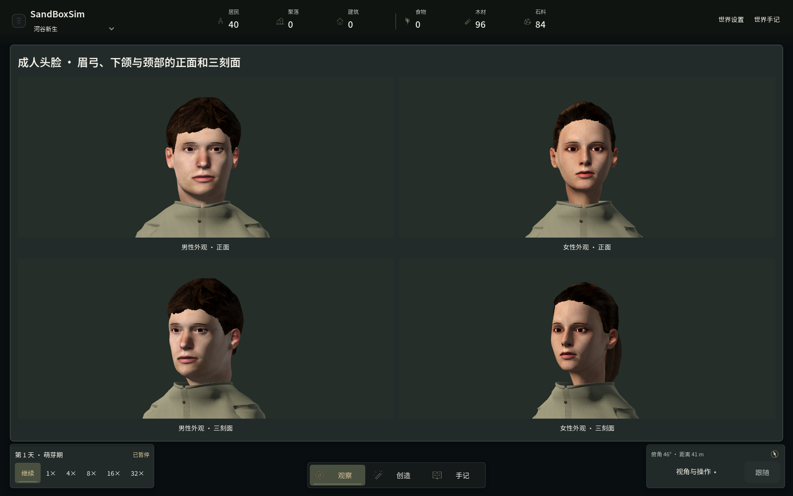

### 行走、启停与转向

`ResidentRig.Locomotion.cs` 使用支撑、蹬离、摆脚和落脚的分段轨迹，替代固定正弦摆腿。世界每帧提供实际渲染位移及剩余转向角，姿态调度消费累计距离与时间得出的平均速度，避免远景只采最后一帧位移；步频按积分后的移动距离推进，启停使用连续速度包络。输入速度在 0–1.7 米／秒的步态表现范围内限幅；单次水平位移达到 1.25 米时按位置重同步处理，不把普通相邻格点插值的较高瞬时速度误当作跳变。预览与人物观察窗没有世界位移时使用独立的标准步速，旋转观察镜头不会被当成角色转身。观察窗的步态因此用于查看动作，不用于测量世界滑步。

支撑段约占周期的 60%，疲劳和双手搬运适度延长支撑；摆动段抬脚、收膝，再向前落脚。脚踝高度参考实际鞋底的 25 个纵向截面，在脚跟／前掌滚动时补偿鞋底接触高度。两节腿部 IK 保留原有大腿、小腿长度，超出可达范围时限制目标，不拉长肢体。近景坡面修正从已有髋关节求解，裤装骨骼在同帧刷新，避免将整条腿从骨盆移开。当前没有跨台阶的路径规划、足底压力或完整物理平衡求解。

男性／女性成人外观分别采用不同幅度的骨盆横向转动、侧倾与基础摆臂，胸廓反向配合，头部在转向时保留较大的朝向偏移。身份带来重叠变化，外观不固定决定移动速度。双手搬运由原有手掌约束接管，骨盆摆动收敛；持锤行走、停止及工作使用同一真实握柄，拾取以 0.48 秒过渡进入重心下降及腿部屈曲。作业力道仍由下节的相对负荷控制。

步态参考 [全身步态实测](https://pubmed.ncbi.nlm.nih.gov/25548119/)与[受控步速研究](https://pmc.ncbi.nlm.nih.gov/articles/PMC7440644/)。胸廓、骨盆、摆臂和摆动脚离地高度使用 [CMU 步行捕捉](human-assets.md#动作捕捉)。步幅、接触时序和地形适配由本项目控制，头部与骨盆分段朝向参考[转身中的头部控制研究](https://pubmed.ncbi.nlm.nih.gov/16506002/)。

`--panel=locomotion` 提供同速度男女外观的启停转身、负重行走及持锤行走—工作六格演示；公开场景为 `visual-locomotion.json`。`LOCOMOTION_PASS` 检查真实关节的启停、不同速度、转向、拾取、固定肢长、实际鞋底截面、步间连续和暂停；`LOCOMOTION_LOAD_PASS` 检查搬运／持锤行走到工作中的掌柄接触、手掌连续、坡面髋部锚点和裤装绑定；`LOCOMOTION_SAMPLING_PASS` 核对逐帧变速输入与间隔八帧消费的相位／速度差，并检查儿童髋部随运动骨盆保持连接。原有远近景节奏、衣装蒙皮和握持检查继续执行。世界根节点仍按模拟格点插值，在高倍速或位置重新同步时不能保证每只脚在世界坐标完全锁定；画廊与截图也不能单独证明动作写实程度。

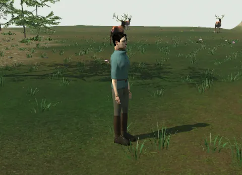

实景地形上的接地可通过跟随居民观察，场景入口见 [场景接触](../../benchmarks/scenarios/world-scenery-contacts.json)。

### 动作链与脚步支撑

#### 交互阶段与中断

`residentConsumption=confirmed-mouth-contact-v1` 把进食和饮水拆成抓握、抬起准备、入口和收手。在胸前等待同一动作编号和同一格子的完成记录。饮水同时验证模拟允许的四向临水格及其可站立的实际岸线。入口后可以在下一动作接管手部时继续完成咀嚼。画面用一次接触表现一次已完成的动作，模拟仍按自己的步数扣除库存和恢复需求。 [饮水动作分段与实际接触测量](https://pmc.ncbi.nlm.nih.gov/articles/PMC1562432/)

`caravanHandling=ledger-supported-cargo-v1` 根据商队账目显示去程货物和回程报酬。报酬随队启运后才显示，商人休息时仍按个人库存选择道具。旧载物先收至腰前并释放双手，新载物等双掌托稳后才出现。职业服装在商队载物收完后再切换。搬运动作使用双手托举和负重步态，包裹代表物资类别。 [双手负重对胸廓和骨盆协同的影响](https://pubmed.ncbi.nlm.nih.gov/32932627/)

`pickupCarryContinuity=palm-supported-transfer-v1` 把拾取抬手与双手搬运接起来。拾取的小件在右手里随掌面移动，左手与右手建立对同类载物的支撑后，才在同一帧切换显示为库存载物。没有同类载物、动作被打断或双手未能及时托稳时，右手保留小件并完成收手。 [场景交互中的持物接触点](https://www.ipab.inf.ed.ac.uk/cgvu/nsm.pdf)

`spearTargeting=bounded-live-contact-v1` 让长矛用场景中对方的躯干和实际站位瞄准。相同目标在可及范围内移动时延续已经蓄好的动作，结算后才进入前刺。矛尖按当前瞄准点转向，并在伸出阶段检查接触。目标离开可及距离或被遮挡时取消前刺，前刺未接触时也会及时收势。狩猎结算会记录猎物槽位和代次，使已移出画面的猎物能保留对应的最后瞄准点。接触检查采用躯干表面近似点与场景障碍，模拟伤害和狩猎收益仍按各自的范围结算。[Witkin 和 Popović 的动作重定向研究](https://publications.ri.cmu.edu/motion-warping) · [Epic 的动态目标约束](https://dev.epicgames.com/documentation/en-us/unreal-engine/python-api/class/MotionWarpingComponent?application_version=5.6)

长矛瞄准点每帧更新，动作调度按目标身份保留尚未消费的动画时间与朝向阈值。同一目标经过格线时仍沿用当前动作。更换目标、接触失效或进入新阶段时，以新状态重新计时。

拾取／采食和存放／分享／交易分别共用手部轨迹与混合量。进食和饮水也共用手部控制，但先把前一件道具放低再换取下一件。暂停冻结道具与手部，物资的状态区分托举和递出。

研究中，抓握与操纵阶段需要分别观察，且物体交互牵涉手、身体姿态和接触关系；参考 [GRAB 全身抓握研究](https://arxiv.org/abs/2008.11200)及[抓握与操纵力研究](https://www.nature.com/articles/s41598-023-38870-8)。这里据此检查动作目标与控制权是否一致，没有导入受试者数据或声称已实现接触力学。

世界画面和居民观察窗使用 `ActionSystem.TryGetPresentationPartner`。执行阶段读取按当前规则选出的候选，结算后读取这次动作真正影响的居民。角色到站后朝向该对象，目标离开范围、死亡或槽位被复用时收势。结算对象记录绑定本次动作编号和双方身份，只用于表现。测试检查结算后附近出现更合适的候选时仍保留原对象，以及超出范围、动作编号变化和状态摘要的处理。

`socialMotion=paired-conversation-v11` 让世界中的近处谈话使用一份双人节奏。双方先停步并朝向对方，发起者说完后留出短暂停顿，接收者再回应。倾听者在对方的句子后段点头。两人过近时使用已有的地面站位求解拉开距离。递物、紧急移动、目标更换及视距之外的对象都可结束当前表现。说话由口形和手势表现。[跨语言轮替观察研究](https://pmc.ncbi.nlm.nih.gov/articles/PMC2705608/) · [面对面交流中的视线和手势研究](https://pubmed.ncbi.nlm.nih.gov/36871587/)

`handlingMotion=supported-parcel-v19` 按到站、转向、伸手、确认握持、接触场景和收势的条件衔接。世界画面分别判断地面位移、转向和接触可用性。模拟独立负责目标、库存、伤害和需求结算，表现读取这些结果。

取物可以先朝有效候选伸手，结算成功后才握住物件。农田候选提供朝向，实际接受劳动后才播下锄。放货和入库等待实际交付凭证。施工凭证对应的木桩尚未渲染时最多等待约 0.8 秒；模型及时出现时完成一次挥击。饮水需要可用水岸，进食开始前需要随身食物，谈话和攻击需要当前对象。条件消失时会退出动作，已经拿在手里的道具沿原有回收路径收回。动作完成收势后，已用完的接触信息会退出姿态调度。

加速观察下的近景居民也使用交替承重的转身动作。摆动脚离地前可修正该步方向，离地后先把脚落到既定位置。交互起手同时检查画面中的实际位移速度、步态速度和转身状态。[足部接触约束](https://research.cs.wisc.edu/graphics/Gallery/kovar.vol/Cleanup/) · [动作阶段的对齐研究](https://research.cs.wisc.edu/graphics/Gallery/kovar.vol/RegistrationCurves/)

搬运转入需要腾手的动作时，居民沿当前双手姿态把包裹收向腰前，确认双掌到位或达到短时等待上限后才退出搬运姿态。步长、支撑时间和骨盆摆幅跟随手臂承重权重平滑过渡。放货和入库用已确认的交付类型锁定物件模型，等双手托稳、站位和朝向就绪后才下放；松手后再选择剩余库存。即使交付结算早于拿起包裹的画面，也会先托稳并只执行一次放置。腰前收拢表现的是随身物资从手中收起。[动作切换与速度连续性](https://media.gdcvault.com/gdc2018/presentations/bollo_david_inertialization_high_performance.pdf) · [双人递接中的接触和握力实验](https://pmc.ncbi.nlm.nih.gov/articles/PMC7759571/)

`residentActionHandoff=displayed-palm-v1` 在拾取、搬运、进食、交谈、递物与拾取收回之间切换时，从前两次实际显示的掌心位置和朝向估计速度，再由新动作在求解关节前接续。左右手分别记录状态。同一控制器继续沿原轨迹更新，离开视野后丢弃上一段的速度样本。实景和居民观察窗都在库存变化时先将双掌托住的包裹收回腰前，再按最新库存重新托起。递接物件换手时保留位置和有界的相对速度，再逐渐贴合接收者的支撑点。[Gears of War 的动画惯性过渡](https://www.gdcvault.com/play/1025331/Inertialization) · [同步测量双人递接的运动与握力](https://pubmed.ncbi.nlm.nih.gov/38139540/)

世界按居民身份、动作编号、阶段、目标和交互对象安排远近景姿态更新。只在观察状态相同时累计姿态时间，遇到状态变化立即用当前帧更新。拾取、作业和需要面向对象的动作会等角色停稳并转向实际目标。工具可以在走近时预备，工作循环从对准后开始。该拆分借鉴了实时动画从当前姿态过渡到新目标，以及接触保持与过渡分开处理的方法。 [GDC 动画惯性过渡](https://www.gdcvault.com/play/1025331/Inertialization) · [动捕中的足点约束](https://research.cs.wisc.edu/graphics/Gallery/kovar.vol/Cleanup/)

成功取物、采集和存放时，模拟用 `ActionSystem.TryGetCompletedContact` 提供本次结算地点和实际资源。记录绑定居民身份和动作编号，只在当前会话使用。即使取空一整堆，居民也能伸向原来物资的高度。低处取物的屈膝和前倾幅度由目标高度决定，手掌到达并短暂停留后合指，取起的代表物件沿手部移动。可站位置由干地支撑和场景遮挡检查决定。[真人步行与拾取协调实验](https://pubmed.ncbi.nlm.nih.gov/8570350/) · [伸手速度与抓握时序实验](https://pubmed.ncbi.nlm.nih.gov/15151851/)

取物和徒手采集在执行时读取候选物资。取物的候选查询与模拟结算共用同一套资源选择规则。角色可以先伸手，只有候选与实际结算对应、手掌持续到达接触点时才合指和抬起。已经握住物件时，紧急移动会先接管下肢，持物手保留原来的握持位置和姿态，随起身动作向腰侧收回。交互对象、格位或物资种类变化时，上一段接触计时失效，新目标重新确认朝向。同一目标已对准后，短暂的小角度偏移仍可维持姿态。[伸手中途修正的实验](https://journals.physiology.org/doi/full/10.1152/jn.00336.2020) · [动作中断的惯性过渡](https://gdcvault.com/play/1025165/Inertialization-High-Performance-Animation-Transitions)

`residentObjectContact=confirmed-support-v1` 将伸手等待和握住后的抬起分开计时。模拟确认后，手在伸手姿态中等待实际接触。目标移动会重算接触，等待有上限。合指后锁住物件网格及其手内变换，后续的场景更新只影响未握住的目标。放货途中若失去朝向、落脚支撑或手部使用权，居民保留双手托举，重新对准后从画面中的包裹位置继续下放。杯子与食物收回腰前时，松指需要连续到位。[目标位移后的手臂修正实验](https://link.springer.com/article/10.1007/s00221-011-2843-4)

模拟可以在同一 tick 结算旧动作并安排下一动作。每位居民保留最近一次已结算的身体接触及其动作编号、时刻和原格位。近景居民只有已伸手、托稳物资、将食物送近嘴边或进入挥击时，才可以用这条记录完成接触。原格位改变、接触面失效、战斗或逃跑会中断这段收尾。放货最多延后 1.60 秒切入普通后续姿态，其余接触最多 0.64 秒。记录只供场景表现读取，资源结算和 AI 决策按原 tick 推进。[Godot 的帧更新与固定步进](https://docs.godotengine.org/en/stable/tutorials/scripting/idle_and_physics_processing.html) · [Unreal 的动画事件与时间窗口](https://dev.epicgames.com/documentation/en-us/unreal-engine/animation-notifies-in-unreal-engine)

地面存放和仓库入库在执行阶段读取可接收的物资与位置。居民可先抱着物资走到堆旁或货箱前，并提前转向。模拟确认后才进入下放，结算结果决定实际交付的物资和目标。若结算时尚未到位，双手继续托住物资，待落脚、转向完成才下放。物件底部接近接收面且双掌持续支撑时松手。还留有同种物资时可恢复搬运。紧急移动或新动作可取消尚未放下的表现。

`residentContactApproach=supported-contact-v1` 让近距离的物资交互、作业和双人会合在加速模式下共用步行控制。重心先转移，再迈步接近目标。剩余距离进入刹停区间时减速，最后两次落脚可以带入一部分目标转角。砍伐、采矿与施工面向工具实际接触的树干、岩面或木桩位置。距离过大时按世界原有的远距离同步规则追上逻辑位置。[Sumo Digital 的落脚预判与地面适配](https://www.unrealengine.com/tech-blog/sumo-digital-shares-how-it-created-spyder-s-sophisticated-animation-systems) · [足点保持研究](https://pages.cs.wisc.edu/~kovar/footskateCleanup.pdf)

`residentSupportRelease=planted-departure-v1` 适用于观察速度下的近景移动，以及加速时仍由步态驱动的近景交互走位。居民从休息、低位取放、作业支撑或举杯姿势起步时，先在原地收势，保留朝向。重心回到可迈步的范围后进入原有的起步换重与步态，余下的上身动作可以在第一步里收完。逃跑、攻击和追猎优先响应。 [起身与起步的重叠时序](https://www.sciencedirect.com/science/article/abs/pii/0966636295010483) · [起步前的支撑脚与重心调整](https://pmc.ncbi.nlm.nih.gov/articles/PMC5015477/)

近景分享先按当前候选接收者走近并朝向对方。双方落脚且模拟确认同一个接收者后，交出方才托起物品。接收者掌面持续到达支撑点时，同一个物件保留运动轨迹并转到接收者手上。换手或中断后，只有持物方继续收手。接收者暂时忙碌时，仍处于短时有效期内的分享可以等对方空闲再开始。站位、目标和双方的动作编号参与校验。递物与交谈都可在紧接的空闲状态中完成已确认的表现，新的主动行为或离开原格会接管。库存和关系按模拟步结算。[双人握力与松手实验](https://pubmed.ncbi.nlm.nih.gov/33361768/) · [配对动作时序与接触约束研究](https://research.cs.wisc.edu/graphics/Gallery/kovar.vol/RegistrationCurves/)

| 环节 | 当前条件与行为 |
|---|---|
| 到站与停步 | `residentLocomotion=settled-arrival-v3` 继续消费实际根节点位移；模拟已进入执行时仍保留到站步态，剩余平面距离小于 35 毫米且表现速度小于 0.15 米／秒才进入原地交互 |
| 取出与换工具 | 手到达实际挂点后才能累计握紧时间；掌柄距离小于 8 毫米且朝向接近才接到手上。收纳核对实际显示的握柄，而不只核对滤波目标；松指阶段保留，随后才能握下一件工具 |
| 作业准备 | 接触握紧后，在抬起过程中进入作业预备；完成抬起才推进挥击相位。支撑手沿同一实际柄轴靠近，避免在首次挥击时追赶工具 |
| 工具收势 | 手锤、斧、镐、锄、矛各有击打或着力节点。短作业补足一次完整动作，已显示的挥击只走完收势。换目标或遇到紧急移动时，未发生的击打可以取消，握持和收纳继续按接触处理 |
| 双手搬运与存放 | 两只实际手掌就位后显示物资。物资到达地面堆或木箱的支撑面，且双掌持续就位后松手。失败或松手前的紧急移动会取消剩余的存放表现 |
| 分享食物 | 两位成人在近景共用一个物件。接收方接触另一支撑点后转手，当前持物方负责中断后的收回 |
| 徒手与交谈 | 收好工具并松指后才进入徒手动作。拾取对准当前场景接触点，交谈在准备完成后开始，与其他徒手动作互斥 |
| 进食与饮水 | 道具在腰侧握稳后随右手抬起。短动作补足一次实际嘴边接近和收手。逃离可以先起步，持物的手继续放低，未接触嘴边的动作取消 |
| 休息与起身 | 双手结束搬运、手势或工具松握后再降低骨盆。起身期间可接入移动，新的作业与伸手等躯干恢复后接手 |
| 动物进食 | 鹿移动时退出低头啃食姿态，停步后再恢复；狼不使用鹿的颈部啃食姿态，原有眨眼和暂停规则保留 |
| 短动作补全 | 近景与远景按实际进入接触或手势的姿态子步计时。到站、收纳和起手时间留给动作准备，失败、逃离或新动作可中断补全。六秒是表现上限，资源仍由模拟结算 |

场景与居民观察窗共享动作实例编号和表现规则。连续两次进食或饮水分别记录嘴部接触。如果上一轮道具仍握在手里，先将它放低并松手，再为新的动作拿取道具。一次新动作即使只采到完成状态也可独立补全。首次显示或在视野外已观察到的完成状态只同步当前状态。搬运切入作业、进食或拾取时，原有托举先释放，下一段才接管手部。手指从上一帧弯曲量过渡，右手握住工具时保持闭合。 [连续动作衔接研究](https://pmc.ncbi.nlm.nih.gov/articles/PMC11434614/)

工具握点在 IK 前跟踪速度，并以实际接触转移归属。交谈和收手由各自姿态驱动，杯沿和食物各有嘴边接近阈值。这些距离、角度与时长用于游戏表现。

斧头沿身体前方横向扫过，镐头从较高、较窄的轨迹落下。建造开工和农田接受劳动时会记录实际场地和建筑代次。工地呈现朝向作业点的手锤动作，锄头沿农田行向取样并拉过可见的土面。农田劳动已满或两侧土面都超出锄刃可及范围时，省去补播的锄地动作。狩猎跟随当前猎物，长矛保持预备姿态，等模拟确认后完成刺击。猎物离开时会重新寻找目标或收势。工具击打节拍用于表现，地面锄刃接触另有实景回归。[真人锤击运动实验](https://pmc.ncbi.nlm.nih.gov/articles/PMC5447007/) · [工具打击的关节协调研究](https://pmc.ncbi.nlm.nih.gov/articles/PMC8923818/) · [Godot 动画状态过渡](https://docs.godotengine.org/en/stable/tutorials/animation/animation_tree.html)

`spearMotion=guarded-thrust-v1` 将矛的架势、前伸和回收分别放在动作的准备、击打与恢复阶段。跟踪使用猎物身份；同一只动物跨过逻辑格时仍延续原来的架势。显示层检查矛尖的实际前移，命中由模拟结算。[真人长矛刺击实验](https://www.sciencedirect.com/science/article/pii/S2352409X16305910)

砍伐和采矿在树干、岩石的渲染网格上按击打高度缓存截面，从站位方向选取可见的第一处表面。建造使用木桩正面。斧刃、镐尖和锤面的接触点与各自工具模型共用局部坐标，接近挥击末段时调整手部轨迹，低处目标会带动身体屈膝。表面变动后重新对准，超出可及范围或失去表面时，角色会收势。接触提示依据逆运动学求解后的工具端点距离和入面深度。[运动轨迹约束研究](https://homes.cs.washington.edu/~zoran/warpage/warpage.pdf) · [场景接触与角色逆运动学研究](https://stevetonneau.fr/files/publications/cg/C_G_tonneau.pdf)

`workContactHandoff=shared-stroke-phase-v1` 让同一位置上的连续砍伐、采矿、敲击与耕种接续已有挥击相位。下一次作业抵达时，居民须站稳、面向目标并保持原工具握持。地面位置、接触点和朝向要吻合，建筑作业还要核对建筑代次。当前挥击的收势继续完成，下一次结算只认它自己的击打。接触消失会中止旧蓄力，目标恢复后重新准备。已确认但尚未落下的挥击遇到目标替换时取消。长矛继续通过活体对象和结算控制瞄准与刺击。[动作时序与接触约束的配准研究](https://graphics.cs.wisc.edu/Papers/2003/KG03/)

设计参考[单手与双手抓取实验](https://pubmed.ncbi.nlm.nih.gov/9224856/)中运输与手形的协调、[联合搬举实验](https://www.nature.com/articles/s41598-019-48758-1)对伸手、接触、抓握和抬起阶段的区分，以及[行走搬运实验](https://pubmed.ncbi.nlm.nih.gov/12632239/)中的负荷与步态协调。工程上参考 [Godot 动画状态过渡](https://docs.godotengine.org/en/stable/tutorials/animation/animation_tree.html)的条件、同步与退出语义；当前仍使用程序姿态控制器，没有改成 AnimationTree 或导入实验动作数据。

公开 `visual-handling-transitions.json` 固定 60 Hz 和零模拟步进，左列展示到站拾取与屈膝放下，中列展示作业、连续饮水、进食和中断，右列展示双人递物。`INTERACTION_SEQUENCE_PASS` 遍历居民动作枚举，`CONTACT_BOUNDARIES_PASS` 检查转向门槛、延迟放置和连续同名饮水。`WORLD_STOCK_CONTACT_PASS` 在实际世界检查清空物资堆后的拾取、贴地放置和部分入库。`SHARED_PARCEL_PASS` 和 `WORLD_HANDOFF_PASS` 检查双人接触与归属切换。`CARGO_PLACEMENT_PASS` 测量四类物资的双手支撑与松手。

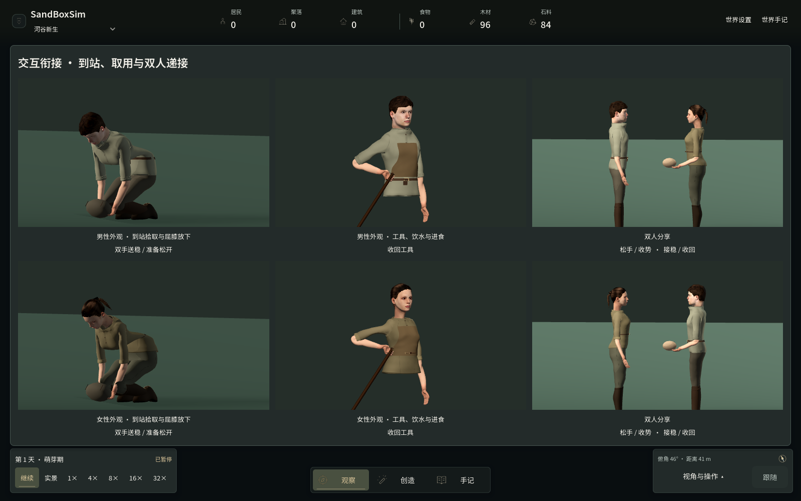

杯子和食物是随居民姿态显示的道具。地面拾取当前分别呈现资源堆和弯身姿态。高速模拟中，短动作补全依赖客户端是否采到完成状态。

`residentLocomotion=settled-arrival-v3` 的行走骨盆采用连续的双步支撑曲线，并受真实腿长、前后脚目标和鞋底滚动约束。摆动脚接近地面时提前参与可达范围计算，支撑中段允许膝部接近伸展；骨盆不会在落地标志切换时突然下降。步频、转身、疲劳、双手搬运及原有左右摆臂仍读取同一行走周期。

女性肩部使用已校验的 `trunk-feminine-cage.json` 中 `sourceShoulder.x × scale.x`，在当前模型局部坐标得到约 0.11608 米的肩关节半宽；导出文件的通用 `shoulder` 字段只表示参考坐标。关节静止位置、逆绑定、连续袖片、卷袖口和远景上臂使用同一个宽度。工具、采集、交谈及进食起手的身体相对横向目标按实际肩宽适配；嘴部接近点和物资支持点继续读取实际对象坐标。垂臂外展余量根据肩宽、髋部间距及固定臂长计算，避免窄肩模型仍向较宽的共用目标外展。

`shoulderSkin=reference-figure-v25` 的成人衣身使用二十六骨绑定：躯干、左右上臂、骨盆衣料、十个分段旋转支撑、十个袖管位置修正支撑及独立的左右肩胛带。袖子的六个旋转区间将摆动和轴向扭转分开处理：摆动从肩胛带逐渐过渡到实际上臂方向；轴向扭转在肩根暂缓，再沿上臂逐渐分配，不再从固定躯干朝向开始；各区间围绕显示肩点保持截面，每个顶点仍至多四个影响，袖口完整跟随上臂。

程序上肢、肘部偏好及肩袖姿态采样共用 `PreferredArmFrame`：从垂臂的中性朝向运输参考轴，随抬臂逐渐加入外旋。外旋设计幅度从侧抬的 30° 过渡到前伸的 5°，在 15°–130° 抬臂范围渐入；这些是项目表现参数，参考坐标与实验定义不同，未拟合个体数据。屈肘围绕该参考的屈曲轴，前臂旋前／旋后保持独立；程序抬臂不再通过把屈肘角加到抬臂角来构造姿势。普通到达目标动作使用同一参考产生低位肘向，前方伸手同时考虑重力支撑与躯干侧向间隙，工具腕角和精确握持继续由原求解器约束。肩带求解以显示上臂或显式肘目标初始化，再与双骨 IK 迭代，减少仅弯肘时由手腕位置引起的耸肩。

设计参考 [Inui 等人的动态抬臂外旋研究](https://actaorthop.org/actao/article/download/18801/22612/65079)中不同抬臂平面的旋转差异，以及 [Epic IK 求解器文档](https://dev.epicgames.com/documentation/unreal-engine/ik-rig-solvers-in-unreal-engine)中的屈曲轴和偏好角方法。项目仍采用自己的解析求解与有限姿态缓存；CMU 143_30 的实际捕捉方向和手腕朝向继续走原始重定向路径。

肩上衣片沿网格表面到共享袖窿的距离渐入肩胛带，下侧胸片的牵拉范围比上肩衣片更窄，颈口、胸口中线及腰部不参与抬臂；躯干衣片不再叠加肱骨摆动。袖管的影响在拟合后的网格上以袖窿零、袖口一为边界，按实际边长求解调和过渡。这样缝线两侧共享同一肩胛带，而不是沿用旧权重在边界突然跳入较大的上臂旋转。原始烘焙资产与来源哈希保留，运行绑定从源数据重新生成。

女性肩部支撑与成衣沿用同一段腋侧曲面。站立时，腋窝前后两道折线之间的胸侧向内收最多 3.5 毫米，保留前侧胸肌与后侧背肌各自的轮廓。抬臂时，袖窿继续随肩胛带移动，其下方的胸侧衣片按高度、深度和抬臂角度渐渐收回多余的外移和上提。姿态修正预先烘焙，三款衣装复用已有的形态缓存。`FEMALE_AXILLA_PASS` 在左右臂各抬至 135° 时测实际蒙皮成品，并限制袖窿下方胸侧的最大外移。造型参考[腋窝前后壁的超声与解剖观察](https://pmc.ncbi.nlm.nih.gov/articles/PMC10175532/)、[多平面抬臂实测](https://pmc.ncbi.nlm.nih.gov/articles/PMC2657311/)和 [Blender Studio 的抬臂衣装形体](https://studio.blender.org/training/realistic-human-research/clothing-shapes/)。

袖管位置修正使用顶点相对肩关节的实际轴向位置，令截面中心沿上臂轴移动、径向截面随分段旋转保持体积。肩关节以上的顶点不获得向下轴段的平移；从共享袖窿起的 4 厘米布面范围平滑引入补偿，缝线继续跟随肩胛支撑。网格最短路径只控制这段缝合过渡，不代替轴向位置，避免绕行袖山的布面距离把肩顶向上顶出。完全随上臂的袖口不需要额外平移。距离、调和影响和姿态形态在拟合网格创建时缓存，动画帧不重建网格。UV2 保留缝片构造坐标。

`reference-contour-physique-v31` 保留来源人体的上臂体积支撑：从已校验的 MakeHuman HM08 男女青年宏目标中，按各自肩—肘轴采样 25×64 个截面半径，保留三角肌区域到肘部的渐变和非圆形截面。成衣留出 7 毫米松量，以距袖窿的网格距离逐渐进入支撑，单点径向修整不超过 12 毫米，袖口保持原有尺寸。该数据提供衣料包络支撑。成衣保留原有缝线拓扑与袖口连接；新增姿态修整另约束位移在短边上的变化，防止小幅修整拉开压缩袖山；来源与重建工具见[人物素材](human-assets.md)。

衣身包含一百二十个归一化姿态修正：左右臂、后斜 45°／侧向／前斜 45°／前向四个平面，45°／90°／135° 三个高度，以及中性、近端内外旋及两端内外旋五种采样。扭转采样包含共享参考的中性朝向、中性两侧 ±0.60 弧度，以及 −1.65／+1.65 弧度两端，按当前朝向到中性与端点的实际角距插值；这些描述缓存覆盖范围，不是人体关节限制。每个衣料顶点先在静止人体表面绑定三角面、重心坐标及 6–18 毫米衣料偏移，此对应关系随各姿态运输，不在抬臂后重新寻找最近身体部位。结构贴合在姿态空间限于 10 厘米，随后在 4 厘米的网格路径补片内进行静止细节恢复：静止与目标表面使用同一组六轮面积加权松弛，静止表面的细节差值在局部切线／法线坐标系内记录，随目标表面框架运输后恢复；单点修正限于 18 毫米，活动掩码固定颈口、中线、腰部及袖口；绑定空间位移保护上限为 8 厘米。64 轮约束同时处理位移梯度与实际蒙皮边长，烘焙目标边长限于静止边长三倍，为姿态间插值留出余量；最终活动范围仍保留原有的 4.5 倍回归上限。颈口、中线、腰部和袖口固定，法线按最终表面重建并反算回蒙皮前坐标。运行帧仅驱动骨骼和形态权重，GPU 负责形态混合及线性蒙皮；不同衣色共享对应体型／剪裁的缓存，LOD 保留形态及混合模式。

`SLEEVE_CORRECTIVES_PASS` 检查两种成人外观与三种剪裁的形态数据、归一化引擎烘焙、两臂同时修正、共享缝线及固定颈口／中线／腰部／袖口、暂停和近远景恢复。`PROTRUDING_CAP_PASS` 单独统计距绑定人体参考点超过 4 厘米的顶点，比较完整表面距离，避免平均法向残差掩盖局部偏移；姿态烘焙还约束实际蒙皮后的短边。法线检查以实际形态混合及蒙皮后的三角面为参考，比较静止法线方案和姿态法线方案；它衡量表面朝向的一致性，不是写实品质评分。`SLEEVE_SWING_TWIST_PASS` 检查独立摆动方向、纯扭转时肩根稳定、端点、四元数符号及旋转区间截面。`ELBOW_PLANE_METRICS` 在实际动作及收回全过程检查前臂相对屈肘平面的偏离；`SIGNED_ELBOW_FRAME_PASS` 另检查稳定抬臂时的有符号屈曲轴，避免只因放宽滚转角度就通过检查。收手仍保留进入速度和阻尼，同时约束实际显示的肩、肘、腕角速度，防止从较大手势返回时突然甩动。

`shoulderSurface=authored-bind-surface-v3` 保留来源 A 姿势、四组来源权重及各自绑定旋转。人体支撑直接从 A 姿势计算目标状态，避免对已经线性压缩过的垂臂表面再次变形；中性状态与导出的垂臂表面逐顶点对齐。肩部辅助段使用半程绑定旋转，胸片的肱骨段保留静止绑定。方法参考 [Kavan 等人的双四元数蒙皮研究](https://users.cs.utah.edu/~ladislav/dq/index.html)，由项目代码实现，仅用于缓存中的人体支撑，GPU 衣料仍使用原有线性蒙皮。

设计参考 [Epic 的 MetaHuman 身体绑定编辑](https://dev.epicgames.com/documentation/metahuman/metahuman-stylized-character-body-rig-editing)：联合检查关节位置、蒙皮和姿态修正，并在完整活动范围内观察穿衣模型。当前是本项目自己的解析支撑、来源人体表面和有限姿态插值，没有导入 MetaHuman 模型或其 RBF 系统，GPU 仍使用线性蒙皮，双四元数仅用于下述人体支撑缓存；当前没有肌肉仿真或布料物理。姿态关联形态的工作方式另参考 [Autodesk 的 PSD 说明](https://help.autodesk.com/cloudhelp/2026/ENU/Maya-CharacterAnimation/files/GUID-00699C13-8CA1-450C-937D-57C7B3DFD8C6.htm)，当前插值与修整由项目代码实现，不需要 Maya。截面体积问题另参考 [Blender 骨架修改器说明](https://docs.blender.org/manual/en/latest/modeling/modifiers/deform/armature.html)。

`shoulderMotion=inertial-reach-v10` 将关节位置与肩胛平台朝向分开。关节位置沿胸锁端的锁骨弧线移动：项目参数在高位渐入至 8° 抬升和 8° 后缩，低位前伸可渐入至 6° 前伸。肩胛平台另有随上臂高度变化的上旋和后倾，分别限于 32° 和 10°；这些是动画设计参数，不是从论文拟合的个体临床数据。上臂实际方向驱动肩带，单独弯肘不触发耸肩；前伸量在垂臂附近淡出，避免水平投影方向不稳定引起肩点跳动。

肩点更新和原有精确臂长 IK 共同求解，修正后保留腕部目标及肘平面的舒适角度。肩胛平台、分段袖管、肱骨和持物都使用同一显示肩点；收回时仍使用实际显示速度和阻尼。上臂按有符号屈曲轴确定朝向，上一帧完整坐标系随方向运输，接近伸直时保留稳定滚转；前臂旋前／旋后与腕部限角继续独立处理。上臂坐标系直接服从实际肩肘腕屈曲平面，时间平滑作用于手掌轨迹与肘平面，不再给已求解的肱骨参考单独加入扭转滞后。肘平面沿上一帧肩腕射线作最短旋转运输，接近伸直时保留稳定参考；收回动作的前臂姿态在惯性阻尼后约束回屈肘与轴向旋转自由度。交互仍采用解析求解，空闲伸展采用捕捉方向与手腕朝向；当前没有完整胸锁／肩锁关节约束、裸露上臂肌肉动力学或全身捕捉重定向。

上臂扭转分配参考 [Autodesk 的实时扭转关节示范](https://www.autodesk.com/learn/ondemand/curated/realtime-rigging-twist-and-roll-joints/6f2TG8ZL79fDFyYDfDXdnC)，使肩部不随整条上臂一起拧转；肘部平面参考 [Autodesk Rotate Plane IK](https://help.autodesk.com/cloudhelp/2022/ENU/Maya-CharacterAnimation/files/GUID-9942FFB5-65C2-46E2-B5A3-297667A9FB5D.htm)。项目实现自己的解析求解与蒙皮，没有复制其角色资产或工具代码。

研究参考 [Ludewig 与 Braman 的肩部力学综述](https://stacks.cdc.gov/view/cdc/33180/cdc_33180_DS1.pdf)，其中区分锁骨运动、肩胛上旋和后倾；另参考[自由过顶伸手实验](https://pmc.ncbi.nlm.nih.gov/articles/PMC2841046/)中抬起／放下及多轴运动的区别，以及[多平面肩部研究](https://pubmed.ncbi.nlm.nih.gov/23141955/)。项目据此拆开驱动和检查，没有给所有角色套用固定肩肱比例，也没有把研究测量范围当作统一活动限制。

`SHOULDER_FIT_PASS` 检查三个成人身份的拟合肩点、逆绑定、实际支撑权重、近远景恢复和全部肩袖骨骼的暂停；窄肩身份另检查空手／携带腕中心横向距离。`SHOULDER_MOTION_PASS` 连续检查实际动作的上臂旋转与支撑截面。`SHOULDER_GIRDLE_PASS` 检查两种成人肩带的镜像、连续弧线、旋转平台和扭转修正的权重分配；`ELEVATION_EDGE_PASS` 检查抬臂全程的实际形态混合／蒙皮边长，包含袖窿极短边。`ELEVATION_SURFACE_PASS` 在两种成人外观、左右臂、三个抬臂平面、0–135° 抬起与放下的 2,172 个姿态上检查实际蒙皮、袖口、袖管离上臂轴的距离、肩带响应和区间旋转半径。原有三种剪裁的动作边长应变、固定领口／中线／腰部、接触、暂停及帧步长回归共同运行；这些工程检查不等同于人体实测或写实质量评分。

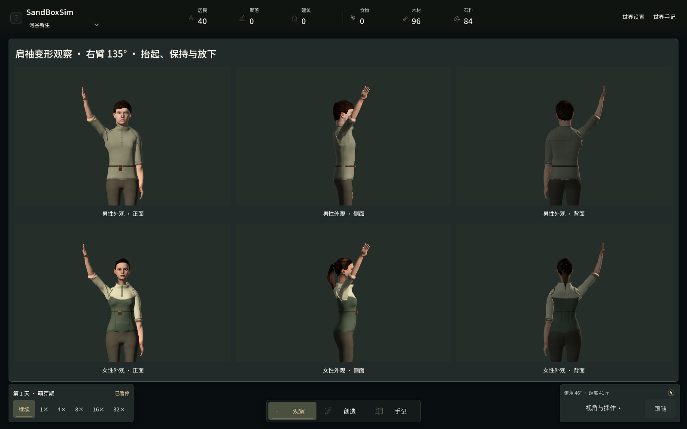

[肩袖连续抬起、保持与放下的公开场景](../../benchmarks/scenarios/visual-shoulder-elevation.json)，使用游戏共用模型和同一个肩肘腕求解器，左右臂各占六秒：1.5 秒抬起、一秒保持、1.5 秒放下、两秒休息。该入口只用于观察绑定范围，不向玩家增加任务，也不是导入的动作捕捉。挥锤与返回可从 [肩肘作业场景](../../benchmarks/scenarios/visual-shoulder-motion.json) 采样。

### 来源肩部与捕捉伸展

`shoulderSurface=authored-bind-surface-v3` 使用 MakeHuman 的三维肩部表面和来源权重。来源四边网格进行一级 Catmull-Clark 细分，导出男性 2,357 顶点／4,518 三角面、女性 2,236 顶点／4,291 三角面。当前直接从来源 A 姿势与各组绑定旋转生成目标姿态；上臂、肩胛平台及锁骨分别传输，肩部辅助区域跟随肩胛平台。下垂臂表面用于静止绑定与固定衣料对应，不作为再次蒙皮的姿态起点。支撑采用自行实现的[双四元数刚体混合](https://users.cs.utah.edu/~ladislav/dq/index.html)，避免直接混合大角度旋转矩阵时的截面塌缩；没有实现优化旋转中心算法，也没有将 GPU 蒙皮改成双四元数。胸侧衣片把肱骨影响转回躯干，再沿袖窿后的 10–80 毫米渐入袖段，防止静止时贴近上臂的胸侧衣片被一起举走。所有表面对应、运输和查询只在姿态缓存创建时进行；该支撑不是新增裸露上臂、肌肉物理或完整来源骨架重定向。

`motionReference=cmu-143-30-v1` 采用 [CMU Graphics Lab 143_30 伸展记录](http://mocap.cs.cmu.edu/search.php?subjectnumber=143)：370 帧、120 Hz，时间跨度 3.075 秒。来源 ASF 的层级、局部旋转轴及 AMC 通道先做前向运动学，再导出相对胸廓的双侧上／前臂方向、手腕朝向和相对根节点的胸廓朝向。重定向保留游戏自己的肩宽和臂长，不使用来源根位移；手指／拇指没有捕捉数据，继续使用本项目放松手型。胸廓运动有限幅，腿脚与世界移动仍受原控制器管理。同一条记录映射到两种成人外观，不将它当作男女动作差异的实测数据。

近景、空手、无搬运的成人持续空闲约 35–57 秒后可自行伸展；移动、工具、搬运与其它互动具有优先级，退出时使用已有的惯性收回。暂停冻结播放，儿童及远景代理不启用该空闲片段。自由运动直接使用来源方向及手腕旋转，不再经过手掌目标速度限制，以免把捕捉时序改成程序 IK 滞后；接触任务继续使用原有求解器。`CAPTURED_ARM_MOTION_PASS` 检查来源方向／朝向、实际蒙皮、空闲世界接入、持物优先级、暂停、退出和 LOD。

`--panel=captured-stretch` 是使用同一游戏模型的观察入口，每 3.075 秒记录后接两秒休息，休息首尾各留 0.25 秒连续混合，连接放下和下一次起手。原生画面见下图，完整伸展可用 [捕捉伸展场景](../../benchmarks/scenarios/visual-captured-stretch.json) 采样，旧的 `shoulder-elevation` 仍用于固定范围检查。捕捉记录按 CMU 的独立条款使用，来源与重建见[人物素材](human-assets.md)，不能将其标成 CC0。

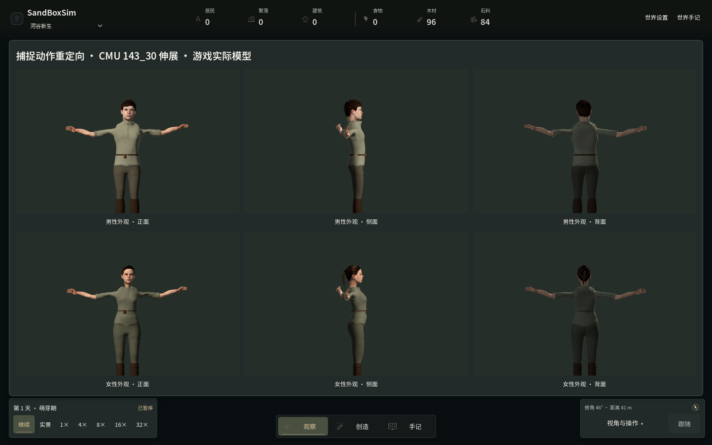

`limbCoordination=hinge-carry-v4` 的携带姿态将手降到身体侧下方，按实际掌柄的四分之一转绑定确定工具方向；短锤与长柄工具采用不同朝向。挥锤时将手的长轴放在前后挥击平面内，锤头朝向按实际网格的负 Y 端安排；携带与作业采用 0.40 秒的混合，工具位置和旋转仍保留阻尼速度。另一只手只在当前工具实际参与作业时进入支撑，换工具时不再伸手追逐正在收回的旧工具。

左右臂分别记录本步是否被交互求解、是否仍在返回；未被当前动作使用的手独立回到垂臂姿态，避免单手进食阻止另一只手从交谈动作收回。实际工具接触点、双手支撑、臂长和暂停规则继续保留。`SHOULDER_MOTION_PASS` 在三个成人身份（其中两个女性身份）、三种职业和连续的空手／工具动作切换中检查 25,920 个显示上臂样本的轴向旋转与相邻帧转角；它与原有握持、手腕、衣料和 60/120 Hz 检查共同运行，不单凭手部到达目标判断肩部正确。

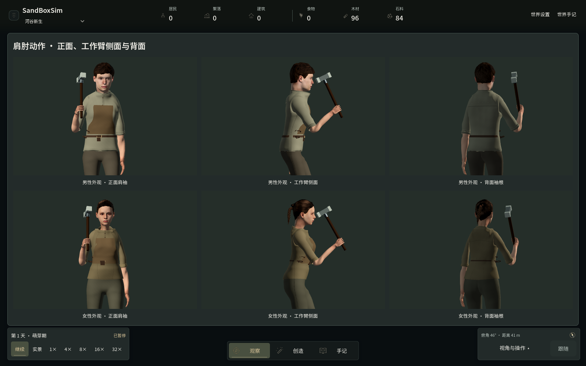

[肩肘连续动作场景](../../benchmarks/scenarios/visual-shoulder-motion.json) 使用同一实际动作控制器。抬臂、肱骨轴向旋转与肩胛／锁骨运动分开描述的参考见 [ISB 上肢关节坐标系建议](https://media.isbweb.org/images/documents/standards/isb_jcs_part_ii.pdf)；当前没有实现独立肩胛骨、锁骨关节或肌肉动力学。

弯身拾取时，在原腿长下求解到角色局部的原脚踝落点，保持脚底朝向；手部、腰背与工具挂点继续跟随现有过渡。这不是世界空间的足部锁定、任意物体抓取、地面接触力或完整动作捕捉。`SUPPORT_COORDINATION_PASS` 检查两种成人外观的支撑中段、骨盆连续性、拾取后的脚踝稳定和低位携带；原有手部／工具接触、60/120 Hz、远近景与暂停检查同时保留，结果不作为写实程度或医学步态评分。

设计参考[不同速度下膝关节功能实验](https://pubmed.ncbi.nlm.nih.gov/11415746/)、[日常上肢多关节协调研究](https://pmc.ncbi.nlm.nih.gov/articles/PMC7357763/)及[日常上肢活动范围实验](https://pubmed.ncbi.nlm.nih.gov/26709433/)。它们用于区分支撑、摆动以及肩肘腕协调；曲线、时长和限角是项目动画参数，没有拟合实验动作或导入受试者数据。

公开 `visual-motion`、`visual-social` 和 `visual-social-side` 可在固定 60 Hz 下观察携带／劳动／收回以及交谈、分享、进食的完整过渡；`visual-locomotion` 和 `visual-body-motion` 分别显示移动与弯身支撑。

### 徒手过渡的速度记忆

徒手靠近、交谈和交接采用手掌目标的位置／朝向阻尼。每只手独立保存线速度和角速度，目标改变时保留运动状态；退出时从实际显示的关节变化估计角速度，以带速度记忆的肩肘腕阻尼返回放松姿态，避免无接触目标的另一只手因 IK 极点改变而翻转。使用 0.65 米／秒起的平滑速度过渡，渐近限制在 0.9 米／秒、腕角和肩部约束，因此这不是任意轨迹下严格的全身 C1 连续保证。

同一已握工具在执行阶段切换采集资源时保留挥动周期；换工具或重新进入执行才重置周期。回归检查比较持续采石与中途切为采铁的两个实际镐具姿态，避免仅靠计时器推断连续性。设计参考 [Inertial Easing](https://www.theorangeduck.com/page/inertial-easing) 对目标改变时保留速度的讨论；本项目使用现有临界阻尼实现，没有移植其曲线求解器。动作演示仍由原生客户端采样，不重绘或插帧。

### 身体参与与劳动节奏

`wholebody-motion-v7` 的徒手伸手根据上一帧实际手腕的前伸和侧向位置，有限调整躯干俯身与转向；退出时随手部混合量收回，拾取已有的深屈身单独处理。身体围绕原髋部基点运动，原脚步、腕角和掌柄接触约束保留。

`elliptic-countermotion-v4` 减小空手基础前举和固定屈肘，扩大行走中的肘部伸屈差，并让前臂相对肩部略微滞后；胸廓继续与骨盆反向运动，按同一实际步速与周期驱动。设计参考[行走摆臂控制实验](https://pubmed.ncbi.nlm.nih.gov/19181900/)和[不同速度及坡度下的摆臂测量](https://pubmed.ncbi.nlm.nih.gov/27367784/)。摆臂包含主动与被动成分，项目仍使用艺术设定与受约束的程序动作，没有实现肌肉动力学或套用单个群体的统一参数。

`arc-recovery-v4` 将劳动抬起曲线改为周期相位扭曲后的余弦，准备较长、返回较短；上止点具有曲率，避免分段五次缓动在关键姿态附近反复停住。负荷仍影响周期与支撑，工具抬起高度及原握持方向保留；手锤高位手部目标进一步前移，减少锤头向脸侧回折。回归检查约束周期边界及顶点邻域的变化，并继续核对真实关节、接触和暂停；这些检查不等于自然度或真实撞击力评分。

### 行走中的肩肘、前臂与手掌

`ResidentRig.ArmSwing.cs` 负责基础空手姿态，当前版本为 `elliptic-countermotion-v4`。左右臂与对侧腿同向，肩关节、小幅滞后的肘部与胸廓转动共同形成轨迹。肘部保留正向屈曲，前摆时适度增加；目标包含弱二次谐波，避免在前后摆交界处突然改变肘部弯曲方向。摆幅同时读取速度、疲劳及原有个体系数，男性／女性外观共用相同协调规则。

授权手部的原始参考掌面朝前，行走采用掌心向内、拇指向前的放松取向。约 1.4 弧度的参考姿态转换放在沿实际肘腕连线的前臂轴向，轴经过实际手腕中心；手腕自身仅保留小幅屈伸和偏移。这样不会靠手腕单独转动近直角，也不会改变前臂长度。左右取向按原有镜像约定成对处理，近景蒙皮和远景代理共用关节变换。

自由摆臂目标分别保留肩部及前臂的阻尼速度；手掌、肘部与工具的交互解算随后接管相应肢体。滤波不重复作用于已解算的工具握持，搬运、双手工具支撑、取出、使用和收回继续走实际掌柄约束。回到空手时，现有收手过渡接回新的基础姿态。该段行走与自由摆臂仍为程序动画与有限骨骼解算；空闲伸展另使用上文的捕捉片段，当前没有肌肉动力学。

研究依据为 [Collins 等的摆臂动力学研究](https://pubmed.ncbi.nlm.nih.gov/19640879/)及 [Hejrati 等在不同速度和坡度下的肩肘轨迹研究](https://pubmed.ncbi.nlm.nih.gov/27367784/)。前者用于检查对侧协调，后者用于区分肩部与肘部的幅度、偏置及相位；项目参数属于动画造型，不是对论文测量曲线的拟合或医疗标准。

`--panel=arm-swing` 和公开 `visual-arm-swing.json` 同步展示正面、侧面及掌腕近景，并包含启停。`WALKING_ARMS_PASS` 从真实手掌网格的掌面法线及已显示关节检查方向、拇指轴、腕角、肘部屈曲、手部连续、臂腿相位及暂停；原有全部持物、衣装和远近景节奏检查继续执行。

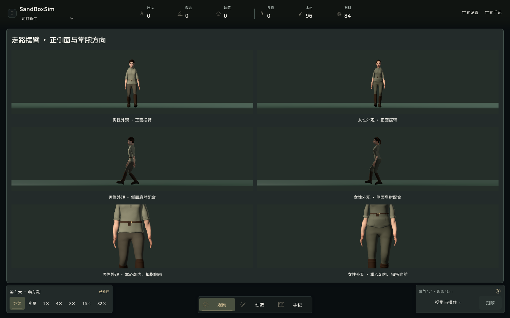

[正面与侧面的摆臂循环场景](../../benchmarks/scenarios/visual-arm-swing.json)

### 发力、疲劳与动作节奏

`ResidentRig.Effort.cs` 以工具类型、个体表现系数、真实疲劳和健康值构成相对作业负荷。男女成人外观的默认系数范围分别为 0.89–1.17、0.80–1.08，范围重叠并由稳定身份选取；这只是程序动画的造型参数，不是实测力量或模拟内核的新技能。相同系数及状态使用同一控制器，不固定规定某种外观必须以某种方式劳动。

蓄力和下挥分别使用端点平滑的五次曲线，末段保留小幅吸收与回收，替代旧循环末尾的停住不动。负荷提高会延长准备与整个周期，疲劳另增加恢复时间；躯干前后配合与小幅转动使用同一作业相位，避免独立正弦摆动与手锤错拍。头部和躯干转动通过保留速度的临界阻尼过渡。状态变化只改变后续相位推进速度，不重置当前挥击。空手到达目标的速度、朝向和肘向随剩余距离减速，已有最高速度、腕角与肩点约束继续生效。

[递增负荷搬举研究](https://pubmed.ncbi.nlm.nih.gov/26851478/)和[上肢搬举研究](https://pubmed.ncbi.nlm.nih.gov/32342895/)用于区分外观、能力与相对负荷；[模拟锤击腕部研究](https://pmc.ncbi.nlm.nih.gov/articles/PMC2901240/)用于理解腕、前臂与上肢协同。搬举不等同于锤击，研究没有直接给出本项目的周期或性别系数。当前仍是受约束的程序动作，没有工具质量、接触冲量、肌肉动力学、完整肩胛骨或动作捕捉；不改变资源产量、伤害和行动时长。

持工具的主手先过滤目标位置与四元数朝向，再执行两节 IK；保留上一时刻的速度，切换目标时不清零。蓄力路径增加小幅外侧／后侧弧线，挥击不原路折返。收纳在位置、完整朝向与剩余速度都接近挂点时才换父节点，工具继续与实际手掌保持刚性接触。工具与头部的阻尼时间参数分别为 40、75 毫秒，躯干随动作风格为 55–70 毫秒；参数控制衰减，不表示精确的到位时间。

设计参考[临界阻尼与动画过渡说明](https://www.theorangeduck.com/page/spring-roll-call)和[动画惯性过渡的工程文档](https://dev.epicgames.com/documentation/en-us/unreal-engine/animation-blueprint-blend-nodes-in-unreal-engine)。当前实现是 IK 前的目标跟踪，不是移植 Unreal 节点，也不是完整动画片段惯性融合。自检包含固定目标下的分步一致性、切换目标前的速度保留、两种成人体型的六类动作切换、工具取放时的位置／转角连续性与握持接触。

世界角色与人物观察窗都读取真实疲劳和健康值。`work-effort` 用相同手锤展示两种成人外观的状态对照；自检核对相同系数下的周期一致性、疲劳后的节奏与躯干响应、掌柄接触、状态切换连续性和暂停。该检查保证运行约束，不把通过结果当作动作写实评分。

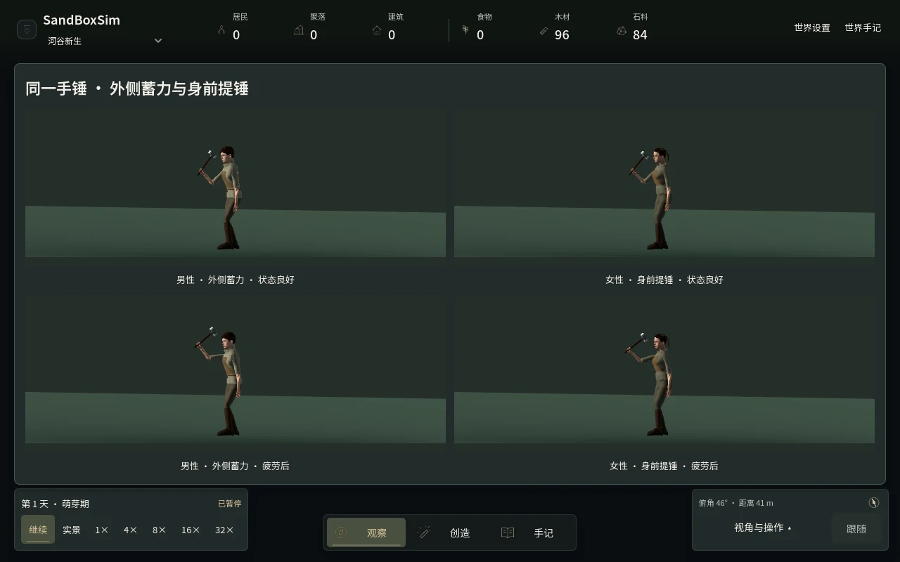

劳动支撑姿态由工具相位和相对负荷驱动，髋部、小幅屈膝与上肢同时配合。计算保持原大腿／小腿长度及脚踝前偏移，反求髋部位置与膝角，使角色局部的两只脚踝落点和鞋底朝向保持稳定；已有世界转向、地面高度与坡面补偿继续生效。这是矢状面支撑姿态，没有全身平衡物理、地面接触力或转身时的世界空间足部锁定。进入和退出保留阻尼速度，暂停冻结。远景仅对便宜的支撑滤波按 60 Hz 分段积分，不重复整套 IK；徒手过渡以最多 1/30 秒子步处理，保留原有 60/120 Hz 和远近景姿态误差检查。

发力节奏对照观察实际握持工具的升降轨迹，以至少 60 毫米的上升和回落确认一次动作，在首个稳定动作后采样同长的 650 帧区间。它不以固定的世界高度切分人物：不同肩点或腰带挂位造成的拿取时间差，不应被当作同等能力下的劳动节奏差异。对照仍同时检查疲劳后的减速、躯干参与、握持接触、过渡和暂停。

眨眼采用身份错开的确定性时间窗，65 毫秒闭合、155 毫秒睁开。交谈的点头、口部和手势共享表达节奏，口部在表达间留出停顿并平滑收口。饮水的口部动作从杯沿接近开始，进食在食物接触后短暂咀嚼。这些时间用于游戏表现。[眨眼与交流研究](https://pmc.ncbi.nlm.nih.gov/articles/PMC6291193/) · [动作捕捉的言语手势研究](https://pmc.ncbi.nlm.nih.gov/articles/PMC7280344/)

成人身体使用 `bodyFrame=reference-contour-physique-v31`。形体参考来自 Blender 官方 [Human Base Meshes v1.4.1](https://www.blender.org/download/demo-files/) 的 `Body Male - Realistic` 与 `Body Female - Realistic`，作者为 Dan Ulrich，许可为 CC0。官方 ZIP 中的来源 `.blend` 长 49,420,489 字节，SHA-256 为 `3c121505651140ceb4d69fd1d8923f7788ffadd81672f5be14845a5f2c75c137`；来源缓存仅保存在项目 `.tools/`，运行和普通构建不需要下载或启动 Blender。完整输入身份见 [reference-shape-sources.json](../../src/SandBoxSim.Godot/assets/models/human/reference-shape-sources.json)。

| 成人外观 | 来源形体 | 规范空间肩点半间距 |
|---|---|---|
| 男性 | Dan Ulrich 写实男性身体，转移到 HM08 拓扑 | 约 0.13117 米 |
| 女性 | Dan Ulrich 写实女性身体，转移到 HM08 拓扑 | 约 0.11608 米 |

制作流程参考 [Blender Studio 的基础网格使用](https://studio.blender.org/training/realistic-human-research/use-of-base-meshes/)与[比例及整体形体设计](https://studio.blender.org/training/realistic-human-research/design-sculpting/)：先确定可比较的身体轮廓，再处理局部细节与衣装。

[export_resident_reference.py](../../tools/export_resident_reference.py) 读取来源模型的区域边界作为重定向参考，整理肩—骨盆轴，再用 41 个关节与胸腹／骨盆表面参考点拟合 HM08。径向基函数的仿射部分同时受到前、后、左、右轮廓约束；条件数检查拒绝欠约束的深度拟合。随后向参考表面转移有界位移：单点投射限于 45 毫米，位移经过有限平滑及边长梯度约束。衣装辅助点继承原表面对应的位移，关节辅助点恢复参考中心。区域边界是制作参考，并非医学骨点或人群分类参数。

`reference-shape-male.json`／`reference-shape-female.json` 各保存 19,158 个原拓扑点的位移，其中 13,380 个属于身体表面。它们记录来源几何、骨架、权重、模型文件哈希和重定向参考；保留现有拓扑索引，未导入参考资产的头脸或手部来替换游戏当前的独立来源。`body-profiles.json` 的两种成人的参考转移权重均为 1.0，分别保留各自 HM08 拓扑；不叠加额外的体重／肌肉／胸部宏目标。

[resident_body.py](../../tools/resident_body.py) 在已校验 HM08 基础体与性别宏目标上应用转移位移。原始拓扑坐标仍以基础男性肩髋纵向 0.43 米换算到规范游戏坐标，三轴共同使用约 0.0922173 的比例；专业参考形体本身的缩放与中性轴重定向独立记录。躯干、上臂、肩面、连续裤装和前臂拟合十份输出共用同一 `shapeRecipe` 与输入哈希，不能混用其中一组的旧身体。头脸、手部和 CMU 动作保持各自的来源与许可。

当前躯干支撑各含 113×128 个 0.74–1.30 米平面截面。手臂排除使用已校验骨架的完整后代权重，覆盖前臂、腕部、掌骨及手指；不再以固定横向裁界截掉真实胸侧，或把靠近腰部的手掌并入腰围。`armholeHalfWidth` 保留为兼容的名义袖窿参考，实际躯干区域由 `armExclusion=source-skin-weights-v1` 标识。胸腹和骨盆的 24 个独立参考截面参与来源偏差检查。原 65×128 胸肩支撑继续作为既有衣片的构造参考。

肩点间距、袖管围度和颈口分别处理。颈侧 55 毫米内保留原连接，向真实肩点以单调曲线过渡；袖管围绕各自肩点拟合，不能把肩点间距系数继续乘到整个上臂围度上。袖口宽深由同形体的肘侧截面及原缝合网格求得，沿上臂逐渐接入，卷边与近远景共用该尺寸。实际关节、衣袖与逆绑定共同适配。

肩部三角面保留同配方的原始 A 姿势和来源权重，垂臂绑定及抬臂参考在同一身体上建立，避免新身体混用旧肩面。袖管中心线的轴向位移在距袖窿 0–60 毫米内平滑接入，随后保持实际肱骨轴上的站位；过渡距离与自由袖管检查共用定义，袖口保持原绑定。连续抬臂检查遍历两种成人、左右臂和三个平面，按实际蒙皮短边的最差拉伸判断，原误差上限保持。上臂截面、肩袖位置修正和现有有限姿态表面修正继续共同工作。身体和衣装参考在创建时缓存，普通构建不运行 Blender、不联网，也没有逐帧重建人体。

`NatureModels.ClothEnvelope.cs` 对相邻高度的五个截面加权平滑，再求截面凸包，让衣料跨过身体凹处。松量沿截面表面法线定义：基础 5.5 毫米、侧面最多增加 1.5 毫米、后片最多增加 1 毫米，成衣腰带处收回最多 1 毫米；射线与截面法线的夹角参与径向换算。低段前片最多保留 3 毫米活动余量，裤装重叠区以实际裤装外包络加 6 毫米作为最低目标。衣料垂落与收褶均使用缩短衣片后的实际腰带高度，旅行衣同时保留各方向开衩对高度的影响。包络按两种体型与三种款式分别缓存，共六组，动画帧不重建。短上衣按最终衣片高度取来源截面，保持腰线到上髋的连续性。

上胸拟合分开处理中央锁骨衣片、颈口与肩峰。中央衣片逐渐接入来源胸廓；颈口保持既有开口，肩峰和袖窿继续使用三维肩面支撑，避免把肩部当成躯干截面径向收缩。设计参考 [Blender Studio 的衣装形态分组](https://studio.blender.org/training/realistic-human-research/clothing-shapes/)与[连续衣装拓扑说明](https://studio.blender.org/training/realistic-human-research/retopology/)，使用本项目已有衣片和来源人体；没有导入课程中的角色资产或声称实现布料物理。

`TAILORED_VOLUME_PASS` 测量最终近远景网格在六个胸腰高度的宽度，相对同体型来源保留至少 8 毫米、至多 40 毫米的总宽度余量。它与三款衣装的局部可逆性、腰带接触、上下衣重叠和连续抬臂检查共同约束体积，不是人体胖瘦、性别或审美的分类标准。

接缝取样对正负近零角与整圈角统一周期索引，避免极小负角舍入到表尾之外；三款衣装的下摆、成衣腰带、衣片参考及两种人体支撑均有实际末行取样检查。

近景拟合从实际重新布线的 `ContinuousGarment` 读取水平截面，衣身、腰带、附件、挂点及远景按同一套缝合网格参考匹配来源包络；解析构造仅作为袖窿开口处的回退参考。衣装参考独立使用 133×128、0.64–1.30 米的构造空间网格，人体来源仍为 113×128、0.74–1.30 米；旅行衣的开衩归一化从实际缝合网格边界恢复下摆高度，不将径向角当作原始纸样参数；内折边按源构造的 10 毫米回退。低段是否拟合按最终成衣高度判断，避免旅行长衣裁剪前低于 0.70 米的衣片被跳过。参考截面按三种衣装缓存，袖片及袖窿开口不被误当成胸廓。前胸和背部另用向上 120 毫米内的支撑包络建立最多 7 毫米的垂落余量，在腰部区域收拢；侧缝与肩袖宽度保持原有拟合约束。这是创建时的衣料形体处理，不是每帧布料模拟。

`NatureModels.GarmentDrape.cs` 为腰下、袖窿与后片建立局部宽峰窄谷褶皱，半径位移限制在 −3 至 +4.5 毫米。布面与附件共用高度映射，领口及袖口退出该位移。下摆长度调整在完整躯干内平滑过渡至 1.23 米，避免窄身衣片被过短的高度坡道压缩；成衣下摆按款式结束在上髋或较长衣裙段，避免统一的长下摆落入最宽的大腿后被裤子穿出。上衣侧缝和背部肩育克、裤腿内外缝使用独立的静止表面坐标与像素导数过滤；缝线随网格变形，不依赖摆姿后的世界位置。

外衣在 0.94 米以下另以实际成品裤装的平面截面凸包作为下层约束，以裤装包络外 6 毫米作为最低拟合目标；因此旅行长衣按实际臀腿高度取样，而不将低段统一钳到 0.80 米。该包络按两种裤装缓存，与人体来源包络共同决定成衣形体。动态检查从真实下摆以上 20 毫米起覆盖重叠区域，仍保留 1 毫米穿插容差。

鞋面与鞋底使用相同的圆头鞋楦，鞋带、鞋舌和沿条随楦型生成；实际鞋底接地、鞋面与鞋底接合及鞋带间距仍由三角面检查。鞋楦是项目手工参数化模型，不是鞋履扫描。

大腿与膝上衣料使用 `source-body-rays-v1`。导出器保留服装辅助网格的连续拓扑，在来源髋—膝中心线上向实际 HM08 身体表面投射径向射线，沿该表面建立名义 4.5 毫米衣料间隙；0.43–0.49 米间接入，0.69–0.77 米间交回骨盆拟合。裤裆中线与靴口退出该拟合，原有的 7 毫米辅助间隙在人体截面拟合接入时同步淡出，避免在辅助服装已经包含的余量上重复增厚。最终三角面重新计算法线，并接受翻折与连通性检查。

两套裤装各记录 `anatomicalSupport`：21×64 个来源皮肤截面半径，覆盖 0.49–0.69 米，步长 10 毫米。它不是额外渲染的裸体模型；工具测试用最终裤装的平面截面与来源参考比较，检查衣料不穿入来源皮肤，也不额外鼓胀出一层肌肉。当前躯干和臀腿使用共同体型配方，头脸保留独立来源流程；这些是项目角色的解剖支撑，不是人体扫描或人群尺寸标准。

成年角色保留身份决定的五档身高变化：1.005–1.053 倍。缩放在三个方向一致，头部、衣装和身体一起变化；局部头脸仍保留原有的小幅身份差异。身体轮廓由来源与衣装拟合决定，外层不再独立收窄宽度。肩关节仍使用既有来源匹配，衣袖、袖口、静止变换和逆绑定共同适配；上臂、前臂、大腿和小腿的局部骨长保持。

两套成人采用关节半间距 0.085 米的共同中性站姿，连续裤装、腿部节点、膝关节逆绑定和步态使用同一数值。骨盆外形由来源软组织及衣装截面形成，关节间距不用于替代骨盆体积。三种衣装的男性／女性基础成衣下缘分别为工作上衣 0.805／0.850 米、轻便上衣 0.825／0.860 米和旅行长衣 0.745／0.780 米，女性腰带从来源腰部最小截面建立目标高度，再分别逆解三种剪裁的衣片映射；腰扣、带尾、布料收褶和工具环共同适配同一挂点。腰包与背包保持刚性形状。

验证直接检查最终近／远网格：`ADULT_CONTOURS_PASS` 将 0.97、1.00、1.04、1.08、1.10、1.135 米的衣身宽度及裤装骨盆截面与各自来源比较，并约束两套胸廓／骨盆的宽差在穿衣和远景后仍与来源相符（差值偏差不超过 15 毫米），排除袖片和不同材质附件；`TRUNK_PROFILE_PASS` 检查中线胸腰投影与来源的偏差。身高缩放必须等比，衣袖和卷边须保持连接；`RENDERED_BELT_PASS` 用实际衣身三角面检查腰带正背面的覆盖与间距；三种衣装仍接受动作穿插、固定肢长、握持及暂停检查。来源宽度取完整截面的横向极值，不使用两条中心射线的弦长；腰背存在前后偏移时，两者并不相等。这里的边界用于项目几何回归，不是性别识别、客观审美或 RSI 分数。

体型形变的组合与依赖参考 [MakeHuman 技术说明](https://static.makehumancommunity.org/oldsite/uncategorized/technical_notes_on_makehuman.html)及 [MPFB 的形体与衣装重拟合流程](https://github.com/makehumancommunity/mpfb2/blob/master/docs/ui/new_human/newhuman.md)。比例、基础网格和 A 姿势组织参考 [Blender Studio 的基础人体流程](https://studio.blender.org/training/realistic-human-research/use-of-base-meshes/)。身体与衣装组织另参考 [Blender Studio 的角色建模流程](https://studio.blender.org/tools/artist-guide/asset-creation/modeling)、[服装与身体形体规划](https://studio.blender.org/training/realistic-human-research/chapter/clothing-shapes-rotation/)及 [MakeHuman 的宏观体型控制](https://static.makehumancommunity.org/makehuman/docs/modeling_the_body.html)、[MetaHuman Body Params 的整体与分区编辑流程](https://dev.epicgames.com/documentation/metahuman/metahuman-creator-body-params-tool-in-unreal-engine)及其[参数化衣装拟合说明](https://dev.epicgames.com/documentation/metahuman/getting-started-for-creating-parametric-clothing-in-metahuman?lang=en-US)。项目使用自己的来源网格、解析绑定和衣料包络，没有导入 MetaHuman 资产或其运行系统。角色仍是穿衣表现模型，没有完整体脂、肌肉量生成或肌肉／布料物理。

### 骨盆与胸廓之间的衣料变形

女性腰背的底模在上臀到下肋之间使用连续的后侧支撑面。后腰中线在 1.00 米截面增加约 11 毫米的深度，向两侧和上下逐渐收回。三种上衣保留各自的下摆，裤腰提供的外层支撑在 0.928–0.990 米之间渐隐。静态回归在实际成衣上测三条后腰纵线，每升高 10 毫米的深度收缩量不得超过 6.55 毫米。站立体表研究用于理解胸椎和腰椎弧线的位置关系，具体尺寸根据游戏底模和成衣截面选定。[成年女性站立体表测量](https://pmc.ncbi.nlm.nih.gov/articles/PMC8642978/)

女性裤腰前片按支撑上衣的同一腹部截面拟合，并保留内层松量。靠近裤腰上缘时，外衣前片对裤装截面的采样渐缓，腰带下方的纵向轮廓因此能接到上方。各层的松量按前片、侧面与后片分别处理。`FEMALE_FRONT_WAIST_PASS` 沿三款成衣各五条前侧纵线取样，检查深度回缩幅度，并以实际蒙皮三角面检验走路、工作和拾取时对裤腰顶边的覆盖。[三维扫描测量衣身与人体间隙](https://www.degruyterbrill.com/document/doi/10.2478/aut-2021-0015/html) · [夹克纸样松量的分区测量](https://ira.lib.polyu.edu.hk/handle/10397/83913)

成人上衣以胸廓、左右肩和 `PelvicCloth` 为基础绑定，两种成人外观均有左右肩胛带及肩袖中间支撑。0.94 米以下随骨盆，至 1.12 米平滑转回胸廓；肩袖保留来源影响分布，两种成人外观均由中间支撑分段承接；第四权重槽绑定骨盆衣料低段。腰带等合并衣面附件使用相同权重，工具、腰包和背包挂点按同一分布移动与旋转，各自保持刚性。裤腰使用同一骨盆变换，胸廓呼吸不再把裤腰整体抬起。近景使用该绑定，远景继续使用简化静态衣料，不包含完整腰背弯曲。

成人弯身拾取时，骨盆随采样的弯身曲线前倾，胸廓继续引导上身，双脚使用原落点求解。骨盆前倾随角色动作风格调节。衣摆和裤腰的重叠在骨盆局部空间检查，使倾斜的下摆仍按实际开口截面比较。参考人体研究中的腰椎与髋部协同关系，游戏中的角度由动作与服装几何约束共同确定。[弯腰时的腰椎与髋部协同](https://pubmed.ncbi.nlm.nih.gov/31473814/)

`residentLocomotion=ankle-offset-v4` 将踝关节与鞋楦中心分开。腿部 IK 使用 0.380／0.355 米的实际大腿、小腿长度；鞋楦中心向前 40 毫米的偏移在脚部朝向确定后应用，不再拼成一段更长的斜向小腿。站立、步行、劳动、拾取与坡面贴合共用该关系，靴口仍跟随原膝部绑定。放松站姿的骨盆降低量为 0.6 毫米，保留原有缓慢侧移；几何检查约束实际膝角与鞋底接地。这些幅度是游戏表现参数。

关节与偏移帧的区分参考 [OpenSim 的模型坐标系说明](https://opensimconfluence.atlassian.net/wiki/spaces/OpenSim/pages/53088473)及 [Godot 的骨架重定向说明](https://docs.godotengine.org/en/stable/tutorials/assets_pipeline/retargeting_3d_skeletons.html)。本项目使用解析 IK 和自身动作控制器，没有导入 OpenSim 人体模型或运行其肌骨动力学。

无工具的成人休息站姿在 0.35 秒内进入轻微骨盆侧移与松膝，采用原脚踝落点和原腿长求解双腿，鞋底保持水平；进入和退出时混合腿部姿态，进入阶段允许最多 4 毫米的微小落点变化，稳定放松后以 0.1 毫米容差检查原落点；暂停立即冻结。行走、劳动、拾取和持工具姿态仍由各自控制器驱动，身体特征不等同于统一的力量或动作风格。儿童保留原身体造型，并共用踝关节与鞋楦偏移关系。

`LUMBAR_CLOTH_PASS` 从实际蒙皮三角面检查两种成人外观、三套衣装在拾取、劳动和行走时的衣摆／裤腰重叠，检查范围随真实衣摆高度确定，露出的臀腿不作为穿衣冲突，检查刚性挂点与暂停；`RELAXED_STANCE_PASS` 检查放松站姿的脚踝落点、鞋底方向、腿长和重心变化。Godot 的 16 位蒙皮权重按运行数组解码校验。它们是几何和动作约束，不是人体真实感评分。

设计参考 [Blender Studio 的服装压缩与拉伸形体](https://studio.blender.org/training/realistic-human-research/clothing-shapes/)以及[形体预览与迭代](https://studio.blender.org/training/realistic-human-research/iterating-on-shapes/)。[SMPL 原始项目](https://smpl.is.tue.mpg.de/)区分身份形状、蒙皮及姿态相关形变；本项目仅参考这种区分，没有下载或使用 SMPL 模型、扫描或学习参数。当前实现是有限骨骼混合与解析腿部求解，没有肌肉动力学、布料物理或扫描级姿态校正。

### 连续骨盆与臀腿裤装

成年女性的后侧骨盆与大腿沿同一深度场过渡。上臀部的后向凸起收顺，后侧大腿上段保留少量体积。深度场同时应用于人体支撑截面和裤装，正面宽度、裤腰顶边及靴口保持原位。裤装的实际截面仍作为上衣的覆盖参考。抬腿时，后侧修形按髋骨权重补偿线性蒙皮在弧线中间损失的半径，前侧保留单独的压褶。`FEMALE_PELVIC_CONTOUR_PASS` 比较成品网格的后侧截面，`HIP_CLOTH_RADIUS_PASS` 检查固定弯曲姿态下的后侧半径，实际拾取、行走和作业另作连续姿态检查。[下半身体型的分区扫描研究](https://kftrj.org/_PR/view/?aidx=42667&bidx=3868) · [Blender Studio 姿态与衣装](https://studio.blender.org/training/realistic-human-research/clothing-shapes/)

成年裤装使用 MakeHuman CC0 HM08 的 `helper-tights` 服装辅助表面，应用当前来源身体配方与参考形体转移，替换原来的截面骨盆和两条规则大腿。`trousers-male.mesh.json` 为 2,741 顶点／5,328 三角面，女性文件为 2,591 顶点／5,008 三角面；保留来源的臀腿曲率，一级细分后重新计算法线。它是完整衣料表面，不导入裸露身体或另叠加球形臀部。

`reference-contour-physique-v31` 裤装从两套来源服装辅助表面重新导出，以来源骨盆截面加 5 毫米松量约束腰臀，上腿另保留有边界的衣料间隙；基础压褶靠近髋部和靴口，幅度不超过 2.5 毫米；细分后另加入 −4 至 +6 毫米范围内的受支撑褶皱和侧缝，并对裤裆极窄翻折作局部松弛，保留原始拓扑。两套裤装的骨盆及臀部不另叠加体积偏移，靴口保持连接。导出器和运行加载器共同检查米制范围，防止局部位移逃逸为远离身体的几何；法线按最终表面重算。

裤装使用腰部、左右大腿与左右膝关节的来源绑定。腰部跟随与上衣低段一致的骨盆变换，0.40 米以下裤脚完全跟随膝部和靴口。女性裤装在成品缓存中重新分配膝部权重，左右各加入一根沿原膝轴转动的支撑骨，角度取屈膝量的一半。支撑权重由大腿和小腿等量分出，前方较强，向膝窝、内缝和靴口渐隐。每个顶点仍最多四个权重，近远景共用绑定和屏幕尺寸 LOD。臀侧与大腿前后的修形在同一连续表面上衔接。[Kavan 等关于线性蒙皮体积损失的研究](https://dcgi.felk.cvut.cz/home/zara/papers/KavanEtAll-TOG08.pdf)

女性裤装的左右膝分别在约 64° 与 128° 之间混合普通弯折和深弯折形态。修形基于新的蒙皮权重重新生成，深弯折额外保留膝后的宽压褶。`FEMALE_DEEP_KNEE_PASS` 检查前膝半径、左右独立性和过渡，在放物资动作中读取真实支撑骨变换、局部网格边长和深弯折权重。网格边长沿用连续裤装的三倍几何上限。[站姿与坐姿下身截面研究](https://pmc.ncbi.nlm.nih.gov/articles/PMC8464815/) · [TailorNet 姿态、体型与服装形变研究](https://openaccess.thecvf.com/content_CVPR_2020/html/Patel_TailorNet_Predicting_Clothing_in_3D_as_a_Function_of_Human_CVPR_2020_paper.html)

[MakeHuman 服装建模文档](https://static.makehumancommunity.org/assets/creatingassets/makeclothes/clothes.html)将 tights 辅助几何用于服装拟合；[Blender Studio 服装形体工作流](https://studio.blender.org/training/realistic-human-research/chapter/clothing-shapes-rotation/)强调身体与服装形体的规划。本项目据此采用连续衣料与独立的骨盆／腿部驱动，保持原有 CC0 来源。

`test_resident_trousers.py` 检查输入／成品哈希、单连通表面、三个开放边界、索引、有限数值与归一化五骨权重。客户端 `CONTINUOUS_TROUSERS_PASS` 检查真实关节变换、行走／劳动／拾取过程中的腰部约束、边长拉伸、暂停及距离切换；这些检查不是人体真实感或性别识别准确率的评分。

[NASA 人体整合设计手册](https://www.nasa.gov/wp-content/uploads/2023/03/human-integration-design-handbook-revision-1.pdf)说明了男女尺寸范围与个体差异；[肩胛形态研究](https://pmc.ncbi.nlm.nih.gov/articles/PMC11470781/)也区分了尺寸与形状因素。[FAA 人因设计指南第 14 章](https://rosap.ntl.bts.gov/view/dot/12782/dot_12782_DS1.pdf)区分肩宽、髋宽等尺寸，并要求考虑衣着及多项尺寸的关联；项目用它指导分区与比较方式，没有把某一个样本均值当作所有人的比例。本项目保留身份决定的等比身高变化，并通过头脸、躯干及小臂共同表现外观。这里是两种成人表现轮廓，不是模拟内核的性别系统或对角色身份的判断；儿童不应用成人女性躯干映射，目前也没有完整年龄、体脂或肌肉量生成系统。

`--panel=body-motion` 配对展示实际站立、行走和弯身拾取，`--panel=body-frames` 显示无职业装备遮挡、同视角与同肤色的正面／侧面／背面全身三视图，`--panel=forearm-frames` 显示两种外观的小臂掌侧、背侧和侧面。图册采用实际游戏模型，参数与采样见[配图索引](../images/README.md)。


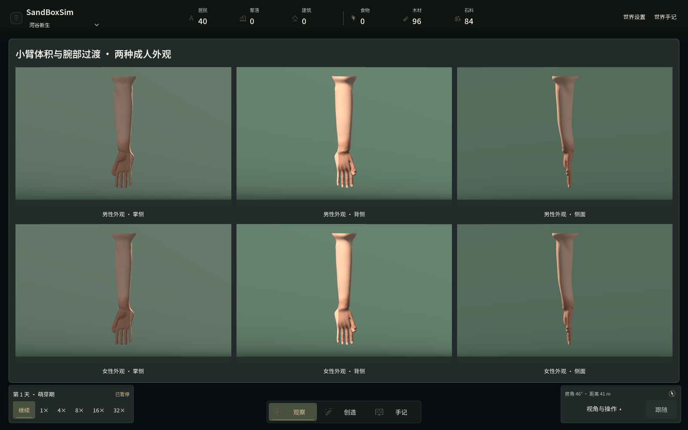

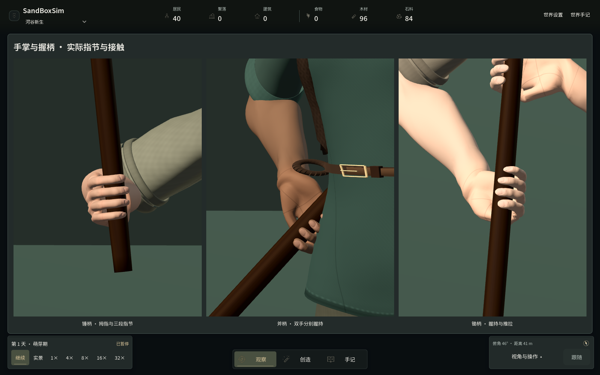

居民闲置、漫游和完成作业后手持职业工具；行走采用单手携带，进入作业时平滑过渡到工作姿态和辅助握持。搬运、交谈、进食和睡眠先让出双手，工具经过伸手、合拢、接管、回位和松开的完整状态转换。收纳处有包围柄轴的双皮环和连接腰带的扁皮带；木柄带渐细端部、细木纹、金属套箍及铆钉。双手目标由两节 IK 求解，支撑手跟随实际握柄，近远景都保留闭合握拳。工具类型由真实动作和职业外观决定，不新增工具库存或任务流程。

握持自检覆盖闲置、行走、作业完成、暂停、货物优先、取回工具及远景闭手；工作测试继续检查手掌位置、指节与柄轴间隙、辅助握持和取放连续性。这些是表现层接触约束，当前没有工具刚体碰撞、可拾取的独立工具物品或工具刃口与每个资源网格的碰撞解算。

交谈、分享、进食和搬运动作读取实际行动状态；短动作可有界补播，新的行进、失败或紧急状态取消补播。观察、肖像、呼吸、注视及姿态不消费模拟随机流、不修改存档。暂停冻结位置与姿态。近景坡面最多补偿 7 厘米，不拉长肢体跨越大台阶。

鞋面、平底鞋底及四组交叉鞋带来自同一鞋楦，保证接触与落地。外观由分段步态和近景腿部 IK 驱动，不模拟完整肌肉或软组织。

### 动物

世界、人物动物图册和视觉评测共用两种授权动物，不再以不断微调的程序头骨作为正式外观。鹿来自 [CDmir / TinyWorlds 的 Old Deer Male](https://opengameart.org/content/old-deer-male)，CC0；狼来自 [0 A.D. 的狼网格与灰狼皮毛](https://github.com/0ad/0ad/tree/61a3b9507d974084e6badb88a0826bd89a6d5b8b/binaries/data/mods/public/art)，CC BY-SA 3.0。各资源目录保留署名、原始路径、源哈希及修改说明，转换规则见下文。

鹿保留原作的头部、眼睛、耳廓、复杂鹿角、体态与六张 1K 颜色／法线图，共 19,840 三角面；狼保留原作肩背、吻部、耳朵、尾部和原始皮毛图，经两次细分为 16,704 三角面。两种网格共享缓存与屏幕尺寸 LOD，鹿源绑定为 14 关节、狼为 15 关节；运行时分别扩展到 18／21 关节，包含四个足部关节与狼尾中、末段。毛皮使用来源 UV，不再叠加旧程序毛束和眼面。

四肢由原有两节肢体与独立足部关节协同解算，来源权重在足区连续转移；鹿采用四拍行走、狼采用对角小跑的表现轨迹。后腿保留源姿态的飞节弯曲方向；24 米内采样实际坡面，身体最多补偿 10 厘米，源足底目标在局部高度范围内最多调整 18 厘米，并按真实腿长限制可达距离，不拉长肢体跨越台阶。耳朵、尾部、呼吸、鹿进食低头与暂停保持接入。狼的 `Jaw2` 权重保留为独立下颌，静止时收拢，移动时轻微张合；下颌不带动上吻与头颈。

耳内短毛从来源表面选择实际受耳骨驱动的顶点，每耳最多 48 个根部，附着到同一耳骨，18 米外隐藏。毛皮微法线按像素足迹衰减，鹿角独立使用较高粗糙度。鹿眼保留源眼球几何，使用较暗虹膜和横向瞳孔；狼的近景角膜通过源 UV 定位，再以局部表面切线构建约 18×9 毫米的眼裂，边缘与原贴图混合，20 米外隐藏。角膜与原头部的实际装配间距自检限制在约 0.1–1.1 毫米以内，跟随头骨运动。`animal-details` 图册提供独立眼眶近景。

正式鹿狼接入来源眼表面上的上下眼睑覆盖，外偏约 0.12 毫米，取相邻皮毛 UV；闭合使用个体的实际眨眼时序，暂停时保持，睁眼时隐藏整个覆盖网格。鹿增加 352、狼增加 560 三角面，包含所有近景细节的总量分别为 23,988 和 23,956，仍受 24,000 面上限约束。它是贴合眼表面的程序遮覆，不是完整重拓扑、具有肌肉和体积形变的动物眼睑系统。

鼻镜与鹿蹄的表面分区在读取来源网格时从绑定姿态生成，保存在顶点颜色通道；鼻部反光较集中，鹿蹄与毛皮保留不同粗糙度。鹿眼的虹膜坐标存入第二 UV，随蒙皮一起移动，避免依赖动画后的空间坐标定位细节。分区和眼部坐标不修改来源 JSON、骨架或存档，自检核对覆盖、范围与有限值。

狼眼周的运行材质在局部源 UV 范围内以原像素密度采样同侧头部的安全皮毛区域，68% 混合减弱过重绘制黑斑，并去除角膜外露出的旧虹膜色素；保留源眉部毛色和暗眼缘，角膜边缘共用同一采样规则，保留较窄杏仁眼裂、窄暗湿边、琥珀虹膜与圆瞳，减少叠加高光；没有修改源贴图文件。自检核对双侧采样仍落在相应头部图集岛内。鹿保留横向瞳孔并提高深棕虹膜的区分，狼闭眼覆盖与周边皮毛采用一致亮度增益。此修复不增加网格、纹理文件、表面或骨骼。

足部使用原下肢蒙皮作有界轮廓细化：狼形成四趾之间的三条凹口，鹿形成双瓣蹄中央凹口。原有顶点的 X／Y 与脚底高度不变，只局部回收足尖 Z 坐标，狼不超过 8 毫米、鹿不超过 12 毫米，法线按形变逆转置修正。鹿两只后蹄在原边插入 11 个采样点、增加 20 个三角形；新增点的 UV 和权重由原边插值。近景完整鹿为 23,988、狼为 23,956 三角形，LOD 共用已调整的顶点缓冲。第二 UV 仅在足区保存绑定坐标，顶点色 Alpha 作为不透明足区掩码，其他区域的眼部坐标和 RGB 分区保留。材质区分趾缝、蹄角质与毛皮；当前没有新增独立足趾骨骼、爪碰撞或蹄瓣张开物理。

四个足部关节分别位于原脚底目标之上，承重期按实际地面高度的局部梯度确定足面方向，摆动期轻微收足；腿部用原段长求解足关节位置。足区在 0.12／0.13–0.24 米高度内连续转接，低段随足部，减少整块足掌跟着下腿翻转的现象。原始 JSON、UV、贴图及脚底高度不变；普通运行不需要 Blender。

狼每足有四枚向前下方弯曲的短爪，前肢另有一枚悬趾，共 18 个贴肤根部；两枚中趾略长，外趾略短。鹿每足后侧有两枚副蹄，共 8 个根部。根部从实际来源三角面采样，随对应足部关节运动，14 米外隐藏。爪蹄采用六边截面和三段弯曲过渡，每个根部 30 面；狼新增 540、鹿新增 240 三角面，分别从护毛分配中减少 54／40 束以维持总预算。狼尾新增中、末段两个关节，按原尾部截面求支点，原尾权重连续分配到三段，保持段长并使用轻微相位延迟；它没有毛发或尾部动力学。

研究参考 [Princeton 犬科形态与四肢图谱](https://assets.press.princeton.edu/chapters/i13221.pdf)对趾行、四个承重趾和前肢悬趾的区分，以及 [明尼苏达大学远端肢体解剖](https://pressbooks.umn.edu/largeanimalanatomy/chapter/distal-limb/)与[密苏里保育部门的鹿足迹说明](https://mdc.mo.gov/discover-nature/field-guide/white-tailed-deer)。[维多利亚博物馆赤鹿资料](https://collections.museumsvictoria.com.au/species/8411)用于核对毛色、臀斑及鹿角等外形参照。这些资料用于结构判断，没有复制其中的照片或图谱。当前尺寸、步态占空比和弯曲幅度是游戏表现参数，不是物种测量数据。

`ARTICULATED_PAWS_PASS` 检查真实蒙皮三角面、爪蹄根部与平地／正反坡面接触，检查步态分段边界连续和暂停；`SEGMENTED_TAIL_PASS` 核对尾段长度、实际骨骼姿态和暂停。原有眼部贴合、来源哈希、LOD、四权重与整只 24,000 面上限继续执行。`--panel=animal-motion` 使用实际世界模型展示行走与足部近景。

`animalLocomotion=ground-distance-v1` 使用实际显示位移推进步态。鹿保持四拍步序，狼采用对角步序。脚掌在承重期按每周期位移向后移动，摆动弧线在离地、触地处与承重段的速度相接。身体随步态起伏并朝转弯方向倾斜，头颈补偿其中一部分晃动。足部目标在角色根坐标中求解，躯干倾斜时脚底继续按地形贴合。犬科的支撑期和步态区分参考[犬科行走与小跑的透视实验](https://pmc.ncbi.nlm.nih.gov/articles/PMC6242825/)。当前参数用于游戏表现，狼的步序与鹿的步序各自固定，模拟跨越未知格点时仍可重新同步。`ANIMAL_STRIDE_PASS` 检查两种速度下实际足底的水平位移。

这些是可再分发的游戏素材及衍生绑定，并非新制作的解剖扫描。原素材年代较早，狼贴图为原始 256×256，近景分辨率有限；当前没有独立足趾关节、密集毛发物理、动物眼睑形变或完整动作捕捉库。细分改善曲面，不会创造源素材中不存在的皮毛细节。

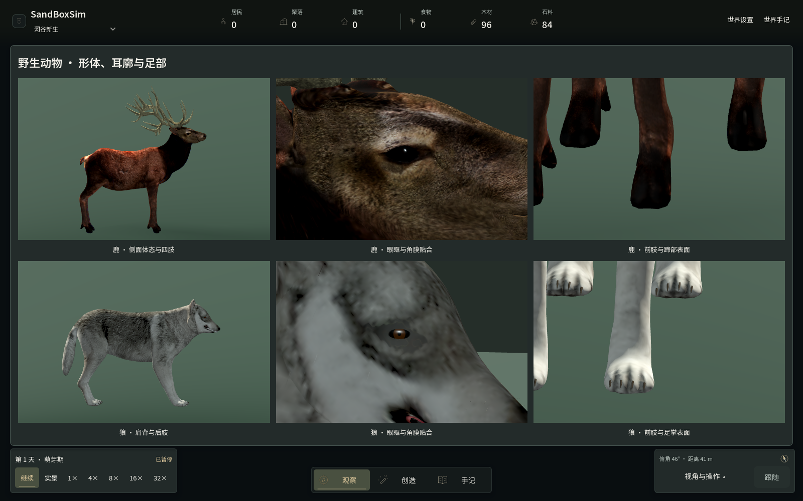

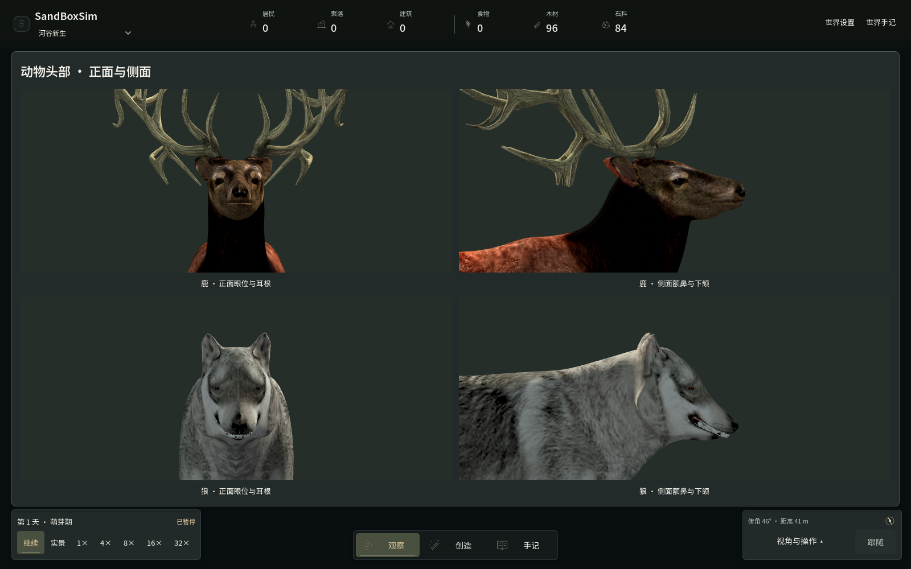

## 植被与地貌

花甸使用约 38 厘米高、花冠约 5.5 厘米宽的通用草花，包含弯曲花茎、三片叶、薄曲面五瓣花冠和独立花心；非开花阶段保留种头。三种配色与两个阶段共享网格和屏幕 LOD。它们属于项目造型，不作为具体植物物种标签。

实际世界中，每株花分别采样脚下地形，跳过建筑、水域、熔岩、道路和火烧占地；花甸按成熟度缩放，分成 24 米空间批次，42 米外裁剪并关闭细花投影。根部随已有土地压实显示刷新调整高度，包围盒保留 4 厘米余量。CPU 保存批次位置供更新和无窗口检查，图形模式额外核对 GPU 实例；不在运行循环中读回实例变换。

芦苇顶端由实际相连的轻弯穗轴、9 条穗枝和成对小穗组成疏松圆锥花序，修正原分枝起点高于主茎、缺少中央支撑的问题。单丛仍为 7 茎，共 5,068 三角形，沿用原材质、缓存及 LOD；成品网格自检检查轴、分枝和小穗的实际支撑。每颗野莓使用 18 个相接的小果粒，顶部保留五片萼片和原有果梗；果实几何缓存共享，合并后的灌丛生成屏幕 LOD，42 米外隐藏。果实的封闭边、法线、朝向、尺度与缓存进入几何自检，植物分布和季节结果仍读取原有模拟。

叶片材质使用少量背光透射，木质面仍保持不透光；降低叶片法线强度与岩石高光，避免细碎亮点。草甸配色减少黄白，山坡保留岩层颜色并收束微法线。扫描岩石降低金黄色偏色、法线强度与高光；浆果灌丛增加到九组枝条，每组配成对侧生复叶和相连叶柄。树木、蕨类、草丛及岩石继续使用已有扫描几何，不把材质调整称为重新扫描。裸坡叠加连续层理色差，湿岸混合较暗淤泥色，仍读取实际水土状态。

阔叶树和针叶树使用授权衍生模型，保留自然枝条与树皮、叶片材质。地图中的树干、枝条、冠层和岩石按 24 米网格分区批量绘制；每批保留自己的包围盒，镜头只绘制可见区域，保持原有植被几何和位置。古树林、野果地和遗迹复用同类叶片、石材与木材；岩石采用低频断面轮廓和倾斜层次，从变形后的三角面累积法线并合并环绕接缝，避免仍按球面着色的软团感。表面保留低对比纹理、粗糙度与材质差异。3D 叶片、树皮、人物与扫描表面统一具有实际 mip 链，远景使用过滤后的源表面。

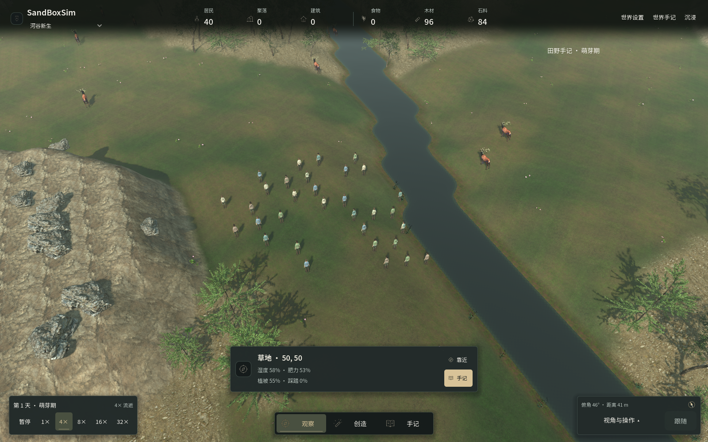

早期地表模型专题见 [历史自然图册](../images/nature-detail.png)。

### 场景接地与采样边界

灌木、蕨类、草丛和芦苇从根部落到地表，按周围高度适度倾斜，根部埋入约 1.2 厘米；树干保持竖直并稍埋根部。扫描灌木不再沿用旧球形灌木的 28 厘米抬升。浆果地使用独立的连枝灌丛，叶柄和浆果梗连接到枝条，不再将果球悬挂在酢浆草上方；遗迹蕨类与倒木草本落在根部，泉水与湿地使用有叶片、种穗的芦苇。普通山石和矿石共用扫描岩石几何，矿石保留独立矿物材质。地表边界显式限制插值格索引，支持边缘以外的坡度探针，避免大地图浮点舍入造成越界。植物和岩石仍使用已有授权扫描资产，本轮没有宣称重新制作全部扫描网格。

## 自然造型与材质层次

当前表现更新覆盖人物、鹿狼、阔叶树和针叶树、灌木、蕨类、草叶、岩石、地表、水面及建筑材料。人物使用授权基础头脸，植物采用专业环境素材，动物使用授权衍生蒙皮，服装、建筑与地形仍包含项目程序网格；本次没有加入完整写实角色动画库。

人物降低肩部鼓起，袖身与前臂改用更收束的轮廓；皮肤、眼球和发丝校准粗糙度及反光，眼白保留暖灰层次。动作与工具仍使用原有骨骼和取用状态，自检检查暂停、握持、腕部与肩部连续性。当前头脸使用上文的三套 MakeHuman 形体，儿童为同源比例变化，不等同于独立儿童雕刻。

鹿狼已切换到上文的授权网格与源 UV 皮毛；旧程序眼部、耳廓、角和短毛束保留为校准实现，不再叠加到正式动物。头颈、耳、尾和四肢由独立骨架活动，身份相位和暂停不消费模拟随机流。

阔叶树、针叶树、蕨类、草丛和灌木使用 Poly Haven CC0 素材的衍生网格，保留 1K 的颜色、法线、粗糙度与透明遮罩。树木按完整叶片单元抽样，木质部分独立简化；蕨类、草叶和灌木保留源素材的轮廓。网格和多材质由世界与图册共用，树木保留导出叶片索引以维护轮廓，其他低矮植物继续使用屏幕 LOD；来源、转换和尺寸见 [环境素材](environment-assets.md)。林下蕨类由真实植被、湿度与火灾状态筛选，稳定位置序列不消耗模拟随机流。

河岸芦苇由七根分节茎、弯曲叶片和立体种穗组成。它只出现在湿度超过 30%、邻接实际水域且未被建筑或烧毁状态占用的适宜土地上；湿度阈值、火灾与占地变化会刷新植被。林下蕨类成簇散布，草叶高度叠加稳定斑块差异。芦苇在 42 米、蕨类在 38 米裁剪，继续按 24 米区域批量绘制；扫描植物使用低频阵风和较轻叶梢摆动。

岩石采用不规则断裂平面的径向交点构造轮廓，法线由实际网格累积。地形保持既有连续地面采样，将规则正弦波纹换成两尺度稳定噪声起伏；水面、道路与压实处减弱起伏，居民和建筑仍从实际地面取高度。地表细砂与木石表面的微法线随屏幕覆盖减弱，避免用大量新增几何表达微小材质变化。水面校准浅岸色、波纹反射与粗糙度。

石砌住房和基础的近景砌块采用浅倒角，远景保留原轮廓；木材、石材、灰泥、瓦片与草束使用统一的低饱和自然色系。世界天气光照、图册中性补光分别维护，图册不使用专用替身模型。

`--panel=ecology-details` 和 [visual-ecology-details.json](../../benchmarks/scenarios/visual-ecology-details.json) 提供树、蕨类、草叶、岩石与灌木的世界共享几何近景。语义裁切标签包含 `tree`、`fern`、`grass`、`rock`、`shrub`；这是对象识别输入，不是游戏任务。植物自检覆盖有限顶点、单位法线、三角面朝向、属性长度、根部范围与缓存预算；完整场景另外核对实际画面和性能。

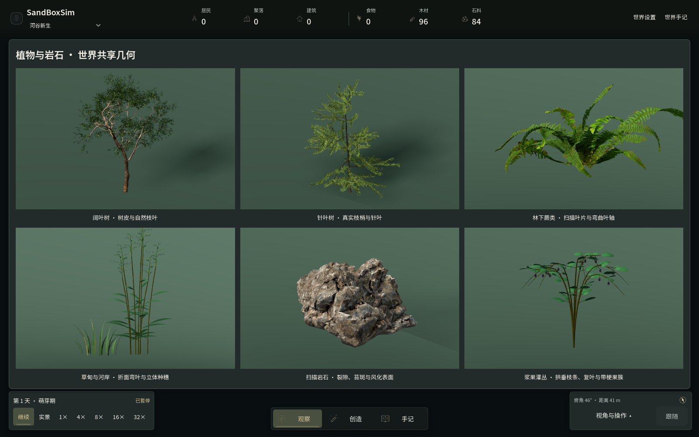

`NatureModels.Bramble.cs` 构造七根拱垂主枝和交错的三／五小叶；每片叶有 20×4 分段，叶面弯曲、叶尖下垂，边缘使用真实锯齿轮廓。复叶的小叶通过短叶柄连到同一节点，主枝补短刺；14 枚果实通过分叉果梗下垂，每枚由 21 个小果粒组成。果实与叶柄在合并后的同一局部坐标中使用共享风动函数，避免枝条摆动时果实停在原处。结果／无果模型共 31,616／16,608 三角形，使用原材质缓存、屏幕 LOD 和 42 米显示距离。结构参考 Kew／RHS 的荆棘类灌木资料，来源与视觉尺度见[环境素材](environment-assets.md)；模拟中的食物、季节和采集规则不变。

野果灌丛可在 [当前生态模型图册](../images/ecology-detail.png) 中查看。

## 源码入口

| 文件 | 作用 |
|---|---|
| `NatureModels.Buildings.cs` | 建筑轮廓、屋顶与窗结构 |
| `NatureModels.ArchitectureDetail.cs` | 门、屋面搭接、砌石、支架与道具 |
| `NatureModels.Joinery.cs` | 空心弧形脊瓦、檐下榫接、陶制烟囱帽 |
| `NatureModels.Residents.cs`、`NatureModels.Tailoring.cs` | 人物衣装、四肢、手部与配件 |
| `NatureModels.Equipment.cs` | 帽壳、贴合衣装与背包挂点 |
| `NatureModels.HandTools.cs` | 工具模型、腰侧与手掌挂点、库存携带外观 |
| `NatureModels.Forearm.cs` | 同源前臂网格加载、左右镜像、腕口对齐及维护预览 |
| `NatureModels.HandSkin.cs` | 连续掌形、手指与腕部过渡的蒙皮网格和绑定 |
| `NatureModels.Hairline.cs` | 来源头皮帽根闭环、毫米度量、非帽体排除和缓存验证 |
| `NatureModels.WristContour.cs` | 手掌、前臂和远手共用的腕部截面与连续法线 |
| `NatureModels.HandSurface.cs` | 绑定坐标、掌背分区、掌纹和甲床表面；近远景细节预算 |
| `NatureModels.AdultPhysique.cs` | 来源女性肩点、短衣片最终高度及卷袖口／远景上臂的统一体型适配 |
| `NatureModels.ClothEnvelope.cs` | 成人衣料截面凸包、松量缓存与最终连续衣片法线 |
| `NatureModels.ShoulderMotionValidation.cs` | 实际显示上臂的轴向扭转、旋转连续性及双侧动作切换检查 |
| `NatureModels.SupportCoordinationValidation.cs` | 实际骨盆、支撑膝角、弯身脚踝与携带位置检查 |
| `ResidentRig.ArmSwing.cs` | 自由摆臂、肩肘配合、前臂轴向与放松掌腕取向 |
| `ResidentRig.Locomotion.cs` | 距离驱动步态、启停、体型动作轮廓、鞋底滚动与腿部 IK |
| `ResidentRig.cs`、`ResidentRig.HandPose.cs` | 真实行为呈现、收纳切换、肘腕求解、指节姿态与手部骨骼 |
| `NatureModels.Articulation.cs` | 连续蒙皮衣袖与肩部结构 |
| `NatureModels.GarmentSkin.cs` | 上衣规则采样导出、缝片网格加载、权重与连通性检查、近远景袖子替换 |
| `NatureModels.Thatch.cs` | 连续草束屋面、厚度、不规则檐口与纤维表面 |
| `NatureModels.HumanAsset.cs` | 授权头脸数据读取、哈希、结构变体与头发表面查找 |
| `NatureModels.Face.cs` | 实际眼球、唇部、眼睑、眉毛与虹膜表现 |
| `NatureModels.ResidentLod.cs` | 保留轮廓与肤发色的远景头部网格 |
| `NatureModels.HandlingValidation.cs` | 工具转移连续性、握持、作业、切换、携带与暂停检查 |
| `NatureModels.ClothSurface.cs` | 扫描亚麻织纹、染色与粗糙度 |
| `NatureModels.AuthoredEyelids.cs` | 正式鹿狼来源眼表面覆盖、皮毛采样、独立闭合与暂停检查 |
| `NatureModels.MeadowTurf.cs` | 共享的 24 片折面弯叶、风动、压实与距离衰减 |
| `NatureModels.AnimalPaws.cs`、`NatureModels.PawValidation.cs` | 足部权重、贴肤爪蹄几何、地面法线与实际蒙皮接触检查 |
| `NatureModels.AnimalTail.cs` | 狼尾来源截面、连续分段绑定与长度／暂停检查 |
| `NatureModels.AuthoredAnimals.cs` | 正式鹿狼资源、来源检查、UV 材质、原始 14/15 关节来源与运行 18/21 关节映射、缓存和接地自检 |
| `NatureModels.Coat.cs` | 旧程序动物的校准毛束、权重插值和几何缓存 |
| `AnimalRig.cs` | 正式与校准动物共用的步态、坡面接地、耳尾及暂停 |
| `NatureModels.Animals.cs`、`NatureModels.AnimalDetail.cs` | 保留的程序动物校准造型与几何检查；不是当前世界外观 |
| `NatureModels.Meadow.cs` | 保留的程序草叶构造器；当前草甸入口为 `NatureModels.MeadowTurf.cs` |
| `NatureModels.Botanical.cs` | 程序植物辅助结构、材料与植物几何检查 |
| `NatureModels.Bramble.cs` | 拱垂野果灌丛、复叶、短刺、果梗、聚合果与共享风动 |
| `NatureModels.ScannedEnvironment.cs` | 专业环境素材读取、哈希、多材质与地面绑定 |
| `WorldView3D.Relief.cs` | 地形的稳定噪声起伏 |
| `WorldView3D.Surface.cs` | 扫描地表混合、坡面投影与读取河床深度的水面 |
| `WorldView3D.ActorGrounding.cs` | 高倍速未知步及近岸无支撑插值的逻辑中心同步 |
| `WorldView3D.Shoreline.cs` | 水陆分类与显示支撑、旱地脚底／通道及植被覆盖率检查 |
| `WorldView3D.Meadow.cs` | 草丛候选掩码、外围根接地与受踩踏邻域更新 |
| `WorldView3D.Buildings.cs` | 地图建筑增量同步、路向、近远景切换与贴地石基 |
| `ScannedSurfaces.cs` | 扫描纹理共享加载、实际 mip 检查与法线/粗糙度打包缓存 |
| `addons/texture_import_guard/` | 编辑器中的纹理重导入与真实 mip 链核验；普通游玩不加载 |
| `NatureModels.ScannedCraft.cs` | 建筑木材、灰泥和石作扫描表面 |
| `NatureModels.Vegetation.cs` | 树冠、针叶枝层与树干 |
| `NatureModels.Craft.cs` | 平滑截面、倒角石块与连接构件 |
| `NatureModels.Surface.cs` | 木纹、灰泥、石材、屋面和植被的表面处理 |
| `NatureModels.RoofSurface.cs` | 弧面瓦片、草束起伏、边缘与封闭截面 |
| `NatureModels.CharacterSurface.cs` | 耳廓曲面、肤色表面和发丝着色 |
| `NatureModels.Validation.cs` | 曲面朝向、网格完整性、静态合并与关节检查 |

地图中的建筑同时缓存近景与远景网格；远景减少曲面细分和小构件倒角，保留同一屋面排布、轮廓与材质。进入 24 米以内切回近景，离开 32 米以外切回远景，避免在边界反复切换。模型图册始终使用近景几何。

新网格需要采用 Godot 的顺时针正面约定，并保持朝外法线。截面插值保留轮廓；不要仅提高球体细分来替代身体结构。静态部件按材质合并，动物和居民保留活动关节。建筑变体键限制到 140 个稳定组合，图册和地图共用缓存规则。

## 人物前臂与鞋楦

人物肘部和前臂使用同一授权人体导出的连续解剖表面，替换球体肘部加截面管的组合；左右分别镜像；近景与手部共用过渡环，构成单张连通蒙皮，避免两张开放表面在腕口相接。源文件、许可、转换方式和维护预览见 [人物解剖素材](human-assets.md)。前臂顶点通过腕部补偿骨保持在肘坐标系内，手掌与手指保留转动；当前仍以现有肘关节驱动整段前臂，不模拟桡尺骨交叉或皮肤滑动。

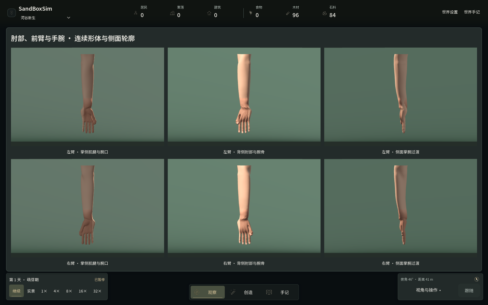

鞋楦长度为局部 0.26 米，前掌和鞋腰收窄，鞋面与鞋底仍共用截面。鞋底降低约 19 毫米，使默认直立姿态落在地面；足弓保留抬起。四组交叉鞋带由同一鞋楦函数采样高度并分段弯曲，替换任意高度的直线，避免穿入鞋面或悬浮。自检按实际鞋面三角形核对鞋带间距、鞋面/鞋底贴合和静止落地。行走使用分段足部轨迹及近景地形腿部 IK，鞋底滚动按实际截面补偿接触高度。

## 动物来源、转换与重建

正式数据位于 `assets/models/animals/cdmir-deer/` 与 `0ad-wolf/`。`tools/export_authored_animals.py` 在项目本地 Blender 中读取源网格、检查固定 SHA-256、转换单位和坐标、细分表面并转移作者权重。鹿细分一次，狼细分两次；保持原始 UV，颜色与法线 PNG 不重绘。PNG 导入开启 mipmap，材质使用各向异性过滤，避免远处皮毛形成高频闪烁。

骨架包含身体、头、尾、四肢上下节、颈和左右耳，鹿共 14 关节，狼另有下颌关节共 15；导出足底位置用于接触解算。反射坐标变换同时处理法线和正面绕序；运行加载器检查衍生 JSON 哈希及对应许可。权重校验允许 GPU 16 位量化误差，不改变归一化要求。

源文件默认位于 `.tools/sources/cdmir-deer/deer1.blend` 和 `.tools/sources/0ad-wolf/wolf.dae`，狼纹理 `wolf-grey.png` 与 DAE 同目录。工具链和下载源均不提交；仓库提交运行数据、PNG、`.import` 和许可。重建示例（替换 Blender 为当前项目内实际路径）：

```powershell
$blender = '.tools/blender-4.5.14/editor/blender-4.5.14-windows-x64/blender.exe'
& $blender --background --factory-startup --disable-autoexec --python tools/export_authored_animals.py -- --species deer --source .tools/sources/cdmir-deer/deer1.blend --output src/SandBoxSim.Godot/assets/models/animals/cdmir-deer
& $blender --background --factory-startup --disable-autoexec --python tools/export_authored_animals.py -- --species wolf --source .tools/sources/0ad-wolf/wolf.dae --output src/SandBoxSim.Godot/assets/models/animals/0ad-wolf
```

重建后检查差异并同步加载器中的成品哈希；不能绕过来源哈希检查接受未知资产。原始下载 URL、版本和许可证位于各目录 `LICENSE.txt`。狼的衍生网格、绑定与源贴图继续按 CC BY-SA 3.0 提供，不更改其他项目代码或无关资源的许可。

`AUTHORED_ANIMALS_PASS` 检查两种正式动物的有限顶点/法线、四权重、关节范围、共享缓存、三角面预算、平地和上下坡接触及暂停。保留的程序动物仍有独立几何校准检查；其毛束、眼睑和趾爪测试通过不表示正式动物具备那些旧细节。近景质量必须查看实际画面，不能从面数或自检推定写实程度。

## 独立预览

当前住房门高为模型局部 1.75 米、门宽 0.82 米，仓库为 1.85/0.95 米；原木屋墙高提高到 2.05 米、仓库到 2.2 米，门框、门板、雨檐与廊柱同步。尺寸还会受建筑根节点缩放影响，模拟占地没有扩大，仍不提供可进入的室内。茅草坡屋面改为连续厚壳与参差檐口，替换瓦片式矩形草束排布；石墙保留扫描细节并降低矿物金色饱和度。

动物预览读取当前授权模型；人物近景使用拟合头部的源发片和原生皮肤图集。来源、预算、转换及当前限制见上文。

先运行 `./tools/godot.ps1 -Mode build -Configuration Debug`，再通过 Godot .NET 可执行文件打开项目：

```powershell
& $env:GODOT_EXE --path src/SandBoxSim.Godot -- --panel=architecture
& $env:GODOT_EXE --path src/SandBoxSim.Godot -- --panel=characters
& $env:GODOT_EXE --path src/SandBoxSim.Godot -- --panel=animal-details
& $env:GODOT_EXE --path src/SandBoxSim.Godot -- --panel=ecology-details
& $env:GODOT_EXE --path src/SandBoxSim.Godot -- --panel=model-details
& $env:GODOT_EXE --path src/SandBoxSim.Godot -- --panel=wardrobe
& $env:GODOT_EXE --path src/SandBoxSim.Godot -- --panel=equipment
& $env:GODOT_EXE --path src/SandBoxSim.Godot -- --panel=actions
& $env:GODOT_EXE --path src/SandBoxSim.Godot -- --panel=motion
& $env:GODOT_EXE --path src/SandBoxSim.Godot -- --panel=grip
& $env:GODOT_EXE --path src/SandBoxSim.Godot -- --panel=hands
& $env:GODOT_EXE --path src/SandBoxSim.Godot -- --panel=forearms
& $env:GODOT_EXE --path src/SandBoxSim.Godot -- --panel=faces
& $env:GODOT_EXE --path src/SandBoxSim.Godot -- --panel=naturemodels
```

`--panel=person-hands` 打开真实人物档案的手部构图。`hands` 提供锤、斧、锄的握持近景；`faces` 同时展示正面与侧转面部。连续预览可使用 `--capture-frames=<绝对目录>`，输出 56 张 PNG，按 8 FPS 采样。录制时给引擎传入 `--max-fps 60 --quit-after 650`，留出启动和七秒录制时间；临时帧放在 `.tools/tmp/model-preview/`，选定的正式配图放在 `docs/images/`。

这些参数仅打开开发用模型预览，使用固定灯光与同一套实际网格；普通游戏不会显示预览面板。原始素材来源见 [美术资源](assets.md)，界面操作见 [观察与界面](../guides/gameplay-observation.md)。

模型图册也提供无标题的评测裁切图及对象类别标签，入口与使用边界见 [评测接口与实验运行](benchmark.md)。

建筑表现按实体增量同步，共享合并网格并保留各自的位置与朝向；网格构造与缓存维护见 [性能采样与渲染维护](performance.md)。

### 树冠轮廓

树冠使用环境素材的自然枝叶，按完整叶片单元进行稳定抽样，保留叶形和 UV。世界树木按原有稳定序列放置，通过共享多材质网格和空间分块绘制；树木保留叶片索引，草丛等较低植物使用屏幕 LOD；变化属于表现层，不影响树木资源或生态状态。

### 材质与环境光

地表使用有草叶、落叶和细枝的 `leafy_grass` 扫描，按 2 米实际覆盖宽度采样；三角格中的四向旋转同步作用于颜色和法线。岩面与建筑三向投影在各自切线方向还原法线，再合并到实际表面，负向立面也使用对应方向；山坡的岩面起伏由连续高度导数限制到约 8 厘米，并随水域、道路权重缩退。

纹理导入的 `mipmaps/generate=true` 不等于缓存已经包含 mip 链。项目的 `texture_import_guard` 编辑器插件在明确维护命令或独立包导出时启用，统一模型／扫描表面的 mip 配置、重导入并核对实际图像；正常编辑和游玩不执行这项批处理。维护命令为 `./tools/godot.ps1 -Mode test -ReimportTextures`。扫描表面与正式动物加载器也会拒绝缺少实际 mip 链的缓存。

木材包含沿板材方向的细纹、条纹和低频色差；石材与屋面增加倾斜层纹、微小孔隙和局部风化。高频纹理按屏幕导数衰减，减少远景闪烁。木石与屋面继续使用现有图集及程序着色；植物与地面材质混合授权 PBR 贴图，几何来源见 [环境素材](environment-assets.md)。

世界光照在初始化和天气更新中使用一致的中性暖色方向，避免天气刷新重新引入过黄的晴天光。岩石修改只构建一次共享网格，新增草丛复用空间批次；草丛的动态变形和远景范围见 [地形与活动痕迹](../guides/terrain-and-traces.md)。

树木在格内稳定偏移并改变尺度，偏移后重新采样根部地面；符合筛选条件的近景草地每格放置四个错位草丛，建筑占用会刷新植物显示。建筑木墙、灰泥与石作改用扫描表面，建筑屋面和几何由各自模型入口维护。住房、仓库的石基裙边按旋转后的四角贴地，只用于遮住坡地下方空隙；当前房屋仍是小型抽象占地，没有完整室内或真实施工结构。植被分布和坡地基座属于表现层，不改变模拟状态。

## 屏幕尺寸与距离细节

人物和动物的共享合并网格保留完整基础表面，由 Godot 屏幕尺寸 LOD 使用较少的索引绘制远处几何。人物在 18 米外额外使用按顶点保留配色的单材质关节和衣身，进入近景恢复原始表面、肩部蒙皮与手指骨骼。近远切换自检核对单表面合并与原始网格恢复，工具动作的关节层级不变。

世界建筑先使用既有远景模型；进入 24 米范围时，每个表现帧最多生成一个需要的精细网格，离开 32 米后使用远景网格。已生成的精细网格缓存复用，状态和槽位身份变化继续独立检查。该调度减少同时建造的停顿，近景细节可能在随后几个帧补齐。

屏幕 LOD 与缓存用于控制近景素材和程序网格的绘制成本。人物头脸与正式鹿狼采用授权衍生素材，建筑仍为程序化模型，未增加新的家庭扩建模拟。

## 茅草屋面与衣装表面

茅草坡屋面具有约 18–21 厘米的可见厚度，保留参差檐口；屋脊使用封闭的圆弧覆层，与两侧屋面嵌接，近景增加沿弧面贴合的束带。近远网格分别缓存，远景保留屋脊轮廓并省略束带；几何自检覆盖有限顶点、单位法线、缓存和屋脊接缝。参数用于当前小型住房的视觉比例，不是历史建筑施工规范。

采集者、猎人与商人的肩带采用与背包协调的深棕皮革表面，继续使用原有衣身贴合与动作挂点。这里没有替换人物头脸或正式鹿狼资产。

## 住房生活与地面物资

`NatureModels.Crops.cs` 使用内核的稳定作物类型和生长阶段显示三类农作物的十二种形态：谷穗、根茎叶丛和豆荚随周期变化。建筑本体保留田埂与围栏，作物独立共享网格并按距离同步；每帧与住房共用一个附件补建额度。远景减少叶片与截面细分、省略麦芒，保留作物种类与阶段；超过 55 米隐藏。图形自检遍历二十四种近远景组合，检查有限顶点、法线及缓存复用。作物外观不推进农业，实际产量与土壤规则见 [农业与食物流动](../guides/living-economy.md)。

陶器使用闭合径向截面生成外壁、卷边与内壁，口部保持开口；共享 32 边截面网格，检查内外法线和缓存复用。近景木桶使用 40 边鼓腹曲面、十四条木板接缝、环形箍带与盖板；远景使用同位置的简化桶体，保留建筑轮廓。部分灰泥、石砌与高山墙住房增加窗台花箱、托架与小叶簇，细件进入既有静态合并。它们属于程序模型细节，不参与粮食生产或新增容量。

`NatureModels.Living.cs` 生成住房附件与四类物资堆，`WorldView3D.Living.cs` 读取完工状态、住户人数、完整度、天气和实际地面库存。附件继承建筑根节点的缩放、旋转与地形位置；静态生活物件按身份、人数和风化档复用合并网格。晾晒布料使用 8×8 曲面与双面粗糙材质，风摆幅度随 UV 高度增长，上缘保持固定。

完整度大于 75%、大于 35% 和其余范围对应三个表现档。生活附件遵循建筑近远景切换，每帧最多补建一个改变状态的住房附件。物资量小于 8、小于 40 和其余范围对应三个规模档；55 米内显示，每次约 0.3 秒的同步按相机距离排序，最多新建或更换四个物资模型，创建耗时达到 2 ms 后不再开始下一个。单个创建不能被中断，因此这不是严格的 2 ms 上限。网格缓存命中时直接实例化，不重新搭建临时零件；同步列表和存活集合复用。取空与槽位复用独立检查，库存量不因观看而改变。

晾晒架与衣物分别控制可见性，雨雪只收起衣物和夹子，保留架子。无住户且没有风化痕迹的空附件隐藏。自检保存并恢复整个模拟，验证正常住房选择、住户档案链接、天气衣物切换、住房缓存与风化切换、远景隐藏、物资数量档、取空清理、复用位置和观察纯度。实机样例见 [聚落生活](../guides/settlements.md) 和 [正式图片索引](../images/README.md)。

## 展示图与几何契约

模型图册和肖像读取共享网格。实机图册按世界与界面、环境模型、人物和动作分类，记录实际采样的源码、场景和帧号。静态图可观察轮廓与材质，短片展示多个动作阶段；几何自检另外检查顶点、法线、UV、关节和预算。[实机图册](../images/README.md)

## 米制构件与近景细节

近景 `Part` 中的木材、陶瓦材料盒体和石砌盒体使用实际长宽高构造封闭圆角块，不再把统一圆角立方体沿长梁或薄石片拉伸。木作与陶瓦构件倒角上限为 3 毫米，石作上限为 12 毫米，均不超过最薄尺寸的 20%。扫描木石表面的法线基在顶点阶段用模型视图逆转置矩阵变换后传入片元，避免非等比缩放使纹理法线方向偏斜。网格按尺寸和倒角半径缓存，进入原静态合并与建筑近远景调度；远景继续使用简化块体。门窗开口、构件中心和占地保持原尺寸。屋面曲瓦、茅草、圆形构件沿各自构造器生成。

授权鹿狼的触须从源蒙皮中筛选头骨权重大于 0.9999、法线朝外的口鼻顶点，短毛根部距源表面约 0.1 毫米；源法线定义外伸方向，四段渐细管形随头节点运动。鹿每侧三根、狼每侧五根，14 米外隐藏、关闭投影，两种模型分别缓存。检查直接比较最终根部环和源网格，限制间距在 0.35 毫米内，并验证有限单位法线、向外绕序与不超过 400 三角面的细节预算。触须没有独立物理或触觉模拟，狼的原始低分辨率毛皮贴图仍限制极近景质量。

动物非眼表面的第二 UV 保存源米制投影坐标，供鼻镜微纹使用；眼表面保留原来的虹膜坐标。颜色通道分别存鼻镜、鹿蹄和源耳骨权重，耳侧薄层背光不覆盖躯干。原授权纹理、骨架和许可仍随模型保留。

通用草花增加花冠下五枚小萼片、独立细花丝与八面体花药，与茎叶和花瓣合并为共享网格，仍受每个原型 1,400 三角面的预算约束。结构用于改善通用草花近景，不作为精确物种复原。

扫描植物的弯曲变换同步更新法线和切线框架：法线使用弯曲 Jacobian 的逆转置，切线与副切线使用正向变换，同时纳入压实及距离缩退的高度缩放。根部不随风平移；既有扫描网格与纹理无需重新下载。

## 授权动物头部曲面

`NatureModels.AnimalTopology.cs` 在首次读取授权网格时，选择头骨完全控制、曲率较大且长度至少 14 毫米的边。眼部 22 毫米、鼻部 24 毫米范围及骨骼边界不作曲面调整；同一物理边的 UV 接缝副本共享细分选择和投影法线。最多选择 400 组物理边，新顶点采用切平面投影与线性中点的混合，偏移不超过 1.5 毫米或相邻三角形高度的 12%，取较小值。

原顶点保持不动；所有相邻面根据一、二或三条分边补齐三角形，避免细分与未细分区域留下 T 形边。UV、表面分区和四骨权重插值后归一化，原源文件与授权记录保持独立。鹿头部从 6,016 增至 6,816 面，整鹿为 20,640 面；狼从 16,704 增至 17,524 面。共享网格仍生成屏幕 LOD，两个物种均低于原 24,000 面上限。额外检查覆盖位移、接缝一致性和新面的向外绕序，不把细分视为新解剖重建或更高分辨率毛皮贴图。

近景曲瓦在下坡端收圆角，保持原厚度与封闭侧壁，近远瓦片一起检查闭合拓扑。人物唇面增加约 7 微米的过滤细纹法线扰动，保留原唇形、闭合边界与说话形变。

## 源表面护毛与眼周

`NatureModels.AnimalFinish.cs` 从当前授权鹿身体与狼表面的三角形按面积采样，向颈肩和尾部增加采样权重；避开脚部、口鼻和狼眼区域。每束两片渐细弯曲带共六面，鹿 360 束／2,160 面，狼 586 束／3,516 面。根部沿源法线抬高约 0.35 毫米，纹理坐标按重心转移，最多四个骨骼权重归一化后共用原骨架。护毛按物种缓存、18 米内显示并关闭投影，不逐帧重建。计入鹿后蹄补点后，源表面、护毛、角膜、耳内短毛、触须、闭眼覆盖及爪蹄附属细节合计为鹿 23,988 面、狼 23,956 面，均受整只动物 24,000 面上限检查。

狼毛皮用连续色阶压缩过强的黑白反差，保留源 UV、毛色分布和独立鼻镜区域；鹿身降低饱和度，鹿角单独向干燥骨色校准。眼部装配与材质处理见上文“动物”。256 像素狼源贴图仍限制极近景细节，程序护毛不能恢复来源中不存在的信息。来源与衍生许可见[美术资源](assets.md)。

人物下眼睑的湿润细边直接读取每侧 49 个源眼裂采样，沿四段半圆截面形成约 0.18 毫米半径的细带，共 768 面。`NatureModels.LidAnchors.cs` 将眼裂采样挂到源头部的最近三角面，按重心转移实际 `blink` 位移，并按来源族缓存。湿润细边与睫毛共用这一采样；每位居民独立更新材质参数，并跟随头部近远切换；自检比较睁眼、闭眼时与源眼睑的实际距离，限制在 0.5 毫米内。肤色与唇色使用同一 `source_color` 参考，保留原照片贴图，减少原有额外压暗。

水面的细波仅影响片元法线，使用两组不同方向的毫米级振幅与解析梯度，再按像素足迹衰减；它与较长波的网格起伏分开，不修改岸线、碰撞或模拟水量，也没有引入流体求解。

## 角膜、领口与织物

`NatureModels.EyeOptics.cs` 在原始眼球拓扑上形成上限 0.35 毫米的角膜起伏：中央约 5.5 毫米尺度的四次指数剖面，6–8 毫米间平滑回到原表面；后侧不位移。UV、索引与顶点数沿用来源，法线通过位移的逆转置修正，不叠加悬空球体。16 套成年／儿童变体自检检查边界、有限法线和缓存；闭眼仍由原始眼睑承担。它是有界的视觉近似，不是眼球光学或视力模型。

人物眼睛、鹿狼角膜与动物鼻镜分别使用低粗糙度的第二反光层，毛皮仍保留粗糙响应。Godot 4.7.2 的实际着色器变量为 `CLEARCOAT_ROUGHNESS`，以固定版本引擎源码和实际编译结果为准。眼睛仍使用原纹理，没有在贴图上绘制固定高光，也没有完整折射或泪液模拟。

人体头颈保留原始连续形体。衣服前领在源高度 1.215–1.28 米内渐变增加最多 28 毫米的喉部空间，翻折领缘同步前移最多 21 毫米，侧面和后侧不作统一放大；三套衣装从同一模式重新采样、烘焙并更新来源哈希。自检对三套成品领口作三条垂直射线检查，拒绝开口附近的布面或封口横穿喉部；另在高度 1.31 米的中线作水平射线检查，要求前片至少留出 92 毫米前向空间，当前约 98 毫米。原骨架、袖窿连接和服装面数保持不变。

扫描亚麻以固定源纹理在 128×128 采样下约 0.3962 的线性平均亮度作参照，保留照片织纹的相对变化并限制范围，不再沿用偏暗的 0.55 参照。织物法线与少量掠射反光独立处理；原服装剪裁、骨骼和运行面数不变。

---

普通世界重建自然物时复用已接受／拒绝的草丛贴地候选，避免为未变化的地块反复检查整圈根部。踩踏字节变化会使邻近地块的支撑缓存失效，重建地形清空缓存；草丛密度、实际根部间距及坡度判定沿用原规则。角色状态和模拟随机流不受此表现缓存影响。

[文档导航](../README.md) · [项目首页](../../README.md)

`workPose=raised-hammer-v1` 的锤击准备由手掌高度 0.92–1.38 米和向前的工作平面共同驱动，使用当前肩肘腕求解器带动上臂；工具旋转保留阻尼速度，作业转速上限为每秒 4 弧度，收纳阶段为每秒 6 弧度并使用更短阻尼时间，以保留及时的手柄归位。该轨迹是游戏表现参数，不是动作捕捉或锤击力学。设计参考 [Autodesk 的肘部参考角与 IK 设置](https://www.autodesk.com/learn/ondemand/tutorial/setting-the-preferred-angle)，以及 [Epic 的惯性过渡说明](https://dev.epicgames.com/documentation/en-us/unreal-engine/animation-blueprint-blend-nodes-in-unreal-engine)中保留运动趋势的原则；项目使用自己的滤波与解析求解。`sleeveFairing=rest-detail-v2` 标记下面说明的静止细节恢复，原有颈口、胸侧与袖口约束保留。

前臂坐标系沿上一帧的前臂方向运输，再以每秒最多 6 弧度追随手掌参考轴的轴向转动，避免参考轴接近平行时的投影奇点。腕部补偿保持原来的手掌朝向和握柄接触，前臂轴向转动使用独立的连续性约束。ResidentMotionOnly 同时覆盖完整拿取／使用／收纳与切换工具检查，保留原有归位时限和连续性阈值。

开发诊断入口 [`--export-resident-pose-study=<绝对输出目录>`](../../src/SandBoxSim.Godot/NatureModels.PoseStudy.cs) 使用与游戏相同的角色构建和求解，输出两种成人外观在 0°／45°／90°／135°、前斜 30° 的实际衣身形态混合及蒙皮结果。每份 JSON 含静止／显示顶点、三角索引、缝片坐标、骨骼影响、肩肘位置、上臂／前臂／手掌的三列坐标轴及对应的人体支撑表面；坐标为躯干局部米制、Y 轴向上。先通过 `tools/godot.ps1 -Mode build` 构建，再给项目本地 Godot 4.7.2 .NET 的用户参数传入该选项。该入口只导出几何，不推进模拟，也不写玩家存档。`SLEEVE_AXIAL_STATION_PASS` 使用实际骨骼矩阵与解码权重检查自由袖管中心线，包含两种成人外观、左右臂及三个平面；16 位权重的量化误差有独立容差，原有边长、接触和动作回归继续执行。

`ANATOMICAL_ARM_REFERENCE_PASS` 对两种成人体型、左右臂检查垂臂时的中性轴向朝向和前向屈肘，并在固定抬臂／屈肘姿态下旋转前臂，检查上臂参考保持稳定。该检查与原有真实顶点、袖口、手柄接触、收纳和动作切换回归共同运行。

`toolMotion=constraint-feedback-v4` 将持物手腕的局部摆动约束在 47° 的舒适锥内，保留轴向朝向。约束生效时，以实际手柄姿态及显示速度反馈轨迹滤波器，使后续动作从真实显示状态继续；工具仍附着在握柄节点。肘部连续性与腕部舒适度分别处理，完整拿取、支撑、使用和收纳继续由接触检查约束。

工具收纳先完成约 0.16 秒的松指，再按挂环到原休息握点的距离、每秒 0.8 米参考速度确定 0.24–0.48 秒的空手收回时间；拿取仍使用 0.48 秒。它避免近距离收手也占用整段拿取时长，接触所有权和物品身份仍在实际挂点转换时改变。

肩袖烘焙缓存每个姿态的蒙皮逆矩阵、各侧可活动边及静止边长，跳过两端均固定的边；原有约束顺序、64 轮迭代和边长限制保持一致。增加旋转样本后，运行帧仍只更新骨骼与形态权重，不在逐帧重新烘焙。

### 肩袖静止细节与肘部惯性

`NatureModels.SleeveDetail.cs` 参考 [Autodesk Delta Mush](https://help.autodesk.com/cloudhelp/2023/ENU/3DSMax-Modifiers/files/GUID-43BE9C68-C2F6-4283-9F4C-AA83118B2221.htm) 和 [SideFX 的静止／变形双输入方法](https://www.sidefx.com/docs/houdini/nodes/sop/deltamush.html)，在来源人体拟合后处理变形产生的尖折。项目自行计算表面补片、松弛及细节运输，没有导入这些软件或其实现。静止细节按各体型／剪裁／左右侧缓存；目标形态松弛后，使用同一表面邻点与法线构造局部框架，恢复衣料原有细节。几何编辑仍受现有绑定梯度、实际蒙皮边长与人体支撑限制，最终法线按实际目标表面重建。这一处理烘焙进现有 120 个姿态，不在每个游戏帧运行松弛求解。

`SLEEVE_DETAIL_PASS` 检查未变形时的细节恢复、任意整体旋转和平移后的等变性、固定边界及人为尖折的削弱。原有真实角色全程抬臂、捕捉重定向和三种衣装的接触／应变检查继续独立运行；合成曲面检查不作为人体真实度评分。设计流程也参考 [MetaHuman 的身体绑定与姿态修正方法](https://dev.epicgames.com/documentation/metahuman/metahuman-stylized-character-body-rig-editing)：同时检查关节、衣料权重、关键姿态及中间插值。当前模型仍使用本项目来源、骨架和缓存，没有采用 MetaHuman 资产或 RBF 系统。

肘部绕肩腕连线的转向保留独立角速度，使用约 0.10 秒的临界阻尼和每秒平方 12 弧度的加速度预算；徒手／工具转速仍分别限制在每秒 2／3 弧度。目标改变时先减速再转向，避免只限制每帧角度却立即反向。这里的时长与速度均为游戏表现参数，不是人体医学限值。没有交互求解的手臂清除旧转向状态，由原有收回控制器管理；暂停保持状态。`ELBOW_INERTIA_PASS` 检查反向目标时的入射速度、速度／加速度预算、暂停以及 60／120 Hz 收敛，完整接触、动作切换与步态检查仍执行。

工具回到腰侧挂点后先完成原有的松指阶段，随后才允许更新当前工具模型。默认工具复位与空手收回分别处理：手臂仍可按当前轨迹继续回落，已经释放的工具不会等待整个空手动画结束；更换作业时也不会在手指仍闭合的阶段替换工具。原有接触所有权、精确握柄与取用／收纳时限检查保留。

自然垂臂的外侧余量按手腕高度附近的实际裤装截面计算，保留手掌宽度与活动空间。低位携带工具时，按自然垂臂的实际手腕位置和携带手掌朝向反算握点，随肩宽、站姿和自由摆臂共同适配；该握点在每步自由姿态建立后、工具 IK 之前计算。工具转向、腕部约束、手柄挂点和原有取放时限继续检查。

腕部近景入口为 `--panel=wrist-motion`，公开采样配置为 `benchmarks/scenarios/visual-wrist-motion.json`。八秒周期依次展示屈伸、侧偏、旋腕及握拳，动作段使用端点缓入缓出的时间曲线；镜头分别沿实际前臂坐标观察手背、掌侧和侧面。`./tools/godot.ps1 -Mode test -HandContinuityOnly` 检查实际蒙皮体积、接缝、来源截面与原有工具接触／取放，不推进世界模拟。

`handSurface=anatomical-regions-v2` 使用乘法计算掌纹、指节和甲缘的带符号距离平方，滤波宽度在逐像素的细节覆盖判断前计算。这样掌纹和肤色能沿整张蒙皮连续过渡，近景手掌保留掌纹及指根的细节。低细节材质共用肤色配方。[Khronos GLSL 规范](https://registry.khronos.org/OpenGL/specs/gl/GLSLangSpec.4.60.html)

腕部旋转混合的收缩问题参考 [Blender 的骨架体积保持说明](https://docs.blender.org/manual/en/latest/modeling/modifiers/deform/armature.html)。当前运行时仍使用引擎原有蒙皮，通过分段四元数支撑减小相邻旋转差，并检查最终蒙皮矩阵的体积与接缝；没有将整个 Godot 角色改为双四元数蒙皮。

当前腕部的[静态近景](../images/resident-wrist-motion.png)与[八秒连续回放](../images/resident-wrist-motion.webp)均来自游戏原生视口。

衣装的 `garmentFit=continuous-drape-v31` 先对衣片的纵向轮廓作受约束的弯曲能量最小化，再进行肩胸与腋下的表面松弛。纵向求解保留来源体型与基础松量，额外间隙上限通常在正背面为 16 毫米、侧面为 6 毫米，女性上胸区再收至 4 毫米，胸下渐增至 13 毫米；领口和腰带支撑保持固定，避免逐层截面在胸腹与腰背处形成突然转折。它按体型与三种剪裁缓存，普通动画帧不运行迭代求解。后续表面松弛沿法线跨过细小凹槽，位移上限 8 毫米，领口、袖口、成衣腰带及下摆保持各自约束，并检查实际三角形方向和固定点。

`reference-contour-physique-v31` 的女性体型使用完整的已转移写实参考，肩胸、腰腹、骨盆与腿部由同一全身配方确定，再应用有界的连续修形。躯干、上臂、肩面、前臂和裤装均由共同配方重新导出，实际肩点、袖口、骨架静止姿态、逆绑定和裤装活动间隙同步适配。头脸使用独立来源。男性几何保持原样，仅同步共同配方的来源身份。

女性裤装沿来源法线交替执行正、负松弛，限制局部起伏，同时减少单向平滑造成的髋部收缩；顶点位移仍限于 2 毫米，固定边界与面朝向继续检查。默认身份的最终近景／远景成衣髋宽约为男性 0.316 米、女性 0.330 米，腰／髋宽比约为 0.816／0.683。这些是当前角色的美术与回归测量，不是人群尺寸或吸引力标准。腰侧到骨盆的宽缓连接参考 [Proko 的腹外斜肌形体说明](https://www.proko.com/course-lesson/how-to-draw-obliques-form/)。

衣装面积加权法线以相邻三角面面积之和判断抵消程度，使有效细小面在不同尺寸下保持相同朝向；无面积顶点和完全抵消的反向面仍拒绝。局部平滑回退同时考虑输入面积，避免原本很小的有效面永远无法达到固定面积门槛。几何回归覆盖三个尺度、抵消面、零面积面、固定缝线、位移上限及源三角面朝向；不以替换默认法线掩盖无效几何。

女性前臂使用受限的正负交替表面松弛，减弱来自通用雕刻的局部肌腹棱线；最大位移 0.8 毫米，腕口、手掌、手指、握柄与肘缘退出拟合。近手、独立前臂分别按来源缓存，左右镜像和不同肤色复用同一份规范形体；实际截面继续接受原有 2 毫米容差检查。

`balanced-adult-v3` 减少叠加在来源脸部上的下颌、颊部和下脸段修饰，眉毛更接近眉弓并保留逐根贴面结构。`framed-source-root-v2` 将成人女性额前发根向下调整至多 5 毫米，按来源头皮截面运输位置，保留发片到头皮的偏移、UV 和 Alpha，对应法线使用拟合映射的雅可比。儿童及后侧发型不应用额前调整。

静止眼睑按每个来源的眼裂宽高计算有限闭合，最大 14%；皮肤、睫毛及泪线共用同一参数，完整眨眼仍到达闭合终点，眼球不缩放。`facialTiming=rested-phrase-blink-v2` 记录这一表现变化；它不改变居民行为或模拟随机数。

形体设计采用 [Blender Studio 的整体比例与形态流程](https://studio.blender.org/training/realistic-human-research/design-sculpting/)及[衣装形态规划](https://studio.blender.org/training/realistic-human-research/clothing-shapes/)，先处理来源比例和衣料包络，再保留局部细节。当前项目使用已有授权来源及缓存网格，不将课程配图作为游戏素材。

女性上衣的肩袖使用双向法线松弛，去除单向填补凹槽后仍残留的凸起棱线；新增阶段位移限于 8 毫米，固定领口、腰带和袖口，并保持三角形方向；细缝片若失去有效面积法线，只回退相关顶点及相邻区域，同时复核边界面朝向；有效小面积采用相对输入的门槛。纵向衣料弯曲权重为 100，男性为 12；权重是表现参数，求解仍受原有来源间隙限制且仅在构建缓存时执行。女性腰带的构造宽度为 18 毫米，扣环同步缩小至 28×22 毫米，挂点与最终贴合检查保留。原始身体来源配方仍为 `reference-contour-physique-v31`，当前衣装表现标识为 `continuous-drape-v31`。

`reference-contour-physique-v31` 在女性身体的来源混合后应用 `balanced-silhouette-v6` 柔和形体场：腰侧增加宽缓过渡，骨盆外侧形成宽缓的外展轮廓，大腿保持柔和衔接；胸廓前侧采用较宽的连续投影，腰背曲面共同调整。位移在规范米制空间定义，总幅度限于 18 毫米；全体关节辅助点保持原位，皮肤与衣装辅助网格使用同一映射。`tools/resident_shape.py` 是可复用的源网格处理工具，普通游戏运行不执行该步骤。躯干、上臂、肩面、前臂及裤装均由共同配方重建；头脸来源独立。构建检查核对场的左右对称、局部可逆性、来源位移上限、实际关节位置和重建一致性。这些数值是当前角色设计参数。

`FRAME_READABILITY_PASS` 测量当前两套成人设计穿衣后的正面骨盆宽度差（至少 14 毫米）与穿衣后的胸廓峰值（高度至少 1.145 米、相对腰部投影至少 8 毫米），同时保留来源间隙、近远景和三款衣装的原有检查。阈值仅用于当前角色轮廓回归，防止衣装拟合抹去设计差异，不作为人体分类或审美分数。实际游戏画面的辨识仍结合正常视距、光照与动作观察。

成年女性的 `femaleLowerLeg=mid-calf-boot-v1` 使用前高后低的中筒靴口。原裤管的下段连续伸入靴口，重新拟合小腿前后截面、接缝坐标和蒙皮权重。小腿后侧的体积高于靴缘，前侧沿胫骨收窄，裤脚与靴筒随同一胫骨旋转。靴筒顶缘使用开放的翻边，末段埋入鞋面。鞋面、鞋底、鞋舌、缝线和鞋带共用同一鞋楦映射，步态读取实际鞋底接触曲线。`FEMALE_MID_CALF_PASS` 检查两只靴口的高度、小腿截面和裤脚包覆，`FEMALE_SHAFT_PASS` 在九种踝部角度复核靴筒末段与鞋面接合。[小腿表面形体](https://www.proko.com/course-lesson/how-to-draw-the-lower-leg-anatomy-for-artists) · [步态中的下肢截面变化研究](https://kjournal.co.kr/_common/do.php?a=full&aidx=19566&b=12&bidx=1544) · [博物馆中筒步行靴](https://collectionsportal.northwestmuseum.org/document/woman-s-brown-leather-walking-boots/666c014e2863bc4c5f81def6?pgn=2&pos=36&topics%5B0%5D=Footwear&v=list)

`garmentFit=continuous-drape-v31` 将女性前领中央的修形项最多下移 12 毫米，领缘、门襟与衣身通过共同 `FramePoint` 映射贴合；肩袖、身体来源及头脸颈部保持各自原有来源。前领中央向两侧和上胸连续退出修形，避免独立移动领圈。儿童不应用成人小腿与鞋部修形。

女性成人的衣装采用浅色内衫与低饱和绿灰外衣分片，胸前边缘以宽缓弧线连接侧片，纵向分片和细边线使用缝片静止坐标，随原有蒙皮共同运动。近景与远景共用 `figure_colour` 分片规则；远景在保留原始染色顶点颜色的同时记录衣片标记，避免距离切换丢失层次。男性与儿童保持原有材质路径。它是贴体衣料上的材质分片，没有新增独立悬浮外壳。布面仍使用已有授权亚麻贴图，女性衣装降低了纤维法线和肩袖缝线的对比。

女性两款短上衣的下摆顺骨盆形成宽弧。相对基础下缘，侧缝抬高 13 毫米，前后中央分别降低 18、17 毫米，并在腰带下方渐隐。基础下缘分别位于 0.85、0.86 米。旅行长衣使用原开衩版型。来源包络在新成衣高度取样，近远景检查比较实际成品的弧度，并在动作中检查下摆对裤腰的覆盖。角色来源体型仍为 `reference-contour-physique-v31`。

衣装设计参考 [FIT 的 1350–1399 服装资料](https://fashionhistory.fitnyc.edu/1350-1399/)与 [Blender Studio 身体及衣装流程](https://studio.blender.org/training/stylized-character-workflow/chapter/5d384eb4a5b8f5c2c32c8505/)，用于当前沙盒角色的原创组合，不作为特定年代服饰的复原。

当前[全身对照](../images/resident-body-frames.png)展示近景衣装轮廓。普通视距的衣装和场景比例见 [世界远景](../images/terrain-modern.png)。身体曲线与分片材质共同决定角色的可读性。

`balanced-silhouette-v6` 对女性前胸增加最多 12 毫米的宽缓向上位移，并将投影从胸下重新分配到上胸；关节辅助点保持原位，向上位移在后侧退出。位移总预算 18 毫米，三轴雅可比、左右对称、来源重建与关节一致性继续检查。当前烘焙前胸截面最前点约为 1.145 米；这个位置是项目角色的设计参数。

`continuous-drape-v31` 的女性前中线拟合区的纵向松量从上胸最多 4 毫米向胸下最多 13 毫米渐变。前片在高度 1.023–1.145 米间沿腰带上方和胸廓两个支撑高度平滑铺展，补足胸下的凹折，前侧垂落径向补偿上限为 14 毫米，向侧片逐渐收束。背片沿原支撑拟合。最终穿衣检查在多个高度扫描实际前轮廓，核对曲线、峰值位置和皮肤间隙。

女性成人前胸在纵向衣料拟合后执行 `RelaxClothHoops`：在胸前活动区最小化横向弯曲，向外调整不超过 1 毫米，不侵入原有来源包络，并固定活动区边界。它圆顺凸包跨过前胸支撑点时的切向过渡，按体型与款式缓存；衣装仍是同一连续网格。前胸的腰部牵引／袖窿折痕最多减弱 80%，分片缝线在上胸渐隐 85%，保留腰部及侧片结构。女性浅色门襟的源坐标下缘为 1.13 米，纽扣和两列针脚随同一范围采样，避免将浅色竖条延伸到胸前两侧之间。

`CHEST_PANEL_PASS` 测量最终女性衣装在九个胸高、十五个横向位置的实际三角面；中线凹陷按同高度的身体皮肤截面约束，最多为来源凹陷加 1.5 毫米且总量不超过 5 毫米；成衣不得侵入来源皮肤超过 1 毫米采样容差，近远景前面偏差不得超过 1 毫米。检查衣料连续性与距离转换，不把形体参数解释为医学标准或审美分数。肩袖动画、固定支持、衣料体积、腰带接触与来源胸廓投影检查继续独立运行。

`femaleRibDrape=coupled-bending-v1` 将胸外侧的身体支撑沿肋缘斜向分布，在胸骨、外侧连接及肩领前淡出。三款上衣在同一前衣片的实际截面上拟合布量，同时约束纵向、横向与混合弯曲。衣片靠近侧胸时逐渐收紧可用的前向布量，身体截面约束向内的位移。这样可以顺着肋缘收掉突兀的斜侧凸折，并保留胸部起伏。拟合在建立网格缓存时完成。[胸壁前表面研究](https://pubmed.ncbi.nlm.nih.gov/17589265/) · [Pixar 的布料垂坠方法](https://graphics.pixar.com/library/BlendedUVs/paper.pdf)

前胸设计将胸廓与局部体积共同观察，参考 [RBSM 研究对胸部与周围胸廓耦合的说明](https://rbsm.re-mic.de/explicit/)、[Blender Studio 衣装形变流程](https://studio.blender.org/training/realistic-human-research/clothing-shapes/)与 [MakeHuman 的身体／衣装辅助网格适配说明](https://www.makehumancommunity.org/assets/creatingassets/maketarget/targetsv2.html)。研究资料用于形态与流程参考；项目运行素材仍使用已有 CC0 来源，没有引入 RBSM 数据或权重。

横向拟合后，女性前胸还有最多 3 毫米的双向法线平滑，用同一活动区处理整个前胸，保持领口、腰部和袖管固定，并保留三角形方向检查。成人静态远景从最终近景的静止衣面生成，位置一致并保留衣片与染色标记，再建立屏幕索引 LOD；不再独立投射成人前胸或恢复旧肩部代理。`MatchDistantFrontPanel` 保留为兼容工具，不能将它解释成当前成人远景路径。普通帧不执行衣面拟合。

女性成人的 `continuous-drape-v29` 在颈根与肩峰之间使用连续的肩背形体场：最高降低 8 毫米、后侧收回最多 3 毫米，组合位移小于 9 毫米；颈口内侧、肩关节支点和前胸外缘退出修形。`SoftShoulderPoint` 同时作用于衣片映射与肩部 A 姿势支撑，后者通过原有双四元数绑定重建中性支撑，避免抬臂后恢复旧的厚重轮廓。`continuous-drape-v31` 的上肩衣料间隙由 9 毫米平滑减至最低 5 毫米，外肩与袖管保留原有规则。它们在构建缓存时执行，骨骼支点及肢体长度保持原有来源。

`SOFT_SHOULDER_PASS` 检查该场的左右对称、最大位移、固定边界和三轴雅可比，肩袖的 A 姿势／中性绑定、实际抬臂及布面边长检查继续独立运行。当前肩线属于角色美术设计参数，不是女性身体的统一标准。形态规划参考 [Anatomy For Sculptors 的肩部骨性标志](https://anatomy4sculptors.com/blog/shoulder-bony-landmarks/)与 [Blender Studio 的颈部及衣装形变流程](https://studio.blender.org/training/realistic-human-research/clothing-shapes/)，以锁骨、肩峰和肩胛支撑组织轮廓及动作。

成人女性三款上衣使用随款式拟合的浅圆领。领口直接从成衣的 64 条开口边向内翻折，增加两圈相连的边，最内一圈下折 5.5 毫米。开口原边与两圈折边都固定到躯干，抬臂修形在这里退出。门襟和细线由近远景共用的静止衣面坐标绘制，三颗实体纽扣从最终前片三角面取样定位。包边与门襟按实际衣片构造处理。参考 [Blender Studio 服装形体](https://studio.blender.org/training/realistic-human-research/clothing-shapes/)及 [ETH Zürich GarmentCodeData](https://igl.ethz.ch/projects/GarmentCodeData/)。

`NECK_COVERAGE_PASS` 使用实际头部网格和完整节点变换，领口先从源坐标经过 `BodyPoint` 比例转换、再经 `FramePoint` 成衣拟合，核对中部颈部皮肤下缘在成品领口之下至少保留 1 毫米覆盖；避免降低衣领后暴露来源颈部的开放边界。衣料拟合的雅可比、领缘连接、实际抬臂及近远景检查同时保留。轮廓组织参考 [Blender Studio 整体比例与形体设计流程](https://studio.blender.org/training/realistic-human-research/design-sculpting/)，当前参数属于角色设计选择。

女性成人头部挂点降低 26 毫米，`HumanPoint` 在源高度 −80 至 −180 毫米间抵消旧附加延展，并向上连续回收最多 2 毫米。该配对修改缩短实际颈部表面，保留颈根覆盖，并携带同一节点上的头脸、眼口、发型和表情。来源顶点、UV、索引和共同法线映射继续使用，不添加独立颈柱。该处理由 `continuous-drape-v29` 标识；原有面部区域的拟合、眨眼与发型保留各自标识。颈部覆盖检查使用真实头部节点尺度和成衣坐标，局部可逆性继续由完整头部来源检查约束。

女性躯干支持文件同时保留 `radii` 衣料凸包和 `skinRadii` 前胸皮肤采样，标记为 `source-anterior-skin-rays-v1`。`tools/export_human_torso.py` 从同一已校验 CC0 身体表面单独射线采样，再平滑接入胸廓；骨盆与其他来源支持继续使用原有合同。当前身体配方为 v31。仅有凸包不能复现前胸的来源凹凸，运行时前胸拟合读取 `skinRadii`，服装轮廓检查与既有消费者仍可使用原有 `radii`。

`continuous-drape-v31` 在横向衣料凸包内保留最多 2 毫米、由来源皮肤决定的浅起伏，仍跨过更深的身体凹处。横向弯曲参数为 8、额外向外调整限于 1 毫米；前胸的早期单向填凹平滑最多减弱 75%，避免再次抹平来源曲面。肩袖与表面拟合后，前胸向外恢复至少 2 毫米径向衣料间隙，修正限于 8 毫米，并检查实际三角形方向；法线由成品表面重建。衣片配色边界采用弧形领根插片，中央约 1.274 米，连续衣身覆盖上胸。

`CHEST_PANEL_PASS` 的胸部峰值在横向多个点扫描，区分胸骨中线和胸部最前点；原有近远景 1 毫米一致性约束继续保留。[胸部近景](../images/resident-thorax-detail.png)由公开 `visual-thorax-frames.json` 采样，展示同一成年角色的正面、三刻面与侧面，供轮廓及连接观察。形体与衣料关系参考 [Anatomy For Sculptors 的女性躯干截面](https://www.artstation.com/artwork/QK5ORZ)及 [Blender Studio 的衣装形变流程](https://studio.blender.org/training/realistic-human-research/clothing-shapes/)，当前参数属于角色美术设计，不是人体分类或医学标准。

前胸接触修正只对具有成衣材质标记的近景衣面执行，避免把扣件、斜带或其他合并表面当成完整躯干。接触修正后，在 35 个高度读取衣面横向两侧的实际三角面支撑，中线保留约 4.3 毫米浅起伏，最多向外桥接 4 毫米；远景由已完成的近景衣面生成并单独验证。该过程保留身体起伏与连续衣料连接，不新增独立胸部壳体。

成人静态远景直接从最终近景衣装的静止位置、法线和材质生成，再重建屏幕索引 LOD；衣身与肩袖共享同一成品表面。近远景前胸继续受 1 毫米偏差约束，另核对近景衣面顶点全部存在于远景成品中。

### 前胸外侧与成衣版型

结构参考采用 [Johns Hopkins 的胸部表面关系说明](https://pathology.jhu.edu/breast/overview)：胸部依附胸大肌与胸廓，外侧连续接入腋下，而非独立附加的球壳。衣装流程参考 [Reallusion 的服装建模规范](https://wiki.reallusion.com/Content_Dev%3ACC_Clothing_Modeling_Guidelines)，分别处理身体参考、轮廓、间隙和高曲率区域拓扑。参考用于约束连接关系；本角色具体宽度与内收量属于美术选择。

`continuous-drape-v29` 在 v30 女性成人前胸采样上构建缓存支撑。`MedialThoraxPoint` 将前侧体积向中线平移，单侧最多 10 毫米；外侧向后调整最多 2.5 毫米，总位移小于 10.31 毫米。高度 1.07–1.23 米之间连续接入与退出，胸骨中线、背部、腰部和上肩支撑保持固定，不缩放整个角色或移动肩关节。映射后的截面重新与径向射线求交，不能用统一缩小半径代替横向重分配。该运行步骤不改写 v30 来源 JSON，许可保持原定义；这是当前角色的有界美术修形，不代表所有成年人的体态标准。

`continuous-drape-v31` 的前侧外缘独立减少最多 2 毫米基础衣料松量。肩胸松弛后的实际衣面还会重新核对外侧来源支撑，以径向来源加 6 毫米间隙为外侧收束起点，经 4 毫米宽的 C1 过渡渐进收回多余膨出，局部收回限于 12 毫米，再恢复至少 2 毫米径向皮肤间隙；只处理成衣材质与躯干版型区域。胸骨浅桥接与胸下过渡继续独立处理，避免把局部内收变成整片胸廓压平。近远景采用相同成品衣装静止表面，静态远景不再独立投射前片或补入旧肩部代理。

`MEDIAL_THORAX_PASS` 检查修形的双侧对称、有界位移、局部可逆性与固定区域。`CHEST_LATERAL_PASS` 在 1.13、1.15、1.17 米三个高度独立测量前侧深度 −0.11 米处的横向宽度，比较原始支撑、修形支撑及最终近远景三角面：来源前侧宽度至少减少 10 毫米，成衣总宽度松量不得超过 25 毫米，近远景左右外缘差的合计不得超过 2 毫米。原有中央前面偏差不超过 1 毫米、皮肤间隙及三角形方向检查继续执行。该检查专门覆盖全躯干最宽点无法识别的前侧外扩；阈值是当前设计的回归约束，不是审美评分。

可单独运行 `./tools/godot.ps1 -Mode test -BodyFramesOnly` 检查实际成人成衣、来源接触、颈口及近远景轮廓；该入口不创建完整世界，也不替代完整 `-Mode test` 或导出包自测。完整包同样支持 `--test-body-frames`。近景观察入口和同角度图见[配图说明](../images/README.md)。

### 成人胸腰整体轮廓与连续衣身

前胸支撑以下，腹部、侧腰和后腰共用一个连续形变场。前腹在高度 0.89–0.96 米接入、1.025–1.10 米退出，回收系数由下段 4.5 毫米渐变至自然腰线附近的 1.5 毫米。侧腰每侧放松系数为 5 毫米，在 0.875–0.965 米接入、1.032–1.115 米退出。后腰支撑在 0.915–0.984 米接入、1.011–1.133 米退出，峰值系数为 12 毫米。组合位移限于 13 毫米，局部体积比保持在 0.85–1.50。修形后的完整截面重新求径向支撑，衣身、腰带和挂点使用同一映射，骨盆关节、肩部和肢体长度固定。

女性圆领在原有低领基础上按短衣、工作款和长外衣分别进一步下收。头颈使用原来的骨长和连接位置。`FOLDED_NECKLINE_PASS` 检查开口只保留一圈边界以及内外折边的蒙皮一致性，`FITTED_PLACKET_PASS` 检查纽扣嵌入实际衣面；下颌余量仍通过九组实际颈根转动验证。

`continuous-drape-v31` 将女性衣装的浅色插片移至较高的弧形领根：中前边界约 1.274 米、后侧约 1.279 米。绿灰衣身连续跨过上胸至腰腹，替代胸前平直的横向色块；边界描线强度减弱，外衣染色采用较柔和的灰绿混合。近远景共用同一静止衣片函数，仍保留袖片、门襟与缝线。女性衣料纵向弯曲权重为 100，减少对胸腹转折的过度填充，同时保留原有皮肤间隙、来源松量上限和固定支持约束。

形体规划参考 [Proko 的骨盆与表面形体](https://www.proko.com/course-lesson/anatomy-of-the-pelvis)及[胸部与胸肌连接](https://www.proko.com/course-lesson/how-to-draw-breasts-form-and-motion)；服装大形流程可参阅 [Blender Studio 衣装形体章节](https://studio.blender.org/training/realistic-human-research/chapter/clothing-shapes-rotation/)。当前参数服务于自然匀称、曲线柔和的成年角色设计。`BALANCED_TORSO_PASS` 测量修形后真实缓存的腰前、腰侧和后腰截面，并检查局部可逆性、位移上限、双侧对称、固定高度与骨盆／胸廓边界；成品皮肤间隙、腰带接触及近远景检查继续独立运行，不作为审美评分。

### 连续前胸体积与局部衣料采样

`continuous-drape-v29` 在现有女性成人胸廓支撑上使用 `ChestVolumePoint`，以同一连续表面增加前向体积，不添加独立胸部球壳或改变肩关节。椭圆形体积场中心位于横向 ±48 毫米、成品高度 1.145 米，横向衰减尺度为 55 毫米，纵向衰减尺度由胸下 60 毫米平滑过渡到上胸 90 毫米，前向位移最多 4.5 毫米。胸骨中心横向 8 毫米内、外侧 115 毫米外及后背固定；高度在 1.075–1.105 米间接入，1.195–1.235 米间退出。该场与已有内收、腰腹修形共同构建径向支撑；上游身体参考及来源许可不变，参数是当前角色美术设计。

`continuous-drape-v31` 在前胸区域将纵向采样间距从 15 毫米逐渐缩至 7.5 毫米，五点滤波的覆盖半宽由 30 毫米缩至最低 15 毫米，避免较宽滤波再次抹平胸部前向起伏。其他区域、男性及儿童沿用原有范围。胸骨桥接目标采用两侧实际衣面支撑加 4.3 毫米，仍受最多 4 毫米桥接位移、最终中线凹陷不超过 5 毫米、来源皮肤间隙和三角形方向约束；近远景继续使用共同成品支撑及静止位置，不通过放宽旧的偏差上限获得通过。

`CHEST_VOLUME_FIELD_PASS` 检查连续体积场的对称性、固定连接及局部可逆性，并保留原有 5 毫米安全上限（当前设计幅度为 4.5 毫米）。`CHEST_VOLUME_PASS` 读取最终穿衣三角面，在横向 ±45 毫米处比较 1.150 米的前表面与 1.085／1.205 米上下参考的平均深度，要求至少 12 毫米起伏，防止平滑流程把当前设计重新变成平板。它是三点截面深度差，不是体积积分、医学标准或审美评分；`CHEST_PANEL_PASS` 和 `CHEST_LATERAL_PASS` 继续分别约束中央连接、皮肤间隙、外扩与近远景一致性。

结构依据参考 [Johns Hopkins 的胸廓与胸部组织关系](https://pathology.jhu.edu/breast/overview)，衣装轮廓与间隙流程参考 [Reallusion 的服装建模规范](https://wiki.reallusion.com/Content_Dev%3ACC_Clothing_Modeling_Guidelines)。正面、三刻面与侧面的实际结果见[胸廓近景](../images/resident-thorax-detail.png)，固定镜头和灯光；形体参数不改变材质配色或观察角度。

### 胸廓截面圆顺与渐进收束

`continuous-drape-v29` 将胸部新增体积改为较宽的上胸斜面与较缓的胸下曲线，当前设计前向增量最多 4.5 毫米，安全位移上限仍为 5 毫米。映射后的运行时支撑在前侧活动区执行八次三点纵向滤波，权重为 0.25／0.5／0.25；高度 1.055–1.09 米间接入、1.195–1.235 米间退出，背面不参与，累计径向修正限于 6 毫米。它先圆顺身体参考中的截面切向变化，再生成衣料，避免衣料平滑后由接触修正恢复原来的尖折。腰腹、肩支点与当前来源支撑继续保持各自约束。

`continuous-drape-v31` 的外侧收束使用 C1 连续接入：径向超出目标间隙不足 4 毫米时，收回量按平方渐增；超过此范围后与线性阶段连续衔接，保留 2 毫米过渡余量。原有 12 毫米收回上限、皮肤间隙、三角形方向和最终外侧宽度限制不变。该修改用于消除硬 `max` 截断在胸部外侧／胸下造成的斜率跳变，不增加独立胸部壳体。

`CHEST_CURVE_PASS` 对最终成衣的四条前侧纵向截线（横向 0、45、75、90 毫米）按 5 毫米间隔取样，检查最大二阶深度差不超过 3 毫米。它专门补充整体投影和轮廓宽度无法识别的尖折回归，数值不是医学曲率或审美评分。相同居民、相同剪裁的诊断仍可由 `--export-resident-pose-study=<目录>` 导出的真实成品三角面复核；公开胸廓近景与完整动态展示最终衣装，不使用诊断线图代替实机结果。

### 肘部皮肤衔接与男女前臂轮廓

`forearmSkin=continuous-elbow-v9` 在近景连体前臂中加入独立肘部过渡。近肘支撑抵消小臂的铰链旋转，保持与上臂／袖口的隐藏连接；向腕部平滑退出后，皮肤跟随小臂屈伸和旋前／旋后。站位按轴向长度的平方根分配，转接在站位比例 0–0.45、即近肘约 42.5 毫米内平滑退出，前臂旋转按实际轴向长度的 0.02–0.85 区间平滑分配，腕部末段保持固定，保留原有骨长、腕部、握柄节点及指节，不通过移动工具来补接缝。每手运行时使用 56 骨：来源 16 骨、36 个新增前臂支撑与 4 个新增腕部支撑；每顶点仍至多四个影响。较密站位用于减轻线性蒙皮在强屈肘时的体积损失，不添加每帧网格重建。

前臂蒙皮缓存同时跟踪肘部、腕部和旋转变化，纯屈肘也会更新；同一只手的公共逆变换、轴、旋转量和铰链分解在更新时只计算一次，再分配各站位。近景成本随支撑数量增加；远景继续使用同源静止前臂代理和缓存手姿，切回近景后同步蒙皮。这里是关节驱动的皮肤变形近似，不是肌肉力学、肌肉收缩或软组织物理仿真。

`forearmProfile=curvature-flow-v9` 将局部前臂表面圆顺扩展到男女两套体型，分别以体型／来源网格为缓存键；男性位移上限 0.65 毫米、女性 0.8 毫米，腕口、手掌、手指、握柄及隐藏肘口保留各自约束。体型截面拟合延续到 0.275 米隐藏肘口，在 0.275–0.290 米的网格外区域退出；原来在 0.245–0.275 米退回通用雕刻尺寸的做法会重新放大近肘肌腹。前臂静态图册重置肘腕参考后刷新皮肤，避免展示已脱离原关节姿态的旧补偿。

成人女性的宽度拟合从绑定坐标 −14 毫米的掌根开始，经 49 毫米的五次过渡接入前臂来源截面。掌侧深度保留独立的来源拟合，手指、甲面、拇指关节及握柄坐标固定。`wristContour=continuous-source-v3` 在近景连体网格的 26–109 毫米段重拟合径向轮廓，跨过掌侧与前臂侧两道来源接环。位移限于 0.85 毫米，并核对三角面朝向。法线在成品表面按 27 个轴向截面与 64 个环向采样求得，向两侧接回原皮肤法线。曲面和法线随网格缓存，蒙皮时沿用原腕部支撑。`FEMALE_WRIST_TAPER_PASS` 逐段核对两手的成品宽度和相邻截面差。[前臂截面与姿态扫描研究](https://pmc.ncbi.nlm.nih.gov/articles/PMC8079810/) · [Blender Studio 关节姿态修形](https://studio.blender.org/blog/rig-with-shape-keys-like-never-before/)

女性手掌在腕部与指根之间使用局部曲面修形。小指侧逐渐收窄，掌背靠腕的隆起平缓接入腕口。拇指根、掌心深侧的握持面、指端和甲面保留原有形体。近景蒙皮和远景手掌使用同一曲面，并在统一的手坐标下生成左右镜像。`FEMALE_PALM_PASS` 在实际近远景网格上测掌根截面，并检查指端和甲面。幅度按当前居民的手型选定。[女性手型三维扫描研究](https://www.nature.com/articles/s41598-026-43547-z) · [数字化手与前臂解剖研究](https://pmc.ncbi.nlm.nih.gov/articles/PMC6183001/)

`bodyPresentation=continuous-drape-v29` 还包含男性肩袖最多 3 毫米的双向表面圆顺，以及女性腰胯到上腿最多 2 毫米的有界圆顺；后者在高度 0.58–0.64 米接入、0.80–0.87 米退出，横向 70–110 毫米之外逐步生效，保留腰口、裤裆和靴口。原有女性肩袖拟合保持独立，法线从实际成品网格更新，来源资产和许可不变。

女性裤装以 `femaleTrouserFit=supported-thigh-v1` 标识。先圆顺裆缝两侧，再分别塑形前裆、上腿前片和臀下后片。前裆在中线附近增加落量，前片收顺大腿上缘的凸折，后片把臀下余量分散到大腿上段。外侧在骨盆最宽处下方逐渐收进，裤腰、内腿下段和靴口保留接合位置。修形作用于现有网格，重算局部法线并从同一静止网格生成两侧屈髋和屈膝目标。三种女性身形分别映射静止网格和姿态目标。[Blender Studio 写实角色雕塑](https://studio.blender.org/training/realistic-human-research/design-sculpting/) · [体形与姿态变形分离研究](https://graphics.stanford.edu/courses/cs468-05-fall/Papers/p408-anguelov.pdf) · [站姿与坐姿下的骨盆与皮肤表面扫描](https://pmc.ncbi.nlm.nih.gov/articles/PMC8464815/)

`FEMALE_TROUSER_DRAPE_PASS` 测量成品前裆落量、上腿的宽度和前后余量，并检查靴口。`FEMALE_HIP_TRANSITION_PASS` 对照 0.69 米与 0.78 米两处成品截面的半宽。步行、作业和拾取检查沿用实际蒙皮矩阵核对裤腰、靴口、布面拉伸及左右独立屈髋。

前屈时，左右裤片分别按大腿相对骨盆的实际角度混合预烘焙形状。前片由内向外斜落的浅褶旁有一道回收，后侧圆弧支撑延伸至外侧，减轻弯曲时臀腿连接处的折瘪。两侧共享一张连续五骨网格，中线、裤腰和靴口保留原绑定。`FEMALE_HIP_FOLD_PASS` 检查前片褶峰和回收的相反深度，`FEMALE_HIP_FLEX_PASS` 检查两条腿独立驱动、形变范围、静止边界和暂停状态。走路、施工和拾取的网格拉伸检查包含混合后的实际顶点。[Blender Studio 衣装姿态塑形](https://studio.blender.org/training/realistic-human-research/clothing-shapes/)

成人女性裤腿在高度 0.405–0.725 米间从原有面网格向外放出最多 10 毫米松量，大腿内侧少放量，上端与靴口连续收回。膝部另有左右两套独立修形。膝前用关节圆弧补偿线性蒙皮的半径损失，后侧形成一条浅压褶；修形按各膝的实际屈角混合，靴口和裤腰的位置固定。裤料改用更细的织纹比例及沿原缝位绘制的双线。静止松量和形变幅度是项目参数。设计参考了不同姿势下的下肢扫描和针对机织裤装的局部松量研究。[下肢姿势扫描](https://journals.sagepub.com/doi/10.1177/0040517510377822) · [机织裤装松量研究](https://pmc.ncbi.nlm.nih.gov/articles/PMC8464815/)

`FEMALE_KNEE_FLEX_PASS` 检查实际动作中两膝的驱动与编辑范围。`KNEE_CLOTH_RADIUS_PASS` 在独立屈膝姿态下比较膝前面料的径向损失。原有裤腰、靴口、距离切换、暂停及拉伸约束覆盖新的四套形状。

`ELBOW_SKIN_PASS` 扫描男女、双臂和反复屈肘下的真实近肘顶点，核对上臂连接误差小于 0.1 毫米、四个小臂主体轴向点偏差小于 0.3 毫米、混合变换行列式至少 0.97，以及近肘尺寸继续受各自来源约束。工具动作检查在连续解剖参考框架中比较实际蒙皮：点误差不超过 1 毫米、混合行列式至少 0.97，固定腕部与实际握柄接触约束继续保留；旧的整段刚性直筒轴向／半径假设不适用于新的肘部过渡。现有左右镜像、动作切换、暂停和近远景恢复检查继续运行。

实现参考 [Blender 骨架变形的体积保持说明](https://docs.blender.org/manual/en/latest/modeling/modifiers/deform/armature.html)与[修正平滑说明](https://docs.blender.org/manual/en/latest/modeling/modifiers/deform/corrective_smooth.html)；实现采用本项目原生分段支撑，不依赖运行时 Blender。公开 `visual-arm-articulation.json` 与 `visual-forearm-frames.json` 分别展示实际动作和静止截面，读图入口见[配图说明](../images/README.md)。

### 肘内侧的角度参数蒙皮

`forearmSkin=continuous-elbow-v9`／`forearmProfile=curvature-flow-v9` 保留 56 骨支撑和来源截面，但可见肘部不再直接沿用窄轴向权重坡。旧坡在强屈肘时可能将内侧皮肤折回自身：混合矩阵的行列式仍为正，真实三角面的朝向却已反转。因此骨点连接和骨骼矩阵检查不能单独证明关节表面有效。

当前映射以腕部绑定坐标 (0, 0.255, 0.010) 为肘中心，取肢体轴与屈伸平面内的截面角。角度参与弯曲分配，沿该平面到肘中心的距离在 40–85 毫米间退出；中心线沿肢体轴，内侧允许压缩、外侧展开。旋前／旋后作为后续独立映射，按弯曲后的轴向坐标分配，避免强屈肘时用旧的轴向坐标再次压折皮肤。两步均由旋转组成，不增加肌腹体积场。实际腕口、指节、握柄和骨长保持原定义。

袖内开口在绑定高度 0.255–0.273 米间恢复上臂支撑，0.273 米及以上固定。这里的高度是手部来源的绑定坐标，不是世界高度。该连接面向当前穿衣角色及其袖口遮盖边界；可见肘域的表面有效性与袖内开口连接分别检查。

近景缓存 24 组位置／法线形态：屈肘 0° 至 157.5°、每 22.5° 一组，旋转 −90°、0°、90°。运行时按当前角度插值，超出范围限制在边界。静止中性形态保留来源顶点，固定腕口、手指、指甲及袖内开口。关节映射重新分配源点的位置，不能继续用原来只适合微小表面松弛的 2 毫米总位移限制代替关节验证；非关节前臂仍保留 2.1 毫米约束，关节另核对相对肘中心的径向误差不超过 1 毫米，以及开口误差不超过 0.1 毫米。法线从最终曲面更新并运输静止细节。

`ELBOW_SURFACE_METRICS` 检查男女、双臂、九档屈肘（最高 2.5 弧度）与五档旋转（最高 ±1.5 弧度）的 130,500 个索引三角面姿态样本。可见域绑定高度为 0.205–0.255 米。检查非正有向面积为零、解析映射的有限差分 Jacobian 行列式至少 0.05、实际面积大小比例至少 0.10；参考法线由该局部 Jacobian 的逆转置运输，并独立核对径向与开口误差。它检查实际形态混合后的网格，不只检查矩阵，也不是医学或审美评分。`FOREARM_SHAPE_PASS` 保留非关节区域的松弛残差与朝向检查；修正已经反向的关节面时，不再把原反向面当作正确朝向参考。

缓存按体型和左右手复用，运行时不重算法线或重建三角面；24 组样本会增加近景存储和混合成本。远景继续使用原代理，恢复近景时同步当前姿态，暂停保持不动。新的视觉与性能基线需固定源码、身份、细节等级、角度和冷热缓存。

公开 `visual-elbow-joint.json` 以 0.34 米正交近景观察肘内侧与侧面，使用当前模型和直接关节参考；实际游玩仍使用同一皮肤映射及原有握持 IK。实现调研参考 [Blender 骨架体积保持](https://docs.blender.org/manual/en/latest/modeling/modifiers/deform/armature.html)、[修正平滑说明](https://docs.staging.blender.org/manual/en/latest/modeling/modifiers/deform/corrective_smooth.html)及 [UAMS 上肢肌群说明](https://medicine.uams.edu/neuroscience/education/medical-school-courses/human-structure-module/anatomy-tables/muscle-tables/muscles-of-the-upper-limb/)。本项目采用原生运行时映射，不依赖运行时 Blender。 [Disney Research 的旋转中心研究](https://studios.disneyresearch.com/2016/07/11/real-time-skeletal-skinning-with-optimized-centers-of-rotation__trashed/)说明了线性蒙皮的肘部塌陷、扭转伪影及双四元数的关节鼓包。该研究用于区分变形问题；当前实现是上述针对现有袖口边界的角度参数映射。

### 稳定上臂轮廓与关节参考

`upperArmFlex=stable-contour-v3`／`shoulderSkin=reference-figure-v25` 使用 120 组肩袖方向形态。成品不生成额外的屈肘鼓包目标，也不从瞬时 IK 肘角直接驱动上臂体积；肌腹与衣料轮廓来自已有来源支撑，肩袖沿原有骨架变形。女性侧腋衣面保留最多 1.5 毫米的静止圆顺，源头脸、腕口、握持节点及比例保持各自定义。这是稳定的穿衣外观基线，不是肌肉收缩仿真。

固定肩位 `upper-arm-flex` 使用 `StudyUpperArmReference` 直接给定无负载关节角，复用实际骨架、成品网格和蒙皮，不逐帧调用握持 IK 或插入待机求解。正常游玩的工具接触仍由原有 IK 和交互控制器完成。`StudyForearmRotation` 为中性参考单独保存连续相位；最终旋转以该参考加指定旋转量确定，避免主值角在 +π／−π 边界突然切换，也避免中间参考姿势累积额外整圈。

`./tools/godot.ps1 -Mode test -UpperArmFlexOnly` 覆盖男女、双臂、三种衣装的完整 480 帧参考循环，检查相邻旋转与实际前臂顶点步进；还检查游玩网格没有体积鼓包目标、待机成品表面步进、五种实际动作及暂停。`GAMEPLAY_ELBOW_PASS` 在五种实际动作的 150 帧过程中每 15 帧取样，检查男女、双臂、三种衣装的最终蒙皮肘域，不只检查参考关节角。完整发行包自检继续验证原有握持与动作切换。几何检查不替代实机审美判断。

原生回放为 `benchmarks/scenarios/visual-upper-arm-flex.json`。该固定关节参考与实际游玩动作应分别观察。调研参考 [Godot 对抖动原因的区分](https://docs.godotengine.org/en/latest/tutorials/rendering/jitter_stutter.html)与 [Blender 驱动形态示例](https://docs.staging.blender.org/manual/en/latest/animation/drivers/workflow_examples.html)；本项目的相位问题通过连续角与逐帧表面检查处理，没有用画面插帧掩盖网格跳变。

### 表面连接与肩袖细节方向

`continuous-drape-v29`／`continuous-drape-v31` 保留来源体型及现有衣装轮廓，分别处理几何圆顺、法线细节与衣片颜色。前臂和女性裤装在静止圆顺后运输原法线相对几何表面的方向差，再随连续遮罩淡出；固定边界保持原法线，避免在接近零权重的位置突然切换成完整几何法线。`REST_NORMAL_FLOW_PASS` 检查独立的作者法线偏移、连续遮罩、固定端与单位长度。

肩背及腰胯的有界圆顺仍使用原位移上限。细小肩缝三角面的面积法线若退化，只回退该点和相邻一圈，并重新检查面朝向；不再由一个局部问题撤销整件衣服的圆顺。原有固定领口、袖口、腰带及来源贴合检查继续执行。

`shoulderSkin=reference-figure-v25` 在姿态烘焙时利用整片测地邻域的协方差恢复切线方向。原先由一条参考边确定的方向可能在旋转时接近表面法线，归一化会放大噪声。当前在已知几何法线下拟合邻域的共同切线；整片退化时保留原姿态，不从不稳定方向恢复细节。保留 120 组肩袖形态及当前握持 IK，运行时没有额外的肌腹鼓包驱动。

近景衣料的 UV 保存独立、连续的静止颜色坐标，UV2 继续保存衣片几何／接缝坐标。衣片类别在顶点阶段确定后插值，颜色细节仍在片元阶段过滤，避免将躯干哨兵值和袖片距离作为同一种连续坐标插值。静态远景从已拟合的顶点推导相同的颜色参考，保留远景 UV 的衣料标记与原有贴合流程。`CONTINUOUS_GARMENT_PASS` 另核对最终近景的颜色坐标；原始来源文件、UV、哈希和许可保持原状。

实现参考 [Blender 修正平滑与细节保持](https://docs.blender.org/manual/en/4.2/modeling/modifiers/deform/corrective_smooth.html)以及 [Disney Research 关节变形研究](https://la.disneyresearch.com/publication/skinning-with-optimized-cors/)。这些改动处理当前穿衣角色的表面与变形连续性，几何回归不代表真实肌肉力学仿真，也不能替代连续实机画面的审美判断。

### 肩袖几何重整与前臂曲率

`bodyPresentation=continuous-drape-v29`／`garmentFit=continuous-drape-v31` 在最终体型拟合后重整肩袖静止几何。原衣片的一些相邻三角面已经相向折回，保留它们的旧朝向并不能得到平顺的外表面。当前按已有肩部解剖支撑建立目标，并在共享袖根两侧的小范围内迭代圆顺；躯干侧沿测地距离在 45 毫米内退出，袖片在版型距离 130–210 毫米间退出。领口、躯干中央、腰部和袖口保持固定，每个点受最多 45 毫米乘局部权重的来源位移约束。

肩侧目标区分上臂与躯干参与，来源极细或接近退化的支撑三角面不用于固定绑定。肋侧衣片另受当前躯干衣料外包络约束，该约束在高度 1.16–1.20 米间平滑退出，避免肩部贴合把肋侧衣料拉入身体。法线从最终三角面重建，姿态烘焙继续使用稳定的邻域细节方向和 120 组肩袖形态。重整结果按体型与衣装缓存；命中前逐项核对来源位置、三角面和版型坐标，输入不同时重新计算，染色变化不重复求解。

`ARMHOLE_REST_FLOW` 比较修整前后真实网格中大于 100° 的相邻面折角，并检查位移上限、固定边界和有限非退化三角面。`ARMHOLE_MOTION_FLOW_PASS` 检查两种成人外观、三款衣装、双臂在 30° 平面内的 0°／45°／90°／135° 稳定姿态；版型距离 0–200 毫米内的边参与统计，尖锐折角比例不得超过 1.5%。腋下压缩仍允许有褶皱；这不是人体肌肉力学或审美评分。

成人静态远景直接从成品近景的静止表面生成，保留染色与衣片标记，使用屏幕索引 LOD。`BODY_LOD_SURFACE_PASS` 核对静止衣面位置一致；原有前胸 1 毫米与横向轮廓约束继续执行。该变化会改变远景网格和构建开销，性能比较需要重新冻结输入与源码。

`forearmProfile=curvature-flow-v9`／`forearmSkin=continuous-elbow-v9` 对 49 排来源截面采用值、斜率及零端曲率相接的五次插值。每排来源值保持不变，避免旧三次插值在 5 毫米接续处只有一阶连续；腕口、手指、骨长和握持定义保持原状。`FOREARM_PROFILE_FLOW_PASS` 在 12,672 个来源剖面采样上检查有限值、无超调与曲率接续。现有截面、Jacobian、双臂肘部、工具接触与暂停检查继续独立执行。

形变调研参考 [EA SEED 的 Direct Delta Mush 研究](https://www.ea.com/seed/news/siggraph2019-direct-delta-mush)与 [UAMS 上肢肌群说明](https://medicine.uams.edu/neuroscience/education/medical-school-courses/human-structure-module/anatomy-tables/muscle-tables/muscles-of-the-upper-limb/)。项目使用自身的支撑约束重整和姿态缓存；原始人体、衣装来源、许可与哈希没有改写。

### 上臂来源曲面与慢速关节连续性

`garmentFit=continuous-drape-v31` 的上臂来源半径使用双向三次 B 样条取样：周向周期接续，纵向端部以零斜率、零曲率退出到固定来源行。正权重避免越出参与支撑的来源范围，取代双线性取样在相邻来源行、周向列之间的切线转折。运行时拟合保留原有 12 毫米位移上限、5／7 毫米衣料松量和袖口退出区；袖口尺度仍按未经改写的来源末行确定。原始解剖 JSON、身体比例、骨长和工具挂点保持原定义，拟合在构建缓存时执行。`UPPER_ARM_SOURCE_FLOW_PASS` 检查两种成人来源的周期接缝、来源范围和整数网格边界的切线残差。

女性成人 `bodyPresentation=continuous-drape-v29` 的颈肩与前后侧肩背修形，使用五次接续：横向 43–75 毫米接入、105–145 毫米退出，前后方向从 −95 至 −5 毫米接入；边界的一阶、二阶导数同时归零。仍限制颈肩下降最多 8 毫米、背侧内收最多 3 毫米，固定颈口内侧、外肩支点与前侧 Z ≤ −95 毫米的区域，衣身映射与肩部 A 姿势支撑共用同一场。原有正 Jacobian、对称性和位移上限检查继续约束它，避免在抬臂时恢复另一套静止轮廓。

`forearmSkin=continuous-elbow-v9` 的蒙皮更新采用四元数分量差，并同时比较等价的正负四元数，替代接近 1 时会丢失精度的单精度点积阈值。屈肘法线姿态以 `atan2` 读取小角度，避免接近伸直时角度突然从零跳出；不新增滞后滤波或肌肉鼓包。该路径由游玩、交互 IK 和关节参考共同使用，静止骨架仍能跳过重复更新。

`SKIN_MICRO_MOTION_METRICS` 在男女、三款衣装、左右腕与肘每步 0.00002 弧度的转动中，独立核对近肘连接探针的实际骨骼变换与法线形态的角度。连接误差和单步跳变上限均为 3 微米，法线姿态角误差上限为 0.000002 弧度；这项检查覆盖缓存与小角精度，不应解释成整张皮肤的微米精度。实际最终网格仍由双臂肘部、袖口、腕部和五种游玩动作的独立检查覆盖。

实现调研参考 [Godot 四元数的默认单精度说明](https://docs.godotengine.org/en/latest/classes/class_quaternion.html)、[Autodesk 的姿态空间关节修正](https://help.autodesk.com/cloudhelp/2023/ENU/Maya-CharacterAnimation/files/GUID-00699C13-8CA1-450C-937D-57C7B3DFD8C6.htm)与 [SciPy 的 B 样条基函数说明](https://docs.scipy.org/doc/scipy/reference/generated/scipy.interpolate.BSpline.html)。本项目使用原生 C# 曲面取样与已有姿态绑定，不依赖运行时 Maya 或 SciPy，也没有把穿衣表面处理称为肌肉力学仿真。

女性穿衣曲面使用 `continuous-drape-v29`／`continuous-drape-v31`，将胸外侧到肩袖的二次曲面整理延伸到 1.09–1.14 米的渐入区；45 毫米邻域同时覆盖胸外侧与袖根，减少窄区域修形留下的凸条。中央胸前、颈口、腰线与开放缝边沿用原退出条件，位移仍限制为遮罩乘 10 毫米，静止与姿态使用同一算法并复核来源间隙及面朝向。该过程在缓存创建时执行；扩大邻域会改变冷构建成本，不能直接沿用旧耗时基线。

`garmentMaterial=quiet-linen-v17` 将女性成衣的照片织纹重复尺度设为 6 厘米，漫反射纹理倍率限制在 0.88–1.10，纤维法线强度为 0.10，以降低粗织纹对肩胸与腰腹曲面的干扰；仍使用授权照片、mipmap 与各向异性过滤。男性和裤装保留原材质尺度。这里调整的是当前穿衣角色的形体阅读与表面表现，来源身体及头脸配方见上文。

### 成人动作风格

世界中的居民在“实景”节奏使用 `residentTravel=projected-resident-route-v4`。世界时钟根据模拟的单 tick 移动预算调节到约每秒 0.52 格。视野中距镜头 54 米内的行走居民用观察器的 A* 缓冲取得接下来的两段路线，结合已累积的移动预算和当前 tick 的小数时间计算画面位置。连续经过格心时步态沿实际位移推进，临近转角时头胸和骨盆预先调整。路线缓存随起点、目标、通行拓扑或搜索上限变化失效，每帧最多刷新两条。两段路径和实际接近轨迹须通过地形支撑与树石净空检查。暂时缺少可用路线时，画面沿已确认的格点追赶。模拟照常在 tick 中寻路、移动和结算，表现搜索使用独立缓冲与计数。转角预判参考真人在转向前一步的姿态调整和 Ubisoft 的未来路径采样。[步行转向实验](https://pubmed.ncbi.nlm.nih.gov/15262627/) · [Ubisoft 动画研究](https://www.ubisoft.com/en-us/studio/laforge/news/6xXL85Q3bF2vEj76xmnmIu/introducing-learned-motion-matching)

新路线方向与角色当前朝向相差约 112° 以上时，进入急转。角色在仍有地面支撑的方向上消化原有速度，最后两步带入一部分转角，再用交替承重的转身完成剩余角度。身体对准后才向新路线移动。双手托物、手持工具以及从拾取中断时的收回动作仍由各自的手部控制器驱动。近景在两步落脚和换脚转身期间保留实际足点，较远处使用低成本转向。处理中的急转可在路线暂时失去投影时沿已确认格点继续。[改变计划落脚点的人体实验](https://pmc.ncbi.nlm.nih.gov/articles/PMC10864096/) · [弯道步行中的头部、躯干与重心](https://pubmed.ncbi.nlm.nih.gov/12859351/)

已站定的居民在较长一段新路前有约 0.16 秒的准备动作。近景双脚保持原站位，骨盆朝初始支撑腿侧移，卸重侧接入第一步。胸廓与骨盆通过阻尼响应加速和制动。持工具步行的握柄沿带相位延迟的弧线移动，锤的摆幅比长柄工具大，手与工具沿用同一个握持约束。起步和摆臂的协调参考[真人起步准备实验](https://pmc.ncbi.nlm.nih.gov/articles/PMC5546309/)和[步行中躯干与手臂的耦合实验](https://pubmed.ncbi.nlm.nih.gov/19181900/)。

到站前，近景居民会随最后两步转向交互目标。视线和胸廓先转，双臂随支撑腿交替摆动。落脚轨迹从上一步显示的足位与摆动速度开始，在目标落点衰减到零。较大的角度由落脚后的换脚转身完成。支撑脚在世界空间保留位置，髋部随两脚交换支撑。完成落脚和转向后才开始伸手或作业。跟随镜头读取实际显示位置。`handling-transitions` 画廊的首列会走近、转向拾取，再转身走回起点。[人体转向中的足点与重心](https://doi.org/10.1098/rsif.2023.0577) · [Gears of War 动作衔接](https://www.gdcvault.com/play/1025331/Inertialization) · [真人注视与伸手的准备动作](https://pubmed.ncbi.nlm.nih.gov/28213690/)

`taskReference=cmu-turn-and-dig-v1` 为换脚转向加入真人折返的头胸先后与手臂反摆。骨盆先移向支撑侧，再带动身体转入第一步；另一脚在前脚落下后跟进。较大的角度使用更长的转身时段，脚的位置仍按角色腿长与接地求解。居民停止后开工时，锤和锄的动作先分两步站出前后支撑；手锤在身体外侧准备，空手前伸平衡，下挥沿身前通过。

开工的两次迈步分别将骨盆移向对侧承重脚，双脚落稳后才推进工作挥动周期。进入或离开休息姿态时，骨盆和躯干一起下降或起身，腿部保持原落点。动作被打断时，休息姿态的速度继续衰减，姿势可以接入下一段动作。

锄头使用约一米长的柄。落锄、拉土、提刃和回程共用同一锄刃轨迹。世界视图在刃路径的远端与近端采样地面，锄刃高度经柄的实际朝向反算到手部，胸髋随后按 80_05 挖掘时序屈伸。手、锄与地面接近由动画求解，耕作进度仍由模拟推进。实现和数据参考[挖掘的全身负荷与动作研究](https://media.isbweb.org/images/conf/2009/data/pdf/106.pdf)，素材来源及重建见[人物素材](human-assets.md)。

多人在同一格停留时，显示层按 0.57 米间隔分配站位。外围站位须通过树石净空和地表支撑检查，已分配的站位在邻居离开时保留。伐木和采石等作业仍使用资源对应的靠近位置，饮水仍朝向逻辑格对应的岸边水点。站位有限时可能出现重叠，居民的模拟坐标和互动规则由原模拟层维护。

`motionStyle=captured-standing-and-stride-v7` 将真人步行、弯身、手势及饮水记录的时序重定向到居民自己的肢长。男性和女性外观的默认风格系数分别为 0.10 和 0.90，稳定身份带来最多 ±0.10 的变化。儿童采用 0.50。正常游玩与图册共用姿态控制器。捕捉记录提供动作变化，成人默认风格由游戏美术设定。

| 动作 | 男性默认表现 | 女性默认表现 |
|---|---|---|
| 同速行走 | 步幅较长、支撑期较长，肩部带动较开放的摆臂 | 步幅较短，骨盆转移更明显，脚尖推离更完整，前臂稍晚跟上 |
| 转身 | 胸廓参与转向较多 | 头部较早带动朝向，胸廓随后跟进 |
| 同工具作业 | 髋胸先向持锤侧蓄力，手锤从外侧升至较高点，再向工作方向释放 | 髋胸先向前转移，手锤沿身前较低的前弧提起，收势时髋部转回另一侧 |
| 弯身拾取 | 胸廓下探较深，重心侧移后随起身回正 | 下探与起身的节拍更紧凑，屈膝较多，头部与胸廓的先后不同 |
| 交谈与饮水 | 主手强调与头部回应，另一只手多处于低位。饮水中段路径偏外侧 | 双手展开后先后收回，掌面随弧线翻转。饮水中段路径偏向上方 |

每米的步态周期数由步幅决定。进入稳定行走后，周期消耗按根节点位移更新。捕捉曲线在脚跟触地与脚尖离地处对齐，左右侧保留各自的抬脚高度与屈肘节奏。摆动脚向转弯方向迈出，近景承重脚在世界空间保留有限的水平锚点；地形高度与足底朝向仍由地面采样确定。锚点在离地或误差过大时释放。

近景接地在每一步支撑期保存鞋底平面的位置与朝向。脚跟、鞋底中段和前掌依次承重时，接触点沿鞋底轮廓移动，腿部 IK 根据该点的地面高度和靴底姿态反算脚踝。坡顶另外采样鞋底前后区域，腾空时逐步减弱坡度对靴子朝向的影响。若腿长限制改变了预定落点，会复查实际鞋底与地面的距离。起步准备结束后，根节点逐渐加速，鞋底从第一步开始贴合地面。转弯时，角色把真实位移分解到身体朝向，摆动脚顺着侧向位移落下，骨盆和外侧手臂随之调整。支撑约束随落脚与离地逐渐接入和释放。已握持的工具仍由实际握点驱动。[动捕足部约束研究](https://graphics.cs.wisc.edu/Papers/2002/KSG02/) · [真人摆臂实验](https://pubmed.ncbi.nlm.nih.gov/19640879/) · [Ubisoft 足部 IK](https://gdcvault.com/play/1023009/Fitting-the-World-A-Biomechanical)

`gaitReference=cmu-contact-curves-v2` 从两段步行记录读取摆脚的前进比例、侧向弧线、鞋底俯仰、骨盆前后位移和上臂外摆。摆脚曲线在离地与落地时渐入渐出，承重中段让鞋底放平。脚跟或前掌着地时，脚踝随鞋底角度补偿水平位移，膝的弯曲平面随落脚朝向调整。髋部前后移动仍受腿长与脚底净空限制。参考[人类行走的足部滚动实验](https://pubmed.ncbi.nlm.nih.gov/15109762/)和[动捕编辑中的脚底支撑约束](https://pages.cs.wisc.edu/~kovar/footskateCleanup.pdf)。

短距离到站时，较高的一只脚先落稳，另一只脚在收回前保留世界空间的落点，避免根节点完成最后几厘米时拖动鞋底。只有需要换位置的脚才额外抬起，约 0.44 秒后释放到站门槛。若旅程继续，剩余收脚姿态会淡回步态。高倍速跨格重新同步时会释放锚点。[真人停步末次落脚实验](https://pmc.ncbi.nlm.nih.gov/articles/PMC2279001/) · [Ubisoft 足部 IK 演讲](https://gdcvault.com/play/1023009/Fitting-the-World-A-Biomechanical)

工具收纳末段在腰带挂点的局部运动中收敛。即使骨盆仍在摆动，手也能沿着实际挂点完成松握，然后进入双手搬运。交接继续核对显示出来的手掌和握柄。

空手放松站立时，胸廓反向平衡髋部侧移，两侧手臂按不同节拍轻微调整。拾取按捕捉片段分别采样胸廓弯曲、髋部下沉、主手下探和空手平衡。髋部在每次取物后回升，双腿反解到原站位。交谈用同一条记录的胸廓、头部和左右手时序规划手势，饮水从手到嘴边的实际接近阶段进入抬头和回正。关于身体支撑与伸手配合，见 [站立伸手的姿态准备研究](https://pubmed.ncbi.nlm.nih.gov/9512378/) 与 [全身伸手时的腰背与髋部协调](https://pubmed.ncbi.nlm.nih.gov/17055098/)。

作业周期由工具、个人能力、疲劳与健康状态决定。手锤、斧与镐的准备弧使用独立的高点和前后轨迹。髋部先做侧向与前后转移，释放开始后承重逐步消退，胸廓在提锤和收势时使用不同的旋转方向。双腿反解回鞋底锚点。锄保留双手握柄，矛采用对应攻击动作。相关逻辑位于 `ResidentRig.MotionStyle.cs`、`ResidentRig.Locomotion.cs`、`ResidentRig.SupportPose.cs` 与 `ResidentRig.HandPose.cs`。

锤击研究把准备与击打分开考察，并观察了前臂、腕、肘在不同任务条件下的协作。项目借鉴这种分阶段观察方式来编排两套动作，提锤高度与重心幅度属于角色美术参数。见 [模拟锤击中的腕与前臂运动](https://pmc.ncbi.nlm.nih.gov/articles/PMC2901240/) 与 [重复锤击中的多关节运动](https://pubmed.ncbi.nlm.nih.gov/15927734/)。

受控研究观察到，按体型和速度归一化后，步长与步频的组间差异减弱，而部分骨盆、躯干和踝部运动差异仍可观察。本项目借鉴躯干与骨盆的协调方向，步幅范围属于角色美术设计。饮水研究也显示关节与手部路径的差异随阶段变化，项目将这些变化集中在接近阶段。见 [受控步速的全身步态研究](https://journals.plos.org/plosone/article?id=10.1371/journal.pone.0237449) 与 [饮水动作研究](https://pmc.ncbi.nlm.nih.gov/articles/PMC10740664/)。

`MOTION_CHOREOGRAPHY_PASS` 在同一身体和同一把锤上检查实际握柄高点、髋部偏移方向，以及交谈中双手共同抬起的时长。`CAPTURED_PICKUP_PASS` 测量取物后的髋部回升、空手平衡和脚底滑移。`REACH_TRAJECTORY_PASS` 核对饮水抬头、手指近嘴和两种更新步进。`GROUNDED_ARRIVAL_PASS` 检查步态接缝、左右摆臂、转向锚点和停步关节连续。`WORK_SUPPORT_PASS` 检查双脚锚点、腿长和暂停。

[同速步态对照](../images/resident-locomotion.webp) · [同锤作业对照](../images/resident-style-work.webp) · [交谈对照](../images/resident-style-social.webp)

场景地表使用 `habitatDetail=responsive-understory-v12`：共享草丛网格包含 20 片较高弯叶与 4 片矮阔叶，336 个三角形；每个适宜格最多四个候选，外围根部核对相邻地类与占用。人物与鹿狼的近景草叶接触场、占用缓存失效、接地和寻路的职责边界见[地形与场景接触](../guides/terrain-and-traces.md)。即时草叶反应是只读显示；长期压实继续来自内核。

`sceneryContact=solid-scenery-corridors-v3` 将实测树干和山石包络布置于格角，留出正交通路。山石和坡向碎石带使用底部支撑点嵌入地表。居民与鹿狼根据显示步的净空选择局部绕行，采集居民则在作业格内靠近有效资源。河岸另用渐变碎砾、湿润沉积和饮水活动涟漪。来源变换和几何边界见[环境素材](environment-assets.md)，交互范围见[地形与场景接触](../guides/terrain-and-traces.md)。
