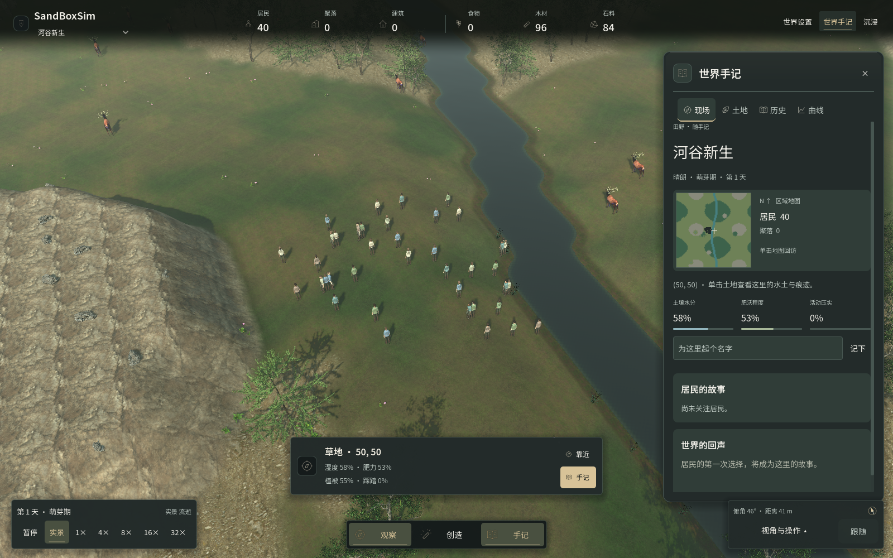
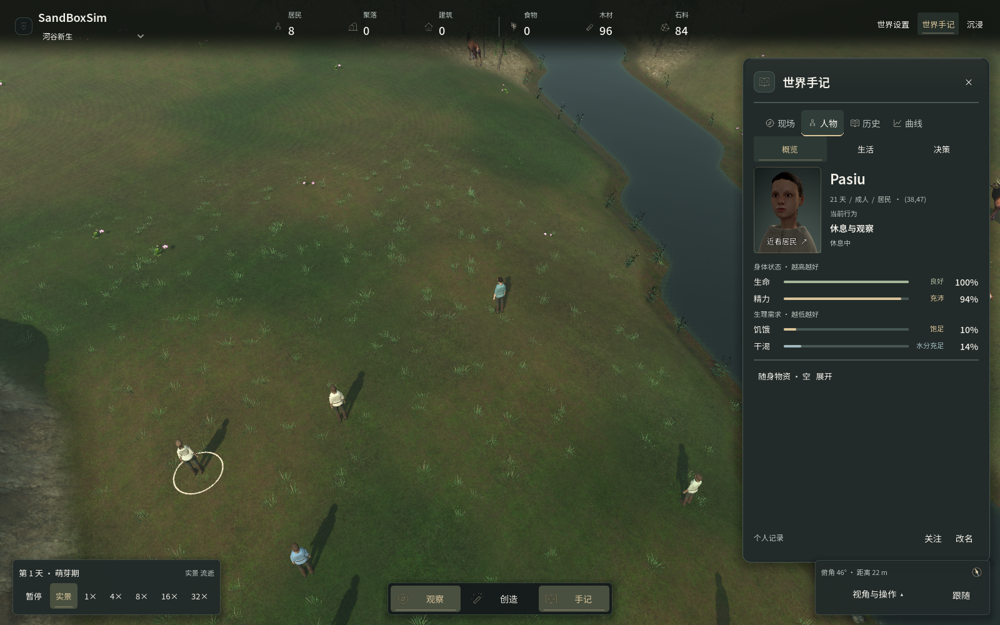
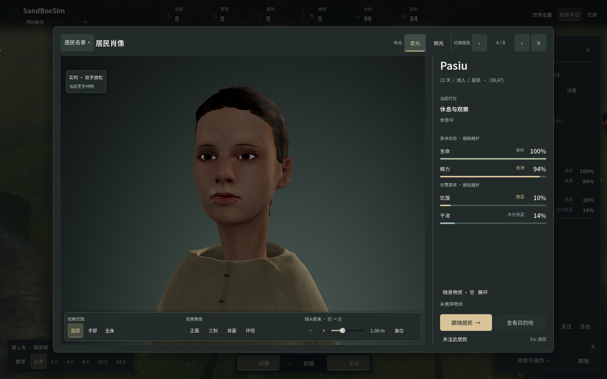
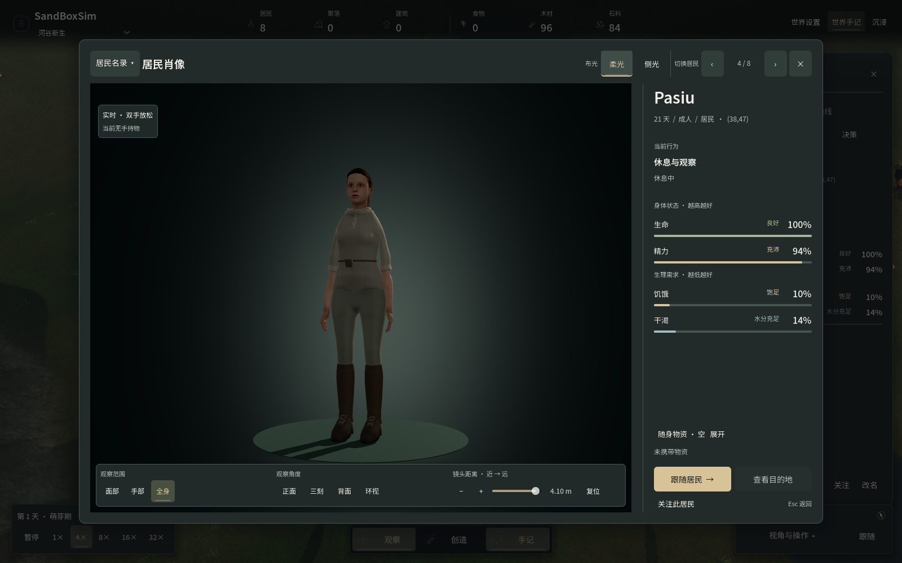
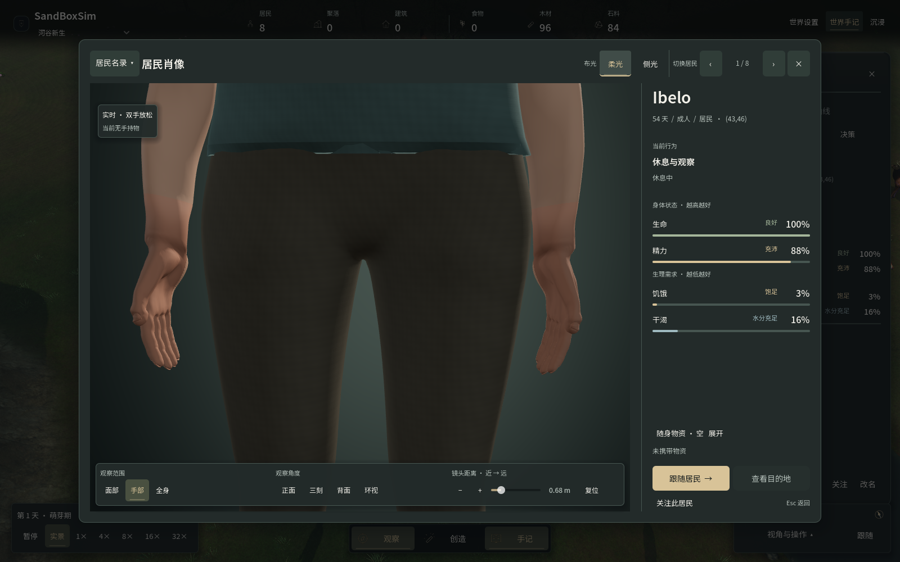
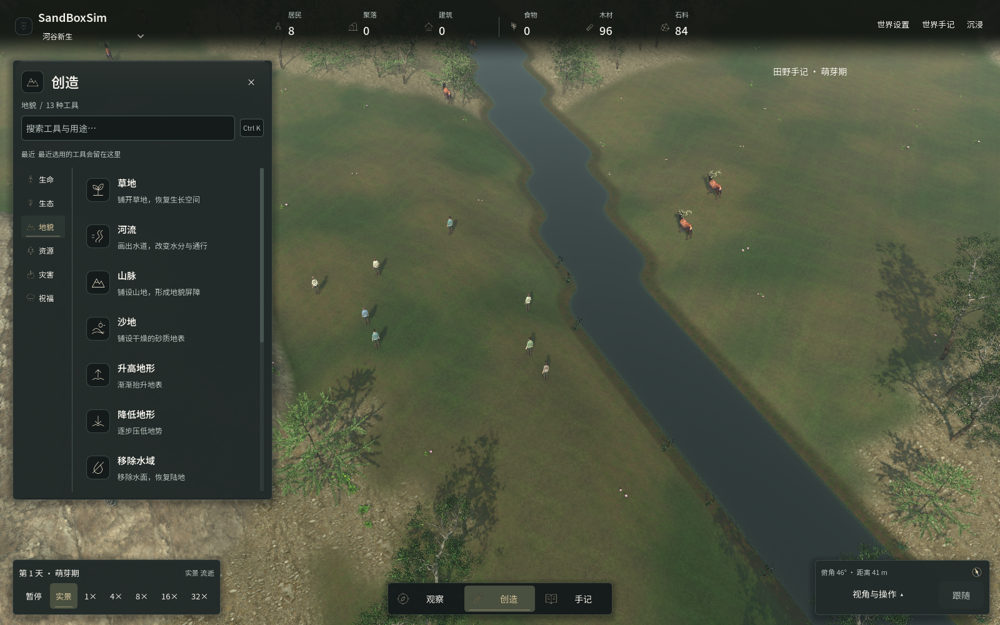

# 观察与界面

世界地图、手记和人物观察窗各有独立的镜头和操作。地图用于移动与选取，手记解释当前世界，人物观察窗用于近看同一个居民。打开资料时，世界继续按当前速度运行。需要细看动作或衣装时，可先暂停。

## 地图与镜头

观察模式下左键拖动平移，右键拖动旋转与俯仰，滚轮以指针下的地面为中心缩放。底部「视角与操作」展开全景、斜视、俯视和近景预设，保留当前距离和俯角读数。选中居民后可点击「跟随」，镜头随实际画面位置移动。手动平移后会退出跟随。

单击居民、鹿、狼、建筑或土地可查看资料。建筑的实际表面会遮挡人物点选，透空的门廊仍可穿过。居民选择卡提供「靠近」和「档案」，动物与土地卡可打开对应的手记。当前对象的详情已打开时，重复选择卡会收起。

点击顶部「沉浸」或按 F10 隐藏界面，保留地图鼠标操作与空格暂停。F10、Esc 或角落的返回按钮恢复界面和原手记。完整按键见 [玩家手册](player-guide.md)。

## 世界手记

「手记」包含现场、详情、历史和曲线。现场页显示区域地图、自选地点和世界记录，详情随选中的人物、动物、房屋或土地变化。区域地图悬停时显示坐标，单击可移到对应地点。可在现场页为当前土地命名并记录，日后从手记定位。

- **人物**的概览显示实际行动、身体状态和随身物资，生活页显示关系与经历，决策页显示性格和当前决策依据。改名时 Enter 保存、Esc 取消。切换居民会结束当前改名。
- **土地与住房**显示水分、肥力、压实、地面库存或住房状态。可用住房卡查看近景，或从实际住户链接打开人物档案。
- **资源总览**汇总居民携带、地面库存和仓库里的资源。顶部折线记录最近 32 次数值变化，时间间隔随实际变化而定。新建、载入或回溯会重新开始记录。

## 人物观察窗

选中居民后点「档案」，或在手记中点「近看居民」。左侧是居民的 3D 模型，右侧显示实际行动、需求和可展开的随身物资。左上角的动作与手持物提示反映画面中的拿取、握持或收回，完整库存可在右侧查看。

| 控件 | 操作 |
|---|---|
| 面部、手部、全身 | 切换观察范围。三种范围各自记住镜头距离 |
| 正面、三刻、背面 | 切换到固定角度；拖动进入自定义角度 |
| 距离滑条、滚轮、加减 | 同步调整观察距离。Shift＋滚轮微调，滑条聚焦后支持方向键与 Home／End |
| 复位、双击模型 | 恢复当前范围的默认角度和距离 |
| 柔光、侧光 | 检查同一模型的颜色、轮廓或表面起伏 |
| 环视 | 主动开启缓慢旋转。拖动、复位、换人、关闭窗口、失焦或关闭界面动效会停止 |
| 跟随居民、查看目的地 | 回到地图跟随居民，或移到其当前有效行动目标；目标失效时目的地入口停用 |

「居民名录」可用 Ctrl / ⌘ F 打开。可按姓名、职业和人生阶段查找，搜索覆盖所有存活居民，每页最多 64 人。方向键、Home／End 和 Page Up／Page Down 浏览列表，Enter 或点击行确认。Esc 先收起名录，再关闭观察窗并返回手记；重新打开时保留观察角度和距离。缩略肖像始终回到面部构图。

## 创造工具

底部「创造」展开工具库。左侧可选生命、生态、地貌、资源、灾害和祝福。Ctrl / ⌘ K 聚焦搜索，Enter 选择首个结果，向下键进入结果列表。切换分类会清空搜索。工具选中后，作用范围与强度可通过滑条和数值框调整，生态工具显示固定三格范围。

工具库保留本次会话最近使用的四项。高窗口在搜索框下显示快捷条，较矮窗口通过标题旁的「最近」打开。工具模式中用 Alt＋左键或中键平移，右键仍可旋转，Shift＋滚轮调整常规笔刷半径。点击「观察」、关闭工具库或打开手记会结束当前干预。

## 显示与操作反馈

焦点、工具勾号和选中状态有可见提示，数值和动作保留文字。可用 Tab 导航，在按钮聚焦时用 Enter 或空格激活。世界设置中的「柔和界面动效」控制界面过渡和人物环视，偏好保存在本机。客户端使用随包 Noto 中文与符号字体。显示细节与场景出处见 [实机图册](../images/README.md)。

[文档导航](../README.md) · [项目首页](../../README.md)
