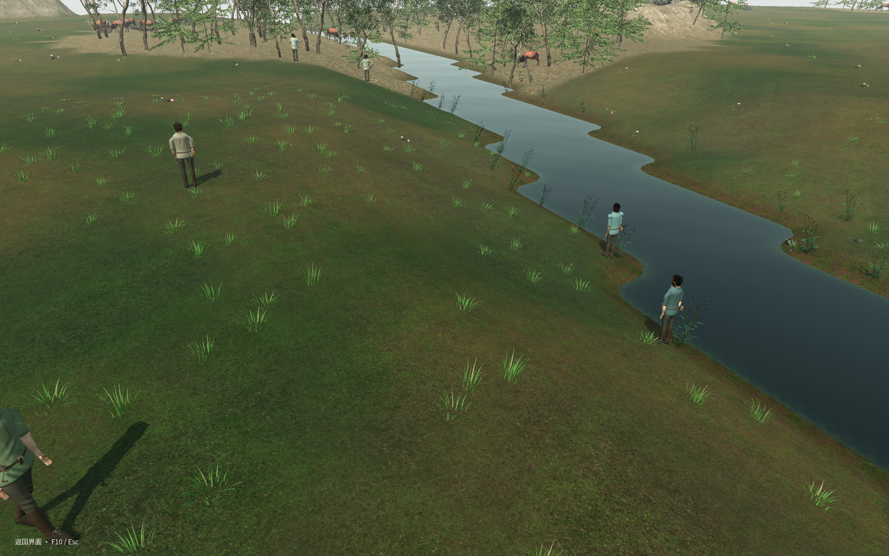
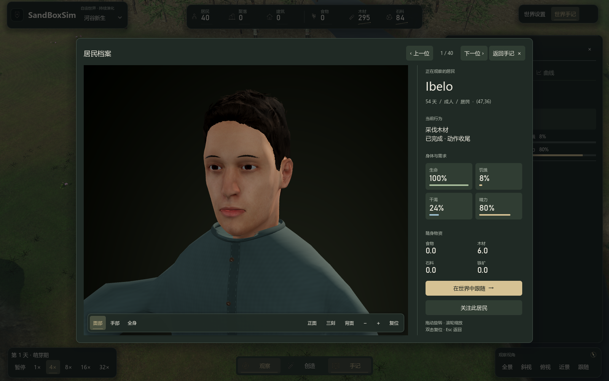
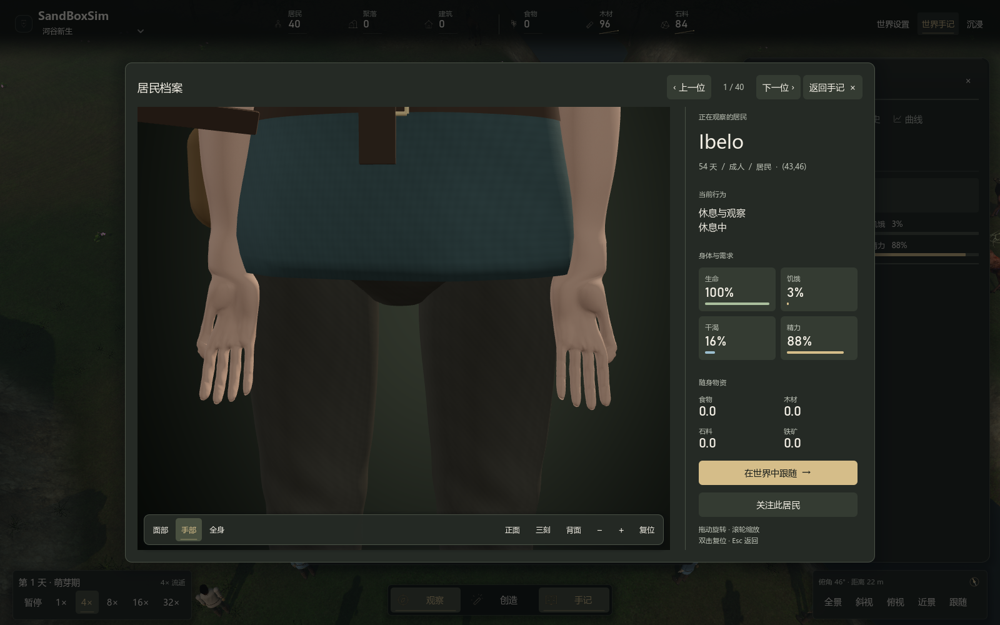
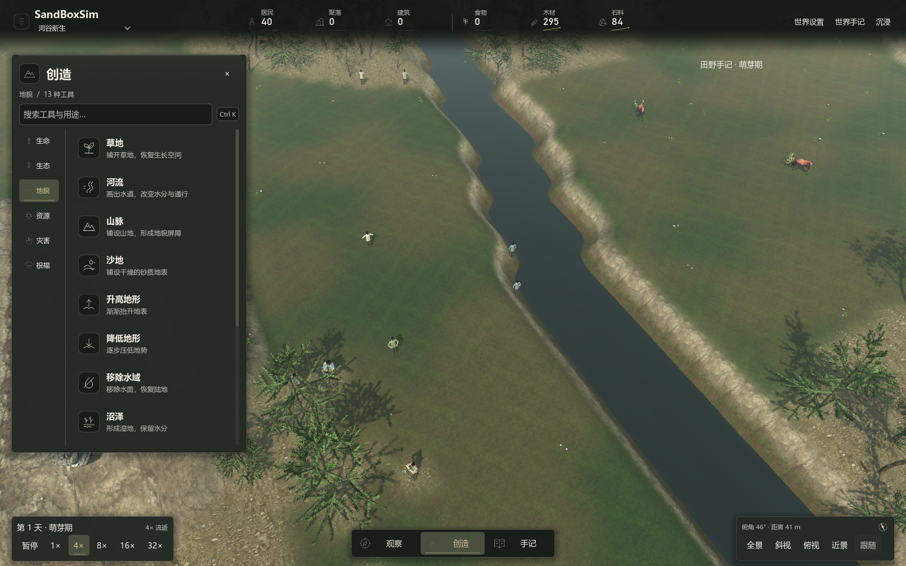
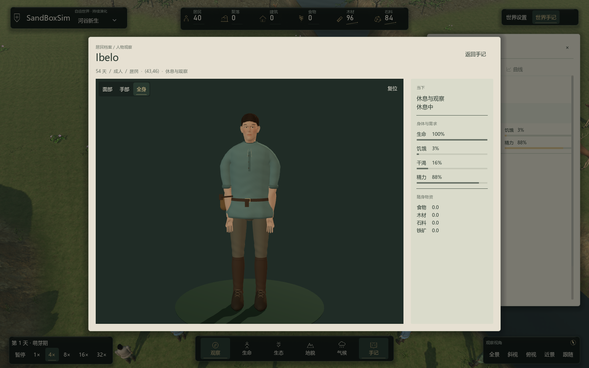
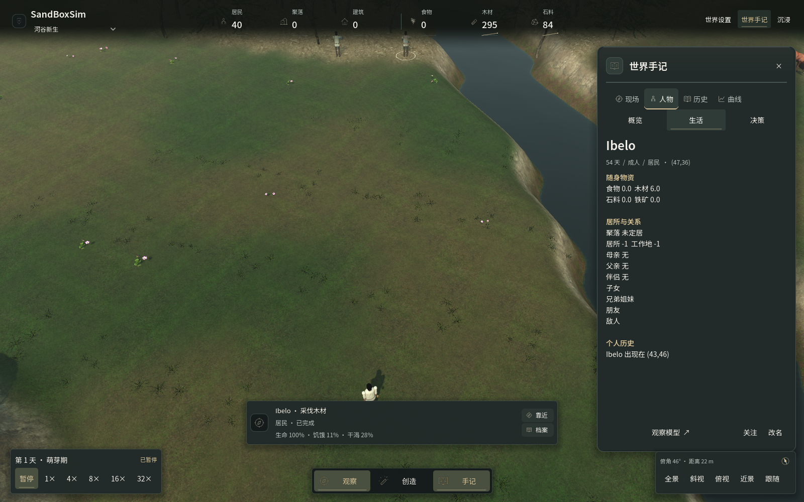
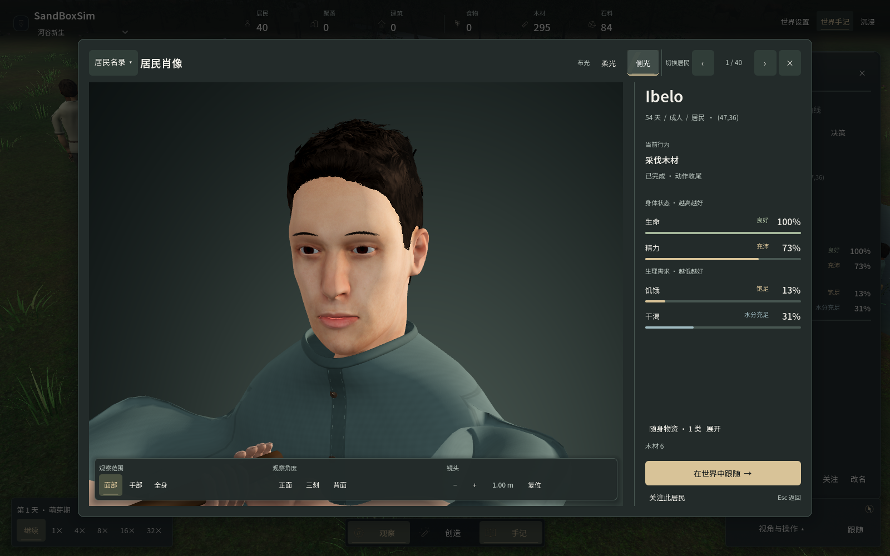

# 观察与界面

界面使用炭灰、低饱和青灰绿和暖铜强调。顶部以连续轻量背景承载世界、资源与菜单；底部保留时间、观察 / 创造 / 手记及镜头控制。工具与资料按需展开，世界镜头不随面板开关缩放。人物手记将可点击肖像、身份与真实行为并排呈现，辅助数据接在下方分组展开。

观察卡现在同时识别居民、鹿、狼和土地。居民显示姓名及实际动作，动物和土地显示名称、坐标；“靠近”读取当前实体位置，将镜头移到约 11 米，“档案”打开居民观察窗，“手记”打开动物或土地资料。按钮使用图标与浅色底板区分点击区域，悬停显示简短说明。死亡或槽位身份变化后隐藏旧实体操作，观察不改变模拟状态。

观察卡的正文随当前选择显示：居民职业、动作阶段与生命／饥渴，鹿狼年龄与需求，土地湿度、肥力、植被与踩踏。数据来自当前世界，常规刷新周期为 0.2 秒；鼠标操作提示放在悬停说明中。保存、载入和干预等反馈出现时优先显示 6 秒，再恢复实时数据；悬停说明保留上次反馈。角色身份失效后不显示旧数据。

## 设计依据与视觉规范

界面参考现代创作工具的层级与操作效率，并保留沙盒的自然环境色彩。参考资料是设计依据，代码仍为 Godot 原生控件，没有引入网页运行时或复制第三方视觉素材。

| 调研参考 | 采用的原则 | SandBoxSim 中的实现 |
| --- | --- | --- |
| [《庄园领主》官方游戏画面](https://store.steampowered.com/app/1363080/Manor_Lords/) | 全局资源置顶，世界画面保持主体，对象资料按选择展开 | 轻量顶栏、稳定的边缘操作与独立对象手记，未使用原作图标或素材 |
| [NN/g：Progressive Disclosure](https://www.nngroup.com/articles/progressive-disclosure/) | 常用信息直接可见，专门功能按需展开 | 资源与当前选择常驻，创造工具、对象观察窗与复杂设置按需打开 |
| [NN/g：Recognition and Recall](https://www.nngroup.com/articles/recognition-and-recall/)与[Xbox XAG 112](https://learn.microsoft.com/en-us/xbox/accessibility/xbox-accessibility-guidelines/112) | 让对象本身提供可识别入口，导航与返回焦点保持一致 | 整张居民缩略肖像可点击或键盘激活，进入和关闭复用同一视口，不必记忆隐藏的放大路径 |
| [Linear：2026 UI refresh](https://linear.app/changelog/2026-03-12-ui-refresh) | 一致的标题、导航和视图控制；降低侧栏的视觉竞争 | 全局信息集中到顶部；创造、手记、人物观察共用色彩和按钮状态 |
| [Figma：Our approach to designing UI3](https://www.figma.com/blog/our-approach-to-designing-ui3/) | 控件位置稳定，关键属性直接可见；设计应保留熟悉的操作路径 | 分类与参数保持固定，仅工具列表滚动；工具用途和数值直接显示，不靠悬停才能辨认 |
| [Figma：Inside the redesigned Figma](https://www.figma.com/blog/behind-our-redesign-ui3/) | 精简底部主工具入口、让主要内容成为中心 | 底部只保留观察、创造、手记三种入口，六种工具分类只在创造面板出现 |
| [Figma：UI design principles](https://www.figma.com/resource-library/ui-design-principles/) | 以层级、邻近关系、对比和一致性减少辨识成本 | 标题、用途、数值分层；工具选中同时显示底色、细线与勾选；危险需求另有名称和百分比 |

调研后的取舍：大面积浅灰白底与本项目的草木、土石和木构建筑不协调，因此采用深色自然中性色。现代感来自清楚的层级、稳定的位置、精确的间距与反馈，而不是提高背景亮度。工具面板保留细边界和有限阴影，世界中的色彩和运动仍是主要视觉内容；没有全屏模糊或持续闪烁的装饰。

| 色彩用途 | 色值 | 使用位置 |
| --- | --- | --- |
| 岩灰底面 | `#232b2a` | 侧栏、手记、人物观察窗；悬浮卡片使用 98% 不透明度 |
| 炭灰暗面 | `#151b1b` | 输入框与图表落点背景 |
| 苔灰分组 | `#303d38` | 当前工具参数、人物行动与需求分组 |
| 暖灰白 | `#f2f0e9` | 主文字 |
| 灰苔文字 | `#b5c0ba` | 用途、单位、辅助信息 |
| 旧铜强调 | `#d8c398` | 当前分类、工具、倍率、焦点与链接 |
| 细分隔 | `#475651` | 边界和分组分隔，不用于小字号正文 |

字号采用 18–24 像素内容标题、14 像素主要控件、15 像素工具名称、12 像素工具用途；次要提示使用 11 像素。主模式按钮以 40 像素为基准，工具行以 66 像素为下限，分类按钮高 38 像素；间距以 4、8、12、16 为基本节奏。主文字、次文字和强调文字在基础面板及分组底色上的对比度由自检约束为至少 4.5:1；这不等同于全产品无障碍认证。

面板标题采用中等偏粗字重，标题和工具配独立图标底座；选中工具使用铜色左边线、图标细边与勾号。图标使用小尺寸平滑采样，减少缩小时的断线。基础悬浮卡片使用 5 像素圆角、细边和向下柔影；资源组以 62 像素、时间与镜头组以 72 像素为基准，实际高度跟随字体与控件最小尺寸，底栏保持 16 像素窗边距。顶部资源的实际历史曲线仅在悬停时短暂渐显，完整趋势可在曲线页查看；关闭动效时立即停止过渡。人口与资源之间用短分隔线区分，搜索快捷键独立显示为键帽。鼠标仅在实际控件区域被截获，组间留白用于世界操作。侧栏顶部有静态柔和亮边，不进行持续重绘。

手记页签使用 14 像素文字、统一内边距与圆角底面，选中有铜色下边线，悬停不改变命中范围；手记外框使用 5 像素圆角。

创造面板宽 416 像素，高度随窗口收缩到可用范围，支持 1280×800 起的实际窗口排版。工具长说明单行省略并提供完整悬停文本，列表滚动不影响分类和参数。手记宽度仍随窗口调整。每个面板仅在打开时使用短暂淡入，按钮反馈不移动点击范围；关闭柔和界面动效后直接呈现最终状态。

在工具模式下，Alt＋左键或中键拖动可平移，右键旋转，滚轮缩放。常规笔刷可用 Shift＋滚轮调整半径，生态工具保持固定范围。切换工具会取消旧笔画。空格恢复暂停前的倍率；左上场景选择先询问是否替换当前世界，取消不会丢失进展。

## 沉浸观察

点击顶部“沉浸”或按 F10 隐藏界面，画面角落保留可点击的返回按钮。鼠标平移、旋转、俯仰、缩放与空格暂停仍可使用；点击角落按钮、按 F10 或 Esc 均可恢复原先的手记状态。进入时结束画笔操作并回到观察模式，地图视口、模拟状态和当前视角不因隐藏界面而改变。Ctrl / ⌘ K 会先恢复界面再打开并聚焦搜索；打开手记、设置或人物观察窗也会恢复界面。此模式仅影响当前会话的显示，不写入存档或覆盖动效偏好。

## 人物与土地

人物页使用三个互斥页签：概览显示对齐的需求条与按需展开的随身物资；生活显示居所、关系和个人历史；决策集中显示性格与上次决策效用。三个页面上方保留同一居民的缩略肖像、姓名、身份与当前行为，点击整张肖像即可近看；不复制角色或改变模拟。页签及底部关注、改名操作位于滚动区之外；点击“改名”才展开输入框，命名后收起。长资料整页滚动，概览不重复这些段落。身份旁直接显示实际行为、执行阶段与目的地，移除单独占位的行为卡与重复放大按钮。短暂的采集完成后会补足一次拿取或工具动作，标记“动作收尾”，不会重复产生资源。人物会眨眼，虹膜与角膜一起轻微转动调整视线。物资开关显示实际持有类别数，概览与大窗共享展开状态；键盘焦点进入滚动区内的物资开关时，页面会自动带出该控件。展开观察后，底部“面部 / 手部 / 全身”切换构图；手部视图跟随实际双手，握持包含接触后合拢和放回后松手。拖动旋转与俯仰、滚轮缩放、双击或“复位”恢复当前构图，只影响肖像镜头。

手记宽度随窗口调整，缩略肖像的逻辑尺寸为 108×138，不显示工作室工具栏；小图与身份并排，需求和物资靠前，长资料及展开后的库存仍可滚动。展开观察窗最大为 1200×800 逻辑像素，随窗口收缩。柔光与侧光切换有暖铜下边线和文字状态，不重置人物、聚焦或镜头，也不改变世界光照。肖像使用中性渐变背景、暖色主光和两盏补光，全身构图以有限圆形地台接住脚下阴影。生命条用灰绿、干渴条用浅蓝、其他需求用旧铜色，危险状态转为暖红；保留名称与百分比。Esc 依次关闭人物观察窗、世界设置、手记；没有展开面板时退出工具。按钮可通过 Tab 获得焦点；关闭“柔和界面动效”后直接呈现最终状态。

近景人物头脸读取 MakeHuman CC0 拓扑与三套形体配方，保留原生皮肤、眼球和发片；眨眼驱动原脸眼睑。远景使用简化模型。衣身与配件仍包含程序构造，具体结构与当前表现边界见 [模型系统](../development/models.md)。

点击整张缩略肖像的“近看居民 ↗”区域，或用 Tab 聚焦后按 Enter／空格，进入独立人物观察窗。左侧复用当前模型视口、旋转角度和构图，继续显示实际动作；右侧同步显示行动阶段、紧凑需求条及可展开的实际随身物资。资料可滚动，跟随与关注操作固定在下方。顶部可按稳定身份顺序切换居民；底部提供聚焦、角度预设、缩放和复位。Esc、顶部关闭按钮或点击遮罩空白处可关闭，回到当前居民的手记并恢复仍可用的入口焦点。展开会中止地图旧拖拽，后续鼠标操作留在观察窗，Tab / Shift+Tab 只在窗内可用控件间移动；仅剩一位居民时导航按钮停用并跳过焦点。模拟仍会推进，未聚焦按钮时空格可暂停；聚焦按钮后空格遵循按钮激活行为。观察窗本身不改变居民、物资或世界状态。

展开时键盘焦点进入模型区域；Tab 长按重复、方向键的控件导航均留在窗内，方向键不移动镜头。返回时恢复此前仍可用的控件焦点。关闭柔和界面动效会同时停止肖像操作提示的淡入淡出，并让缩放与旋转立即到达当前目标。

土地页展示湿度、肥力、植被与资源，现场页保留玩家自选地点和世界故事。历史与曲线记录实际变化，没有完成百分比。

## 交互反馈

底部“创造”打开左侧工具库。左侧固定六种分类，右侧单列工具保留名称、用途和选中勾号；搜索跨全部分类查找，标题下显示结果数量，搜索期间不把结果误标为某一个分类。无结果时显示明确提示，切换分类清空搜索。

按 Ctrl+K（macOS 也可用 ⌘K）打开并聚焦工具搜索。Enter 选择首个结果，向下键将焦点移到结果列表；这些方向键操作只用于控件导航，不移动世界镜头。搜索框内 Esc 先清空非空查询，查询为空时结束干预并收起面板。没有结果时 Enter 不执行工具。

选中工具后，当前工具说明、作用范围与强度固定在列表下方，范围和强度各有拖动条与精确数值输入，两者双向同步；Shift＋滚轮调半径也会更新拖动条。长说明可悬停完整查看；生态工具显示固定三格范围。Alt＋左键或中键平移，右键旋转，滚轮缩放，常规笔刷可用 Shift＋滚轮调范围。再次点击“创造”、关闭按钮或未在搜索中使用 Esc 都会结束当前干预，避免隐藏面板后仍留着活动画笔。打开工具收起手记与设置，打开手记也会结束当前干预。

顶部和底部手记入口同步显示开合状态，“观察”表示当前处于选择模式；打开手记时这两个状态可以同时成立。分类、工具与倍率使用同一套苔灰底色、旧铜文字和细线反馈，工具另有勾号，不依赖颜色单独传达选中状态。下拉箭头、数值加减、输入焦点与滚动条共用主题。

按钮悬停、按下、页签切换、面板展开和数值变化有短暂过渡。设置可关闭柔和界面动效，偏好保存在本机 `user://interface.cfg`；视觉过渡不推进内核、不消耗模拟随机流。小地图标出选中位置，悬停显示坐标与定位环，单击可定位。

镜头支持鼠标平移、旋转、俯仰与缩放，小罗盘随真实视角变化。画笔工具下右键拖动仍然旋转视角，Esc 才返回观察。操作见 [玩家手册](player-guide.md)。

观察模式的操作说明集中在底部悬浮提示卡，随手记侧栏避让，正文最多显示两行，悬停可查看完整信息。打开创造工具库时整张卡收起，操作说明留在工具库内；模型图册不显示提示卡。布局检查覆盖 1280×800、1600×1000 和 1920×1080 的侧栏开合组合。

右下镜头组显示当前俯角与距离，距离单位为米。未选择居民时“跟随”不可用；选择居民后点击开始跟随，按钮保持选中，再次点击停止并保留当前镜头。手动平移或其他操作结束跟随后，按钮同步恢复。

提示卡使用图标、左对齐标题与正文，避免把长操作说明排成居中的一整行。工具列表以较重标题和最多两行用途说明区分层级，当前工具同时改变标题、图标底面和勾号；搜索、键盘焦点和完整悬停说明仍可使用。左下时间组明确显示“已暂停”或当前运行倍率，点击倍率与空格暂停会立即同步状态。

选中有效居民后，提示卡标题显示姓名与当前行为，悬停可查看职业及行为阶段。右侧“靠近”把世界镜头移至居民附近约 11 米处，“档案”直接打开该居民的独立观察窗。未选择居民或身份已失效时隐藏这组操作；人物手记和原有观察窗入口继续可用。操作只改变观察状态，不推进模拟或生成任务。

## 世界呈现

单击住房后，手记显示独立生活状态卡：实际住户人数、建筑完整度细条和空置状态。单击有地面物资的土地可查看精确库存，世界中的物资堆同步反映数量档和取空。这些信息来自当前世界，不生成住房委托或发展目标。

住房与物资所在格优先显示土地页；住房卡支持转入建筑近景和打开住户档案。施工中显示进度，空地不会保留空的住房卡背景。人物档案中的镜头操作继续独立使用。

现场页将所选土地的水分、肥沃度与活动压实显示为三组分色读数和细条，数值直接读取当前土地。地面库存使用独立物资卡，仅显示存在的食物、木材、石料或铁矿；数量与世界物资模型来自同一库存记录。

天气与日间进度驱动光照和雾气。地表采样保留近远景层次，水面有细波纹；火灾、疾病和人物行为有视觉反馈。房屋、人物、动物与植被使用实际 3D 网格，详见 [模型系统](../development/models.md)与[美术资源](../development/assets.md)。

当前地表与建筑表面使用扫描材质：陡坡显露岩面，岸线过渡为湿泥，河水颜色读取河床深浅；草木位置和大小带有稳定差异。住房石基随坡地采样贴合。这些显示规则不修改寻路和经济参数，也没有加入任务流程；详细机制见 [地形与活动痕迹](terrain-and-traces.md)。

顶部各读数下方的小折线保留最近 32 次实际数值变化，按各自范围缩放；它表示变化方向，不是固定时间间隔或可直接比较的增长率。生成新世界、载入存档或回到实验起点都会清空旧折线，避免把不同世界和回溯前后的数值连成假趋势。

顶部资源栏统计居民携带、地面物资堆和仓库，排除未采集的地表资源。总量不代表每位居民都能到达相应物资。

人物详情摘要去除前导空白，全身构图可与实际身份、需求和关系同时观察：

## 居民资料与表面观察

概览默认保留日常观察所需的数据；生活和决策按用途分组，避免一整列同等权重的段落。这种组织参考 [NN/g 视觉层级](https://www.nngroup.com/articles/visual-hierarchy-ux-definition/) 关于分组、对比和尺寸的说明，没有照搬网页运行时。

展开人物观察窗后，柔光用于比较肤色和衣料，侧光更容易观察鼻梁、手指和衣褶的起伏；两者均照亮同一模型，没有为截图替换材质或形体。视线、眨眼和工具动作继续读取居民实际状态。

## 中文、符号与数字

界面使用随包 Noto Sans SC 与 Noto Sans Symbols 2，不读取主机系统字体。正文、600 标题和 500 数字统一层级；资源量、百分比与物资列使用等宽数字，数值变化时减少横向跳动。工具分类保留 38 像素点击高度，分类间隔与列表最小高度为字体行高留出空间；1280×800 的参数区保持可见。选择卡的双行提示按字体真实行高测量，必要时向上增长，并与底栏保持间距，避免完成反馈或实时数据被截断。

---

[文档导航](../README.md) · [项目首页](../../README.md)
