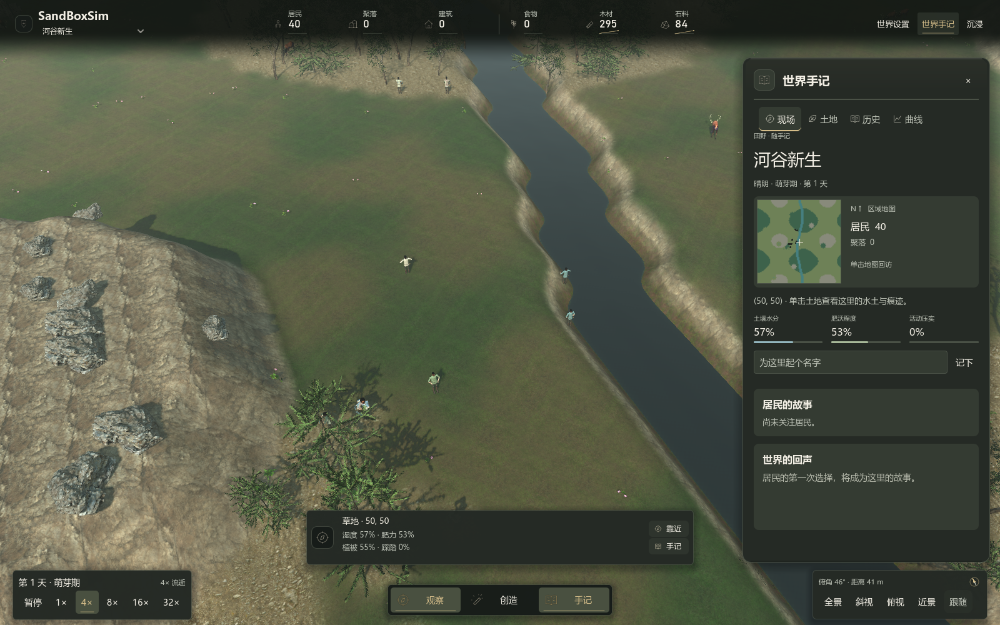

# SandBoxSim · 玩家手册

游戏围绕自由观察、改变世界与自主居民展开。没有住房委托、工程阶段、蓝图目标、试炼、干预额度或指定发展路线。玩家可以直接改变地貌、添加生命、调整资源与天气，居民依照实际条件自行建造、生产、迁徙和形成关系。

## 鼠标与时间

| 操作 | 用途 |
|---|---|
| 观察模式左键拖动 | 平移地图 |
| 右键拖动 | 旋转与调整俯仰 |
| 滚轮 | 围绕鼠标指向的地面拉近、拉远 |
| 中键或 Alt＋左键拖动 | 任意工具模式下平移 |
| Shift＋滚轮 | 调整常规笔刷半径；生态工具保持固定范围 |
| 单击 | 直接选中画面中的人物、动物；空地查看土地，工具模式施加工具 |
| 观察模式双击 | 查看对象并把镜头移近 |
| Esc | 返回观察 |
| 空格 | 暂停、恢复暂停前的倍率 |
| F | 返回全景 |
| F10 | 进入／退出沉浸观察；沉浸时 Esc 也可返回 |

观察模式下，悬停人物或动物显示简短信息；建筑的实际表面会遮挡人物点选，门廊等空隙仍可透过。单击可见的屋顶或墙面会选择该建筑，避免选到建筑后方的地块。左键拖动不会顺便触发选择；按右键、中键或滚轮导航会中止当前画笔手势，移入界面时停止施加，重新回到地图不会隔着面板连画。快速拖动画笔会补齐经过的格子，范围环沿当前地面起伏显示。鼠标移动还会核对实际按键状态，即使系统漏发释放事件也会停止已松开的拖拽或画笔；窗口失焦、地图隐藏与世界载入/重建会清除当前手势，下一次操作需重新按下。

顶部“沉浸”隐藏界面，保留鼠标视角与空格暂停；点击角落返回按钮或使用 F10 / Esc 返回后保留原手记，Ctrl / ⌘ K 可直接恢复界面并搜索工具。

底部时间按钮控制倍率。暂停仍可移动镜头、观察或直接改变世界；人物与生态的模拟变化随时间推进。镜头不使用方向键、WASD 或 Q/E。

人物交谈使用张手、点头与视线转移，采集、分享和进食仍由实际动作状态驱动。镜头靠近时可观察鞋底的坡面补偿；暂停同时停止角色位置、转向与关节变化。

## 自由工具

底部“创造”展开左侧工具库；搜索跨全部分类查找名称和用途，切换分类清空搜索。左侧固定生命、生态、地貌、资源、灾害和祝福分类。Ctrl / ⌘ K 聚焦搜索，Enter 选择首个结果，向下键进入列表；搜索框中 Esc 先清空非空查询，空查询时退出。单列工具保留名称、用途与选中勾号，列表可滚动，当前工具参数固定在同一面板下方。常规工具可通过拖动条或数值框调整作用范围与强度，两种方式同步；生态工具每次栽植一片影响周围三格的地块，可连续栽植。地貌工具包含草地、河流、山地、沙地、湿地、雪地、旱地、熔岩、农田和道路，以及升降地形、移除水域。

资源工具改变真实地表节点；居民仍需要采集和可达路径。湿润土壤不等于饮水，农田地形也不同于居民建造的农业建筑。这些是模拟中的自然关系，不是玩家必须完成的步骤。

打开手记会结束当前干预；Esc 或工具库关闭按钮返回观察。左上角切换场景会先显示替换确认，取消保留当前世界；需要保留的进展应先保存。

世界设置提供天气、世界规则、图层、保存、载入和实验回溯。可以开启和平、高出生、禁止死亡等规则，也可以让自然变化继续发生。

## 自由栽植

“生态”提供花种、野果、苇泽与腐木。适宜水土下，植物约八天逐步成形；干旱会使成熟度停滞或回退，踩踏会减慢恢复。附近成熟且湿润的花甸为野果授粉，增加四分之一的额外结果。苇泽涵养周围土壤；新放置腐木带有有限的 24 单位木料，留在原地育土或被居民取走。

栽植保留已有地形高度、道路与建筑；不会凭空增加居民库存。可以把不同生态并置，观察季节、动物、采集和火灾的连锁变化。新地块与成熟度随世界保存。

## 世界手记

再次点击“创造”收起工具库会同时结束当前画笔，避免隐藏工具后误画地图。

控制栏、工具库与手记统一使用岩灰底色、暖灰白文字、苔灰分组与旧铜色强调，当前倍率、工具与手记入口以底色及细线标识；顶部和底部的手记入口保持同步。人物页将更多空间留给可旋转的模型预览，悬停时显示拖动、缩放和复位提示。观察窗使用相同的自然深色底与分色需求条，需求危险时转为暖红；名称和百分比仍保留，不需要仅靠颜色识别状态。

人物肖像的“放大”打开独立观察窗。底部工具栏集中提供面部、手部、全身聚焦，以及正面、三刻、背面、拉远、拉近和复位；切换视角保留聚焦与缩放，双击画面也可复位。顶部“上一位”“下一位”按稳定身份顺序切换当前存活居民，中间显示位置与人数，无须退出到地图重新点选。右侧同步显示当前居民的真实行动、两列身体需求卡片和分组物资；下方跟随与关注按钮固定显示，资料滚动时仍可操作。返回按钮、Esc 或点击窗外空白可回到当前居民的档案，视角保留。观察窗不会自动暂停世界，空格可以暂停或恢复。

手记只有现场、详情、历史和曲线。现场页显示当前地区、区域地图、自选地点和世界记录，不会推荐下一步任务。详情根据选择显示人物、动物或土地；地表数据来自实际状态。

人物可以命名、关注或跟随。人物页有可旋转与缩放的独立肖像，显示需求、行动、物资、关系与历史。名称最多 24 字，旧历史保留当时的名字。

自然地点与季节作用见 [自由探索](exploration.md)，居民自主发展见 [聚落与居民](settlements.md)，天气和生态关系见 [生态变化](ecology.md)。

## 世界手记的阅读与导航

顶部世界信息、资源和菜单分开悬浮显示，保留中间的地图视野。手记使用浅亚麻色面板、深绿灰文字与青灰选中强调；底部导航使用上下排列的图标与标签，左侧工具库按内容与窗口高度调整，列表可滚动，详情页图标随人物/土地选择变化，小地图作为浅色地图嵌入面板；HUD 减弱双层边框与尖角装饰，按钮用底色和细线区分悬停/选中状态。现场页将居民故事与世界回声分区显示。上方标签切换现场、土地、历史和曲线；关闭按钮只收起面板，不改变世界。小地图标出选中地点，悬停显示坐标与定位环，单击跳转；记录地点和故事链接可用于回访，关注居民后能追踪其状态。页面内容来自实际世界，没有要求完成的流程。界面动效可在世界设置中关闭。

## 土地上的活动痕迹

居民反复经过和采集活动会缓慢压实土地，损耗植被并留下轻微下陷；闲置后逐步恢复。变化会保存，也会影响资源和植被再生。详见 [地形与居民留下的痕迹](terrain-and-traces.md)。

---

[文档导航](../README.md) · [项目首页](../../README.md)
