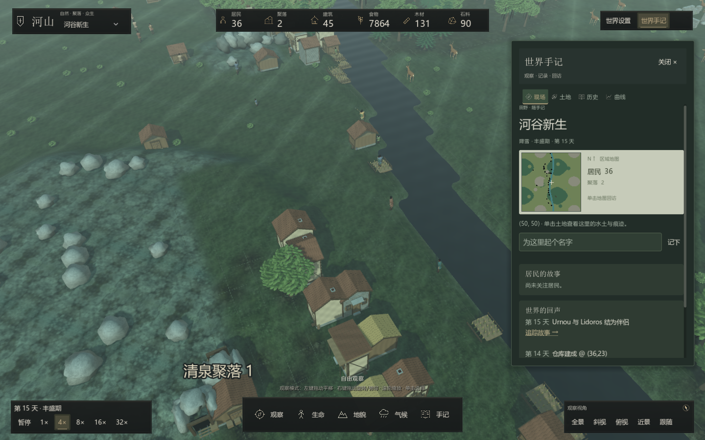
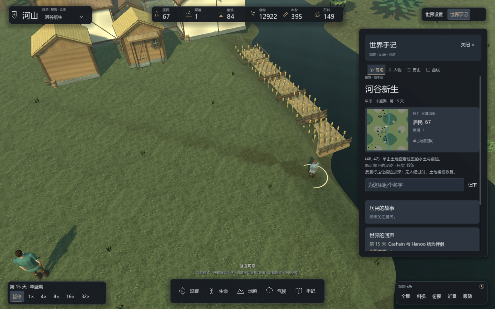
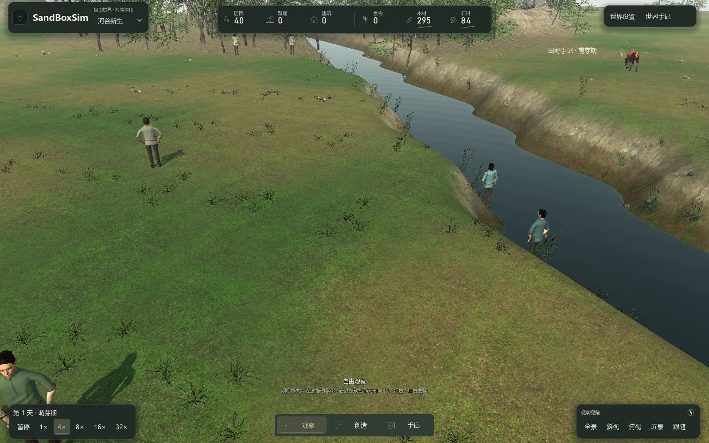

# 地形与居民留下的痕迹

地形使用共享顶点的细分曲面和平滑法线，河床、水面与旱地按实际水陆地类衔接。格子仍是模拟的空间单位，细分、微起伏和岸线过渡属于表现层；不把每个显示顶点变成一个模拟格子。

每个模拟格的显示宽度为 2 米。世界的水域由地形分位分类，不能再把固定 `Height < 0.25` 当成水面判据。显示层先保留逻辑水陆：旱地基础海拔具有支撑下限，临水陆地逐渐过渡到低岸，山地保留自身高度；细分网格再按两侧地类形成连续岸坡。旱地显示顶点最低 0.08 米，最大压实位移 0.024 米后仍高于 0.02 米水面。拾取和生物脚底读取同一显示曲面，不是只抬高角色；存档海拔与寻路规则不变。

草地、泥土、林地和岩面采用扫描颜色、法线与粗糙度，陡坡显露岩面，临水地带转为湿泥，真实踩踏区域逐渐露土。沙地使用扫描颜色。来源与重建见 [环境素材](../development/environment-assets.md)。水面用实际网格河床高度纹理计算深浅色、吸收与接岸色带，仍属于视觉水体，没有新增流体模拟。

草地颜色与法线／粗糙度在三角格上使用三组稳定偏移与四向旋转采样，混合具有草叶和落叶的扫描表面，减弱同向重复；颜色与法线同步旋转；显式纹理梯度和实际导入的 mip 链保持格边界的过滤层级。低频灰绿与枯草色形成斑块，岸边沉积采用连续过渡，显示曲面叠加最多约 7 厘米的稳定侵蚀起伏。山坡另按连续高度场导数叠加最多约 8 厘米的岩面起伏，水域与道路处缩退；陡坡法线分别按三向投影坐标还原。这里的侵蚀是只读造型，不是随时间运行的新侵蚀模拟；真实长期土地变化仍由压实等内核状态驱动。

住房和仓库按建筑旋转与占地四角采样地面，生成贴地石基裙边，避免下坡一侧直接悬空；不等于整平土地、提供可进入室内或改变碰撞规则。树木在格内稳定错位、改变尺度，草丛使用两个稳定候选并区分宽矮与窄高比例；各自根部重新采样地面，建筑占地不显示植被。湿润河岸增加有茎、叶与立体种穗的芦苇，林下蕨类成簇分布。

## 土地如何逐渐改变

居民实际跨到下一格时，该格累积少量 `FootTraffic`（土壤压实）。采木、采矿等作业接触也会少量累积，商队行走压力略高。普通行走每次增加当前剩余空间的 0.15%，不是走过一次就造出一条路；没有人数门槛或任务进度。反复使用的区域逐渐变暗、植被受损，地面产生轻微下陷。

压实也会减慢该格的资源再生和自然植被恢复，因此是实际生态状态，不只是脚印贴花。它不会自动把地形改成正式道路。水域、不可行走土地、铺装道路和建筑占地受到保护。

停止使用后，压实每个游戏小时保留原值的 99.6%；约 173 游戏小时下降一半。对应的微小下陷随压实缓解恢复，植被继续由原有水土、生长与火灾规则决定。改变地形会清除原有压实，既有收获、火灾或植被损耗不会被一并撤销。

300 次连续普通经过、期间不计恢复时，压实约为 36%。这只是说明累积速度；实际世界中不同路线、人数、作业和空闲时间会形成不同结果。玩家可以观察聚落周边、资源采集地和往返取水路线，查看长期活动如何留下痕迹。

## 观察与保存

世界手记会在被明显踩踏的选中土地旁显示压实信息。核心存档 v4 保存逐格压实、海拔和植被，并纳入确定性摘要；载入 v3 存档时缺失压实默认零，从载入后的实际活动开始积累，不推测过去的行走历史。

在线 `/v1/sessions/{id}/map` 增加 `elevation`、`footTraffic`、`vegetation`。`elevation` 是实际归一化海拔；旧的 `traversalHeight` 仍保留原有寻路温度代理语义。读取地图不会推进游戏时间。

## 表现与性能

每格显示为 4×4 个小四边形，共享相邻顶点并计算平滑法线。坡面叠加稳定起伏，道路附近减弱，建筑保留独立地基；水陆边界共享支撑顶点，只有水域一侧降向河床，水面按同一地形三角面裁切。人物和动物采样显示三角面并加入压实下陷，近景人物还有脚下高度和鞋底倾斜的有界补偿。扫描地表按实际尺寸缩放，颜色边界加入稳定扰动和连续混合，坡面采用三向岩石采样；河边、沙地和山地散布近景碎石。颜色纹理生成 mipmap，以减轻远景闪烁；近景水面使用多方向微波法线。

草地露土斑块读取实际植被量，与湿度、坡度和踩踏混合；数据复用既有地表 tint 的 alpha，不新增地表节点或采样器。外观签名按 16 档刷新，允许约 6% 的覆盖率量化间隔，不是逐帧逐百分点追踪。岸线的九邻域支撑计算只发生在地形重建时，更新覆盖率本身不重建地形。

踩踏纹理与微小下陷通过共享贴图更新，压实变化不逐步重建整张地形；地形工具和海拔变化仍触发正式网格更新；资源、湿度、肥力、人口与领土图层仅更新颜色贴图。网格索引和 UV 按地图尺寸缓存，避免地形变化时重复生成；新建筑通过自己的地基适应微起伏，不因为占地变化重建整张地形。视觉刷新按 8 位贴图精度更新，模拟中的压实值仍按每次实际接触连续保存。

早期版本中自由运行 14 个游戏日后的世界（保留作土地活动示例）：

### 水面与岸线

水面采用同一组连续波函数计算顶点位移和法线方向，根据实际河床深度在浅岸逐渐减弱振幅，避免几何波峰和反光方向脱节。此变化属于表现层，水域格、海拔、河床采样与寻路规则保持原有契约；没有加入流体动力学或水量输运。

## 自然形成的小径

相邻土地都出现实际踩踏时，地表显示连接的窄径与柔和边缘；反复使用逐渐加深，停止使用随原有压实恢复消退。单次经过不会立即形成路网。小地图标出压实区域，土地观察解释当前足迹状态。小径是现有模拟压实的可见表现，不增加正式道路、通行加速或建筑容量。

下图来自 80 位初始居民自由运行 14 日后的实际世界，镜头聚焦当时压实最多的格子（19%）；没有预画路线或添加演示脚印。

## 近景草丛

花甸中的每株草花独立采样实际地面，根部埋入约 1.2 厘米，避免整片花甸以中心高度悬在坡上。建筑、水面、道路、熔岩及火烧占地不放置花株；草花按成熟度缩放，沿用原有开花与种头阶段。根部高度随土地压实的显示刷新调整，花株位置保存在 CPU 端，再上传变更的实例变换；花株按 24 米分块绘制，42 米外裁剪。这些显示更新不改变食物、授粉或土地规则。

草地和林地上的草丛使用项目构造的折面弯叶，与土地的植被状态、火烧状态和建筑占用相对应，原扫描草来源仍保留。压实越高，草叶越伏低；该变化读取共享压实贴图，根部变换只检查受影响地块邻域，不因每次脚步重建全部草丛。微风摆动是纯视觉效果，不消耗模拟随机数。

草丛按 24 米区域批量绘制；距离相机 24–32 米逐渐缩退，34 米以后整批裁剪。每丛 24 片弯叶、336 个三角形，每个适宜地块最多两个稳定候选，分别采用宽矮与窄高比例；实际落点受植被量、坡度和外围根接地约束，草叶关闭投影。河岸芦苇在 42 米裁剪，湿润林下蕨类在 38 米裁剪。它们是稀疏地表细节，完整植被状态仍以模拟数据为准。

普通河岸芦苇在原有湿度、地类和稳定抽样筛选后，沿相邻水域方向最多尝试四个落点。每个落点重新采样实际显示地面：相对水面的高度需在 −0.06 至 0.58 米之间，地面法线的向上分量不低于 0.80，避免仅因邻接水格就在高岸、陡坡长出芦苇。根部继续贴地，保持既有分块与 42 米裁剪。特殊地点的苇泽配置单独维护；这些阈值是表现层规则，不增加生态、河流或寻路模拟。

草地扫描纹理的宽域明暗对比经过压缩，实际土壤湿度与稳定空间斑块参与干草色混合；这属于地表材质，不改动草量、采集产量、可行走性或碰撞高度。植物风摆会同步变换法线和切线框架，保留根部位置。

世界方向光深度偏移为 2.4，用于抑制连续坡地自遮挡条纹；保留四级联、原来的动态阴影距离与法线偏移。视觉评测同时记录这些实际参数，改动后应重新建立画质与耗时基线。

视觉评测记录 `landscapeSurface=coverage-mosaic-v6`、`habitatDetail=stratified-meadow-v10` 和 `waterSurface=logical-bank-v4`。覆盖率、草丛比例与水陆支撑已改变显示内容，比较性能时应重新建立同场景基线，不能把不同画面负载直接当成内核加速。

## 数据与画面的区别

`FootTraffic` 是连续模拟值，贴图按 1/255 的显示精度更新；共享显示顶点与河岸插值不会增加模拟格子或改变通行规则。相同地表状态在不同 GPU 上可以有像素差异，核心摘要与存档状态仍按同版本规则比较。外部读取字段见 [在线接口](../development/online-efficiency.md)。

---

[文档导航](../README.md) · [项目首页](../../README.md)
