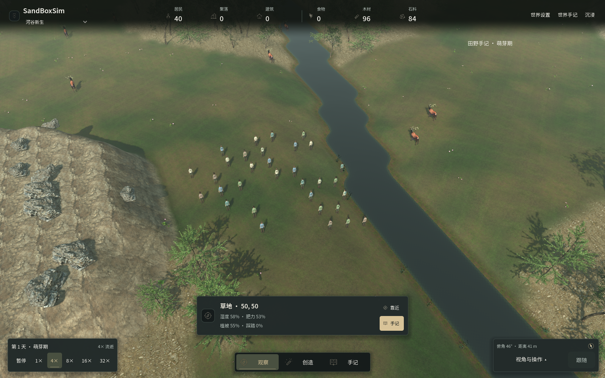
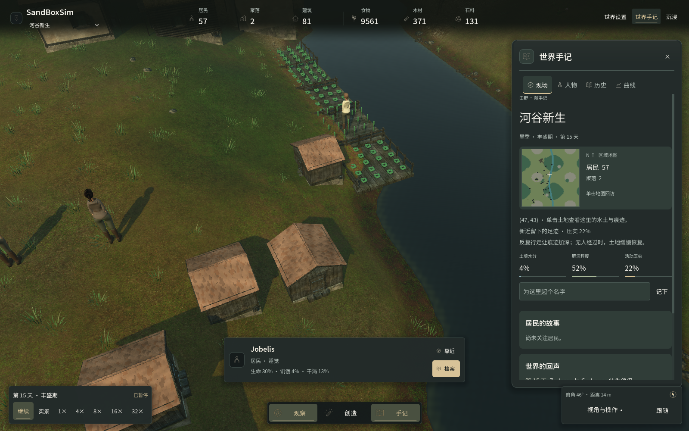
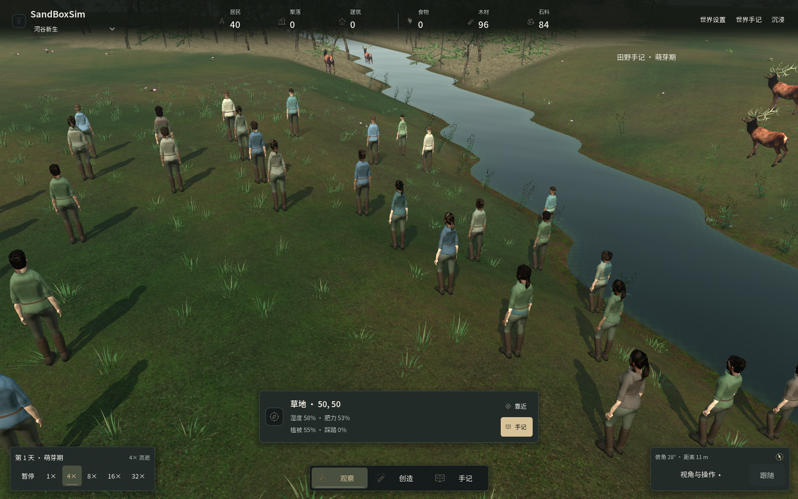
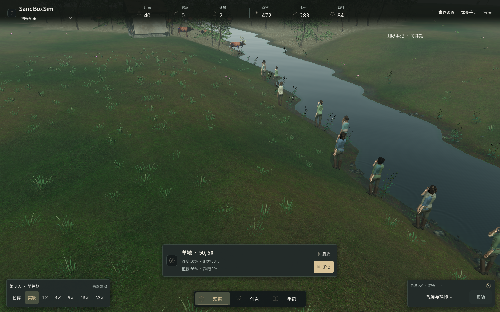

# 地形与居民留下的痕迹

地形使用共享顶点的细分曲面和平滑法线，河床、水面与旱地按实际水陆地类衔接。格子仍是模拟的空间单位，细分、微起伏和岸线过渡属于表现层；不把每个显示顶点变成一个模拟格子。

每个模拟格的显示宽度为 2 米。世界水域按地形分位分类，显示层用 5×5 邻域、2.1 格半径的紧支撑连续场连接水陆，合并重复的阶梯轮廓，并叠加受种子控制的低频小幅变化；实际足区与合法通路约束保留山地和旱地支撑，水格中心保留河床深度。干格中心 ±28 厘米脚区，以及允许相邻通道两侧 ±28 厘米保留支撑，满压实后仍高于水面；格子未使用的角部可以出现浅水，不再保证整块干格的每个显示顶点都在水上。拾取、生物脚底和水面深度读取同一实际三角曲面，存档海拔与寻路规则不变。

草地、泥土、林地和岩面采用扫描颜色、法线与粗糙度，陡坡显露岩面，临水地带转为湿泥，真实踩踏区域逐渐露土。沙地使用扫描颜色。来源与重建见 [环境素材](../development/environment-assets.md)。水面用实际网格河床高度纹理计算深浅色、吸收与接岸色带，仍属于视觉水体，没有新增流体模拟。

草地颜色与法线／粗糙度在三角格上使用三组稳定偏移与四向旋转采样，混合具有草叶和落叶的扫描表面，减弱同向重复；颜色与法线同步旋转；显式纹理梯度和实际导入的 mip 链保持格边界的过滤层级。低频灰绿与枯草色形成斑块，岸边沉积采用连续过渡，显示曲面叠加最多约 7 厘米的稳定侵蚀起伏。山坡另按连续高度场导数叠加最多约 8 厘米的岩面起伏，水域与道路处缩退；陡坡法线分别按三向投影坐标还原。这里的侵蚀是只读造型，不是随时间运行的新侵蚀模拟；真实长期土地变化仍由压实等内核状态驱动。

住房和仓库按建筑旋转与占地采样地面，生成贴地石基裙边。树丛沿地形斑块分布，山石贴坡，碎石向坡下逐渐变小。适宜地块最多布置四个草丛候选，根部与外围均检查地面支撑，并避开树石和建筑占地。湿润河岸生长有茎、叶与立体种穗的芦苇，林下蕨类成簇分布。

## 土地如何逐渐改变

居民实际跨到下一格时，该格累积少量 `FootTraffic`（土壤压实）。采木、采矿等作业接触也会少量累积，商队行走压力略高。普通行走每次增加当前剩余空间的 0.15%，不是走过一次就造出一条路；没有人数门槛或任务进度。反复使用的区域逐渐变暗、植被受损，地面产生轻微下陷。

压实也会减慢该格的资源再生和自然植被恢复，因此是实际生态状态，不只是脚印贴花。它不会自动把地形改成正式道路。水域、不可行走土地、铺装道路和建筑占地受到保护。

停止使用后，压实每个游戏小时保留原值的 99.6%；约 173 游戏小时下降一半。对应的微小下陷随压实缓解恢复，植被继续由原有水土、生长与火灾规则决定。改变地形会清除原有压实，既有收获、火灾或植被损耗不会被一并撤销。

300 次连续普通经过、期间不计恢复时，压实约为 36%。这只是说明累积速度；实际世界中不同路线、人数、作业和空闲时间会形成不同结果。玩家可以观察聚落周边、资源采集地和往返取水路线，查看长期活动如何留下痕迹。

## 观察与保存

世界手记会在被明显踩踏的选中土地旁显示压实信息。核心存档 v4 保存逐格压实、海拔和植被，并纳入确定性摘要；载入 v3 存档时缺失压实默认零，从载入后的实际活动开始积累，不推测过去的行走历史。

在线 `/v1/sessions/{id}/map` 增加 `elevation`、`footTraffic`、`vegetation`。`elevation` 是实际归一化海拔；旧的 `traversalHeight` 仍保留原有寻路温度代理语义。读取地图不会推进游戏时间。

## 表现与性能

每格显示为 4×4 个小四边形，共享相邻顶点并计算平滑法线。连续岸坡复用 5×5 邻域与细网格相位权重。水面按同一三角面裁切，拾取按真实深度先命中水面，最后选择原逻辑格。人物和动物在安全通行时保持插值，高倍速跳过未知步或近岸插值脚区失去支撑时同步到逻辑位置。扫描表面按实际尺寸缩放，近岸细波由法线表现。

草地露土斑块读取实际植被量，与湿度、坡度和踩踏混合；数据复用既有地表 tint 的 alpha，不新增地表节点或采样器。外观签名按 16 档刷新，允许约 6% 的覆盖率量化间隔，不是逐帧逐百分点追踪。岸线的 5×5 邻域掩码和细网格权重只用于地形重建，更新植被覆盖率本身不重建地形。

踩踏纹理与微小下陷通过共享贴图更新，压实变化不逐步重建整张地形；地形工具和海拔变化仍触发正式网格更新；资源、湿度、肥力、人口与领土图层仅更新颜色贴图。网格索引和 UV 按地图尺寸缓存，避免地形变化时重复生成；新建筑通过自己的地基适应微起伏，不因为占地变化重建整张地形。视觉刷新按 8 位贴图精度更新，模拟中的压实值仍按每次实际接触连续保存。

### 水面与岸线

水面采用同一组连续波函数计算顶点位移和法线方向，根据实际河床深度在浅岸逐渐减弱振幅，避免几何波峰和反光方向脱节。此变化属于表现层，水域格、海拔、河床采样与寻路规则保持原有契约；没有加入流体动力学或水量输运。

## 自然形成的小径

相邻土地都出现实际踩踏时，地表显示连接的窄径与柔和边缘；反复使用逐渐加深，停止使用随原有压实恢复消退。单次经过不会立即形成路网。小地图标出压实区域，土地观察解释当前足迹状态。小径是现有模拟压实的可见表现，不增加正式道路、通行加速或建筑容量。

下图来自 80 位初始居民自由运行 14 日后的实际世界，镜头聚焦当时压实最多的格子（22%）；没有预画路线或添加演示脚印。

## 近景草丛

花甸中的每株草花独立采样实际地面，根部埋入约 1.2 厘米，避免整片花甸以中心高度悬在坡上。建筑、水面、道路、熔岩及火烧占地不放置花株；草花按成熟度缩放，沿用原有开花与种头阶段。根部高度随土地压实的显示刷新调整，花株位置保存在 CPU 端，再上传变更的实例变换；花株按 24 米分块绘制，42 米外裁剪。这些显示更新不改变食物、授粉或土地规则。

草地和林地上的草丛使用项目构造的折面弯叶，与土地的植被状态、火烧状态和建筑占用相对应，原扫描草来源仍保留。压实越高，草叶越伏低；该变化读取共享压实贴图，根部变换只检查受影响地块邻域，不因每次脚步重建全部草丛。微风摆动是纯视觉效果，不消耗模拟随机数。

草丛按 24 米区域批量绘制；距离相机 24–32 米逐渐缩退，34 米以后整批裁剪。每丛 20 片较高弯叶与 4 片矮阔叶，共 336 个三角形，每个适宜地块最多四个稳定候选，交错采用宽矮与窄高比例；实际落点受植被量、坡度和外围根接地约束，草叶关闭投影。河岸芦苇在 42 米裁剪，湿润林下蕨类在 38 米裁剪。它们是稀疏地表细节，完整植被状态仍以模拟数据为准。

普通河岸芦苇在原有湿度、地类和稳定抽样筛选后，沿相邻水域方向最多尝试四个落点。每个落点重新采样实际显示地面：相对水面的高度需在 −0.06 至 0.58 米之间，地面法线的向上分量不低于 0.80，避免仅因邻接水格就在高岸、陡坡长出芦苇。根部继续贴地，保持既有分块与 42 米裁剪。特殊地点的苇泽配置单独维护；这些阈值是表现层规则，不增加生态、河流或寻路模拟。

草地扫描纹理的宽域明暗对比经过压缩，实际土壤湿度与稳定空间斑块参与干草色混合；这属于地表材质，不改动草量、采集产量、可行走性或碰撞高度。植物风摆会同步变换法线和切线框架，保留根部位置。

世界方向光深度偏移为 2.4，用于抑制连续坡地自遮挡条纹；保留四级联、原来的动态阴影距离与法线偏移。视觉评测同时记录这些实际参数，改动后应重新建立画质与耗时基线。

视觉评测记录 `landscapeSurface=wet-bank-mosaic-v7`、`habitatDetail=responsive-understory-v12` 和 `waterSurface=shore-activity-v7`。覆盖率、草丛比例与水陆支撑已改变显示内容，比较性能时应重新建立同场景基线，不能把不同画面负载直接当成内核加速。

## 数据与画面的区别

`FootTraffic` 是连续模拟值，贴图按 1/255 的显示精度更新；共享显示顶点与河岸插值不会增加模拟格子或改变通行规则。相同地表状态在不同 GPU 上可以有像素差异，核心摘要与存档状态仍按同版本规则比较。外部读取字段见 [在线接口](../development/online-efficiency.md)。

## 场景与角色的接触

当前世界的模拟格宽 2 米，寻路使用内核的八邻接格子 A*，地形显示在这些格子之间形成细分三角曲面。角色位置、四足／鞋底接地、鼠标拾取和河床深度读取同一显示地面；连续地形不等于连续导航网格，也不会自动将每个装饰模型变成障碍物。

| 场景部分 | 当前数据与交互 |
|---|---|
| 河岸、坡地 | 共享显示三角面；脚底、地面拾取与水面深度共用高度。近岸失去支撑或跨过未知逻辑步时重新同步到真实格中心 |
| 草丛、林下层 | 稳定斑块采样，短阔叶与长弯叶交错；实际外围根部检查地形高度及地类、建筑、火烧占用 |
| 人物、鹿狼经过 | 近景草叶读取实际显示位置，向角色外侧弯折并压低；根部保持原位，离开后随空间影响减弱恢复 |
| 长期土地变化 | `FootTraffic` 由实际内核行走／作业接触累积并缓慢恢复，继续影响土地、资源再生及植被；即时弯折不写回这些值 |
| 建筑 | 建筑占地来自模拟；地基裙边采样地面。草丛所属格与相邻实际根部均排除建筑／道路等不适宜占地 |
| 树、岩石、灌木 | 普通山石与树干按测量包络摆放，格中心通路留出角色净空。资源锚点决定采集朝向，灌木提供柔性植被细节 |

`responsive-understory-v12` 的草叶接触场在现有角色更新遍历中收集位置，最多保留相机 34 米内最近的八个角色，每约 1/60 秒上传一次共享材质。人物影响半径为 0.55 米、动物为 0.75 米；高差超过 0.9 米不产生影响，减少跨层误触。顶端世界偏移限于 0.16 米并换算到草丛的实际旋转／缩放空间，近距离最多压低约 65%，根部权重为零。远处及影响半径之外先用距离平方排除，避免额外求根与矩阵变换。沿用原有 24–32 米缩退、34 米分块裁剪与无投影；这是有限预算的视觉接触，不是草叶刚体碰撞或软体物理。

暂停时角色位置不推进，接触采样仍可随观察相机更新近处候选；换世界时先清空旧接触场。草叶微风继续沿用原着色器。建筑、地类和火烧条件以邻域九位占用掩码参与放置缓存身份，地面压实继续使用原地面版本；占用或地面变化后重新检查，不从旧缓存恢复穿入道路或建筑的草丛。

回归检查覆盖实际草丛外围根接地、建筑占用后的缓存失效与恢复、最近八个接触的选择、材质位置上传、失效接触清除，以及观察前后的模拟摘要一致。运行包自检同时检查人物和动物接地、岸线通路、建筑地基、存档与界面操作；这些检查不构成所有模型碰撞的物理保证。

实现划分参考 [Godot 的导航网格说明](https://docs.godotengine.org/en/stable/tutorials/navigation/navigation_using_navigationmeshes.html)，其中明确区分导航数据与视觉／物理几何；地表层次参考 [Epic 的地形材质分层说明](https://dev.epicgames.com/documentation/en-us/unreal-engine/landscape-quick-start-guide-in-unreal-engine)。项目继续采用自己的格子模拟、Godot 渲染和已有授权扫描材质，没有引入 Unreal 运行时或新增素材下载。

## 资源显示位置与采集朝向

树干、矿石和食物灌丛按实际实例落点登记带资源类型的显示锚点。居民执行对应采集动作时，以该锚点调整身体朝向与注意方向；寻路目的地、采集量、库存和时间仍由内核格子与实体决定。资源耗尽、类型不符、显示物不存在，或动作不是对应采集动作时，回退到原逻辑格位置。自然物刷新与世界载入会重建登记表，避免沿用旧显示位置。

朝向解算只使用水平距离。目标只有高度差时保持水平注意中性。执行伐木、采石或采铁的居民进入目标格后，向有效资源靠近最多 0.72 米，离测量包络外缘保留 0.34 米，并在同一逻辑格内检查整段接地和净空。可用站位取决于实际地形和自然物摆放。作业朝向使用显示锚点，工具逐帧命中仍不在该模型的覆盖范围内。

`TREE_ROOT_ANCHOR_PASS` 检查实际渲染树根中心。`SCENERY_SUPPORT_PASS` 检查底部探针、接近站位、资源耗尽回退及观察前后的模拟摘要。公开场景预运行两日后每帧推进一个模拟步，用于观察正在活动的居民、鹿狼和自然物。见 [world-scenery-contacts.json](../../benchmarks/scenarios/world-scenery-contacts.json)。

## 林间与山坡通路

`WorldView3D.SceneryTraversal.cs` 把树干和普通山石布置到 2 米格子的角部，每个角最多一个实体。角部相邻四格必须可通行，且适合自然物放置。实体到正交格中心线至少 0.94 米，最大包络半径为 0.63 米，再为角色根节点加 0.28 米水平净空。树干包络测量阔叶树下段和针叶树近地段，岩石包络测量完整网格。低矮碎片、枝叶、建筑和特殊地点组合模型采用各自的地面或占地规则。

居民和鹿狼朝相邻目标移动时检测整个显示步的线段。斜向直线被占用时，尝试经相邻格中心走两段，两段都要通过实体净空、可通行地类和近岸脚底支撑检查。角色朝实际移动方向转身。无法找到局部干路或一次跨过多个未知模拟步时，显示位置同步到有效目标，可能出现一次短跳。动物的岸边站位另行检查树石净空，摆放刷新后会重新求值。

这套规则以格子模拟的目标与八邻接通路为输入，覆盖已登记的树干与普通山石圆形包络。Godot 的障碍物可以参与导航网格烘焙或配置给避让代理，项目的格子内核与表现层在这里分别处理全局路线和局部移动。见 [Godot 障碍物说明](https://docs.godotengine.org/en/stable/tutorials/navigation/navigation_using_navigationobstacles.html)。

`SCENERY_TRAVERSAL_PASS` 从实际摆放实例出发，验证正交通路净空、斜向绕行的逐帧位移、地面支撑、暂停和模拟摘要。

## 水岸细节与饮水活动

岸边碎砾以真实显示水岸为基准散布，不沿逻辑水格画方形边框。落点限制在地面高度 −0.04 至 0.27 米、向上法线分量至少 0.85 的窄带，排除建筑、道路、熔岩和烧毁占地；每处稳定斑块最多九颗，尺度由临水向干岸逐渐变化。它们沿用实际底部探针接地，以 24 米分块、28 米裁剪且不投影；湿石逐渐变深、降低粗糙度。地面材质同时按实际显示高度与水域邻近程度混合湿润沉积，减少草皮直接切到水面的突兀边缘。

`WorldView3D.ShoreInteractions.cs` 在相邻实际水格方向二分搜索同一地形曲面的浅水位置，要求站立位置可通行、九点脚底支撑均高于水面，且站立高度不超过 0.65 米。水侧落点的河床不高于 0.015 米，目标水面高度为 0.02 米；优先选择距格中心 1.65 米内最近的候选，实际显示位置另有 1.8 米距离限制。高岸、无可接近浅水或脚底失去支撑时沿用原朝向，不虚构水源。缓存随自然物重建清空，使用前重新核对支撑与水侧高度。

居民仅在实际饮水执行阶段并已接近逻辑位置时朝向该水岸。鹿使用相同水岸查询，停稳后面向水源并复用低头混合；移动中的鹿继续行走，不同时低头。动物移动／到达只比较水平距离，身体高度变化不会被误算为行走，静止饮水朝向也不会触发步态。内核的饮水可用性、解渴量与动作持续时间继续由现有系统决定；湿地饮水在没有可见水面的情况下不会显示水面反馈。

鹿狼在岸边停留还会使用自身足部跨度选站位。`AnimalRig.BankSupportRadius` 从来源模型四个静止足底推导水平半径，加入现有 0.14 米步幅及足垫余量；`WorldView3D.AnimalBanks.cs` 检查中心、24 个外围点与八个中圈点。格中心不够宽时，按最小位移顺序尝试同一逻辑格内 0.2–0.8 米的候选偏移，找到支撑位置后平滑接近；位置按逻辑目标与地面／压实身份缓存，避免每帧搜索。仍然过窄时保留原逻辑位置，不移动到其他格伪造可达性。因此这改善的是岸边显示站位，不能保证所有狭岸或移动路径上始终没有悬足。

水面最多保存八个饮水活动脉冲，同一小范围至少间隔 0.85 秒产生一次，2.6 秒内消退，离开后不继续产生；34 米以外不新增。暂停冻结事件年龄及新增事件，换世界清空。径向波的解析斜率进入水面法线，水岸和远景进行衰减；不增加场景节点、网格细分或流体计算。涟漪表达饮水活动，**不声称逐帧检测了嘴、手与水面的物理接触**，也不改变水量、河床或寻路。

`SHORE_INTERACTION_PASS` 检查岸线支撑、水侧落点、可接近距离、暂停、到期与着色器上传。`ANIMAL_BANK_PASS` 检查鹿狼实际四足、24 个朝向与前后步幅的水陆支撑，同格偏移及缓存失效。水岸材质身份为 `landscapeSurface=wet-bank-mosaic-v7` 和 `waterSurface=shore-activity-v7`。

水面法线设计参考 [NVIDIA GPU Gems 的水面波形与法线说明](https://developer.nvidia.com/gpugems/gpugems/part-i-natural-effects/chapter-1-effective-water-simulation-physical-models)和[Godot 空间着色器坐标约定](https://docs.godotengine.org/en/stable/tutorials/shaders/shader_reference/spatial_shader.html)。[Godot 障碍物说明](https://docs.godotengine.org/en/stable/tutorials/navigation/navigation_using_navigationobstacles.html)区分路径数据与避让；本项目没有将显示反馈等同于接入新的导航系统。

---

[文档导航](../README.md) · [项目首页](../../README.md)
